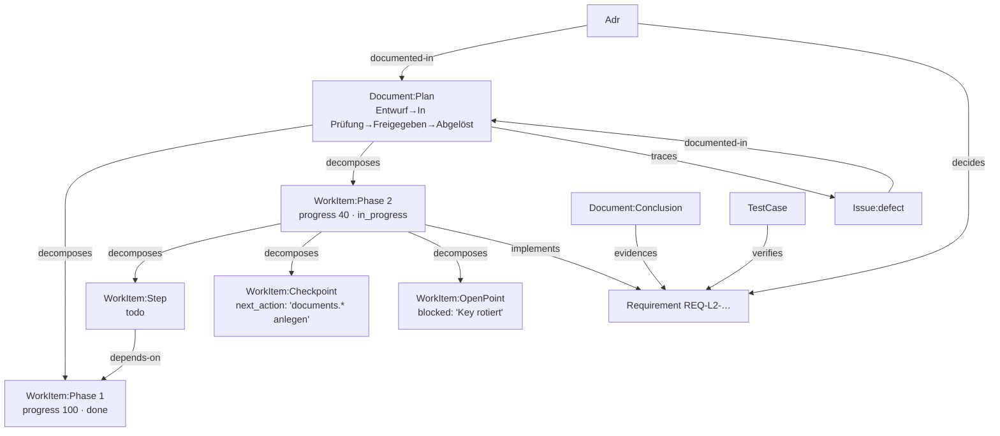

# ReqogniLoom: Dokument-Artefakte & Dokumenten-Workflow — Methodik (v4)

> **Status:** internes Konzept / Methodik-Kanon (Vorstufe zum Feature-Request). Nicht implementiert.
> **Autor:** Babsi (Hermes) für Daniel | **Datum:** 2026-10-16
> **Feature-Request:** [#1374](https://github.com/Popoboxxo/ReqogniLoom/issues/1374) · **Ablage:** `docs/concepts/`
> **Version 3 — tiefgelegt nach Entscheidungen vom 16.10.2026.** Neu gegenüber v2:
> Dokumenten-Lifecycle (§ 5), Feld-Freeze bei Freigabe (§ 5.3), eigener Item-Typ mit Fortschritt
> (§ 4.2/4.4), **Umkehrung der Blickrichtung: Loom ist die Quelle, `.md` ist Projektion oder
> Altbestand** (§ 1, § 7), Vollzugriff-Matrix für REST/MCP/Plugins (§ 8), **Agenten-Zustandsspeicher**
> (§ 9).
>
> **Version 4 — zweite Entscheidungsrunde (16.10.2026) eingearbeitet:** Item-Typ heißt **`WorkItem`**;
> Projektion geht als **Pull Request**; WorkItems haben in **jedem** Preset einen Workflow (minimal =
> nur Abarbeitungsstand, extended = menschliche Freigabe); `Diagram`, `Icd` und `GlossaryTerm` werden
> als Artefakte nachgezogen und **in Dokumenten** verwendbar (Glossar zusätzlich inline im Text);
> **alle** Dokument-Kinds erhalten eine Projektion. Details in § 0.
>
> **Nachmeldung (gleiche Sitzung):** WorkItems bleiben **dokumentgebunden** (freie Agenten-Aufgaben
> bekommen später einen eigenen Typ `Task`, § 12 T1); Inline-Verweise werden **doppelt** geführt —
> Textanker **und** Kante, bidirektional synchron, mit Einfachst-Bedienung (§ 6.7).
>
> **Quellen**
> - Live `172.20.5.120:8001` — `serverInfo.version = 1.8.0-beta.21`; OpenAPI `/api/v1/schema/`
>   = 1,23 MB / 98 Schemata
> - Checkout `/opt/data/reqogniloom` — VERSION `0.2.0`, Commit `a602811d` (17.09.2026)
> - POC über **781** Markdown-Dateien in `docs/` von 4 Repos (§ 13.1)
>
> **Lesehinweis:** „LIVE" = am laufenden System verifiziert · „CHECKOUT" = aus v0.2.0, kann in
> 1.8.0-beta.21 abweichen (Befund F8).

---

## 0. Entscheidungen, die in diese Fassung eingearbeitet sind

| # | Frage | Entscheidung |
|---|---|---|
| E1 | Zustandsmodell für Dokumente | **Eigener Dokument-Lebenszyklus auf der vorhandenen Maschinerie** als `item_type=Document`: Entwurf → In Prüfung → Freigegeben → Abgelöst/Archiviert, Übergänge je Rigor-Preset konfigurierbar |
| E2 | Übergang „Freigegeben" | **Feld-Freeze**: quellbesessene Felder werden eingefroren; Re-Sync darf sie nicht mehr ändern; Abweichung → neue Version + Drift-Meldung |
| E3 | Plan-Phasen | **Eigener Typ mit Fortschritt je Phase und Verlinkung innerhalb des Dokuments** — ausdrücklich auch als **Zustandsspeicher für KI-Agenten** („wo bin ich stehen geblieben?"); langfristig Auslagerung des Zustandsspeichers nach Loom |
| E4 | Quelle→Loom | **Nicht** als Migrationsthema. Ziel: **alle dokumentenbasierten Inhalte aus `.md`-Dateien in Repos vermeiden** — Loom erhält **Vollzugriff** (alle REST-/MCP-Oberflächen), Integrationen/Plugins werden befähigt, diese Artefakte zu nutzen; optional **MD-Generator** als Projektion |
| E5 | Umfang | **Methodik ausarbeiten** — Migrationsvolumen ist nachrangig |
| E6 | Name des Item-Typs | **`WorkItem`** (§ 4.2) |
| E7 | Schreibrecht der Projektion | **Pull Request** — Generator öffnet einen PR, nie Direkt-Push (§ 7.3) |
| E8 | WorkItem-Workflow | **in jedem Preset vorhanden**: `minimal` = nur Abarbeitungsstand, `standard` = + `blocked`, `extended` = **menschliche Freigabe** vor `done` (§ 5.2) |
| E9 | `Diagram`/`Icd`/`GlossaryTerm` | **alle drei** erhalten Artefakt-Rückgrat und werden **in Dokumenten** verwendbar; **GlossaryTerm zusätzlich inline in den Texten** (§ 4.6) |
| E10 | Projektionsumfang | **alle Kinds** (§ 7.3) |
| E11 | WorkItems ohne Dokument | **nein** — `document` bleibt Pflicht. Freie Agenten-Aufgaben bekommen einen **eigenen Typ `Task`** (vertagt, T1 in § 12) |
| E12 | Inline-Verweise | **Kanten UND Textanker**, bidirektional synchron gepflegt; Einfachst-Bedienung über Inline-Suche, direkte Begriffseingabe und **Drag & Drop aus einer Begriffsleiste** (§ 6.7) |

---

## 1. Leitbild: die Umkehrung

**Heute:** Dokumentinhalte entstehen in Repos als `.md`, der Nutzen ist dort lokal, das Wissen ist
verteilt, nichts ist verlinkt, nichts hat einen Zustand.

**Ziel (Methodik):**

```
      ┌──────────────────────────────┐
      │  ReqogniLoom  =  QUELLE      │   Dokumente, Items, Kanten, Zustände, Review, Baselines
      └───────────┬──────────────────┘
                  │  Projektion (optional, generiert)
                  ▼
      ┌──────────────────────────────┐
      │  Repo:  docs/**.md (generiert)│  lesbar für Mensch & Agent, diffbar, NIE handeditiert
      └──────────────────────────────┘
                  ▲
                  │  Altbestand: einmalige Adoption (nicht Ziel, sondern Übergang)
```

Drei Betriebsarten, klar getrennt:

| Modus | Quelle | `.md` im Repo | Rolle |
|---|---|---|---|
| **A — Loom-first** (Ziel) | Loom | generierte Projektion | Dokument wird in Loom erstellt/geprüft/gepflegt; Repo bekommt eine **erzeugte** Sicht |
| **B — Repo-first** (Übergang) | Repo | handgeschrieben | Adoption einmalig; danach Drift-Gate. **Kein Endzustand.** |
| **C — Rein intern** | Loom | keine | Dokumente ohne Repo-Bezug (Audit-Berichte, Konzepte, Session-Reports) |

**Methodik-Kernsatz:** Wer ein Dokument ändern will, ändert das **Artefakt**, nicht die Datei.
Eine generierte Datei mit abweichendem Hash ist ein **Fehlerfall**, kein Freibrief (fail-loud).

---

## 2. Begriffe und Achsen

| Begriff | Bedeutung |
|---|---|
| **Dokument** | der Register-Eintrag einer zusammenhängenden schriftlichen Einheit (Spec, Plan, Bericht …) — mit Lifecycle und Kanten |
| **WorkItem** | ein zerlegbarer, adressierbarer und **zustandsbehafteter** Bestandteil eines Dokuments (`Phase`, `Step`, `Milestone`, `OpenPoint`, `Checkpoint`) |
| **Quelle** | registrierter Herkunftsort (Repo+Root) oder `loom` bei Loom-first |
| **Projektion** | generierte `.md`-Datei aus Loom-Artefakten (niemals handgeändert) |
| **Adoption** | Übergang Repo-first → Loom-first für ein einzelnes Dokument |
| **Freeze** | Zustand nach „Freigegeben": quellbesessene Felder sind eingefroren (E2) |
| **Inline-Anker** | Markierung einer Textstelle, die einen Verweis trägt (z. B. `[[Hydraulikpumpe]]`); hält Text und Kante automatisch synchron (§ 6.7) |
| **Fünf Achsen** | Zerlegung · Ableitung/Herkunft · Beschreibung/Referenz · Nachweis · Innenstruktur (§ 6.1) |

---

## 3. Ausgangsbefund (Kurzfassung, Details § 13)

| | Zahl |
|---|---|
| Markdown-Dateien in `docs/` (4 Repos) | **781** |
| Sections / Tabellenzeilen / Checkboxen | 15.611 / 24.333 / 6.675 |
| ID-Mentions | **9.099** — davon nur 881 Identitätsdefinitionen (≈85 % sind **Verweise**) |
| Dokumente ohne jede Struktur | **0** |
| Checkbox-Items in `docs/plans/` | 2.970 — überwiegend `Step 1: Write the failing test` |

**Drei Strukturklassen** entscheiden über den Modus: **Identitätsträger** → Artefakt anlegen ·
**Referenzträger** → Kante · **Verfahrensschritt** → Text/Item, kein Register-Artefakt.

**Live-Anker (B1–B7):** `Requirement` hat bereits `acceptance_criteria_items`
`{text, fulfilled, evidence_ref}` · `Goal` ist artefakt-gestützt, aber vorgelagert (→ `MainGoal`) ·
`ChangeRequest` hat kein `artifact_id` (nicht verlinkbar) · `TraceLink` hat `rationale` und
`suspect_flagged_at`/`suspect_source_change` · **kein** `Document`/`Review`/`Suggestion`-Schema unter
98 Schemata · Workflows konfigurierbar per `/workflow-defaults/{item_type}/{preset}/`.

---

## 4. Artefakt-Modell

### 4.1 Bestandsartefakte (LIVE-Wahrheitstabelle, gekürzt — Details § 13.3)

| Typ | `artifact_id` LIVE | Link-fähig | Kern |
|---|---|---|---|
| `StakeholderNeed` | ✅ | ✅ | title, description, stakeholder |
| `Requirement` | ✅ | ✅ | + rationale, source, acceptance_criteria_items, level, level_source, suspect |
| `ArchitectureElement` | ✅ | ✅ | title, element_type, role |
| `TestCase` | ✅ | ✅ | test_type (Sub-Tag) |
| `Adr` | ✅ | ✅ | context, **decision**, consequences, deciders, status, version |
| `Risk` | ✅ | ✅ | probability, impact, risk_score, rpn, severity, detection, mitigation_strategy |
| `Issue` | ✅ | ✅ | severity, **category** (defect/improvement/documentation/question), tags, assignee |
| `Goal` | ✅ | ✅ | lineage_id, sequence_number, status, Workflow |
| `MainGoal` | ❌ | ❌ | generiert aus Goals (`generated_from_goal_ids`) |
| `ChangeRequest` | ❌ | ❌ | nicht verlinkbar |
| `Diagram`, `Icd` | ❌ kein Schema | ❌ | REST vorhanden, kein Artefakt-Rückgrat |
| `GlossaryTerm` | ❌ | ❌ | — |
| `Baseline`, `Comment`, `Notification`, `TestRun`, `WorkflowDefinition` | teils | teils | Verwaltung/Laufzeit |

Artefakt-übergreifende Attribut-Oberfläche (LIVE bei Requirement/Adr/Risk/Issue/Goal **identisch**):
`owner`, `reporter`, `priority`, `stakeholder`, `custom_fields`, `version` (Optimistic-Lock),
`change_reason`.

### 4.2 Neue Artefakte: **genau zwei**

| # | Typ (`artifact_type`) | Subtypen | Modell | Rolle |
|---|---|---|---|---|
| **A1** | `Document` | `:Spec`, `:Plan`, `:AuditReport`, `:Review`, `:Conclusion`, `:Concept`, `:Guide` | `application.Document` | Register-Eintrag: Identität, Herkunft, **Lifecycle**, Kanten |
| **A2** | `WorkItem` | `:Phase`, `:Step`, `:Milestone`, `:OpenPoint`, `:Checkpoint` | `application.WorkItem` | **Zerlegbarer, zustandsbehafteter Knoten**: Fortschritt, Abhängigkeiten, Beleg (E3) |

Beide nach Haus-Muster: eigenes Modell in `application/models.py`, `OneToOneField` →
`persistence.Artifact`, eigenes `uid`, gemeinsame Attribut-Oberfläche (owner/reporter/priority/
stakeholder/custom_fields), `version` als Optimistic-Lock. **Keine Änderung an `persistence.Artifact`.**

Dazu **Nicht-Artefakte** (ohne fachliche Kanten): `Source`, `ImportRun`, `SourceBinding` (§ 4.5).

**Warum `WorkItem` nach E3 doch nötig ist** (Korrektur zu v2): Der pauschale Item-Typ aus v1
wurde für Decision/Risk/Finding gestrichen — zu Recht, dafür gibt es `Adr`/`Risk`/`Issue`. Für
**Phase/Step/Meilenstein/Checkpoint** gibt es dagegen **kein** Zuhause, und E3 verlangt genau dort
**Fortschritt und Verlinkung** plus die Rolle **Agenten-Zustandsspeicher** (§ 9). Ein Item ist damit
kein Dokument-Deckblatt, sondern ein **Arbeitsstands-Knoten**.

### 4.3 Abbildungsregel: was wird was

| Struktur im Dokument | Ziel | Typ | Grund |
|---|---|---|---|
| `## Decisions` / ADR-Datei | Entscheidung | `Adr` (best.) | decision/context/consequences/deciders existieren |
| Risiko-Abschnitt/-Tabelle | Risiko | `Risk` (best.) | probability/impact/rpn/mitigation existieren |
| Befundtabelle, Audit-Zeile mit Schweregrad | Problem | `Issue` (best.) | severity/category/Workflow existieren |
| „offene Frage" / TBD | Problem | `Issue` `category=question` | Kategorie existiert |
| Überschrift/Zeile mit neuer REQ-ID | Anforderung | `Requirement` (best.) | — |
| Akzeptanzkriterien-Liste | Kriterien am Requirement | `Requirement.acceptance_criteria_items` | existiert mit `fulfilled`/`evidence_ref` |
| `COMP-*`-Code | Architekturelement | `ArchitectureElement` (best.) | — |
| Phasen-/Schritt-/Meilenstein-Überschrift | **Arbeitsstand** | **`WorkItem`** (neu) | kein Bestandsäquivalent + Fortschritt nötig (E3) |
| Checkpoint („hier weiter") | **Wiederaufnahme** | **`WorkItem:Checkpoint`** (neu) | Agenten-Resume (§ 9) |
| Plan-Kopf-Meta (Status/Estimate/Issues) | Felder + Kanten | `Document` / `traces` | — |
| TDD-Schritt, Prosa, Aufzählung | kein Register-Artefakt | Text/optional `WorkItem:Step` | Strukturklassenregel (§ 3) |

**Ursachen-Kriterium Issue vs. Risk (verbindlich):** Issue = **gegenwärtiger** Zustand
(„ist kaputt"), Risk = **künftiges** Ereignis mit Wahrscheinlichkeit („könnte ausfallen").

### 4.4 Feldspezifikationen

**A1 — `Document`**

```
uid                CharField, unique            Pflicht   "doc:reqogniloom:docs/plans/2026-09-04-…" bzw. "doc:<uuid>" (Loom-first)
title              CharField(255)               Pflicht   erste H1 / angelegt
kind               CharField(32)                Pflicht   Spec|Plan|AuditReport|Review|Conclusion|Concept|Guide
description        TextField, blank             optional  Zweck/Zusammenfassung
lifecycle_state    CharField(64)                Pflicht   Entwurf|In Prüfung|Freigegeben|Abgelöst|Archiviert  (§ 5.1)
frozen_at          DateTimeField, null          optional  gesetzt beim Übergang → Freigegeben
frozen_fields      JSONField                    optional  Liste der eingefrorenen Feldnamen (§ 5.3)
version            IntegerField, default 1      Pflicht   ++ bei Inhaltsänderung nach Freeze
doc_date           DateField, null              optional  aus Dateinamen (105 Pläne datiert)
owner_mode         CharField(16)                Pflicht   loom | repo-external   (§ 7.1)
source             FK → Source, null            optional  null bei Loom-first
source_path        CharField(512), blank        optional  + source_prev_paths (JSON)
source_ref         CharField(64), blank         optional  Commit-SHA / SHA der letzten Generierung
source_hash        CharField(64), blank         optional  SHA-256 des Adoptions-/Projektionsstands
projection_mode    CharField(16)                Pflicht   none | generated   (§ 7.3)
artifact           OneToOne → Artifact          Pflicht
```

**A2 — `WorkItem`**

```
uid                CharField, unique            Pflicht   "item:<document-uid>:<selektor>" — stabil bei Textänderung
document           FK → Document               Pflicht
kind               CharField(32)                Pflicht   Phase|Step|Milestone|OpenPoint|Checkpoint
ordinal            IntegerField                  Pflicht   Reihenfolge im Dokument (Kante `precedes` entfällt dadurch)
title              CharField(255)               Pflicht
body               TextField, blank             optional  Markdown des Abschnitts (bei Step/Checkpoint)
item_state         CharField(32)                Pflicht   todo|in_progress|blocked|done|dropped  (§ 5.2)
progress           PositiveSmallIntegerField    optional  0–100, für Phase/Milestone (E3 „Fortschritt je Phase")
blocked_reason     TextField, blank             optional  Pflicht bei item_state=blocked
next_action        CharField(255), blank        optional  **Wiederaufnahme-Hinweis** für Agenten (§ 9.2)
last_activity_at   DateTimeField, null          optional  Heartbeat (§ 9.4)
last_actor         CharField(128), blank        optional  Agent/Mensch-Kennung
evidence_ref       CharField(512), blank        optional  Beleg (Commit, Testlauf, Artefakt-ID)
approved_by        CharField(128), blank        optional  nur extended-Preset: menschliche Freigabe (§ 5.2)
approved_at        DateTimeField, null          optional  nur extended-Preset
due_date           DateTimeField, null          optional
exit_criteria      TextField, blank             optional  Fertigstellungskriterium (Gates § 5.4)
source_selector    CharField(256), blank        optional  Überschriftenpfad/Zeilenbereich bei Adoption
source_hash        CharField(64), blank         optional  Block-Hash → Drift je Item
artifact           OneToOne → Artifact          Pflicht
```

### 4.5 Nicht-Artefakte

**`Source`** — `uid, repo, root, default_ref, profile_path, projection_path`
**`ImportRun`** — `id, source, ref, profile_hash, mode (plan|apply|check|project), counts{created,
updated, linked, unchanged, skipped, failed}, warnings[(datei, grund)]` ← nie still verschlucken,
`started_at, finished_at, actor`
**`SourceBinding`** — `artifact_id (unique), source, source_path, source_ref, source_selector,
source_hash, owner_mode, import_run, imported_at`
→ liegt **neben** dem Artefakt, damit **jedes** Artefakt (auch Requirement/Adr/Risk/Issue) Herkunft
tragen kann, ohne Bestandsmodelle zu ändern. `Requirement.source` (LIVE) bleibt der
**menschenlesbare** Vermerk; `SourceBinding` liefert Pfad + SHA + Selektor.

---

### 4.6 Nachgezogen: `Diagram`, `Icd`, `GlossaryTerm` (E9)

Diese drei sind heute **keine** Artefakte (kein `artifact_id`) und damit **keine Link-Endpunkte** —
obwohl für das Glossar sogar ein Link-Typ existiert (`uses-term`), der deshalb faktisch unbenutzbar ist.

| Objekt | Maßnahme | Nutzung in Dokumenten |
|---|---|---|
| `GlossaryTerm` | `artifact_id` nachrüsten (OneToOne, analog `Adr`) | **`Document`/`WorkItem` —`uses-term`→ `GlossaryTerm`** (Link-Typ existiert bereits) |
| `Diagram` | `artifact_id` nachrüsten | `Document` —`traces`→ `Diagram`; das Diagramm selbst beschreibt weiterhin per `documents` |
| `Icd` | `artifact_id` nachrüsten | `Document` —`traces`→ `Icd` |

**Regel „Glossar im Text" (E9):**

1. Beim Anlegen/Überarbeiten scannt der Term-Extraktor den Text gegen das Glossar-Register →
   **Kantenvorschläge** `uses-term` (Vorschlag-Modus, O5).
2. Bestätigte Kanten machen auswertbar: „welche Dokumente verwenden Begriff X?" und „welche Begriffe
   sind definiert, aber nirgends benutzt?".
3. Die **Projektion** rendert jeden Begriff als Link zurück ins Glossar
   (`[Begriff](loom:glossary/<uid>)`) — der Text im Repo bleibt navigierbar, ohne Begriffe zu duplizieren.
4. **Definieren ≠ Verwenden:** die Definition bleibt `GlossaryTerm`, Dokumente **verwenden** ihn nur.

---

## 5. Workflow-Methodik (E1, E2, E3)

### 5.1 Dokument-Lebenszyklus

```
   ┌──────────┐  einreichen  ┌─────────────┐  freigeben  ┌──────────────┐
   │ Entwurf  │─────────────▶│ In Prüfung  │────────────▶│ Freigegeben  │
   └────┬─────┘              └──────┬──────┘             └──────┬───────┘
        │        zurückweisen       │                           │ ablösen/archivieren
        │◀──────────────────────────┘                           ▼
        │                                            ┌──────────────────────┐
        │  neue Version nach Freeze (§ 5.3)          │ Abgelöst / Archiviert│
        └────────────────────────────────────────────└──────────────────────┘
```

| Zustand | Bedeutung | Wirkung |
|---|---|---|
| `Entwurf` | in Arbeit, änderbar | alle quell-/loom-besessenen Felder schreibbar |
| `In Prüfung` | eingereicht, Review läuft | Inhalt schreibbar nur für Reviewer-Rolle; Kommentare offen |
| `Freigegeben` | verbindlicher Stand | **Freeze** (E2); Baseline-fähig; Projektion erzeugbar |
| `Abgelöst` | durch Nachfolger ersetzt | nur lesbar; Kante zum Nachfolger |
| `Archiviert` | aus dem Verkehr | nur lesbar, aus Standardlisten ausgeblendet |

**Zustandsnamen-Vokabular:** LIVE existieren bereits deutsche Zustände (`Goal`: „Entwurf" ↔
„Archiviert", `/outdate/` + `/reactivate/`) — die Dokument-Zustände folgen diesem Haus-Vokabular.

**Anbindung an die vorhandene Maschinerie (LIVE verifiziert):**
`/api/v1/workflow-defaults/{item_type}/{preset}/` (+ `/states/`, `/transitions/`, `/initialize/`)
→ `Document` als neuer `item_type`, Defaults je Preset `minimal|standard|extended`.
`/api/v1/workflows/definition/` (+ `/states/`, `/transitions/`, `/reset/`) → per Workspace änderbar.
`/api/v1/documents/{id}/transitions/`, `/workflow-history/`, `/versions/`, `/diff/` analog zu Goal/MainGoal.
**Kein neuer Workflow-Mechanismus wird gebaut.**

### 5.2 WorkItem-Zustände (E3)

| Zustand | Bedeutung |
|---|---|
| `todo` | geplant, nicht begonnen |
| `in_progress` | in Arbeit (mit `last_actor`/`last_activity_at`) |
| `blocked` | blockiert (`blocked_reason` Pflicht) |
| `done` | erledigt (`evidence_ref` empfohlen) |
| `dropped` | verworfen (Grund im Body/`blocked_reason`) |

Fortschritt je `Phase`/`Milestone`: explizites Feld `progress` (0–100) **oder** berechnet aus
Kind-Items (`done / (total − dropped)`). **Workflow-Tiefe je Preset (E8):**

| Preset | WorkItem-Zustände | Zweck |
|---|---|---|
| `minimal` | `todo → in_progress → done` (+ `dropped`) | **nur den Abarbeitungsstand sehen** — bewusst winzig gehalten (E8) |
| `standard` | + `blocked` (mit `blocked_reason`) | Hindernisse sichtbar machen |
| `extended` | + `in_review` → **menschliche Freigabe** vor `done` | Nachweis, dass ein Mensch abgenommen hat |

Übergänge kommen aus `workflow-defaults/{item_type=WorkItem}/{preset}`; `progress` ist in allen
Presets möglich. In `extended` setzt die Freigabe `approved_by`/`approved_at` am WorkItem — dieselbe
Mechanik wie der Dokument-Freeze (§ 5.3).

### 5.3 Freeze bei Freigabe (E2) — exakte Regeln

| Regel | Inhalt |
|---|---|
| **F-1** | Beim Übergang → `Freigegeben` wird `frozen_at` gesetzt und `frozen_fields` mit der Menge der **quell-/inhaltlich besessenen** Felder gefüllt (title, description, body, kind, Item-Struktur, **Inline-Anker**). |
| **F-2** | **Loom-Felder bleiben frei:** `lifecycle_state`, `owner`, `reporter`, `priority`, `stakeholder`, `custom_fields`, **alle Trace-Kanten**, Kommentare, Item-Zustände, Item-Fortschritt, **Kanten ohne Textanker**. |
| **F-3** | Ein Schreibversuch auf ein eingefrorenes Feld liefert **409 Conflict** mit Verweis auf den Freigabestand (technisch anschlussfähig: LIVE `version`-Optimistic-Lock + ETag/If-Match → 412). |
| **F-4** | Ein Re-Sync/Import, der eine Abweichung in eingefrorenen Feldern findet, **schreibt nicht**, sondern erzeugt: Drift-Eintrag + `suspect`-Kennzeichnung (LIVE vorhanden) + Benachrichtigung + Vorschlag „neue Version". |
| **F-5** | Änderung nach Freigabe ist ein **Vorgang**: Übergang `Freigegeben → In Prüfung` erzeugt **Version v+1**; der freigegebene Stand bleibt nachweisbar (Baseline/Version). |
| **F-6** | **Identität wird nie umgeschrieben.** Neue ID in der Quelle = neues Artefakt, altes auf `Abgelöst` mit Kante (reqmd-Regel 3 / bluepencil-Muster). |
| **F-7** | Die Projektion (generierte `.md`) trägt Freigabestand + Hash; Abweichung der Datei → Drift, **keine** stille Übernahme. |

### 5.4 Gates (verbunden mit der RuleEngine, § 6.6)

| Gate | Bedingung für `Freigegeben` |
|---|---|
| **G-1** | kein `WorkItem` in `in_progress`/`blocked` — offene Punkte sind `done` oder `dropped` (mit Grund) |
| **G-2** | jedes Item hat ≥1 Kante **oder** ist als `informational` markiert |
| **G-3** | kein offener Drift gegen die Quelle (bzw. Quelle = `loom`) |
| **G-4** | Pflichtfelder je `kind` gesetzt (Spec: Akzeptanzkriterien-Kanten; Plan: Issues/Estimate-Meta; AuditReport: Findings) |

**Nicht** gefordert (bewusste Entscheidung, E1): Vier-Augen-Prinzip, Rollen-Zwang, Signatur. Review
ist **optional** und läuft organisatorisch über `In Prüfung` + Kommentare.

---

## 6. Verwobenheit — Link-Fabric (v4)

### 6.1 Fünf Achsen (vier plus Innenstruktur)

| Achse | Frage | Link-Typen |
|---|---|---|
| **Zerlegung** | Woraus besteht es? | `decomposes`, `parent-child` |
| **Ableitung/Herkunft** | Woher stammt es? | `derives-from`, `refines`, `copy-of`, **`documented-in`** |
| **Beschreibung/Referenz** | Was nennt es? | `documents`, `traces`, `related-to` |
| **Nachweis** | Wer belegt es? | `verifies`, **`evidences`**, `satisfies`, `implements`, `allocated-to`, `decides` |
| **Innenstruktur/Arbeitsfluss** | Wie hängt es zusammen? | **`depends-on`** (neu) — Reihenfolge läuft über `ordinal`, nicht über Kanten |

### 6.2 Ziel-Fabric

**Genau DREI neue Link-Typen. Keine Matrix-Erweiterung.**

| Quelle | Link-Typ | Ziel | Status | Achse | Zweck |
|---|---|---|---|---|---|
| `Requirement`/`Adr`/`Risk`/`Issue`/`Goal` | **`documented-in`** | `Document` | ➕ neu | Ableitung | Herkunft: „stammt aus diesem Dokument" |
| `Document` (`:Conclusion`/`:Review`/`:AuditReport`) | **`evidences`** | `Requirement`/`ArchitectureElement`/`StakeholderNeed` | ➕ neu | Nachweis | „belegt Erfüllung" (ohne die Test-Coverage zu kapern) |
| `WorkItem` | **`depends-on`** | `WorkItem` | ➕ neu | Innenstruktur | Arbeitsfluss: Schritt B braucht A (auch dokumentübergreifend) |
| `Document` | `decomposes` (best.) | `WorkItem` | ✅ best. | Zerlegung | Dokument → Items |
| `WorkItem` | `decomposes` (best.) | `WorkItem` | ✅ best. | Zerlegung | Phase → Schritt |
| `WorkItem` | `implements` / `traces` (best.) | `Requirement` / `Issue` / `Adr` | ✅ best. | Nachweis/Referenz | Arbeitsstand ↔ Sache |
| `Document:Plan` | `traces` (best.) | `Issue` | ✅ best. | Referenz | Plan referenziert Issue #505 |
| `TestCase` | `verifies` (best.) | `Requirement`/`Arch` | ✅ best. | Nachweis | **unverändert**, speist Test-Coverage |
| `Adr` | `decides` (best.) | `ArchitectureElement` | ✅ best. | Nachweis | unverändert |
| `Risk` | `threatens`/`mitigated-by` (best.) | Artefakt | ⚠️ Pfad defekt (F1) | Nachweis | nach F1 nutzbar |
| `Document` | `copy-of`-Semantik | `Document` | ✅ best. | Ableitung | Ablösung: neuer Plan ersetzt alten |
| `Document` / `WorkItem` | **`uses-term`** (best.) | `GlossaryTerm` | ✅ best. | Referenz | Begriff im Text verwendet — durch E9 erst nutzbar (§ 4.6) |
| `Document` | `traces` (best.) | `Diagram` / `Icd` | ✅ best. | Referenz | Dokument verweist auf Diagramm/ICD (§ 4.6) |

### 6.3 Was bewusst **nicht** eingeführt wird

| Kandidat | Warum nicht |
|---|---|
| `promoted-to` (Item→Issue) | Ein Befund **ist** von Anfang an ein `Issue` (v2-Korrektur bleibt) |
| `addresses` | bis F1 geklärt; bis dahin `traces` |
| `documents`-Erweiterung auf `Document→*` | Namenskollision (F2) — `documented-in` + `evidences` decken den Bedarf |
| `derives-from`-Erweiterung auf Dokumente | würde die V-Modell-Hierarchie-Traversierung mit Dokumentknoten verunreinigen |
| `precedes` | Reihenfolge ist ein Feld (`ordinal`), keine Kante |

### 6.4 Skizze: Plan als Arbeits- und Zustandsträger



### 6.5 Kennzahlen

| Metrik | Definition | Status |
|---|---|---|
| Test-Coverage | Requirement mit eingehendem `verifies` (TC→Req) | unverändert |
| Herkunfts-Coverage | Requirement mit `documented-in` → `Document` | neu |
| Nachweis-Coverage | Requirement mit `evidences` **oder** `verifies` | neu |
| **Dokument-Fortschritt** | Σ `progress` bzw. `done/(total−dropped)` je Dokument | neu (E3) |
| **Arbeitsstand-Kennzahl** | Items in `in_progress`/`blocked` je Workspace („wo hängt es") | neu (§ 9) |
| Dokument-Integrität | Dokument mit ≥1 Item und ≥1 Kante oder als `informational` markiert | neu |

### 6.6 Regel-Katalog (RuleEngine, Muster `VERIF-P8`/`TRACE-P2`, Tier über `severity_for_tier`)

| Regel | Prüfung | minimal | standard | extended |
|---|---|---|---|---|
| `DOC-P1` | Dokument ohne Items **und** ohne Kante | – | WARNING | BLOCKER |
| `DOC-P2` | Artefakt ohne `SourceBinding` (Herkunft verloren) | – | WARNING | WARNING |
| `DOC-P3` | Drift in eingefrorenem Feld (Quelle ≠ Loom) | – | WARNING | BLOCKER |
| `DOC-P4` | Freigabe-Gate verletzt (G-1…G-4) | – | WARNING | BLOCKER |
| `DOC-P5` | Item `in_progress` ohne `last_activity_at`-Aktualisierung > X Tage (verwaister Arbeitsstand) | – | WARNING | WARNING |
| `DOC-P6` | Unklassifizierte Datei im Profil-Scope | – | WARNING | WARNING |
| `DOC-P7` | Toter Inline-Verweis (Ziel gelöscht/archiviert) | – | WARNING | BLOCKER |

**Anschluss einer bestehenden Lücke:** Regel-Engine-Befunde sind heute **nicht persistiert**
(*„non-persisted finding"*; Seed `audit.se_audit` = `total 273, blockers 272`) → mit der Abbildung
auf `Issue` (v2) bekommen sie erstmals einen Verlauf.

---

### 6.7 Inline-Verweise: Text und Kante synchron (E11/E12)

**Problem.** Verweise im Fließtext sind heute entweder nicht modelliert oder nur grob als
Objektkante („Dokument nutzt Begriff X"). Beides braucht eine Kopplung — **ohne** den Autor mit
Technik zu belasten.

**Zwei Wege, ein Bestand:**

| Weg | Entstehung | Kante |
|---|---|---|
| **Anker im Text** (fein) | Autor markiert die Textstelle | wird **automatisch** angelegt |
| **Kante am Objekt** (grob) | Verweis ohne Textstelle (z. B. für eine ganze Sektion) | erlaubt, **ohne** Anker |

**Invariante (in beide Richtungen gepflegt):**

| Regel | Verhalten |
|---|---|
| **I-1** | Anker gesetzt ⇒ Kante existiert — automatisch, ohne Zusatzklick |
| **I-2** | Anker entfernt ⇒ Kante wird entfernt, **sofern** kein weiterer Anker derselben Kante im Dokument bleibt |
| **I-3** | Kante im Graph gelöscht ⇒ zugehörige Anker werden mitentfernt; vorher Bestätigung **mit Anzahl** der betroffenen Stellen |
| **I-4** | Kante **ohne** Anker bleibt zulässig und wird als „ohne Textstelle" gekennzeichnet |
| **I-5** | Ziel gelöscht/archiviert ⇒ Anker wird **toter Verweis** (Regel `DOC-P7`; Projektion rendert Klartext + Warnung) |

**Syntax — maximal einfach, keine großen IDs im Text:**

| Ebene | Darstellung |
|---|---|
| Autor tippt | `[[Hydraulikpumpe]]` (Wiki-Form); optional Anzeigetext `[[Pumpe\|Hydraulikpumpe]]` |
| Anzeige im Editor | Begriff als dezenter Chip/Link — **nie** eine UUID |
| maschinell | Auflösung über das Register (Slug → `uid`); die stabile ID lebt **ausschließlich** im Anker-Register |
| mehrdeutiger Name | einmalige Auswahl beim Einfügen, danach kurzer Suffix `[[Pumpe\|hydraulikpumpe#2]]` — nur im Ausnahmefall |
| in der **Projektion** | normale Markdown-Links mit Deep-Link; die „große" ID steht nur in der **generierten** Datei, nie in der Eingabe |

**Ein Syntax, viele Ziele** (das ist der Konsistenzpunkt im Gesamtsystem): derselbe Resolver bedient
alle auflösbaren Ziele; der Kanten-Typ ergibt sich aus dem Zieltyp.

| Marker | Ziel | Kante |
|---|---|---|
| `[[Begriff]]` | `GlossaryTerm` | `uses-term` |
| `[[REQ-L2-AS-014]]` | `Requirement` | `traces` |
| `[[ADR-001]]` / `[[COMP-AS-009]]` | `Adr` / `ArchitectureElement` | `decides` bzw. `traces` |
| `[[#505]]` | `Issue` | `traces` |
| `[[doc:<slug>]]` / `[[wi:<slug>]]` | `Document` / `WorkItem` | `traces` bzw. `depends-on` |

**Bedienmechanik (niemand muss die Syntax kennen):**

1. **Inline-Suche:** `[[` tippen → Autovervollständigung über alle auflösbaren Ziele (unscharf, nach
   Typ gruppiert); Auswahl mit Enter → Marker **und** Kante entstehen automatisch.
2. **Begriffsleiste in der Klappleiste:** eine Seitenleiste des Editors listet das Glossar (und die
   zuletzt genutzten Ziele); **Drag & Drop** in den Text setzt den Anker an der Ablagestelle.
3. **Direkte Begriffseingabe:** beim Tippen eines bekannten Begriffs erscheint ein dezenter Vorschlag
   („verlinken?", Tab zum Annehmen) — Standard ist **Vorschlag**, nicht Automatik (O5).
4. **Nachlauf für Bestände:** „erkannte Begriffe verlinken" — Trefferliste mit Häkchen, einzeln
   bestätigbar.
5. **Rückwärts genauso einfach:** Klick auf den Chip → „Anker entfernen" (Kante wird nach I-2
   mitgepflegt).

**Freeze-Wechselwirkung (Fortsetzung § 5.3):** Ein Anker **sitzt im Text** und ist damit Inhalt —
im Zustand `Freigegeben` ist Setzen/Entfernen ein Versionsvorgang (F-5), während Kanten **ohne**
Anker frei bleiben (F-2). Begründung: der Text ändert sich, nicht nur der Graph.

**Anker-Philosophie (Konsistenz über Systeme):** dasselbe Prinzip wie bei den Review-Ankern aus
bluepencil — der Inhalt trägt den Anker, Agenten können ihn lesen, die Anzeige bleibt menschlich.
**Kein neues Ankerformat erfinden, wo schon eines existiert.**

---

## 7. Dual-Source-Methodik (`.md` ↔ Loom)

### 7.1 Betriebsart je Dokument

| `owner_mode` | Quelle | Projektion | Sync-Richtung |
|---|---|---|---|
| `loom` | Loom | optional `generated` | Loom → Repo (Generator) |
| `repo-external` | Repo | keine (Datei ist Original) | Repo → Loom (Import mit Drift-Gate) |

**Adoption** (Repo-first → Loom-first) ist ein **expliziter Vorgang**: `document.adopt` prüft
Hash-Gleichheit, friert optional einen Freigabestand ein und schaltet `owner_mode=loom` +
`projection_mode=generated`. Danach ist die Datei **Projektion**.

### 7.2 Konfliktregeln (fail-loud)

| Situation | Verhalten |
|---|---|
| Projektionsdatei weicht vom generierten Stand ab (Hash ≠) | **Fehlerfall**: Report + „Änderung zurückführen" oder „neu generieren"; **nie** stilles Übernehmen |
| `repo-external`, Quelle geändert / Loom nicht | Update anbieten (Ownership-Split § 5.4 v2) |
| `repo-external`, **Loom** geändert / Quelle nicht | Änderung bleibt; Herkunft wird `suspect` (LIVE: `suspect_source_change`) |
| **beide** geändert | **Konflikt** → Mensch entscheidet; Modus-Empfehlung: Adoption |
| Datei verschwunden | Dokument wird nicht gelöscht; Zustand bleibt, Herkunft `suspect` + Report |
| eingefrorenes Feld betroffen | kein Schreibvorgang → neue Version (§ 5.3 F-4/F-5) |

### 7.3 MD-Generator (Projektion)

- **Templates je `kind`** — Loom-seitig versioniert, nicht im Repo. **E10: alle Kinds erhalten eine
  Projektion** (Spec, Plan, AuditReport, Review, Conclusion, Concept, Guide).
- **Glossar-Rendering (E9):** jeder erkannte Begriff wird als Link ins Glossar ausgegeben
  (`[Begriff](loom:glossary/<uid>)`); die Term-Liste des Dokuments steht als Abschnitt am Ende. Ebenso werden **Anker anderer Zieltypen**
als Markdown-Links ausgegeben (Requirement/ADR/Issue/Dokument/WorkItem), **Verweise ohne Textstelle**
als Kantenliste am Dokumentende und **tote Verweise** als Klartext mit Warnhinweis — nie still.
- **Determinismus Pflicht:** stabile Sortierung (IDs, `ordinal`), keine Zeitstempel außer explizit
  angefordert, fixiertes Zeilenende → sonst sind diffbare Repos unmöglich (Muster: bluepencil/reqmd).
- **Kopf jeder erzeugten Datei:**
  ```
  <!-- GENERATED by ReqogniLoom — do not edit.
       document: <uid> · version <v> · state Freigegeben · hash <sha256>
       regenerate: reqlo project <uid>   (oder MCP: document.project) -->
  ```
- **Zustellung:** Generator erzeugt **Branch + Pull Request**, niemals direkten Push auf `main`
  (Hausregel: „NIEMALS direkt auf main/default-branch committen — immer Feature-Branch + PR").
- **Trigger:** (a) manuell via CLI/MCP, (b) CI-Job im Repo, (c) Plugin/Integration (§ 8.4).
- **Nicht erzeugt** werden Dokumente mit `projection_mode=none` (rein interne Berichte) — die
  Entscheidung über die Projektion liegt am Dokument, nicht am Kind.

### 7.4 „Keine handgeschriebenen Doku-MDs" — was das methodisch bedeutet

| Konsequenz | Behandlung |
|---|---|
| Repos haben weniger Prosa, mehr generierte Sicht | Generator liefert Navigation + Deep-Links zurück nach Loom |
| Offline/ohne Loom lesbar? | Ja: Projektion ist vollständig lesbar (Titel, Struktur, Zustände, Kantenliste) |
| Agenten **im Repo** brauchen Inhalte | sie lesen die Projektion (read-only) **oder** gehen über MCP auf Loom — beides muss gehen (§ 8) |
| Prüf-/Freigabeprozess verschiebt sich | Review passiert in Loom (`In Prüfung` + Kommentare), nicht im PR |
| Git-Historie als Inhaltshistorie | ersetzt durch Loom `versions`/`diff`/Baselines; generierte Dateien tragen nur den Stand |
| Audit („wer hat wann was geändert") | LIVE: `AuditLogEntry`, `/versions/`, `/diff/`, `/workflow-history/` je Artefakt |

---

## 8. Vollzugriff-Methodik: REST, MCP, Integrationen (E4)

### 8.1 Oberflächen-Regel (Vollständigkeitsmatrix)

> **Neue Artefakte sind erst fertig, wenn sie in JEDER bestehenden Artefakt-Oberfläche auftauchen.**

| Oberfläche | Anforderung für `Document`/`WorkItem` | Nachweis |
|---|---|---|
| Artefakt-Baum / `artifact.get_tree` | erscheint als Knoten mit Kind-Items | MCP-Test |
| Suche (`/search/`, `artifact.search`) | Volltext + Filter auf `kind`, `lifecycle_state`, `item_state` | REST+MCP |
| Inline-Verweise | Resolver für `[[…]]` in Dokument-/WorkItem-Text; Anker⇄Kanten-Sync (§ 6.7) | REST+MCP + Editor |
| Kanten (`trace-links`, `traceability.query/coverage/suggest`) | Kanten les-/schreibbar, Coverage-Metriken (§ 6.5) | REST+MCP |
| Workflow | `transitions`, `workflow-history`, `versions`, `diff` je Dokument/Item | REST+MCP |
| Baselines | Dokument in Baseline-Scope; Diff zeigt Item-Zustände | REST |
| Kommentare (`/artifacts/{id}/comments/`) | an Dokument **und** Item | REST |
| Notifications | bei Zustands-/Gate-Ereignissen | REST |
| Attribute (Visibility/Catalog/Defaults) | `Document`/`WorkItem` als `entity_type`, Felder katalogisierbar | REST |
| Memory/Digest (`/artifacts/{id}/memory/`, `/memory/digest/`, LIVE) | Dokument-/Item-Zusammenfassung abrufbar | REST+MCP |
| CSV/ReqIF-Export/Import | Dokumente/Items exportierbar (Rückweg!); Import = Migrationspfad | REST |
| Kennzahlen (`/metrics/`), Konsistenzprüfung | neue Regeln (§ 6.6) integriert | REST |
| Diagramme/ICD/Glossar | als Artefakt verlinkbar (§ 4.6); `uses-term` in Projektion und Suche sichtbar | REST+MCP |

### 8.2 MCP-Tool-Gruppen (neu + erweitert)

| Gruppe | Tools (Vorschlag) |
|---|---|
| `document.*` (neu) | `create`, `get`, `list`, `update`, `search`, `transition`, `versions`, `diff`, `adopt`, `project`, `supersede`, `attach_source` |
| `work_item.*` (neu) | `create`, `list`, `get`, `update`, `set_state`, `set_progress`, `link`, `checkpoint`, `resume` |
| `artifact.*` (erweitert) | `get_tree` inkl. Dokumente; `search` über neue Typen |
| `traceability.*` (erweitert) | `coverage` um Herkunfts-/Nachweis-Coverage; `suggest_links` auch Item↔Requirement |
| `workflow.*` (erweitert) | `document`/`work_item` als `item_type` in Defaults/Transitions |
| `attribute_catalog.*`, `attribute_migration.*` (vorhanden) | neue Felder katalogisieren |

**Paritätsregel:** für jeden REST-Endpunkt ein MCP-Werkzeug — und **Read-only-Keys** müssen
Dokumente/Items lesen können (LIVE-Hebel: `read_only`-Scope → 76 Tools).

### 8.3 REST-Ressourcen

```
/api/v1/documents/                        GET POST
/api/v1/documents/{id}/                   GET PATCH DELETE   (DELETE nur ohne Freigabestand)
/api/v1/documents/{id}/transitions/       GET POST
/api/v1/documents/{id}/versions/          GET
/api/v1/documents/{id}/diff/              GET
/api/v1/documents/{id}/workflow-history/  GET
/api/v1/documents/{id}/project/           POST   MD-Projektion erzeugen (liefert Datei + Hash)
/api/v1/documents/{id}/render.md          GET    Projektion direkt abrufen
/api/v1/documents/{id}/adopt/             POST   Repo-first → Loom-first
/api/v1/documents/import/                 POST   Migrations-/Adoptionspfad
/api/v1/work-items/                   GET POST
/api/v1/work-items/{id}/              GET PATCH
/api/v1/work-items/{id}/state/        POST   Zustandswechsel
```

### 8.4 Integrationen und Plugins befähigen

| Baustein | Inhalt |
|---|---|
| **Events** | `document.created`, `document.state_changed`, `document.published`, `document.drift_detected`, `item.state_changed`, `item.blocked` → Webhooks/SSE (LIVE: `sse_pubsub` vorhanden) |
| **Scopes** | `documents:read`, `documents:write`, `documents:project`, `documents:adopt` — getrennt vergebbar |
| **Konfigpunkte** | `workflow-defaults/{item_type}/{preset}`, `link-type-defaults`, `attribute-defaults` → Plugins steuern Verhalten ohne Code |
| **Plugin-Vertrag** | Plugins arbeiten **nur** über REST/MCP (kein DB-Zugriff), holen Inhalte als Projektion, schreiben Zustände als Item-Übergänge |
| **Bilateralität** | Externe Systeme (Git, Paperless, Issue-Tracker) hängen als `Source` an, nicht als Sonderweg |

---

## 9. Agenten-Zustandsspeicher (E3, tief)

### 9.1 Warum Items als Zustandsspeicher

Heute schreiben Agenten Fortschritt in `.md`-Dateien (`progress-ledger`, `docs/plans/*`,
Session-Logs). Das ist **nicht abfragbar, nicht verlinkt, nicht zustandsbehaftet, nicht
kollaborativ**. Die Items liefern genau diese vier fehlenden Eigenschaften.

### 9.2 Resume-Protokoll („wo bin ich stehen geblieben?")

```
1) Frage      work_item.resume(workspace, document|filter, actor)
2) Antwort    letzter Checkpoint + alle Items state≠done (nach ordinal sortiert), je Item:
              item_state, progress, next_action, blocked_reason, last_actor, last_activity_at,
              plus Kanten (implements → Requirement, depends-on → Vorgänger)
3) Fortsetzen Item → in_progress, last_actor + last_activity_at setzen
4) Beenden    Item → done + evidence_ref, ggf. neuen Checkpoint anlegen (next_action)
```

**Pflichtregel für Agenten:** *Kein* Arbeitsschritt ohne Item-Zustand. Ein Fortschritt, der nur im
Chat existiert, ist nach der Session verloren.

### 9.3 Abgrenzung: Honcho vs. Loom (verbindlich)

| Frage | Zuhause | Begründung |
|---|---|---|
| „Was war / was wurde gesagt / wie tickt der Nutzer" | **Honcho** (Memory, projektorbasiert) | Gesprächs-Erinnerung, unscharf, assoziativ |
| „Wo steht das Vorhaben, was ist offen, was kommt als Nächstes" | **Loom** (`Document`/`WorkItem`) | explizit, abfragbar, verlinkt, zustandsbehaftet |
| Übergang | Digest `/artifacts/{id}/memory/digest/` (LIVE) fasst Dokument/Items zusammen; Honcho zieht diesen Digest als Kontext | verhindert Doppelspeicherung |

### 9.4 Multi-Agenten-Betrieb

| Regel | Inhalt |
|---|---|
| **A-1** | Ein Item hat **einen** `last_actor` und einen Zustand — kein stilles Parallelarbeiten; sichtbar über `in_progress` |
| **A-2** | Optimistik statt Locks: `version` (Optimistic-Lock, LIVE) + ETag/If-Match → 412 bei Konflikt |
| **A-3** | Heartbeat: `last_activity_at` bei jeder Aktion; `DOC-P5` meldet verwaiste Arbeitsstände |
| **A-4** | Blockade wird **sichtbar**: `blocked` + `blocked_reason` (statt „Agent hängt") |
| **A-5** | Abhängigkeit explizit: `ordinal` + `depends-on` → parallele Arbeit nur auf unabhängigen Items |
| **A-6** | Resume ist ein **MCP-Aufruf**, damit jeder Agent (auch ohne Repo-Zugang) fortsetzen kann |

---

## 10. Was ein Dokument „fertig" macht (Methodik-Zusammenfassung)

1. Dokument angelegt (`Entwurf`) mit Items (`ordinal`, `exit_criteria`).
2. Arbeit läuft über **Item-Zustände**, nicht über Textänderungen.
3. `In Prüfung` → Review in Loom über Kommentare.
4. Gates G-1…G-4 erfüllt → `Freigegeben` → **Freeze** (E2) + Baseline-fähig.
5. Optional Projektion ins Repo (PR, generiert, hash-markiert) — oder `projection_mode=none`.
6. Änderung nötig → `Freigegeben → In Prüfung` = **Version v+1**; alter Stand bleibt nachweisbar.
7. Ersetzt → `Abgelöst` + Supersedes-Kante; aus dem Verkehr → `Archiviert`.

---

## 11. Rollout (Methodik, nicht Migration)

| Stufe | Inhalt | Abnahmekriterium |
|---|---|---|
| **S0** | Methodik-Kanon (dieses Dokument) + Profil-/Regeldefinitionen | Regeln G-1…G-4, F-1…F-7 testbar formuliert |
| **S1** | Modell `Document`, `WorkItem`, `Source`, `ImportRun`, `SourceBinding`; Lifecycle + Item-Zustände auf der vorhandenen Workflow-Maschinerie | Übergänge, Freeze, Versionshistorie laufen; 409 auf eingefrorene Felder |
| **S2** | Vollzugriff: REST/MCP-Parität, Events, Scopes, Plugin-Vertrag, Attribute-/Memory-/Baseline-Anschluss | Vollständigkeitsmatrix § 8.1 vollständig abgehakt |
| **S3** | Projektion: MD-Generator (Templates, Determinismus, PR-Zustellung) + Adoptionspfad | Zwei Generierungsläufe → identischer Hash (§ 7.3) |
| **S4** | Agenten-Zustandsspeicher: `resume`, Checkpoints, Heartbeat, Digest-Anschluss, `DOC-P5` | Resume-Query liefert reproduzierbar den Arbeitsstand |

---

## 12. Entscheidungen & offene Punkte

**Erledigt (zweite Runde, 16.10.2026):**

| # | Punkt | Entscheidung |
|---|---|---|
| O1 | Item-Typname | **`WorkItem`** |
| O2 | Schreibrecht der Projektion | **Pull Request** — Generator öffnet einen PR, nie Direkt-Push (§ 7.3) |
| O3 | WorkItem-Workflow | **in jedem Preset**: `minimal` = nur Abarbeitungsstand, `standard` = + `blocked`, `extended` = **menschliche Freigabe** vor `done` (§ 5.2) |
| O4 | `Diagram`/`Icd`/`GlossaryTerm` | **alle drei** erhalten Artefakt-Rückgrat; in Dokumenten verwendbar; Glossar **inline im Text** (§ 4.6) |
| O5 | Referenz-Mentions als Kanten | **Vorschlag** (Mensch bestätigt) |
| O6 | Projektionsumfang | **alle Kinds** (§ 7.3) |
| O7 | WorkItems ohne Dokument | **nein** — `document` bleibt Pflicht; freie Agenten-Aufgaben bekommen einen **eigenen Typ `Task`** (vertagt, T1) |
| O8 | Inline-Glossar | **beides**: Kanten **und** Textanker, bidirektional synchron (I-1…I-5), bedienbar über Inline-Suche, Begriffseingabe und **Drag & Drop aus einer Begriffsleiste** (§ 6.7) |

**Offene Punkte im Modell: keine.** Vertagte Vorhaben (bewusst nicht Teil dieses Konzepts):

| # | Vorhaben | Notiz |
|---|---|---|
| **T1** | Eigener Typ **`Task`** — Aufgaben **ohne** Dokument (Agenten-Ad-hoc-Arbeit, freie Worklists) | Entscheidung vom 16.10.2026: WorkItems bleiben dokumentgebunden; `Task` ist ein eigenes Vorhaben an einem anderen Tag |
| **T2** | Text-Spans als zusätzlicher Ankertyp (Wortlaut-Präzision im Nachweis) | Anker + Kanten reichen heute; Spans erst, wenn Wortlaut exakt nachgewiesen werden muss |

---

## 13. Anhang

### 13.1 POC-Rohdaten
`/opt/data/reqogniloom-ingest-poc-files.json` — 781 Einträge
`{repo, rel, kind, ids, head_ids, table_rows, checkboxes, sections}`.

### 13.2 Live-Befunde
**B1** `Requirement.acceptance_criteria_items` = geordnete Liste `{text, fulfilled, evidence_ref}` →
Item-Bedarf für Kriterien entfällt · **B2** `Goal` artefakt-gestützt (`artifact_id`), aber vorgelagert
(`lineage_id`, `/main-goals/generate/`, `/approve/`) → nicht als Phasen-Container ·
**B3** `ChangeRequest` ohne `artifact_id` → nicht verlinkbar · **B4** `TraceLink.rationale`,
`suspect_flagged_at`, `suspect_source_change`, `Requirement.suspect` existieren → Drift-Markierung
vorhanden · **B5** kein `Document`/`Review`/`Suggestion`/`Source`-Schema unter 98 Schemata;
`/reviews/`, `/suggestions/`, `/link-type-defaults/` nur mit `ErrorResponse` ·
**B6** Workflows konfigurierbar per `/workflow-defaults/{item_type}/{preset}/`; `Goal`/`MainGoal`
nutzen bereits `/transitions/` · **B7** Artefakt-Attributfläche (`owner/reporter/priority/stakeholder/
custom_fields/version`) ist über Requirement/Adr/Risk/Issue/Goal **identisch** — Muster für neue Typen.

### 13.3 Befunde mit Handlungsbedarf

| # | Befund | Schwere | Status |
|---|---|---|---|
| **F1** | Issue-/Risk-Link-Vokabeln nicht in der zentralen Linktyp-Validierung: `IssueService.link_issue` prüft eigene Whitelist, dann validiert `TraceLinkService.create_trace_link` hart gegen die 14 Enum-Werte → `resolves`/`blocks`/`threatens`/`mitigated-by` können den Pfad nicht passieren; keine Tests für `link_issue`/`link_risk`; ADR-Kommentare dokumentieren denselben Wall | **CRITICAL** | CHECKOUT — an 1.8.0-beta.21 nachprüfen |
| **F2** | `documents` ist `Diagram → *` reserviert; `Diagram` ist nicht link-fähig → Eintrag greift ins Leere | HIGH → entschärft | v3 nutzt `documented-in` |
| **F3** | `Artifact.parent` deprecated → Struktur über Links | INFO | CHECKOUT |
| **F4** | Kein `Document`/`Source`/`ImportRun`-Schema LIVE; Regel-Befunde nicht persistiert | INFO | LIVE |
| **F5** | CSV-Transport verfälscht Markdown (`_csv_safe`: `#`→` #`); `_MAX_ROWS=1000`; All-or-Nothing pro Batch | HIGH | CHECKOUT |
| **F6** | `level`-Beschreibung LIVE („1=System, 2=Subsystem, 3=Component") weicht vom Checkout-Enum (`L0_SYSTEM=0`) ab | MEDIUM | LIVE vs. CHECKOUT |
| **F7** | `/reviews/`, `/suggestions/`, `/link-type-defaults/` LIVE nur `ErrorResponse` | MEDIUM | LIVE |
| **F8** | Gemischte Analysebasis (v0.2.0 vs. 1.8.0-beta.21) → vor Umsetzung live verifizieren | MEDIUM | — |
| **F9** | `GlossaryTerm`, `Diagram`, `Icd` haben **kein Artefakt-Rückgrat** (kein `artifact_id`) → nicht verlinkbar. Folge: der Link-Typ `uses-term` existiert, ist aber **faktisch unbenutzbar**, und der SE-Matrix-Eintrag `documents: Diagram → *` zeigt auf einen Nicht-Endpunkt | HIGH | LIVE (98 Schemata) + CHECKOUT — Voraussetzung für E9 (§ 4.6) |

### 13.4 Versionsmarker
`serverInfo.version = 1.8.0-beta.21` · OpenAPI 1.227.988 Bytes · 98 Schemata · Checkout `a602811d` /
VERSION `0.2.0` · MCP-Key für Hermes rotiert (`tools/list` → 401), daher Live-Aussagen aus
`initialize` + OpenAPI, nicht aus Datensätzen.
