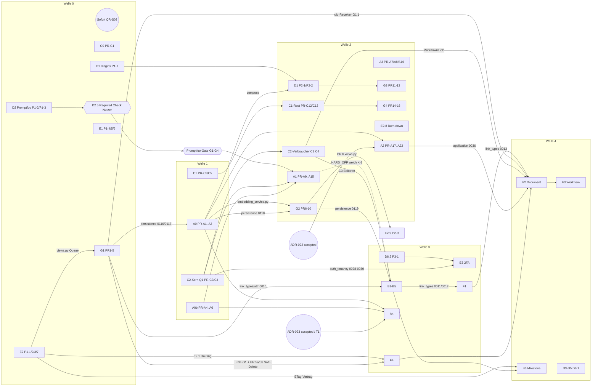

# Plan-Index — Backlog-Umsetzung A–G

> **Verbindlich.** Dieses Dokument ist der „Plan-Index“, auf den die Pläne A–G verweisen
> (Querreview QR-T01). Es legt plan-übergreifend fest: Wellen und Reihenfolge,
> Abhängigkeiten, Parallelisierung und Merge-Queues, **Migrationsnummern**, gemeinsame
> DoD-Regeln, Rollen und Review-Gates. Es ändert **keine** Entscheidung der Planbasis.
>
> **Vorrang:** Planbasis (Nutzerentscheidungen) > dieser Index > einzelner Plan. Widerspricht ein
> Plan dem Index, gilt der Index; der Plan wird über
> [`2026-10-21-korrekturauftraege.md`](2026-10-21-korrekturauftraege.md) angepasst.
> Offene Nutzerentscheidungen stehen in
> [`2026-10-21-entscheidungen-offen.md`](2026-10-21-entscheidungen-offen.md) (IDs `ENT-*`).
>
> **Messbasis:** Arbeitsbaum `b175c970` (= `origin/main`), Migrations-Höchststände per
> `ls backend/<app>/migrations` am 2026-10-21 geprüft, CI-Jobs aus `.github/workflows/*.yml`
> gelesen. Live-Bezüge heißen nur „QS“.

---

## a. Überblick Pläne A–G

| Plan | Ziel (1 Zeile) | Issues | Aufwand grob (Planautor, Stand Stufe 2) | Datei |
|---|---|---|---|---|
| **A** Memory & Suche | Embedding-Fundament, gehärteter Memory-Port, 3-Ebenen-Injektion mit HARD_OFF, Qdrant-Vollbetrieb mit pgvector-Fallback, pgvector-Hybrid, Honcho-Ausbau | #1317, #1336, #1337, #1339, #1314, #1334, #1316, #18, #1378 | ≈ 40,5 PT (inkl. Stufe-2-Zuschlag +2,5) | [plan-a](2026-10-21-plan-a-memory-und-suche.md) |
| **B** SE-Modell | SE-Attribute real befüllt, `validates`, Funktionsebene `function`/`performs`, Attribut-v3-Abschluss, Qualitätsbewertung advisory, `Milestone` | #272, #878, #877, #934, #941, #378, #879, #393 | ≈ 23,5–32 PT (ohne `Measure`, ENT-B2 = b: +8–12 d) | [plan-b](2026-10-21-plan-b-se-modell.md) |
| **C** UI/UX | ErrorBoundary-Leck, Button-Standard als Gate, Präferenzdienst Q1 + Verbraucher, Inspector-Rest, A11y/i18n-Rest | #598, #1258, #186, #1094, #1287, #801, #946, #85, #1379 | ≈ 14–15,5 PT (ohne G4) | [plan-c](2026-10-21-plan-c-ui-ux.md) |
| **D** Deployment/DX | nginx-Header (D1.0), Promptfoo-Netz vor A1, Env-Secret-Scan (D2.6), BluePencil-Hub als Image, #792/#1171/#1230, `seed_demo`-Guard | #1418, #587, #792, #1171, #1230, #92, #89 | ≈ 15–17 PT (+ Nutzerzeit D5) | [plan-d](2026-10-21-plan-d-deployment-dx.md) |
| **E** Security/API | Key-Fence wie MCP, ehrlicher API-Vertrag (Routen, If-Match, ETag, OpenAPI-Ratchet, Listen-Parameter E2.9), TOTP-2FA für Staff | #1444, #1443, #1439, #1380, #1388, #1396, #1397, #1308 | ≈ 24–31 PT (E3 inkl. Stufe 2 +≈ 1 PT; E2.9 ≈ 0,5 PT Index-Schätzung) | [plan-e](2026-10-21-plan-e-security-api.md) |
| **F** Dokumente & Baselines | Link-Validierung zentral, Verlinkbarkeit, verlustfreier Import, Baseline-Tags, additiver Rollback, `Document`, `WorkItem` | #1374, #50 | ≈ 47,5–63,5 PT (F2/F3 inkl. Spec; +1 d bei ENT-F1 = b im oberen Wert) | [plan-f](2026-10-21-plan-f-dokumente-baselines.md) |
| **G** QA-Härtung | `uid`/Workspace-FK in der DB, deterministische Listen, ruhiger Betrieb, Pflicht/Länge/24-px-Treffer, Sammel-Lows | #1379–#1412 (24 Befunde) | ≈ 11,5–15,5 PT | [plan-g](2026-10-21-plan-g-qa-haertung.md) |

Summe ≈ 176–215 PT (aus den Aufwandstabellen der Pläne nach Stufe 2 addiert; vorher ≈ 170–205 PT).
Schärfung über `effort-estimator` steht aus (Planbasis O5).

**PR-Splits nach Stufe 2 (bindend für alle Verweise):** Ein Verweis auf den ungeteilten PR meint **beide** Teile;
Queue-Positionen gelten für den genannten Teil.

| Plan | vorher | jetzt | Reihenfolge | Queue-relevant |
|---|---|---|---|---|
| A | PR-A21 | PR-A21a (T-A2-1 Entkopplung) · PR-A21b (T-A2-8 Workspace-Scope) | A21a → A21b | beide `views.py` W2 |
| B | PR-B20 | PR-B20a (API/MCP) · PR-B20b (UI) | B20a → B20b | B20a: `urls.py`, Tool-Queue; B20b: `BaselinesView`, Ratchet |
| C | PR-C7 | PR-C7a (Backend, `0030_backfill_show_readable_ids`) · PR-C7b (Frontend-Hydrator) | C7a → C7b | C7a: `auth_tenancy`-Kette (vor E P3-2) |
| F | PR-F3 | PR-F3a (additiv `artifact_id`) · PR-F3b (Breaking, Workspace-Pflicht) | F3a → F3b | beide Tool-Queue |
| F | PR-F11 | PR-F11a (Service) · PR-F11b (REST/MCP) | F11a → F11b | F11b: `views.py` W3, Tool-Queue |
| F | PR-F18 | PR-F18a (REST) · PR-F18b (MCP) | F18a → F18b | F18a: `urls.py`; F18b: Tool-Queue |
| F | PR-F24 | PR-F24a (Service) · PR-F24b (REST/MCP) | F24a → F24b | F24b: `urls.py`, Tool-Queue |
| G | PR 5 | PR 5a (additiv `change_reason`) · PR 5b (brechend Arch-GET 200) | 5a → 5b | beide `views.py` W0, gemeinsam Position 4 |
| G | PR 15 | PR 15a (Anforderung/Architektur/Test) · PR 15b (übrige Dialoge inkl. `BaselinesView.tsx`) | 15a → 15b | 15b: `BaselinesView`-Queue |
| E | – | **neu P3-6** (E3.9 `mfa_enforce_cutover`), **neu P2-9** (E2.9 Listen-Parameter) | P3-6 nach P3-4; P2-9 nach G PR 6 | P2-9: `views.py` W2 |
| D | – | **neu P1-4** (D2.6 Env-Secret-Scan, ehem. „KA-D-03“) | P1-3 → P1-4 → P1-1 | `ci.yml` W0 |

---

## b. Wellen und Gesamt-Reihenfolge

Grundlage: Planbasis §3 (Welle 0–4, unverändert). Plan-interne Phasen sind darauf abgebildet.
„Vorziehen“ eines abhängigkeitsfreien Pakets in eine frühere Welle ist **nicht** ohne Freigabe
erlaubt (ENT-V1); Verschieben nach hinten nur mit Index-Update.

### Vor Welle 0 (Sofort, keine Code-Arbeit)
- Sofortmaßnahmen §h (QR-S03, `.env.bak-*`). Empfehlung, Ausführung durch Nutzer/`devops-engineer`.
- Entscheidungen, die Welle 0 blockieren: ENT-G1 (E-G1), ENT-G2 (E-G2 inkl. Archiv QR-S16), ENT-G3 (E-G3),
  ENT-D8 (Promptfoo-Provider), ENT-E1 … ENT-E4 (E2-Optionen), ENT-X3 (Belege versionieren).
  Ohne ENT-G2/G3 startet G1.4 nicht; ohne ENT-G1 startet G1.5 nicht; der Rest von Welle 0 läuft.
  Ohne Entscheidung arbeiten Pläne mit ihrer ausgewiesenen Empfehlung **nur dort, wo
  `2026-10-21-entscheidungen-offen.md` „vorläufig mit Empfehlung“ erlaubt**.

### Welle 0 — Vertrags- und Sicherheitslücken, Promptfoo-Netz

| Plan | Phase/PRs | Inhalt | Austritt (Kurz) |
|---|---|---|---|
| C | P1: PR-C1 | C0 ErrorBoundary | `ErrorBoundary.test.tsx` grün |
| D | P1: P1-2 → P1-3 → **D2.5 (Nutzer)**; P1-4; P1-1 (Merge-Reihenfolge P1-2 → P1-3 → P1-4 → P1-1) | D2 Promptfoo; D2.6 Env-Secret-Scan; D1.0 nginx-Header | **Promptfoo-Gate G1–G4** (unten) |
| D | P1-4 (D2.6, ehem. KA-D-03) | `secret-scan` deckt Env-Geheimnisse ab (QR-S03 CI-Teil); Eintritt Sofortmaßnahme §h + ENT-X1 | dritter, blockierender gitleaks-Schritt über den PR-Diff rot bei Testgeheimnis |
| E | P1: P1-1 → P1-2 → P1-4 → P1-3 → P1-5 → P1-7; P1-6 frei | E2 Vertrag, E1 Key-Fence, OpenAPI-Ratchet | Plan E P1-Austritt |
| G | P1: PR 1 → PR 2 → PR 3; PR 5a → PR 5b (in `views.py`-Queue, nach ENT-G1); PR 4 (nach ENT-G2/G3) | G1 Datenintegrität | Plan G P1-Austritt |

**Promptfoo-Gate (Q2) — Voraussetzung für jede A1-Task (T-A1-1 … T-A1-8):**
- **G1** `python manage.py export_promptfoo_configs --check` → Exit 0, letzte Zeile
  `promptfoo export: <n>/<n> slots, 0 missing cases, 0 unresolved placeholders, memory slots covered <b>/<b>`,
  wobei `<n> = len(get_prompt_slots())` (dynamisch, **keine** feste 23; QR-T07).
- **G2** `pytest application/tests/test_prompt_testing_cases.py application/tests/test_export_promptfoo_configs.py -q` → 0 failed.
- **G3** Job `prompt-regression` grün auf dem Merge-Commit in `main` **und** als Required Check eingetragen (D2.5, Nutzer).
- **G4** Negativnachweis (Exit 100) im PR P1-3 verlinkt.
- Plan A P2-Eintritt verweist **wörtlich** auf G1–G4 (QR-T29).

**QR-T06/T07-Folgen (bindend):**
1. Ein PR, der einen **neuen Prompt-Slot** einführt, bringt im **selben PR** die Case-Datei
   `backend/application/prompt_testing/cases/<slot>.yaml` mit (betrifft B5-T2: vier `quality_*`-Dateien).
2. Plan A legt **keine** neuen Case-Dateien an; T-A1-8 **erweitert** die D2-Dateien um Szenarien.
3. In `main` wird nie ein roter Case gemergt. PR-A9 enthält nur Szenarien, die auf `main` grün sind.
   Das `bundle_compression`-Szenario „ohne Memory“ wird **im selben PR wie T-A1-1 (PR-A10)** scharf
   geschaltet; der rote Baseline-Nachweis steht nur im PR-Text.
4. Top-k-/Format-Prüfungen gehören in `application/tests/test_prompt_resolver.py` (echte DB-Fixtures), nicht in Promptfoo.

### Welle 1 — Fundament

| Plan | Phase/PRs | Inhalt | Eintritt |
|---|---|---|---|
| A | P1: PR-A1 → PR-A2 → PR-A3; PR-A4 ∥ PR-A3; PR-A5 → PR-A6 | A0, A0b | `origin/main` mit Welle-0-Migrationen (persistence 0117) |
| C | P2: PR-C3 → PR-C4 (Q1-Kern); PR-C2 → PR-C5 (C1-Gate + `/system-settings`) | Q1, C1-Start | QR-T09-Entscheid (ENT-C6) **vor PR-C2** |

A3 (PR-A7, PR-A8) steht in Plan A P1 „parallel“; laut Planbasis ist A3 **Welle 2**. Bis ENT-V1 entschieden ist, gilt Welle 2.

### Welle 2

| Plan | Phase/PRs | Inhalt | Eintritt |
|---|---|---|---|
| A | P2: PR-A9 … PR-A15, PR-A16 | A1, A3-Rest | **Promptfoo-Gate G1–G4**; PR-C3 gemergt; Sicherheitskorrekturen QR-S05/S06 im Plan |
| A | PR-A7, PR-A8 | A3 (mode, ID-Pin, Recall-Set) | – (siehe ENT-V1) |
| A | P3: PR-A17 … PR-A22 (PR-A21a → PR-A21b) | A2 Qdrant | ADR-022 `accepted` + ENT-A2 (ADR-020 §4 Teilablösung); QR-S07/S23 im Plan; PR-A21a erst ausrollen nach PR-A18-Backfill `failed:0` und PR-A19 aktiv |
| C | P3: PR-C6 … PR-C15 (PR-C7a → PR-C7b) | C2-Verbraucher, C1-Rest, C3, C4 | P2-Austritt; ENT-C1 für PR-C10; ENT-C3 für PR-C11 |
| D | P2: P2-1 → P2-2 | D1 BluePencil B+C | **ENT-D2 (Hub-Auth, QR-S02) entschieden; P1-1 gemergt; A PR-A2 gemergt** (Compose-Queue §d.2) |
| E | P2: Burn-down B1…B7; P2-9 | E2.8; E2.9 Listen-Parameter | P1-7 gemergt; für P2-9 zusätzlich G PR 6 gemergt |
| G | P2: PR 6 … 10; P3: PR 11 … 13; P4: PR 14, PR 15a → 15b, PR 16; P5: PR 17 … 19 | G2, G3, G4 (= C4), G5 | PR 13 nach D P2-1; PR 16 erst nach PR-C12 (C1 vollständig), ENT-C6 und ENT-G4 |

### Welle 3

| Plan | Phase/PRs | Inhalt | Eintritt |
|---|---|---|---|
| D | P3-1 (D6.2) | `seed_demo`-Guard (vorgezogener „Rest“, QR-T19) | ENT-D9 (Opt-in-Semantik, QR-S15) |
| E | P3: P3-1 … P3-6 | E3 2FA inkl. **E3.9 `mfa_enforce_cutover` (P3-6)** | Sign-off `pyotp` (E3.0, Nutzer-Gate U-2); ENT-E7 (Enrollment-Grant, QR-S01) für P3-2/P3-3/P3-4; **P3-5 (E3.8) erst nach D P3-1**; P3-6 nach P3-4; Umschalten auf `required` erst nach P3-6 (Betreiber) |
| B | P1 → P2 → P3 | B1–B5 | ENT-B1 (K-1); `link_types 0010`/`attribute_definitions 0010` (G1.4) gemergt |
| F | P1, P2 | F1, F4 | ENT-F0, ENT-F1; F4: E P1-1 (E2.1) gemergt; QR-S09 im Plan; **F4.4 (PR-F11a/b): ENT-G1 entschieden und G PR 5a/5b gemergt (hart, §c)** |
| A | P4: PR-A23 … PR-A28 | A4 | T-A0-2 dokumentiert bzw. ENT-A3 (Teilfreigabe); ADR-023 `accepted`; QR-S04 im Plan |

### Welle 4

| Plan | Phase/PRs | Inhalt | Eintritt |
|---|---|---|---|
| F | P3, P4 (PR-F18a/b, PR-F24a/b) | F2 Document, F3 WorkItem | F-Specs `approved`; ENT-F2/F3/F4/F5 |
| B | P4: PR-B19 → PR-B20a → PR-B20b | B6 Milestone | ENT-B2 (K-2) |
| D | P3-2 … P3-10, D6.1 | D3, D4, D5, #92 | Nutzer-Gates U-W* für D5 |

### Release-gebunden (Contract, ≥ 1 ausgeliefertes Release nach Expand)
- A PR-A29 (`memory` Drop Altspalten, Nummer abhängig ENT-A5, §e) — nach Release mit PR-A5.
- C PR-C16 (`auth_tenancy` Drop `show_readable_ids`) — nach Release mit PR-C7a.

### Sicherheits-Gates je Welle (aus QR-S-Bilanz)
- **Vor Welle 0:** QR-S03 (Sofortmaßnahme §h).
- **Vor Welle 2:** QR-S02 (D1.1), QR-S05 (A1-Rendering), QR-S07 (Qdrant-Hydrierung) als Plan-Korrektur umgesetzt bzw. entschieden.
- **Vor Welle 3:** QR-S01 (E3 Enrollment), QR-S04 (A4 Suche), QR-S08 (B5), QR-S09 (F4), QR-S10 (E3 Cutover) in den Plänen.

---

## c. Plan-übergreifender Abhängigkeitsgraph



| Plan/WP | benötigt (hart, außer „weich“) | blockiert |
|---|---|---|
| C0 | – | G5.2 (`NavigationShell.tsx`) |
| D2 (D2.1–D2.4) | ENT-D8 | Promptfoo-Gate → alle A1-Tasks |
| D2.5 | D2.4 gemergt; Nutzerhandlung | Promptfoo-Gate G3 |
| D1.0 | – | D1.2 |
| E2 (E2.1–E2.7) | – | G1.5 (Queue `views.py`), F4.2/F4.4 (E2.1), B6-T2/F2-T5/F3-T5 (ETag-Vertrag), alle REST-PRs ab E2.7 (OpenAPI-Ratchet) |
| E1 | – | G5.3 R3-08-Pin-Test 2 (nach E P1-4); D-D5-Folge-Issue |
| E2.9 (P2-9) | E P1-7; G PR 6 (`views.py` W2); ENT-G1 (vorläufig A) | G PR 19 (`views.py` W2) |
| G1.1 | – | G1.3, F2-T1, F3-T1 |
| G1.3 | G1.1 | A T-A0-5 (persistence-Kette), G2.2 |
| G1.4 | ENT-G2, ENT-G3 | B1-T1 (`attribute_definitions`), B2-T1/B3-T3 (`link_types`), F1.1-T2 |
| G1.5 (PR 5a/5b) | ENT-G1; E P1-4 gemergt (Queue) | G2.1, G5.3, F2-T5, **F4.4 (hart)**, E P1-3 (Queue) |
| A0 | Welle-0-Migration persistence 0117 | A2, A4, G2.4 (`embedding_service.py`), G2.2 (persistence 0119) |
| A0b | – | A1, A4 |
| Q1 (C2-Kern) | – | A T-A1-2/T-A1-4, C2-Verbraucher, E3.1 (auth_tenancy-Kette) |
| C1 | ENT-C6 (QR-T09) vor PR-C2 | G4.3 (nach PR-C12) |
| A1 | Promptfoo-Gate; PR-C3; T-A0b-1 | B5 (weich, ENT-B3) |
| A2 | A0; ADR-022 `accepted`; ENT-A2 | F2-T7 (application-Kette) |
| A3 | – | A2 (T-A2-6 braucht T-A3-1/2) |
| C2-Verbraucher/C3 | Q1; ENT-C1 (PR-C10), ENT-C3 (PR-C11) | B5-T5 (Editoren), F2-T8 (`MarkdownField`) |
| G2 | G1.3, G1.5; A0 (G2.4) | B5-T1 (persistence-Kette) |
| G3 | – | – (Compose-Queue §d) |
| G4 | PR-C12; ENT-G4; ENT-C6 | G5.2 |
| D1 | D1.0; ENT-D2 | D3.4 (Compose-Kopf) |
| D6.2 (D P3-1) | ENT-D9 | E3.8 (E P3-5) |
| E3 | E3.0 Sign-off (U-2); ENT-E7 (P3-2…P3-4); PR-C7a (`auth_tenancy`-Kette); D6.2 (nur E3.8/P3-5); E3.9 (P3-6) vor `required` | – |
| B1–B5 | ENT-B1; G1.4; G2.2 (persistence) | F1.1-T2, F2-T3 (link_types-Kette), B6 |
| F1 | ENT-F0, ENT-F1; B3-T3; G1.4 | F2 |
| F4 | E2.1; F4.0 (ADR-025); **für F4.4 (PR-F11a/b) hart: ENT-G1 entschieden + G PR 5a/5b gemergt** (Soft-Delete-Vertrag V1–V6, `reactivate`) | F2 (Baseline-Scope `document`, ENT-F2) |
| A4 | A0, A0b; T-A0-2 bzw. ENT-A3; ADR-023 | – |
| F2 | F1; G1.1; B3-T3; A T-A2-4; C2 (`MarkdownField`); F-Spec | F3 |
| F3 | F2; ENT-F3 | – |
| B6 | ENT-B2; B5 (persistence-Kette); E2-Vertrag | – |
| D3–D5 | Nutzer-Gates U-W* (D5) | – |

---

## d. Parallelisierungsmatrix und Konfliktdateien

**Obergrenze: max. 4 gleichzeitige Agenten über alle Pläne** (Host ≈ 5,8 GiB RAM). Lokale Testläufe
nur gezielt, volle Suiten nie parallel. Gleiche Konfliktdatei = Entwicklung parallel erlaubt,
**Merge seriell** in der Queue-Reihenfolge unten.

### d.1 Slot-Belegung je Welle

| Welle | Slot 1 | Slot 2 | Slot 3 | Slot 4 |
|---|---|---|---|---|
| 0 | E-Strang `views.py`: P1-1 → P1-2 → P1-4 → (G PR 5a/5b) → P1-3 → P1-7 | G-Strang: PR 1 → PR 2 → PR 3 → PR 5a → PR 5b (Queue, nach ENT-G1) → PR 4 (nach ENT-G2/G3) | D-Strang: P1-2 → P1-3 → P1-4 (D2.6 gitleaks) → P1-1 | C0 PR-C1 (kurz), danach E P1-5, E P1-6 |
| 1 | A0: PR-A1 → PR-A2 → PR-A3 | A0b: PR-A4 → PR-A5 → PR-A6 | Q1: PR-C3 → PR-C4 | C1: PR-C2 → PR-C5 |
| 2 | A1: PR-A9 → … → PR-A15 (Priorität 1, kritischer Pfad zu B5) | A2/A3: PR-A7 → PR-A8 → PR-A16; PR-A17 → … → PR-A21a → PR-A21b → PR-A22 | C: PR-C6 → PR-C7a → PR-C7b ∥ PR-C8 → PR-C9/C10/C11 → PR-C12 → PR-C13 → PR-C14 → PR-C15 | G: PR 6 → PR 7 → PR 8 → PR 9 (→ 10); PR 11–13; PR 14 → 15a → 15b → 16; PR 17–19; danach D P2-1 → P2-2, E P2-9 (nach G PR 6, vor G PR 19), E2.8-Batches |
| 3 | E3: P3-1 → … → P3-4 → P3-6; P3-5 nach P3-4 und D P3-1 | B: P1 → P2 → P3 | F: P1 (PR-F1 … F6 inkl. F3a/F3b), P2 (PR-F7 … F12 inkl. F11a/F11b) | D P3-1 (zuerst), danach A4: PR-A23 → … → PR-A28 |
| 4 | F2: PR-F13 → … → PR-F20 (inkl. F18a/F18b) | F3: PR-F21 → … → PR-F27 (inkl. F24a/F24b) | B6: PR-B19 → PR-B20a → PR-B20b | D3–D5, D6.1 |

Welle 2 hat mehr Stränge als Slots. Priorität: A1 > A2/A3 > C > G > D1 > E2.9 > E2.8. Ein Strang wartet, statt einen fünften Agenten zu starten.

### d.2 Konfliktdateien-Register (Merge-Queues)

Allgemeine Regel: **Wer zuerst merged, gewinnt.** Jeder spätere PR mit derselben Konfliktdatei
rebased auf `main`, erzeugt generierte Dateien neu (Manifest, Baselines, Migrationsnummer),
läuft die gezielten Tests erneut und darf erst dann mergen. Kein Force-Merge über rote Checks.

| Datei / Artefakt | Beteiligte (Welle) | Merge-Reihenfolge / Regel |
|---|---|---|
| `backend/rest_api/views.py` | E P1-1, P1-2, P1-4, P1-3, P1-7 (W0); G PR 5a, PR 5b (W0); G PR 6, E P2-9, G PR 19 (W2); A PR-A7, PR-A20, PR-A21a, PR-A21b (W2); B PR-B9 (W3); F PR-F9, PR-F11b (W3) | **W0-Queue:** E P1-1 → E P1-2 → E P1-4 → G PR 5a → G PR 5b → E P1-3 → E P1-7 (QR-T14). **W2:** G PR 6 → E P2-9 → G PR 19; A-PRs danach rebasen. **W3:** F PR-F9 → F PR-F11b. |
| `backend/rest_api/urls.py` | E P1-1 (W0); C PR-C3 (W1); A PR-A12, PR-A26, PR-A28 (W2/3); E P3-3, P3-4 (W3); B PR-B16 (W3), PR-B20a (W4); F REST-PRs (W3/4, u. a. PR-F18a, PR-F24b) | seriell; neue Pfade je Plan in einem eigenen, alphabetisch sortierten Block. |
| `backend/mcp_server/tool_registry.py`, `docs/agent-templates/tool-manifest.json` + Doku-Zähler (§f.1) | E P1-4 (W0, nur Beschreibung, Delta 0); C PR-C4 (W1); A PR-A7, PR-A13, PR-A16 (W2), PR-A25, PR-A26 (W3); B PR-B9, PR-B10, PR-B16 (W3), PR-B20a (W4); F PR-F3a, PR-F3b, PR-F9, PR-F11b (W3), PR-F18b, PR-F24b (W4) | **Eine globale Tool-Queue** über alle Pläne. Manifest und Zähler immer im letzten Rebase neu erzeugen. |
| `backend/rest_api/tests/openapi_warning_baseline.json` (**entsteht erst mit E P1-7**) | alle REST-PRs ab E P1-7 (u. a. E2.8-Batches, E P2-9, G PR 14, G PR 19) | nur Shrink; seriell; PR aktualisiert die Baseline selbst (QR-T12). **Sonderfall G PR 5a/5b (Plan-G-Regel):** sie mergen in der W0-Queue **vor** E P1-7; die Baseline existiert dann noch nicht, G aktualisiert nichts, und E P1-7 misst den Stand inkl. PR 5. Merged E P1-7 abweichend früher, aktualisiert G PR 5 die Baseline selbst (nur Shrink). |
| `frontend/src/test/design-system-ratchet.baseline.json`, `ui-ratchet.test.ts`, `design-system-ratchet.test.ts` | C PR-C2, PR-C5 (W1), PR-C12, PR-C13 (W2); G PR 16 (W2); B PR-B18 (W3), PR-B20b (W4); F PR-F10, PR-F12 (W3); E P3-5 (W3) | C1-PRs seriell PR-C2 → PR-C5 → PR-C12 → PR-C13; G PR 16 danach. Spätere CSS-PRs rebasen und dürfen Deckel nur senken (QR-T21). |
| `frontend/src/styles/tokens.css`, `global.css` | C PR-C5, PR-C12; G PR 15a/15b, PR 16 | C1 vor G4 (beide Pläne korrekt). |
| `.github/workflows/ci.yml` | D P1-3, P1-4, P1-1 (W0); D P2-2 (W2); D P3-2, P3-3 (W4) | **D P1-3 → D P1-4 → D P1-1** (W0) → D P2-2 (W2) → D P3-2 → D P3-3 (W4); D-intern seriell, jeder rebased auf den Vorgänger. P1-3, P1-4, P3-2, P3-3 erweitern denselben `agent-templates-test`-Befehl (§f.2). |
| `deploy/docker-compose.yml` | A PR-A2 (W1); D P2-1 (W2); G PR 13 (W2); D P3-4 (W4) | **A PR-A2 → D P2-1 → G PR 13 → D P3-4** (QR-T20). G3.3-Grep ohne `node:22-slim`-Ausnahme, sobald D P2-1 gemergt ist. |
| `backend/auth_tenancy/management/commands/seed_demo.py` (+ `test_seed_demo.py`) | D P3-1 (W3); E P3-5 (W3) | **D P3-1 → E P3-5** (QR-T19; E3.8 erst nach D P3-1). |
| `backend/auth_tenancy/management/commands/seed_toothbrush.py` | B PR-B2 (W3); G PR 1 (Test ruft es, W0) | kein Dateikonflikt; B-Seed-Tests nach G-FK mit echten `Workspace`-Zeilen. |
| `backend/application/prompt_slots.py`, `prompt_resolver.py` | A PR-A10, PR-A11, PR-A14 (W2); B PR-B15 (W3) | A1 vor B5. |
| `backend/application/prompt_testing/cases/*` | D P1-2 (W0, Besitzer); A PR-A9/PR-A10 (W2); B PR-B15 (W3) | D besitzt; A/B erweitern bzw. legen nur für neue Slots an (§b QR-T07). |
| `backend/persistence/models.py` + `persistence`-Migrationen | G PR 3 (W0); A PR-A3 (W1); G PR 7 (W2); B PR-B14 (W3); F PR-F14, PR-F22, PR-F25 (W4); B PR-B19 (W4) | Kette §e. |
| `backend/link_types/builtin.py`, `traceability/types.py`, `frontend/src/…/traceLinkLabels.ts`, `link_types`-Migrationen | G PR 4 (W0, nur `models.py`); B PR-B8, PR-B13 (W3); F PR-F2 (W3), PR-F16, PR-F23 (W4) | G → B → F (§e). |
| `backend/link_types/catalog.py`, `schema.py` | B PR-B12 (W3); F PR-F1 (W3, indirekt), F2-Subtyp (W4) | B PR-B12 zuerst; Subtyp-Mechanismus generisch (QR-T10). |
| `backend/application/models.py` (Outbox-Enum) + `application`-Migrationen | A PR-A19 (W2); F PR-F19, PR-F26 (W4); G nur bei E-G3=B | Kette §e. |
| `frontend/src/i18n/locales/{de,en}.json` | fast alle Frontend-PRs | Entwicklung parallel, Merge seriell mit Rebase; Paritätstest im PR. |
| `backend/llm_adapter/embedding_service.py` | A PR-A2/PR-A3 (W1); G PR 9/10 (W2) | A0 vor G2.4. |
| `frontend/src/components/BaselinesView/BaselinesView.tsx` | C PR-C13, G PR 15b (W2); F PR-F10, PR-F12 (W3); B PR-B20b (W4) | C/G vor F vor B6. |
| `frontend/src/components/NavigationShell/NavigationShell.tsx` | C PR-C1 (W0); G PR 18 (W2) | C0 vor G5.2. |
| `backend/requirements.txt` / `requirements.lock` | A PR-A1 (W1); E P3-1 (W3) | seriell; `requirements-drift-check` grün. |
| `.gitignore` | D P1-2, D P1-4 (W0); Sofortmaßnahme §h; ENT-X3; D P2-2 (W2) | seriell, je PR nur eigene Zeilen. Sofortmaßnahme §h vor D P1-4. |
| `.meta-config/project.yaml` (+ generierte `CLAUDE.md`/`AGENTS.md`) | jeder Tool-PR (§f.1), B-Zählerzeilen | nur über `agent-meta-manager` (Sync); lokal uncommittete Änderungen zuerst klären (ENT-X5). |

---

## e. Konsolidierte Migrationsvergabe (bindend)

**Ist-Stand** (geprüft 2026-10-21, erneut 2026-10-22 unverändert, `ls backend/<app>/migrations`): persistence **0115**
(`0115_workspace_glossary_reference_mode`), auth_tenancy **0027** (`0027_create_form_config`), link_types **0009**
(`0009_backfill_need_satisfies_pair`), attribute_definitions **0009** (`0009_backfill_requirement_rationale_source`),
memory **0008** (`0008_system_memory_qdrant_settings`), application **0035** (`0035_alter_domaineventoutbox_event_type`),
baseline **0011** (`0011_baseline_admin_delete_trigger`), workflow **0023** (`0023_we_item_state_workspace_fk_cascade`),
audit **0015** (`0015_alter_auditentry_op`), icd **0013** (`0013_drop_icd_version`).
Nachtrag 2026-10-22 (G P1, PR 3): auf `main` liegt zusätzlich
`persistence/0116_index_hygiene_1411` (Issue #1411) als Leaf. Damit verschiebt sich die
persistence-Kette dieses Index um **+1**; Tabelle unten ist angepasst (Regel 1).
Abgleich 2026-10-22: Alle Migrationsnamen in den Plänen A–G stimmen mit den Tabellen unten überein; Abweichungen
gibt es nur bei den hier als „bedingt“ markierten Zeilen (memory-Contract, baseline-help_text, application bei ENT-G3 = B).

**Regeln (für alle Pläne):**
1. **Reihenfolge und Name sind bindend, die Nummer ist die erwartete Nummer.** Beim Merge gilt
   `Nummer = höchste Nummer der App auf main + 1`. Weicht sie von der Tabelle ab (Bedingung nicht
   erfüllt, Plan übersprungen), nimmt der PR max+1 und aktualisiert diese Tabelle im selben PR.
   Keine Lücken, keine Puffer-Blöcke (ersetzt „persistence 0130–0139“ aus Plan F und „0150–0159“ aus Plan C).
2. **Rebase-Schritt vor jedem Merge:** `ls backend/<app>/migrations | tail -1` gegen `main` prüfen,
   Datei ggf. umbenennen, `dependencies` auf die **zuletzt gemergte** Migration der App setzen.
3. `python manage.py makemigrations --check --dry-run` → `No changes detected` (lokal, alle Apps;
   CI prüft das nur für `persistence` über `persistence/tests/test_migrations_and_indexes.py`).
4. Rückwärts-Probe: `migrate <app> <name-der-vorgänger-migration>` → `migrate <app>` rund.
   **Rollback- und Testbefehle nennen Namen, nie Nummern** (QR-T04); Tests nutzen `MigrationExecutor`
   mit `loader.graph.leaf_nodes()` bzw. Migrationsnamen.
5. **`CreateModel` eines `TenantScopedModel` und seine RLS-Policy-Migration stehen im selben PR**;
   `persistence/tests/test_rls_coverage.py` ist Pflicht-Check jedes solchen PRs (QR-S19).
6. Expand/contract: Contract-Migrationen frühestens ein ausgeliefertes Release nach dem Expand.

### persistence (QR-T01 gelöst)

| Nr. | Name | Plan/WP | Welle | Merge-Bedingung |
|---|---|---|---|---|
| 0117 | `0117_entity_workspace_fk_backfill` | G / G1.3 (PR 3) | 0 | nach G PR 1; +1 wegen `0116_index_hygiene_1411` auf `main` |
| 0118 | `0118_uid_workspace_unique_constraints` | G / G1.3 (PR 3) | 0 | mit 0117 |
| 0119 | `0119_embedding_model_columns` | A / T-A0-5 (PR-A3) | 1 | nach G PR 3; sonst max+1 und G rebased |
| 0120 | `0120_requirement_list_index` (`atomic=False`) | G / G2.2 (PR 7) | 2 | nach PR-A3 und G PR 6 |
| 0121 | `0121_quality_assessment` | B / B5-T1 (PR-B14) | 3 | nach G PR 7 |
| 0122 | `0122_quality_assessment_rls_policy` | B / B5-T1 (PR-B14) | 3 | mit 0121 (Regel 5) |
| 0123 | `0123_document` | F / F2-T1 (PR-F14) | 4 | nach PR-B14 |
| 0124 | `0124_document_rls_policy` | F / F2-T1 (PR-F14) | 4 | mit 0123 |
| 0125 | `0125_work_item` | F / F3-T1 (PR-F22) | 4 | nach PR-F14 |
| 0126 | `0126_work_item_rls_policy` | F / F3-T1 (PR-F22) | 4 | mit 0125 |
| 0127 | `0127_inline_anchor` | F / F3-T7 (PR-F25) | 4 | nach PR-F22 |
| 0128 | `0128_inline_anchor_rls_policy` | F / F3-T7 (PR-F25) | 4 | mit 0127 |
| 0129 | `0129_milestone` | B / B6-T1 (PR-B19) | 4 | nur bei ENT-B2 = a/b; nach den F-Migrationen, sonst max+1 |
| 0130 | `0130_milestone_rls_policy` | B / B6-T1 (PR-B19) | 4 | mit 0129 |

Begründung der Reihenfolge in Welle 4: Planbasis §3 nennt F2, F3 vor B6; B6 ist an ENT-B2 gebunden.
Ein späteres F5 (Projektion, ENT-F5) nimmt max+1.

### auth_tenancy (QR-T03 gelöst)

| Nr. | Name | Plan/WP | Welle | Merge-Bedingung |
|---|---|---|---|---|
| 0028 | `0028_preferencevalue` | C / T-C2-1 (PR-C3) | 1 | – |
| 0029 | `0029_preferencevalue_rls` | C / T-C2-1 (PR-C3) | 1 | mit 0028 |
| 0030 | `0030_backfill_show_readable_ids` | C / T-C2-6 (PR-C7a) | 2 | nach PR-C3 |
| 0031 | `0031_user_mfa` (inkl. Enrollment-Grant-Modell, ENT-E7 vorläufig A — **kein** eigener Migrationsname) | E / E3.1 (P3-2) | 3 | nach PR-C7a (KA-C-10); P3-2 erst nach ENT-E7 |
| 0032 | `0032_drop_userdisplaypreference_show_readable_ids` | C / T-C2-9 (PR-C16, contract) | release-gebunden | ≥ 1 Release nach 0030; merged der Contract vor E3.1, tauschen 0031/0032 (Regel 1) |

### link_types (QR-T02 gelöst — Vorschlag des Reviewers geprüft und übernommen)

Prüfung: G läuft in Welle 0 und belegt zuerst; B (Welle 3) und F (Welle 3/4) folgen; F1.1-T2 hängt laut Plan F
an B3-T3. Der Vorschlag ist widerspruchsfrei mit den Wellen und wird festgelegt.

| Nr. | Name | Plan/WP | Welle | Merge-Bedingung |
|---|---|---|---|---|
| 0010 | `0010_workspace_definition_workspace_fk` | G / G1.4 (PR 4) | 0 | ENT-G2/ENT-G3 entschieden; Archiv gemäß QR-S16 |
| 0011 | `0011_seed_validates_link_type` | B / B2-T1 (PR-B8) | 3 | nach G PR 4 (hart); Migrationstests mit echten `Workspace`-Zeilen |
| 0012 | `0012_seed_performs_and_satisfies_function_pair` | B / B3-T3 (PR-B13) | 3 | nach PR-B8 und PR-B12 |
| 0013 | `0013_seed_issue_risk_link_types` | F / F1.1-T2 (PR-F2) | 3 | nur bei ENT-F1 = b; nach PR-B13 |
| 0014 | `0014_seed_document_link_types` | F / F2-T3 (PR-F16) | 4 | nach 0013 bzw. 0012 (wenn ENT-F1 = a → wird 0013) |
| 0015 | `0015_merge_work_item_pairs` | F / F3-T3 (PR-F23) | 4 | nach PR-F16 |

Seed-Migrationen pinnen ihre Definitionen (lesen `BUILTIN_LINK_TYPES` nicht live, Plan B R-B2-2).

### attribute_definitions (QR-T02)

| Nr. | Name | Plan/WP | Welle | Merge-Bedingung |
|---|---|---|---|---|
| 0010 | `0010_workspace_definition_workspace_fk` | G / G1.4 (PR 4) | 0 | wie link_types 0010 |
| 0011 | `0011_requirement_interview_elicits_se_fields` | B / B1-T1 (PR-B1) | 3 | nach G PR 4; Reverse = dokumentiertes noop |

### memory

| Nr. | Name | Plan/WP | Welle | Merge-Bedingung |
|---|---|---|---|---|
| 0009 | `0009_memoryentry_embedding_model` | A / T-A0-5 (PR-A3) | 1 | – |
| 0010 | `0010_systemmemorysettings_backend_options` | A / T-A0b-3 (PR-A5) | 1 | nach PR-A3 |
| 0011 | `0011_backfill_backend_options` | A / T-A0b-3 (PR-A5) | 1 | mit 0010; strikte Entschlüsselung (QR-S13) |
| (0012) | `0012_workspacememorysettings_injection_policy` | A / T-A1-3 (PR-A11) | 2 | **bedingt, abhängig ENT-A5:** nur bei ENT-A5 = B; nach PR-A5. Vorläufig ENT-A5 = A (Plan A) → **entfällt** |
| 0012 bzw. 0013 | `<nr>_drop_legacy_backend_columns` | A / T-A0b-6 (PR-A29, contract) | release-gebunden | ≥ 1 Release nach 0011; erst nach Ende Dual-Write (QR-T15). **Nummer abhängig ENT-A5:** vorläufig A → `0012_drop_legacy_backend_columns` (Vorgängerin `0011_backfill_backend_options`); bei B → `0013_…` (Vorgängerin `0012_workspacememorysettings_injection_policy`) |

### icd

| Nr. | Name | Plan/WP | Welle | Merge-Bedingung |
|---|---|---|---|---|
| 0014 | `0014_icd_embedding_model` | A / T-A0-5 (PR-A3) | 1 | – |

### application

| Nr. | Name | Plan/WP | Welle | Merge-Bedingung |
|---|---|---|---|---|
| 0036 | `0036_alter_domaineventoutbox_event_type` | A / T-A2-4 (PR-A19) | 2 | Standardfall ENT-G3 = A |
| 0037 | `0037_alter_domaineventoutbox_event_type_documents` | F / F2-T7 (PR-F19) | 4 | nach PR-A19 |
| 0038 | `0038_alter_domaineventoutbox_event_type_work_items` | F / F3-T8 (PR-F26) | 4 | nach PR-F19 |
| (0036) | `0036_outbox_workspace_fk` | G / G1.4 | 0 | **nur bei ENT-G3 = B**: G nimmt 0036 in Welle 0, A/F verschieben sich um +1 (0037/0038/0039) |

Jede EventType-Erweiterung bekommt eine eigene Choices-Migration (Konfliktpunkt `application/models.py`).

### baseline, workflow, audit

| App | Nr. | Name | Plan/WP | Welle | Merge-Bedingung |
|---|---|---|---|---|---|
| baseline | (0012) | `AlterField` help_text `BaselineGateWaiver` (Name von `makemigrations`, max+1) | G / G5.3 (PR 19) | 2 | **bedingt:** nur falls `makemigrations` für den help_text eine Migration erzeugt (reine Metadaten); dann verschieben sich die F-Zeilen auf 0013/0014 und PR 19 aktualisiert diese Tabelle |
| baseline | 0012 | `0012_baselinetag` | F / F4.2 (PR-F9) | 3 | nach E P1-1; nach G PR 19 (falls dort Migration: 0013) |
| baseline | 0013 | `0013_baseline_tag_rls_policy` | F / F4.2 (PR-F9) | 3 | mit 0012 (bei G-help_text-Migration: 0014) |
| workflow | 0024 | `0024_seed_document_workflow_definitions` | F / F2-T2 (PR-F15) | 4 | – |
| workflow | 0025 | `0025_seed_work_item_workflow_definitions` | F / F3-T2 (PR-F22) | 4 | nach PR-F15 |
| audit | 0016 | `0016_alter_auditentry_op_mfa` | E / E3.1 (P3-2) | 3 | – |

Kurzregel für Pläne: Pläne nennen künftig **Name + Index-Verweis**, keine eigene Nummernreservierung mehr.

### ADR-Nummern (gleiche Regel: Reihenfolge bindend, Nummer = höchste + 1 beim Merge)

Ist-Stand `docs/se/ADR/`: höchste Nummer **ADR-024**.

| ADR | Inhalt | Plan/WP | Welle | Bedingung |
|---|---|---|---|---|
| ADR-025 | additiver Baseline-Rollback mit CCB-Freigabe | F / F4.0 (PR-F7) | 3 | – |
| ADR-026 | `Measure`/Zeitreihe, superseded ADR-008 | B / B6 | 4 | nur bei ENT-B2 = b |
| – | ADR-004, -021 (Nachtrag), -022, -023, -024 | B4-T2, E3.0, A | 2–3 | Bestands-ADRs, keine neue Nummer; Ausführende Rolle laut ENT-X4 |

---

## f. Gemeinsame Regeln

### f.1 MCP-Tools, Manifest und Doku-Zähler (QR-T08)
- `python manage.py export_tool_manifest` schreibt **nur** `docs/agent-templates/tool-manifest.json`
  (`export_tool_manifest.py:102`). Es aktualisiert **keine** Doku.
- Doku-Guards, die die Zahl prüfen:
  - `docs/agent-templates/test_doc_surface_consistency.py` (CI `agent-templates-test`): `README.md`,
    `docs/api/MCP-SURFACE.md` (Zeile `| Tools | **N** |` und Prosa), `docs/clients/antigravity.md`,
    `docs/clients/antigravity.de.md`, `clients/registry.yaml` (Client `antigravity`, `verify`-Block).
  - `docs/agent-templates/test_meta_tool_count_drift.py`: `.meta-config/project.yaml` → generierte `CLAUDE.md`/`AGENTS.md`.
  - `backend/mcp_server/tests/test_tool_manifest_drift.py` (set-3-mcp): Registry ↔ Manifest.
- **DoD-Zeile für jeden PR, der ein MCP-Tool anlegt, entfernt oder umbenennt:**
  1. `python manage.py export_tool_manifest` (im Container `--out` laut Projektmuster).
  2. Zahl in `README.md`, `docs/api/MCP-SURFACE.md`, `clients/registry.yaml` anpassen; danach
     `python3 scripts/clients/render.py` (erzeugt `docs/clients/antigravity(.de).md`; Check `--check`).
  3. `.meta-config/project.yaml` über `agent-meta-manager` nachziehen (Sync erzeugt `CLAUDE.md`/`AGENTS.md`).
  4. `pytest docs/agent-templates dist -q` und `pytest mcp_server/tests/test_tool_manifest_drift.py -q` grün.
- **Pläne nennen nur Deltas** („+2 Tools, +1 Präfix“), **keine Absolutzahlen**. Ist-Zahlen ermitteln:
  `jq '.tool_count' docs/agent-templates/tool-manifest.json` und
  `jq '[.tools[].prefix] | unique | length' docs/agent-templates/tool-manifest.json`.
- Tool-PRs mergen über die globale Tool-Queue (§d.2).
- Gleiches gilt für andere Zähler (Link-Typen, Audit-Regeln, Slots): Tests prüfen
  **Mengen-Zugehörigkeit** (`"validates" in keys`), keine Gesamtzahl; QS-Verifikationen nennen „vorher + Delta“ (QR-T25).

### f.2 Reale CI-Jobs (QR-T17, Fehlbelege `build`/`dependency-check`)

| Workflow | Job (Check-Name-Basis) | Trigger | Inhalt |
|---|---|---|---|
| `ci.yml` | `lint` | push, PR | **nur ESLint im Frontend** (der Job `lint` enthält keinen Python-Linter) |
| `ci.yml` | `backend-test` (Matrix `set-1-core`, `set-2-api`, `set-3-mcp`, `set-4-features`) | push, PR | pytest je Set; nur in `set-1-core` zusätzlich **pip-audit** und Schritt „Lint backend with ruff (SA-45)“ (`ci.yml:114-127`): `ruff==0.16.5`, `ruff check . --select=F821,F822` (nur undefinierte Namen, F-Regeln) |
| `ci.yml` | `requirements-drift-check` | push, PR | requirements.txt ↔ Lock |
| `ci.yml` | `agent-templates-test` | push, PR | `pytest docs/agent-templates dist` |
| `ci.yml` | `hermes-plugin-test` | push, PR | Hermes-Plugin |
| `ci.yml` | `frontend-test` | push, PR | Vitest + **npm audit** (`--audit-level=high`) |
| `ci.yml` | `workflow-lint` | push, PR | actionlint |
| `ci.yml` | `restore-smoke` | push, PR | Restore-Gate (ADR-012) |
| `ci.yml` | `secret-scan` | push, PR | gitleaks 8.30.1, **nur Regel `reqlo-api-key`** (QR-S03) |
| `playwright.yml` | `e2e` (4 Shards) | push, PR | E2E + Schritt „Verify prod Docker build“ (nur **Frontend**-Image) |
| `client-artifacts-check.yml` | `client-artifacts` | PR **mit Pfadfilter** (`clients/**`, `docs/clients/**`, `dist/**`, …) | Client-Doku-Drift |
| `client-smoke.yml` | `smoke` | nur `workflow_dispatch` | manuell auslösen, Lauf im PR verlinken |
| `docker-publish.yml` | `build-and-push` u. a. | Tags `v*.*.*`, `workflow_dispatch` | kein PR-Check |

- **Gibt es nicht:** `build`, `dependency-check` als CI-Job. `dependency-check` ist der Paved-Road-Block
  (`dependency-auditor`, manuell); Ergebnis als PR-Kommentar. „Build“ heißt für das Frontend: Job `e2e`;
  für `backend/Dockerfile`: lokaler `docker build` durch `devops-engineer`, Log im PR.
- **Python-Linter:** Der frühere Satz „kein Python-Linter in CI“ war falsch. Ruff läuft als Schritt im Job
  `backend-test` (`set-1-core`), aber nur mit `F821`/`F822`. Stil- und Import-Regeln (`E`, `W`, übrige `F`)
  prüft die CI nicht; sie bleiben lokale Prüfung. Plan-Aussagen „`lint` = nur Frontend-ESLint“ bleiben richtig.
- **Neu durch Pläne (vollständig, Plan D):**

  | Check / Erweiterung | erzeugender PR (Task) | Art | gilt als Check für andere PRs ab |
  |---|---|---|---|
  | Job `prompt-regression` (ohne Pfadfilter; `permissions: contents: read`, `npm ci --ignore-scripts`, keine `secrets.*`) | D P1-3 (D2.4) | neuer Job; Required Check durch Nutzer (D2.5, U-1) | Merge P1-3 + Eintrag Required Check |
  | Job `secret-scan`: dritter, blockierender Schritt „Scan PR diff for env secrets“ (`gitleaks git … --enable-rule env-secret-assignment --log-opts="<base>..HEAD"`) | D P1-4 (D2.6) | Erweiterung bestehender Job | Merge P1-4 |
  | Job `nginx-headers-smoke` (ohne Pfadfilter; Image per Digest; Negativfall CSP) | D P1-1 (D1.0) | neuer Job | Merge P1-1 |
  | Job `agent-templates-test` ruft zusätzlich `scripts/test_prompt_regression_workflow.py` (Workflow-Vertragstest) | D P1-3 (D2.4) | Erweiterung pytest-Aufruf | Merge P1-3 |
  | … zusätzlich `scripts/test_gitignore_env.py` | D P1-4 (D2.6) | Erweiterung pytest-Aufruf | Merge P1-4 |
  | … zusätzlich `scripts/test_setup_script.py` (+ `pip install cryptography`) | D P3-2 (D3.2) | Erweiterung pytest-Aufruf | Merge P3-2 |
  | … zusätzlich `scripts/test_offhost_backup_check.py` | D P3-3 (D3.3) | Erweiterung pytest-Aufruf | Merge P3-3 |
  | `docs/agent-templates/test_doc_surface_consistency.py` verbietet `npx (-y )?mcp-remote(?!@\d)` | D P3-5 (D4.1) | Erweiterung bestehender Test in `agent-templates-test` | Merge P3-5 |
  | Job `frontend-test`: Schritt `deploy/bluepencil/fetch-layer.sh` vor Vitest | D P2-2 (D1.2) | Erweiterung bestehender Job | Merge P2-2 |

  Bis zum Merge des erzeugenden PRs nicht als „grün auf“ für andere PRs nennen. Neue pytest-Dateien unter
  `scripts/` laufen nur über diese explizite Anbindung (RB-D18, §f.4).
- Neue Jobs ohne Pfadfilter, wenn sie Required Check werden (ein pfadgefilterter Required Check bleibt „pending“).
- Required-Check-Kontextnamen nach Einrichtung mit
  `gh api repos/Popoboxxo/ReqogniLoom/branches/main/protection/required_status_checks --jq '.contexts'` prüfen.

### f.3 Lokale Testbefehle und Passwort-Variable (QR-T23)
Einziges Makro für Backend-Tests gegen den Dev-Stack (RLS-Tests brauchen den Superuser):

```bash
DBPW="$(grep -m1 '^DB_PASSWORD=' .env | cut -d= -f2-)"   # Env-Datei des laufenden Stacks; bei Start aus deploy/ dort
docker exec -e DJANGO_SETTINGS_MODULE=reqogniloom.settings_test \
  -e DB_USER=reqogniloom -e DB_PASSWORD="$DBPW" \
  reqogniloom-backend-1 python -m pytest <pfade> -q
```

`$PG_SUPERUSER_PASSWORD` und `$POSTGRES_SUPERUSER_PASSWORD` existieren nicht. Pläne verweisen auf dieses Makro (`BT`).
Frontend: `docker exec reqogniloom-frontend-1 sh -c 'cd /app && npx vitest run <pfad>'`. Volle Suiten nur sequenziell.

### f.4 Testpfad-Konventionen und CI-Set-Zuordnung

| Testort | CI-Set |
|---|---|
| `backend/application/tests`, `backend/persistence/tests` | `set-1-core` |
| `backend/{attribute_definitions,rest_api,auth_tenancy,presets,reqogniloom,test_runs}/tests` | `set-2-api` |
| `backend/mcp_server/tests` | `set-3-mcp` |
| `backend/{memory,link_types,traceability,baseline,workflow,icd,audit,llm_adapter,…}/tests`, `backend/tests` | `set-4-features` |
| `docs/agent-templates/*`, `dist/*` | `agent-templates-test` |
| `scripts/test_*.py` | **läuft in CI nicht** (RB-D18); neue Tests dort nur mit CI-Anbindung im selben PR |

- Memory-Tests liegen unter `backend/memory/tests/` (z. B. `test_memory_entry_service.py`), **nicht** `application/tests/` (QR-T22).
- Pfadbelege nennen den vollen App-Pfad (z. B. `auth_tenancy/services/authorization.py`).

### f.5 Ratchets (QR-T09, QR-T12, QR-T21)
- **Design-System-Ratchet** (`frontend/src/test/design-system-ratchet.baseline.json`): Deckel nur senken, nie heben.
  Button-Geometrie-Regel aus C1 (T-C1-1) und Trefferflächen aus G4.3 werden **vor PR-C2** über ENT-C6 vereinheitlicht:
  entweder `var(--target-min)` als zulässige Höhe für Icon-Buttons oder Token `--btn-h-xs: 24px` in der Höhenskala;
  das E2E-Gate „≤ 3 Höhen“ zählt dann Icon-Buttons gesondert. G4.3 nutzt genau dieses Token. G-DoD „Ratchet unverändert grün“ gilt danach.
- **`ui-ratchet.test.ts`** (`STYLE_BRACE_BASELINE`): nur Inline-Styles; kein Geometrie-Gate.
- **OpenAPI-Ratchet** (ab E P1-7): jede neue View hat `serializer_class` oder `@extend_schema`; der PR aktualisiert
  `openapi_warning_baseline.json` (nur Shrink); Merge seriell.
- **Sortierte Listen:** G2.1 macht `UnorderedObjectListWarning` global zum Fehler; alle neuen Listen aus A/B/C/F sortieren deterministisch (DoD-Zeile).

### f.6 Belege `docs/test-reports/` (QR-T18)
- `.gitignore:91` ignoriert `docs/test-reports/`. Alle Live-Belege der Pläne (`plan-review-2026-10-21/**`) sind **nicht versioniert**.
- **Empfehlung (nicht umgesetzt, ENT-X3):** Belege vor Versionierung anonymisieren (interne QS-Adressen → „QS“,
  Sicherheitsreview Nebenbefund). Danach entweder
  (a) `.gitignore`: `docs/test-reports/*` statt `docs/test-reports/` und `!docs/test-reports/plan-review-2026-10-21/`
  (eine Negation greift nicht, solange das Elternverzeichnis selbst ausgeschlossen ist), oder
  (b) DoD-Artefakte künftig nach `docs/se/reports/` bzw. `docs/reviews/` schreiben.
- Bis zur Entscheidung: DoD-Nachweise gehören in den PR-Text bzw. als CI-Artefakt, nicht nur in ignorierte Dateien.

### f.7 PR-Zuschnitt (QR-T27)
- Richtwert ≤ 400 geänderte Zeilen Produktivcode (ohne Tests/Migrationen), harte Obergrenze 600 → Split Pflicht.
- Kein PR mischt additive und brechende Änderungen. In Stufe 2 umgesetzte Splits: siehe §a „PR-Splits“
  (A21a/b, B20a/b, C7a/b, F3a/b, F11a/b, F18a/b, F24a/b, G 5a/5b, G 15a/15b).

### f.8 Weitere Querschnittsregeln
- **Neuer Prompt-Slot ⇒ Case-Datei im selben PR** (§b).
- **Neue REST-Route** ⇒ OpenAPI-Regel f.5, `urls.py`-Queue, ETag-Entscheidung nach E2.6 (`etag_supported` + `version`-Feld oder ehrliche 412-Zusage, QR-T13).
- **Neue Tenant-Tabelle** ⇒ RLS im selben PR (Regel e.5).
- **TenantContext** in kontextfreien Einstiegen per Kontextmanager mit Wiederherstellung im `finally` (QR-T26/QR-S14).
- **`secret-scan`-Gate** deckt nur `reqlo_`-Keys ab; Pläne nennen das ehrlich, bis D P1-4 (D2.6, ehem. KA-D-03) gemergt ist (QR-S03).
- **Branches** immer von `origin/main` (lokales `main` divergiert). Commits nach Conventional Commits, englisch.

---

## g. Wer macht was

### g.1 Agent-Rolle je WP-Typ

| WP-Typ | Rolle | Hinweis |
|---|---|---|
| Migration, Modell, RLS-Policy, Index, Datenbackfill | `database-engineer` | Kette §e; Review `security-auditor` bei RLS |
| Fachlogik, Service, View, MCP-Tool (Standard) | `developer` | |
| Querschnitt, Port/Protokoll, Auth/MFA, Policy, Subtyp-Mechanismus, Rollback-Service | `senior-developer` | |
| Frontend-Komponenten, UI-Sektionen | `frontend-component-engineer` | Plan-Rolle „frontend-developer“ gibt es nicht |
| Design-Tokens, Button-/Trefferflächen-Standard (ENT-C6) | `design-system-architect` bzw. `ui-ux-designer` | Plan-Rolle „ux-designer“ gibt es nicht |
| A11y-Prüfung (G4, C4) | `accessibility-specialist` | |
| Unit-/Integrationstests, Testsets, Recall-Set | `tester` | |
| Gezielte E2E-Specs, Live-UI-Checks | `e2e-tester` | voller E2E-Lauf nur nach Nutzerfreigabe |
| Compose, CI, Images, nginx, Runbooks | `devops-engineer` | |
| Abhängigkeiten, SBOM/CVE (`dependency-check`) | `dependency-auditor` | |
| Sicherheitsreview (Auth, Keys, Secrets, RLS, Prompt-Injection) | `security-auditor` | `ai-security-guardian` optional für LLM-Themen (QR-S05) |
| Doku, ADR-Text, Issue-Abschlusskommentare | `documenter` | |
| Specs F2/F3, Konzeptreview | `concept-specifier` / `concept-reviewer` | |
| ADR-Statuswechsel (ADR-004, -022, -023, -024, -025) | Nutzer + Rolle laut ENT-X4 | `se-architect`/`se-critic` sind in diesem Repo nicht installiert |
| Commit/Push/PR/Tag | `git` (Push/Branch/Tag/PR); Commit auch durch die umsetzende Rolle mit Auto-Commit-Recht | |

### g.2 Review-Gates je PR-Typ

| PR-Typ | Pflicht-Reviewer | Pflicht-Checks (real, §f.2) |
|---|---|---|
| Migration / Modell | `code-reviewer`, `database-engineer` | betroffenes `backend-test`-Set; `makemigrations --check` lokal; Rückwärts-Probe |
| Neue Tenant-Tabelle / RLS | + `security-auditor` | `set-1-core` (`test_rls_coverage.py`) |
| Auth, API-Keys, MFA, Secrets, Webhooks, Prompt-Rendering | `code-reviewer`, `security-auditor` | betroffene Sets; `secret-scan` |
| MCP-Tool | `code-reviewer` | `set-3-mcp`, `agent-templates-test`, ggf. `client-artifacts` (§f.1) |
| REST-Route / Schema | `code-reviewer` | `set-2-api` inkl. OpenAPI-Ratchet |
| Frontend-UI | `code-reviewer` (+ `ui-reviewer`/`ui-ux-designer` bei sichtbaren Flächen, `accessibility-specialist` bei A11y) | `lint`, `frontend-test`, gezielte `e2e`-Spec |
| Dependency | `dependency-auditor`, `security-auditor` | `requirements-drift-check`, `set-1-core` (pip-audit) bzw. `frontend-test` (npm audit); `dependency-check` manuell |
| CI / Compose / Docker / nginx | `devops-engineer`, `security-auditor` | `workflow-lint`, `e2e` (Frontend-Image), lokaler Backend-Build |
| ADR | Rolle laut ENT-X4 + Nutzer | `secret-scan`; `agent-templates-test` nur bei Doku-Guard-Treffer. Kein CI-Job prüft ADR-Inhalt oder Frontmatter (`lint` ist nur Frontend-ESLint) — Prüfung durch Reviewer gegen MADR-Minimal |
| Doku | `documenter` | `agent-templates-test` / `client-artifacts`, wenn betroffen |

---

## h. Sofortmaßnahmen vor Welle 0 (Empfehlung, nicht ausgeführt)

Aus Sicherheitsreview **QR-S03** (hoch). Befund am 2026-10-21 bestätigt: Im Repo-Root liegen drei
**ungetrackte** Dateien `.env.bak-20261004-011947`, `.env.bak-20261004-014841`,
`.env.bak-before-memswitch-20261012-215918` (Rechte bereits `600`). Sie setzen laut Review produktive
Geheimnisse (Werte nicht gelesen). `.gitignore` deckt nur `.env`, `.env.local`, `.env.*.local`; das Repo ist öffentlich;
`secret-scan` prüft nur `reqlo_`-Keys.

Empfohlene Schritte (Nutzer bzw. `devops-engineer`, **vor** jedem Agentenlauf mit `git add`):
1. Backups aus dem Repo-Baum an einen Ort außerhalb des Repos verschieben (Rechte `600` beibehalten).
2. `.gitignore` ergänzen: `.env*`, `!.env.example` (deckt auch `frontend/.env.example`), oder enger `.env.bak*`.
3. Falls eine der Dateien je geteilt, synchronisiert oder in einen Commit gelangt ist: `SECRET_KEY`, `AUTH_JWT_SECRET`,
   `FIELD_ENCRYPTION_KEY` (mit Re-Encrypt-Plan), `DB_PASSWORD`, `LLM_API_KEY`, `HONCHO_API_KEY`, `SYSTEM_ADMIN_PASSWORD` rotieren.
4. Agenten-Regel bis dahin: kein `git add -A`/`git add .`, nur explizite Pfade.
5. Folgearbeit als Task in Plan D (D2.6, PR P1-4, ehem. KA-D-03): blockierender gitleaks-Schritt mit Env-Geheimnis-Regel über den PR-Diff;
   Test `scripts/test_gitignore_env.py` mit CI-Anbindung; `setup.sh` (D3.2) legt Backups nur außerhalb des Repos ab.

Weitere Arbeitsbaum-Befunde (nur Hinweis): untracked `deploy/docker-compose.sandbox.yml` publiziert den Hub-Port
ohne Auth ins LAN (QR-S02) — Port entfernen oder Datei nicht committen; untracked `frontend/public/bluepencil/*`
(Plan D RB-D23); lokal modifizierte `.meta-config/project.yaml` (ENT-X5).

---

## i. Änderungsprotokoll Abschluss-Integration (2026-10-22)

Grundlage: Änderungsprotokolle Stufe 2 der Pläne A–G (Abschnitte „offen gegenüber Index“) und Abschlussauftrag.
Keine Entscheidung der Planbasis und keine `ENT-*`-Entscheidung geändert. Bericht:
[`PLAN_REVIEW_2026-10-21_BACKLOG_UMSETZUNG.md`](../reviews/PLAN_REVIEW_2026-10-21_BACKLOG_UMSETZUNG.md).

| # | Widerspruch (Quelle) | Aufgelöst in |
|---|---|---|
| 1–9 | PR-Splits fehlten im Index: A21a/b (A), B20a/b (B), C7a/b (C), F3a/b, F11a/b, F18a/b, F24a/b (F), G 5a/5b, G 15a/15b (G) | §a „PR-Splits“, §b, §d.1, §d.2 (Queues), §f.7 |
| 10 | D Welle-2-Eintritt ohne „A PR-A2 gemergt“ (Plan D (xiii) P2) | §b Welle 2 |
| 11 | `ci.yml`-Queue ohne D P3-3 (Plan D (xii) D3.3) | §d.2 |
| 12 | E P3-6 (E3.9 `mfa_enforce_cutover`) fehlte in Welle 3 (Plan E Stufe 2) | §b Welle 3, §c, §d.1 |
| 13 | E3.8 nach D P3-1 nur im Plan, nicht im Welle-3-Eintritt | §b Welle 3, §c, §d.2 |
| 14–18 | Aufwand: A ≈ 38 → 40,5; G 11–14,5 → 11,5–15,5; E +≈ 1 PT (E3) und E2.9; D 12–13,5 → 15–17; B, F aus den Plantabellen; Summe neu | §a |
| 19 | §f.2 „kein Python-Linter in CI“ falsch: ruff (F821/F822) läuft in `backend-test` `set-1-core` (`ci.yml:114-127`) | §f.2 |
| 20 | Neue Checks unvollständig (nur `prompt-regression`, `nginx-headers-smoke`) | §f.2 Tabelle „Neu durch Pläne“ |
| 21 | ADR-PR-Check `lint` ohne Wirkung auf ADRs | §g.2 |
| 22 | memory-Contract-Nummer abhängig ENT-A5 (Plan A: vorläufig 0012) | §e memory, §b Release-gebunden |
| 23 | mögliche `baseline`-`AlterField`-Migration aus G5.3 (PR 19) fehlte | §e baseline |
| 24 | Enrollment-Grant-Modell (ENT-E7) ohne Migrationszuordnung | §e auth_tenancy 0031 |
| 25 | G PR 5 (vor E P1-7) vs. „PR aktualisiert die OpenAPI-Baseline“ | §d.2 Baseline-Zeile (Plan-G-Regel) |
| 26 | ENT-G1 + G PR 5 als harter Eintritt für F4.4 fehlte (Plan F Stufe 2) | §b Welle 3, §c Graph und Tabelle |
| 27 | D-Strang nannte „KA-D-03“ statt PR D P1-4 (D2.6) | §b, §d.1, §d.2, §f.8, §h |
| 28 | Plan E (v) „offen“: R3-08 und Listen-Parameter (Plan G §4.1) | Plan E E2.9 + (v); §c, §d.1, §d.2 (`views.py` W2: G PR 6 → E P2-9 → G PR 19) |

Migrationsabgleich: Höchststände je App am 2026-10-22 = Ist-Stand §e (unverändert); alle Namen in A–G
gegen §e geprüft, keine weiteren Abweichungen.

**Bekannte Restabweichung (Plan nicht geändert):** Plan E (xiii) Vorspann und E3.4-DoD nennen „`ruff` nur lokal /
kein CI-Job“. Richtig ist §f.2 (ruff F821/F822 in `set-1-core`). Bei der nächsten Plan-E-Bearbeitung angleichen.
