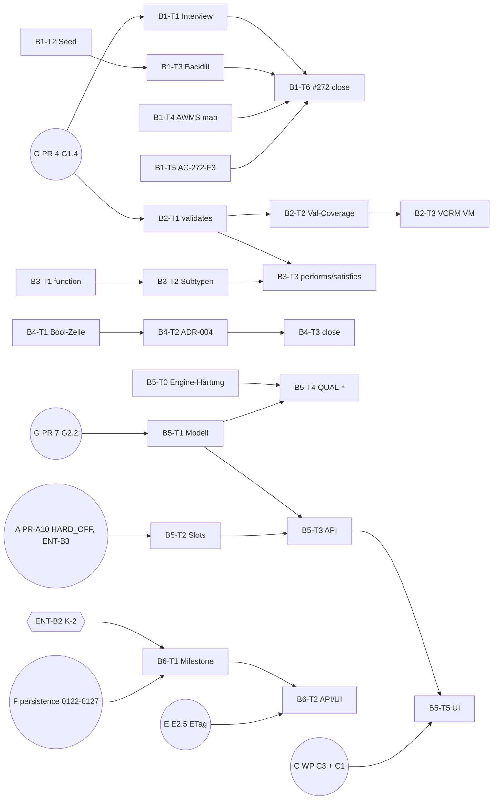

# Plan B — SE-Modell, Attribute, Qualität (WP B1–B6)

> **Reiner Umsetzungsplan.** Kein Code, keine Migration ist in diesem Dokument umgesetzt.
> Grundlage: Planbasis `docs/superpowers/specs/2026-10-21-backlog-umsetzungsplaene-design.md` (§1, §2 Plan B),
> Arbeitsbaum = `origin/main` `b175c970`, QS v1.8.0-beta.22 (commit `dc7ee14`).
> Jede `datei:zeile`-Angabe ist gegen den Arbeitsbaum bei `b175c970` verifiziert.
> Live-Belege: `docs/test-reports/plan-review-2026-10-21/plan-b/live-checks.md` (Check-IDs `B-L1` … `B-L11`).
> **Belege unter `docs/test-reports/` sind gitignored (`.gitignore:91`); DoD-Nachweise stehen im PR-Text bzw. als CI-Artefakt**
> (vorläufig, ENT-X3 = C als Übergang; nach ENT-X3 = B gehen neue DoD-Artefakte nach `docs/se/reports/` bzw. `docs/reviews/`).
> graphify-Graph (`graphify-out/graph.json`) existiert im Arbeitsbaum nicht; Navigation daher per gezieltem Grep/Read.
>
> **Stufe 2 (Integration Querreview, 2026-10-21):** Korrekturaufträge KA-B-01 … KA-B-15 und KA-ALL-01 … KA-ALL-11 aus
> [`2026-10-21-korrekturauftraege.md`](2026-10-21-korrekturauftraege.md) sind eingearbeitet; Nachweis im
> [Änderungsprotokoll Stufe 2](#änderungsprotokoll-stufe-2). **Vorrang:** Planbasis > [Plan-Index](2026-10-21-backlog-umsetzung-index.md) > dieser Plan.
> Offene Nutzerentscheidungen: [`2026-10-21-entscheidungen-offen.md`](2026-10-21-entscheidungen-offen.md) (IDs `ENT-*`);
> Stellen mit vorläufiger Empfehlung sind mit „vorläufig, ENT-…“ markiert.

---

## (i) Ziel und Nicht-Ziele

**Ziel.** Das SE-Datenmodell trägt die Qualitätsmerkmale, die ISO 29148/15288 verlangen, *tatsächlich* —
nicht nur als optionale leere Felder:

1. **B1** — Demo-Daten und Interview füllen `acceptance_criteria`, `verification_method`, `rationale`,
   `owner`, `priority` (QS heute 0/880, `B-L1`). #272 wird geschlossen.
2. **B2** — Validierung (TestCase → `validates` → StakeholderNeed) ist modelliert, messbar und im VCRM
   steht die Verifikationsmethode (#878).
3. **B3** — Funktionale Architekturebene: `element_type='function'`, Link `performs`, `satisfies` → Funktion (#877).
4. **B4** — Attribut-v3 abschließen: Restlücken #941 schließen, ADR-004 auf `accepted`, Epic #934 schließen.
5. **B5** — Qualitätsbewertung advisory: Slots `quality_*`, `quality.assess` (REST+MCP), Score-Historie,
   UI-Badge, `QUAL-*` als Auditor-Warnung, Slots ohne Memory-Injektion (#378).
6. **B6** — „Technical Planning": `Milestone` (#879); `Measure` nur nach Auflösung des Entscheidungs-Konflikts mit ADR-008 (#393).

**Nicht-Ziele.**
- Kein `QUAL-*`-Blocker, keine Baseline-Sperre durch Qualität (Entscheidung „nur advisory in v1").
- Kein Auto-Modus der Qualitätsbewertung (Transition/Create/periodisch) in diesem Plan — siehe (ix) E-3 (vorläufig, ENT-B4 = a).
- Keine Spezifikation des Memory-Ports, von `HARD_OFF` oder des Präferenzdienstes Q1 (Besitzer: Plan A WP A0b/A1, Plan C WP C2);
  dieser Plan **referenziert** sie nur.
- Keine Link-Typen `documented-in`, `evidences`, `depends-on` (Besitzer: Plan F WP F2).
- Keine Typisierung von `TestCase.steps` (Gherkin) — Rest aus #272, als eigenes Issue auszulagern (Task B1-T6).
- Keine Änderung der Seed-Struktur (Anzahl/Texte/Hierarchie) des Zahnbürsten-Workspaces — E2E prüft Texte
  (`e2e/tests/toothbrush-syseng.spec.ts:158-193`).

---

## (ii) Entscheidungen (aus der Planbasis, unverändert zitiert)

> Plan B — „Entscheidungen: NASA-SE-Ebene **gestaffelt**; Qualitätsbewertung **nur advisory in v1**."

| WP | Inhalt (Planbasis, wörtlich) | Issues |
|---|---|---|
| B1 | Seed füllt `acceptance_criteria`, `verification_method`, `owner`, `priority` (QS: 0/100 Stichprobe). Interview fragt AC/VM/Rationale ab (`ai_elicit`). #272 schließen (4/5 gebaut, Rest hier) | #272 |
| B2 | Link-Typ `validates` (TestCase→StakeholderNeed), Validierungs-Coverage, `verification_method` im VCRM | #878 |
| B3 | `ArchitectureElement.element_type='function'`, Link `performs`, `satisfies`→function | #877 |
| B4 | Attribut-v3-Rest: WS3 Display-Engine, WS4 Layout-Engine, WS7 AWMS-Wertemigration; ADR-004 auf `accepted` | #934, #941 |
| B5 | Qualitätsbewertung: Slots `quality_*` (Prompt-Override je Workspace), `quality.assess` (MCP+REST), Score-Historie, UI-Badge, `QUAL-*` als Auditor-Warnung (nie Blocker). Slots **ohne** Memory-Injektion (HARD_OFF). Aufwand laut Scoping 8–11 Tage | #378 |
| B6 | Später: `Milestone` + `Measure` als ein Plan „Technical Planning" | #879, #393 |

Reihenfolge (Planbasis §3): B1–B5 in **Welle 3**, B6 in **Welle 4**. „B5 nutzt `HARD_OFF` aus A1."

Querschnitt: Link-Typ-Katalog-Erweiterungen `validates` + `performs` sind **Besitz dieses Plans** (Plan-Brief).

**Entscheidungs-Konflikte** (nicht umgebogen, siehe (ix)): K-1 = ENT-B1 (alle ENT-IDs: [Entscheidungsliste](2026-10-21-entscheidungen-offen.md))
B4 (WS3/WS4/WS7 bereits erledigt, `B-L11`); K-2 = ENT-B2 B6 (`Measure` widerspricht dem akzeptierten ADR-008);
K-3 = ENT-B3 „B5 nutzt `HARD_OFF` aus A1“ als harte oder weiche Abhängigkeit (vorläufig, ENT-B3 = A: hart, wie Planbasis).

---

## (iii) Ist-Stand (verifiziert)

### B1 — Attributfüllung, Seed, Interview

| Befund | Beleg |
|---|---|
| Vollerhebung 880 Requirements: AC 0, AC-Items 0, VM 0, owner 0, priority 0, rationale 0, source 0, uid 880; 240× `level=None`; nur 32 verschiedene Titel | `B-L1` |
| Seed erzeugt 44 Requirements je Need (2+6+12+12+12) via `create_requirement(title=…, type=SYREQ)` ohne AC/VM/rationale | `backend/auth_tenancy/management/commands/seed_toothbrush.py:226-332` (Aufruf `:239`) |
| Seed ist „skip if exists": bestehender Workspace wird **nicht** angefasst → eine reine Seed-Änderung erreicht QS nie | `seed_toothbrush.py:475-480` |
| `create_requirement` akzeptiert `acceptance_criteria`, `rationale`, `verification_method`; **nicht** `owner`/`priority` | `backend/application/requirement_service.py:326-342` |
| `owner`/`priority` liegen auf `Artifact` (Actor-FK / CharField ohne Choices; Skala aus Definition `low/medium/high/critical`) | `backend/persistence/models.py:1266-1291`; `B-L8` |
| Actor für einen User: `ActorService.get_or_create_for_user(ctx, user_id)` | `backend/application/actor_service.py:160` |
| Schreibpfad für System-Felder: `ArtifactAttributeGateway.write(ctx, item_type, artifact, values, merge=True)` | `backend/application/artifact_attribute_gateway.py:884-905` |
| `ai_elicit` nur `title`+`description` (+ Risk `probability`/`impact`) | `backend/attribute_definitions/management/commands/bootstrap_attribute_definitions.py:239-245`, Live `B-L8` |
| Tier-Reihenfolge Interview: Override → Definition (`ai_elicit`) → Factory | `backend/application/interview_protocol.py:307-345`, `:216-250` |
| **Defekt (neu):** `build_adapter_fields` poppt `rationale` und verwirft es, wenn `description` schon gesammelt ist → wird `rationale` per `ai_elicit` abgefragt, geht die Antwort still verloren | `backend/application/interview_artifact_adapters.py:193-226` |
| Präzedenz-Migration für `ai_elicit`-Reparatur bestehender Definitionen | `backend/attribute_definitions/migrations/0007_risk_interview_elicits_probability_impact.py` |
| AWMS-Plan `priority_backfill.yaml` schreibt MoSCoW-Werte (`derive_from_link` auf `moscow_priority`, Fallback `"Should"`) in das Enum `low/medium/high/critical` | `backend/attribute_definitions/migration_plans/priority_backfill.yaml:19-28`; Needs alle `Must` (`B-L5`); Optionen `B-L8` |
| #272-Rest AC-272-F3 (Test `seed_full_chain` × `GET /requirements/coverage-report/`) fehlt weiterhin | `backend/auth_tenancy/tests/test_seed_full_chain_272.py:70-151` (kein Coverage-Test) |
| Verifikationsabdeckung live 30/880 = 3,4 % | `B-L10` |

### B2 — Validierung, Coverage, VCRM

| Befund | Beleg |
|---|---|
| Katalog: 11 Built-ins, kein `validates` | `backend/link_types/builtin.py:90-410`; `B-L2` |
| Neue Built-ins erreichen Bestands-Tenants nur per Daten-Migration; Werte sind zu **pinnen** (Lehre aus 0009) | `backend/link_types/migrations/0008_seed_satisfaction_link_types.py:1-60`, `0009_backfill_need_satisfies_pair.py:1-30` |
| `coverage_relevant` hat **keinen Laufzeit-Konsumenten** (nur Schema/Metadaten) → die Sorge „verdoppelt verifies-Coverage" (#878 Kommentar) ist gegenstandslos | `grep coverage_relevant`: nur `backend/link_types/schema.py:11,27,77`, `backend/mcp_server/tools/link_type.py:42` |
| `CoverageCalculator.coverage()` / `get_coverage_data()` nur Requirements × `verifies` | `backend/traceability/coverage_calculator.py:102-212`, `:214-343` |
| VCRM ohne `verification_method` (Row, CSV-Header, PDF) | `backend/traceability/types.py:231-256`; `backend/traceability/vcrm_report_generator.py:134-156`, `:288-305` |
| VCRM-Transport: nur MCP `traceability.vcrm` (kein REST) | `backend/mcp_server/tools/cross_cutting.py:225`, `:1819-1850` |
| Coverage-Transporte: REST `GET /requirements/coverage-report/`, MCP `traceability.coverage` | `backend/rest_api/views.py:2025-2120`; `cross_cutting.py:223`, `:1787` |
| Vorlage für eine advisory Validierungsregel (immer WARNING) | `backend/traceability/audit/rules/validation_goals.py:88-160`, `registry.py:125` |
| Live: 20 Needs, 30 TestCases, 0 Validierungslinks möglich | `B-L4`, `B-L5`, `B-L6` |

### B3 — Funktionale Architektur

| Befund | Beleg |
|---|---|
| `ElementType` = component/interface/subsystem/layer/module | `backend/persistence/models.py:109-121` |
| `element_type` ist Freitext (`CharField(64)`, keine `choices`) → kein DB-Migrationsbedarf | `backend/persistence/models.py:1753-1762`; Definition `type=text` (`B-L3b`) |
| Paar-Validierung kennt nur Artefakt**typen**, keine Subtypen; Schema verwirft unbekannte Paar-Schlüssel | `backend/link_types/catalog.py:98-152`; `backend/link_types/schema.py:111-138` |
| Einziger Aufrufer der Paarprüfung | `backend/application/trace_link_service.py:410-480` (Aufruf `:474`) |
| `satisfies` = Requirement→Goal, StakeholderNeed→Goal | `builtin.py:174-208`; `B-L2` |
| **Kollision (neu):** TRACE-P3 verlangt für **jedes** ArchitectureElement eingehendes `allocated-to`, sonst **BLOCKER** → jede Funktion ohne `allocated-to` blockiert Baselines | `backend/traceability/audit/rules/trace_derivation_allocation.py:522-597` (BLOCKER `:588`) |
| Single-Root-Invariante I5 je Workspace → Funktionen hängen im selben Baum | `backend/application/architecture_service.py:140-151` |
| Frontend-Typ `ElementType` (5 Werte), i18n `arch.elementType.*` | `frontend/src/types/architecture.ts:15-20`; `frontend/src/i18n/locales/de.json:410` |
| Link-Typ-Editor erhält zusätzliche Paar-Schlüssel per Spread | `frontend/src/components/LinkTypeEditor/LinkTypeEditorPage.tsx:285-290`; Typ `frontend/src/api/link-types.ts:25-28` |

### B4 — Attribut-v3

| Befund | Beleg |
|---|---|
| WS3 Display-Engine **live**: `id {copyable:true, reveal:click, mask:short}` | `B-L11`; `backend/attribute_definitions/schema.py:182-260` |
| WS4 Layout-Engine **im Code**: `SPAN_COLUMNS` full/half/quarter, `SPACER_COLUMNS`, `section_flow`/`attribute_flow` | `schema.py:294-334`; `frontend/src/components/shared/ArtifactForm/layout-flow.ts:34-54`; `frontend/src/components/AttributeEditor/LayoutFlowEditor.tsx` |
| WS7 AWMS **live**: `GET /attribute-migration/runs/` 200, 8 Pläne | `B-L11`; `backend/persistence/models.py:990`; `backend/attribute_definitions/migration_plans/README.md` |
| Sub-Issues #935–#940, #929, #930 alle CLOSED | `gh issue view` (2026-10-21) |
| #941-Rest: 3× Limitation „kein Core-Boolean", 3× „Goal REST-PATCH 405 by design" | `backend/attribute_definitions/tests/contract_matrix_baseline.json:18-60` |
| ADR-004 `status: proposed` | `docs/se/ADR/ADR-004_traeger_modell_und_auc.md:1-8` |

### B5 — Qualitätsbewertung

| Befund | Beleg |
|---|---|
| Nicht implementiert: keine `quality_*`-Slots, kein `QUAL-*`, keine Pfade | `B-L9`, `B-L10` |
| Scoping (Aug.) existiert, teils veraltet (Modell-Ort, Slot-Registry) | `docs/superpowers/plans/2026-08-07-artifact-quality-assessment-scoping.md` |
| Slot-Registry ist inzwischen `application/prompt_slots.py`; Memory-Injektion nur für Slots, die `memory_context` in `data_variables` deklarieren | `backend/application/prompt_slots.py:65-115`; `backend/application/prompt_resolver.py:295-296` |
| Factory-Defaults-Dict | `backend/application/ai_derivation_service.py:375-385` |
| LLM-Aufruf mit Token-Limit/Timeout/Audit/Cache | `ai_derivation_service.py:2983-3060` (`_complete`) |
| Mock-Provider purpose-gekeyed | `backend/llm_adapter/providers.py:954-1000` |
| LLM-Fehler → 503/504 + Codes `LLM_UNAVAILABLE`/`LLM_TIMEOUT` | `backend/rest_api/views.py:287-319` |
| Domänenmodelle liegen in `persistence` (nicht `application`); RLS-Policy-Migration je neuer Tabelle Pflicht | `backend/persistence/models.py:3146-3154`; `backend/persistence/migrations/0107_suggestion.py`, `0108_suggestion_rls_policy.py:1-60`; `backend/persistence/tests/test_rls_coverage.py` |
| `RuleEngine._run_rule` ohne try/except → eine werfende Regel kippt Audit **und** Baseline-Gate | `backend/traceability/audit/rule_engine.py:128-166` |
| MCP-Schreibschutz fail-closed (`*.query` ist read-exempt) | `backend/mcp_server/tool_registry.py:430`, `:1780-1795` |
| Manifest ist die Tool-Quelle; Ist-Zahl nie fest im Plan, sondern `jq '.tool_count' docs/agent-templates/tool-manifest.json` (Index §f.1) | `docs/agent-templates/tool-manifest.json:3` |

### B6 — Technical Planning

| Befund | Beleg |
|---|---|
| #393 **CLOSED** per ADR-008 (accepted, `deciders: [user]`): MOE/MOP/TPM werden **nicht** modelliert | `docs/se/ADR/ADR-008_moe_mop_tpm_nicht_modelliert.md:1-8`, `:107-140` |
| ADR-008 trennt #879 ausdrücklich: Meilenstein braucht keine `Measure` | ADR-008 `:132-140` |
| Kein `Milestone`-Code, keine Pfade | `B-L10`; Code-Grep nur Kommentare „Milestone M2" |

---

## (iv) Arbeitspakete

Konventionen für alle Tasks:
- **Testbefehl Backend:** Makro `BT` aus [Plan-Index §f.3](2026-10-21-backlog-umsetzung-index.md#f3-lokale-testbefehle-und-passwort-variable-qr-t23)
  (Superuser `DB_USER=reqogniloom`, Passwort aus der Env-Datei des laufenden Stacks, nie ausschreiben). Abgekürzt unten als `PYTEST <pfade>` (= `BT` mit `<pfade>`).
- **Testbefehl Frontend:** `docker exec reqogniloom-frontend-1 sh -c 'cd /app && npx vitest run <pfad>'` → `VITEST <pfad>`.
- Erwartete Ausgabe „grün" = letzte pytest-Zeile `N passed` ohne `failed`/`error`; Vitest `Tests  N passed`.
- TDD: jeder Task beginnt mit dem genannten **fehlschlagenden** Test gegen echte DB/Services (kein Mock für Kernpfade; LLM nur über den Projekt-Mock-Provider).
- **QS-Verifikationen** (lesend): `$H` = `$QS_URL/api/v1`, `$WS` = Workspace-ID, `$TOKEN` = Bearer-Token — nur Variablen, keine Literal-Adressen.
  Zähler werden als „vorher + Delta“ geprüft, nie als Absolutzahl (Index §f.1, QR-T25).
- Nach Code-Änderung: `graphify update .` (falls graphify-Graph angelegt ist).

**Plan-weite DoD-Regeln (Stufe 2, gelten zusätzlich zur Task-DoD):**
- **D-MIG** (KA-ALL-01/02): Migrationen laut [Plan-Index §e](2026-10-21-backlog-umsetzung-index.md#e-konsolidierte-migrationsvergabe-bindend);
  Nummer = höchste Nummer der App auf `main` + 1 beim Merge, `dependencies` auf die zuletzt gemergte Migration der App;
  `python manage.py makemigrations --check --dry-run` → `No changes detected`; Rückwärts-Probe
  `migrate <app> <name-der-vorgänger-migration>` → `migrate <app>`. Rollback- und Testangaben nennen **Namen**, nie nackte Nummern;
  Migrationstests nutzen `MigrationExecutor` mit Migrationsnamen bzw. `loader.graph.leaf_nodes()`.
  Nach Plan G G1.4 hat `workspace_id` auf `lt_/ad_workspace_definition` eine FK: Migrations- und Seed-Tests legen **echte
  `Workspace`-Zeilen** an (kein `uuid4()`).
- **D-RLS** (KA-ALL-01, QR-S19): `CreateModel` eines `TenantScopedModel` und seine RLS-Policy-Migration stehen im **selben PR**;
  `backend/persistence/tests/test_rls_coverage.py` grün ist Pflicht-Check.
- **D-TOOL** (KA-ALL-03): Tool-PR (Tool neu/entfernt/umbenannt/Schema- oder Beschreibungsänderung): `python manage.py export_tool_manifest`;
  bei Zahländerung Zahl in `README.md`, `docs/api/MCP-SURFACE.md`, `clients/registry.yaml` angleichen, `python3 scripts/clients/render.py`
  (erzeugt `docs/clients/antigravity(.de).md`); `.meta-config/project.yaml` nur über `agent-meta-manager` (Eintritt: ENT-X5 entschieden);
  `pytest docs/agent-templates dist -q` und `pytest mcp_server/tests/test_tool_manifest_drift.py -q` grün; Merge über die globale
  Tool-Queue (Index §d.2). Der Plan nennt nur Deltas („+2 Tools, +1 Präfix“).
- **D-API** (KA-ALL-04): Neue Views mit `serializer_class` oder `@extend_schema`; der PR aktualisiert
  `backend/rest_api/tests/openapi_warning_baseline.json` (entsteht mit Plan E P1-7; nur Shrink); Merge seriell (Index §d.2, §f.5).
  Neue Routen: `urls.py`-Queue, ETag-Entscheidung nach Plan E E2.6 (Index §f.8).
- **D-SORT** (KA-ALL-10): Jede neue Listen-/Historienroute sortiert deterministisch (`order_by` mit eindeutigem Tiebreaker, z. B. `id`);
  nach Plan G PR 6 macht `UnorderedObjectListWarning` den Test rot.
- **D-PROMPT** (Index §b QR-T07): Neuer Prompt-Slot ⇒ Case-Datei `backend/application/prompt_testing/cases/<slot>.yaml` (Verzeichnis
  entsteht mit Plan D P1-2) im **selben PR**; in `main` wird nie ein roter Case gemergt.

### WP B1 — Attributfüllung (Seed + Interview), #272 schließen

**B1-T1 — Interview fragt AC/VM/Rationale ab (Tier 2 + Bestandsreparatur)** · Rolle: `developer`
- Dateien (ändern): `backend/attribute_definitions/management/commands/bootstrap_attribute_definitions.py`
  (`PER_ITEM_TYPE_AI_ELICIT_FIELDS["Requirement"] = frozenset({"acceptance_criteria", "verification_method", "rationale"})`).
- Dateien (neu): `backend/attribute_definitions/migrations/0011_requirement_interview_elicits_se_fields.py` (Index §e; erwartete Nummer
  0011 nach Plan G `0010_workspace_definition_workspace_fk`, beim Merge max+1, `dependencies` auf die zuletzt gemergte Migration)
  — Kopie der Form von `0007` (Tenant-Arming, beide Tabellen `GlobalAttributeDefinition`/`WorkspaceAttributeDefinition`,
  nur Zeilen `item_type="Requirement"`, nur Presets `standard`/`extended` (in `minimal` sind die Felder nicht sichtbar),
  Cache-Invalidierung je Workspace). Reverse: `RunPython.noop` (Begründung wie 0007).
- Eintritt: Plan G PR 4 (G1.4, `attribute_definitions 0010_workspace_definition_workspace_fk`) gemergt (hart, Index §e).
- Dateien (ändern): `backend/application/interview_protocol.py:143` — Tier-3-Zwilling: `_EXTRA_REQUIRED_FIELDS["Requirement"]`
  mit `acceptance_criteria (textarea)` und `verification_method (enum, choices: [Test, Review, Analysis, Inspection, Demonstration])`.
- **Review-Befund R-B1-1 eingearbeitet:** `backend/application/interview_artifact_adapters.py:193-226` —
  `build_adapter_fields` darf einen Alias-Quellwert nie verwerfen: ist `description` bereits gesammelt, bleibt
  `rationale` als eigener Schlüssel erhalten (Requirement akzeptiert `rationale=`; andere Typen erhalten dann den
  dokumentierten `TypeError` → `ValidationError`, nicht stillen Verlust).
- Schnittstelle unverändert: `InterviewViewSet` (`backend/rest_api/interview_views.py:168-388`), MCP `interview.*`.
- TDD (zuerst rot):
  1. `backend/application/tests/test_interview_adapter_rationale_preserved.py::test_rationale_survives_when_description_collected`
     — `build_adapter_fields({"title":"T","description":"D","rationale":"R"}) == {"title":"T","description":"D","rationale":"R"}`.
  2. `backend/attribute_definitions/tests/test_requirement_elicits_se_fields.py` — `introspect_core_attributes("Requirement","extended")`
     markiert die drei Felder `ai_elicit=True`; Migration `0011_requirement_interview_elicits_se_fields` setzt das Flag auf einer vorab
     ohne Flag angelegten Workspace-Definition eines **echten** `Workspace` (echte DB, `MigrationExecutor` wie die 0007-Tests:
     `migrate` auf `("attribute_definitions", "0010_workspace_definition_workspace_fk")` → Zeile anlegen → `migrate` auf
     `("attribute_definitions", "0011_requirement_interview_elicits_se_fields")`; Namen, keine Nummern).
  3. `backend/application/tests/test_interview_requirement_protocol_272.py` — `get_protocol(ctx,"Requirement",ws)` (Tier 2) enthält
     Phasen mit `acceptance_criteria`, `verification_method` (Typ `enum`, Choices aus Definition), `rationale`; End-to-End über
     `InterviewService` (Mock-LLM): `formalize` legt ein Requirement mit nicht-leerem `acceptance_criteria`, gesetzter
     `verification_method` und `rationale` an.
- DoD: drei Tests grün; bestehende Interview-Tests grün (`PYTEST application/tests/ -k interview`); keine Änderung an REST/MCP-Verträgen; D-MIG.
- Verifikation: `PYTEST attribute_definitions/tests/test_requirement_elicits_se_fields.py application/tests/test_interview_adapter_rationale_preserved.py application/tests/test_interview_requirement_protocol_272.py` → `… passed`.
  Nach Deploy QS (lesend): `GET $H/workspaces/$WS/attribute-definitions/Requirement/` → `acceptance_criteria ai_elicit= True`, `verification_method ai_elicit= True`, `rationale ai_elicit= True`.

**B1-T2 — Seed füllt SE-Attribute (Neuanlage)** · Rolle: `developer`
- Datei (ändern): `backend/auth_tenancy/management/commands/seed_toothbrush.py`.
- Inhalt: Neue Modul-Konstanten
  - `SE_ATTRIBUTES_BY_TITLE: dict[str, tuple[str, str]]` — für **jeden** der 32 Titel aus `realistic_l1…l5` (`:253-326`) ein
    deterministisches Paar `(acceptance_criteria, rationale)`; AC als messbares Kriterium („Gegeben … wenn … dann …" bzw.
    Messgröße + Sollwert, abgeleitet aus dem Titeltext, z. B. „5000 RPM ± 2 % im Dauerlauf 10 min gemessen").
  - `VERIFICATION_METHOD_BY_LEVEL = {1: "Test", 2: "Test", 3: "Analysis", 4: "Inspection", 5: "Review"}` (Werte aus `VerificationMethod`, `persistence/models.py:307-317`).
  - `PRIORITY_BY_LEVEL = {1: "high", 2: "medium", 3: "medium", 4: "low", 5: "low"}` (Skala der Definition, `B-L8`).
  - `create_req(...)` übergibt `acceptance_criteria=`, `rationale=`, `verification_method=`; danach
    `ArtifactAttributeGateway().write(ctx, "Requirement", r, AttributeValues(core={"owner": {"kind":"user","id": <admin-actor-id>}, "priority": …}))`
    mit Actor aus `ActorService().get_or_create_for_user(ctx, user.id)` (einmal je Lauf).
  - `acceptance_criteria_items` wird durch den bestehenden Normalisierungspfad bzw. explizit `[{"text": ac, "fulfilled": False, "evidence_ref": None}]` gesetzt (Konsistenz mit `persistence/migrations/0113_requirement_acceptance_criteria_items.py`).
- Nicht ändern: Titel, Anzahl, Hierarchie, `level=None` der L5-Ebene (E2E-Text `e2e/tests/toothbrush-syseng.spec.ts:158`); siehe R-B1-4.
- TDD (zuerst rot): `backend/auth_tenancy/tests/test_seed_toothbrush_se_attributes.py`
  - `test_every_requirement_has_ac_vm_rationale_owner_priority` — nach `call_command("seed_toothbrush")`: alle Requirements des
    Workspaces haben nicht-leeres `acceptance_criteria`, `rationale`, `verification_method ∈ VerificationMethod`, `artifact.owner_id is not None`,
    `artifact.priority ∈ {low,medium,high,critical}`.
  - `test_seed_is_still_idempotent` — zweiter Aufruf erzeugt keine Duplikate (Count gleich).
- DoD: Tests grün; `PYTEST auth_tenancy/tests/` grün; E2E-Spec (gezielt) `npx playwright test e2e/tests/toothbrush-syseng.spec.ts` grün.
  Hinweis Index §d.2: Plan G PR 1 ruft `seed_toothbrush` im Test (Welle 0) — kein Dateikonflikt; B-Seed-Tests laufen nach G1.4 mit echten `Workspace`-Zeilen.

**B1-T3 — Backfill bestehender Seed-Workspaces (QS)** · Rolle: `developer`
- Datei (ändern): `seed_toothbrush.py` — neues Flag `--backfill-se-attributes` (Default aus). Verhalten: für den vorhandenen
  Workspace `WORKSPACE_NAME` jedes Requirement, dessen Titel in `SE_ATTRIBUTES_BY_TITLE` steht, **nur leere** Felder füllen
  (`only-if-empty`, idempotent) über `RequirementService.update_requirement` (`requirement_service.py:742`) bzw. Gateway (`owner`/`priority`);
  Level aus `Requirement.level` (bei `None` → 5). Ausgabe: `Backfilled <n> requirements (<m> already complete).`
- Kein Weg über `priority_backfill.yaml` (siehe R-B1-3).
- TDD (zuerst rot): `test_seed_toothbrush_se_attributes.py::test_backfill_fills_only_empty_fields` — Requirement mit
  manuell gesetzter AC behält sie, leeres erhält Seed-Wert; zweiter Lauf meldet `0` geänderte Zeilen.
- DoD: Test grün; Laufzeit auf 880 Requirements < 120 s (lokal gemessen, im PR notiert).
- Rollout QS (Betriebsschritt, durch `devops-engineer` nach Merge+Deploy): `docker compose exec backend python manage.py seed_toothbrush --backfill-se-attributes`
  → erwartete Ausgabe `Backfilled 880 requirements (0 already complete).`; Nachmessung lesend mit dem Skript aus `B-L1`:
  `acceptance_criteria 880`, `verification_method 880`, `owner 880`, `priority 880`, `rationale 880`.

**B1-T4 — AWMS-Plan `priority_backfill.yaml` auf die Definitionsskala abbilden** · Rolle: `developer`
- **Review-Befund R-B1-3 eingearbeitet.** Datei (ändern): `backend/attribute_definitions/migration_plans/priority_backfill.yaml` —
  zusätzlicher Schritt `map_value` nach `backfill_value` (Operation existiert, `migration_plan.py` OPS-Katalog, README `:44-50`):
  `Must→high`, `Should→medium`, `Could→low`, `Won't→low`; Fallback `"medium"` statt `"Should"`
  (**vorläufig, ENT-B5 = a**; bei ENT-B5 = b: `Must→critical`, `Should→high`, `Could→medium`, `Won't→low`, Fallback `"high"`). PR-B3 ist erst nach ENT-B5 final.
- TDD (zuerst rot): `backend/attribute_definitions/tests/test_migration_plans.py` (bestehende Datei, Fixture `:219`) — neuer Test
  `test_priority_backfill_writes_definition_vocabulary`: Dry-Run gegen Requirement mit Need `moscow_priority="Must"` liefert `high`;
  ohne Need `medium`; alle Werte ∈ Definitionsoptionen.
- DoD: Test grün; README-Tabelle (`migration_plans/README.md:20`) Spalte „Transform" aktualisiert.

**B1-T5 — Testlücke AC-272-F3** · Rolle: `tester`
- Datei (neu): `backend/rest_api/tests/test_seed_full_chain_coverage_report_272.py` —
  `call_command("seed_full_chain")`, dann `GET /api/v1/requirements/coverage-report/?workspace_id=<ws>` → `summary.total > 0`, `summary.covered > 0`.
- DoD: grün; damit ist der letzte offene #272-Punkt aus dem Validierungskommentar vom 2026-09-22 erfüllt.

**B1-T6 — #272 abschließen** · Rolle: `documenter` (Issue-Kommentar über `git`/Orchestrator)
- Kommentar mit Messung nach B1-T3 (Skript `B-L1`), Verweis auf PRs; Restpunkt „`TestCase.steps` untypisiert" als neues Issue
  „TestCase steps: typed Given/When/Then model" anlegen (Agent `feedback`), dann #272 mit `Closes #272` im letzten B1-PR schließen.

### WP B2 — `validates`, Validierungs-Coverage, VCRM-Methode (#878)

**B2-T1 — Link-Typ `validates` im Katalog** · Rolle: `developer`
- Dateien (ändern): `backend/link_types/builtin.py` (neuer Eintrag nach `verifies`, `:257-281`; Modul-Docstring-Tabelle `:12-28`
  um `validates  source = TestCase  target = StakeholderNeed` ergänzen; Kopfzeile ohne Zahlwort formulieren, z. B. „core built-in types“ — Plan F ergänzt weitere Typen, QR-T25),
  `backend/traceability/types.py:27-60` (`LinkType.VALIDATES = "validates"`).
- Definition:
  ```python
  "validates": {
      "label": {"de": {"downstream": "validiert", "upstream": "wird validiert durch", "neutral": "Validierung"},
                "en": {"downstream": "validates", "upstream": "is validated by", "neutral": "Validation"}},
      "allowed_pairs": _pairs(("TestCase", "StakeholderNeed")),
      "coverage_relevant": True, "suspect_rule": "target_change_flags_source", "impact_weight": 1.0,
      "manual_creatable": True, "system_owned": False, "active": True, "built_in": True,
  }
  ```
- Dateien (neu): `backend/link_types/migrations/0011_seed_validates_link_type.py` (Index §e; erwartete Nummer 0011 nach Plan G
  `0010_workspace_definition_workspace_fk`, hart; beim Merge max+1) — Form von `0008` (Tenant-Arming, Global + Workspace,
  `is_customized=False`-Zeilen unberührt lassen), aber Definition **gepinnt** im Migrationsmodul (nicht `BUILTIN_LINK_TYPES` lesen,
  Lehre aus `0009:18-23`). Reverse: löscht nur `key="validates"`-Zeilen ohne verlinkte TraceLinks; sind Links vorhanden → `RuntimeError`
  mit Anzahl (kein stiller Datenverlust).
- Frontend (ändern): `frontend/src/constants/traceLinkLabels.ts` (`FALLBACK_TRI_LABELS.validates`, Kommentar ohne Zahlwort).
- Tests anpassen (Mengen-Zugehörigkeit statt Gesamtzahl, KA-B-03): `backend/link_types/tests/test_builtin.py:12-28` (`EXPECTED_KEYS` um
  `validates` ergänzen; Assertion `EXPECTED_KEYS <= set(BUILTIN_LINK_TYPES)`, Testname ohne „eleven“), `:40` (`"validates" in coverage`
  statt exakter Menge), `backend/mcp_server/tests/test_link_type_tool_group.py:89` (`"validates" in {lt["key"] for lt in …}` und
  `len(…) == len(BUILTIN_LINK_TYPES)` statt `== 11`).
- TDD (zuerst rot): `backend/link_types/tests/test_validates_link_type_878.py`
  - `test_validates_allows_testcase_to_need_only` — `validate_link_pair(ws,"validates","TestCase","StakeholderNeed",manual=True)` ok;
    `("TestCase","Requirement")` → `ValidationError` mit Text `Allowed: TestCase->StakeholderNeed`.
  - `test_migration_seeds_existing_workspace` — echter `Workspace` vor Migration ohne Zeile (`MigrationExecutor`: `migrate` auf
    `("link_types", "0010_workspace_definition_workspace_fk")`, dann auf `("link_types", "0011_seed_validates_link_type")`) → danach
    `lt_*`-Zeile `validates`, customized-Zeilen unverändert.
  - REST-Durchstich: `POST /api/v1/trace-links/` `{"source_id": <tc-artifact>, "target_id": <need-artifact>, "link_type": "validates"}` → `201`.
- DoD: Tests grün; `PYTEST link_types/tests mcp_server/tests/test_link_type_tool_group.py traceability/tests` grün; D-MIG.
- Verifikation QS nach Deploy: `GET $H/workspaces/$WS/link-type-definitions/` → `count` = vorher + 1, `validates … pairs=['TestCase->StakeholderNeed']`.

**B2-T2 — Validierungs-Coverage (Service + REST + MCP)** · Rolle: `developer`
- Datei (ändern): `backend/traceability/coverage_calculator.py` — neue Methode
  ```python
  def validation_coverage(self, workspace_id: uuid.UUID, *, include_outdated: bool = False,
                          include_unreviewed_ai: bool = False) -> ValidationCoverageReport: ...
  ```
  Logik: aktive StakeholderNeeds des Workspaces; „validiert" = ≥1 eingehender `validates`-Link, dessen Quelle ein TestCase ist,
  der nicht `outdated` ist und `counts_as_verification_evidence(origin, reviewed)` erfüllt (gleiches Prädikat wie `verifies`, `:63`).
- Datei (ändern): `backend/traceability/types.py` — `@dataclass ValidationCoverageReport(total: int, covered: int, uncovered: list[str], percentage: float, pending_ai_review: int = 0, entries: list[NeedValidationEntry] = field(default_factory=list))`,
  `NeedValidationEntry(need_id: str, uid: str, title: str, test_cases: list[dict])` (`test_cases` = `{id, title, latest_result}` wie VCRM-Ergebnisse).
- REST (neu, in `StakeholderNeedViewSet`, `backend/rest_api/views.py:715`): `@action(detail=False, methods=["get"], url_path="validation-coverage")`
  - `GET /api/v1/needs/validation-coverage/?workspace_id=<uuid>[&include_outdated=true][&include_unreviewed_ai=true]`
  - `200`: `{"summary": {"total": 20, "covered": 0, "percentage": 0.0, "pending_ai_review": 0}, "needs": [{"need_id": "…", "uid": "NEED-001", "title": "…", "test_cases": []}]}`
  - Fehler: `400 VALIDATION_ERROR` (fehlende/ungültige `workspace_id`), `404 NOT_FOUND` (Workspace unbekannt/fremd), `403` (keine Leserechte).
  - Muster: wie `coverage_report` (`views.py:2025-2120`): `parse_workspace_id`, Existenzprüfung über `WorkspaceService().get_workspace`, keine Model-Query im View.
  - OpenAPI: `extend_schema` mit Response-Serializer `NeedValidationCoverageResponseSerializer` (`backend/rest_api/serializers.py`).
- MCP (ändern): `traceability.coverage` (`cross_cutting.py:1787-1818`) neuer optionaler Parameter `kind: "verification" | "validation"` (Default `verification`, bisheriges Verhalten unverändert); bei `validation` Antwort `{"kind":"validation","total","covered","percentage","uncovered_need_ids":[…]}`; unbekannter `kind` → JSON-RPC-Fehler `-32602` mit erlaubten Werten. Schema in `_TOOL_SCHEMAS` + Manifest neu exportieren: `python manage.py export_tool_manifest` (**Delta 0 Tools, 0 Präfixe**; Doku-Zähler unverändert, D-TOOL).
- Sortierung (D-SORT): `entries` nach `uid`, Tiebreaker `need_id`; `uncovered`/`uncovered_need_ids` in derselben Reihenfolge.
- Konfliktdatei `backend/rest_api/views.py`: Welle-3-Merge nach den Welle-0/2-Queues (Plan E P1-*, Plan G PR 5/6/19) rebasen (Index §d.2).
- TDD (zuerst rot):
  - `backend/traceability/tests/test_validation_coverage_878.py` — 2 Needs, 1 TestCase `validates` Need A → `total 2, covered 1, percentage 50.0`; outdated TestCase zählt nicht; AI-unreviewed TestCase zählt nicht (`pending_ai_review 1`).
  - `backend/rest_api/tests/test_need_validation_coverage_rest_878.py` — 200-Form, 400 ohne `workspace_id`, 404 fremder Workspace.
  - `backend/mcp_server/tests/test_traceability_coverage_kind_878.py` — `kind="validation"` liefert Need-Zahlen; ohne `kind` identisch zu heute.
- DoD: Tests grün, `backend/mcp_server/tests/test_tool_manifest_drift.py` grün; D-TOOL (Delta 0), D-API (`NeedValidationCoverageResponseSerializer`, Baseline nur Shrink), D-SORT.
- Verifikation QS (lesend): `curl -s -H "Authorization: Bearer $TOKEN" "$H/needs/validation-coverage/?workspace_id=$WS"` → `{"summary":{"total":20,"covered":0,"percentage":0.0,…}` (Zahl ändert sich erst mit angelegten `validates`-Links).

**B2-T3 — `verification_method` im VCRM** · Rolle: `developer`
- Dateien (ändern): `backend/traceability/types.py:191-205` (`RequirementCoverageEntry.verification_method: str | None = None`),
  `:231-256` (`VCRMRow.verification_method: str = ""`, `to_dict` ergänzt), `coverage_calculator.py:265-268` (`values(…, "verification_method")`),
  `vcrm_report_generator.py:64-132` (Feld durchreichen), `:134-156` (CSV: Spalte **am Ende** anhängen:
  `requirement_id,component_id,test_case_id,test_result,verification_method` — bestehende Spaltenpositionen bleiben),
  `:288-305` (PDF-Spalte „Method"; leere Methode → `"(none)"`).
- MCP-Vertrag `traceability.vcrm`: JSON-Zeilen erhalten additiv `verification_method`; Beschreibung im Manifest ergänzen
  (`export_tool_manifest`, **Delta 0 Tools**, D-TOOL).
- TDD (zuerst rot): `backend/traceability/tests/test_vcrm_report_generator.py` (bestehend) — neue Tests
  `test_vcrm_row_carries_verification_method`, `test_csv_appends_verification_method_column` (Header exakt wie oben, Wert `Test`).
- DoD: Tests grün; bestehende VCRM-Tests unverändert grün (Spaltenpositionen stabil); D-TOOL (Delta 0).

### WP B3 — Funktionale Architekturebene (#877)

**B3-T1 — `element_type='function'`** · Rolle: `developer`
- Dateien (ändern): `backend/persistence/models.py:109-121` (`FUNCTION = "function", "Function"`; **keine** Migration nötig, Feld ohne `choices`,
  `:1753-1762`), `frontend/src/types/architecture.ts:15-20` (`| "function"`), `frontend/src/i18n/locales/{de,en}.json`
  Schlüssel `arch.elementType.function` = DE „Funktion" / EN „Function".
- Prüfen statt annehmen: `python manage.py makemigrations --check --dry-run` → `No changes detected`.
- TDD (zuerst rot): `backend/application/tests/test_architecture_function_element_877.py::test_create_function_element` —
  `ArchitectureService().create_architecture_element(..., element_type="function", parent_id=<root>)` → gespeichert `function`.
- DoD: Test grün; Frontend `VITEST src/components/ArchitectureEditors` grün.

**B3-T2 — Subtyp-fähige Paare im Link-Katalog (generisches Subtyp-Register)** · Rolle: `senior-developer` (Vertragsänderung am Katalog-Schema)
- **Korrigiert in Stufe 2 (KA-B-08, QR-T10):** Subtyp-Paare sind **generisch**, nicht an `ArchitectureElement` gebunden. Zulässig für jeden
  Artefakttyp mit registriertem Subtyp-Feld. Wire-Format ist die **bestehende** Notation `Typ:Subtag` (`normalize_artifact_type`,
  `backend/link_types/catalog.py:40-48`); keine neuen Paar-Schlüssel.
- Dateien (ändern):
  - `backend/link_types/catalog.py` — neues Modul-Register `SUBTYPE_FIELDS: dict[str, str] = {"ArchitectureElement": "element_type"}`
    (Plan F ergänzt `"Document": "kind"`, KA-F-02, ohne Änderung an der B-Validierung). Docstring von `normalize_artifact_type` und Modul-Docstring
    dokumentieren `Typ:Subtag` als **einzige** Subtyp-Repräsentation (Paar-Seite und Endpunkt-Seite).
  - `backend/link_types/catalog.py:98-152` — `validate_link_pair` behält seine Signatur. Matching: ein Paar-Typ mit Subtag (`ArchitectureElement:function`)
    passt nur, wenn der Endpunkt-Typ exakt `ArchitectureElement:function` ist; ein Paar-Typ ohne Subtag passt wie bisher auf den
    normalisierten Basistyp. Fehlermeldung listet die Paare in derselben Notation (`Requirement->ArchitectureElement:function`).
  - `backend/link_types/schema.py:111-138` — `_validate_pairs` akzeptiert `source_type`/`target_type` der Form `Typ:Subtag` (Subtag nicht leer,
    lowercase normalisiert) **nur für Typen im Subtyp-Register**, sonst `ValidationError` („subtype tag is only supported for: ArchitectureElement“ — Liste aus dem Register).
  - `backend/application/trace_link_service.py:410-480` — `_check_link_pair` reicht für Endpunkte, deren Basistyp im Register steht, den Typ als
    `Typ:<wert des Subtyp-Felds>` weiter (eine `values_list`-Query je Endpunkt, nur wenn der Workspace-Katalog mindestens ein Paar mit Subtag enthält).
  - `frontend/src/api/link-types.ts:25-28` — Typ unverändert (`source_type`/`target_type` tragen `Typ:Subtag`);
    `frontend/src/components/LinkTypeEditor/LinkTypeEditorPage.tsx` — je Paar zwei optionale Eingabefelder für den Subtag, beim Speichern zu
    `Typ:Subtag` zusammengesetzt, beim Laden zerlegt; `data-testid="link-type-pair-source-subtype-{index}"` / `"link-type-pair-target-subtype-{index}"`, i18n
    `linkTypeEditor.pairSourceSubtype` (DE „Quell-Subtyp (optional)", EN „Source subtype (optional)"),
    `linkTypeEditor.pairTargetSubtype` (DE „Ziel-Subtyp (optional)", EN „Target subtype (optional)"); Felder nur aktiv für Typen im Register
    (Register-Liste über die bestehende Katalog-Antwort bzw. Konstante im Frontend, eine Quelle).
- REST-/MCP-Vertrag: `PUT /api/v1/workspaces/{id}/link-type-definitions/{key}/` und `link_type.*` akzeptieren `Typ:Subtag` in den bestehenden
  Paar-Feldern; Antwort spiegelt sie; Bestandsdaten ohne Subtag unverändert gültig (rückwärtskompatibel, expand). Keine Tool-Änderung (Delta 0 Tools).
- TDD (zuerst rot): `backend/link_types/tests/test_pair_subtypes_877.py` — Schema behält `ArchitectureElement:function`;
  `test_subtype_pair_rejected_for_type_without_registered_subtype_field` (`Requirement:foo` → `ValidationError`/REST 400);
  `test_subtype_register_lists_architecture_element`; `validate_link_pair` mit/ohne passendem Subtag; Paar ohne Subtag passt weiter auf
  `ArchitectureElement:<beliebig>`; Frontend `frontend/src/components/LinkTypeEditor/link-type-editor-page.test.tsx` neuer Fall „subtype round-trips on save as Typ:Subtag".
- DoD: Tests grün; `PYTEST link_types/tests application/tests/test_trace_link*` grün; Review `security-auditor` (Eingabevalidierung Katalog-Schema).
- Konfliktdatei `backend/link_types/catalog.py`/`schema.py`: PR-B12 merged **vor** Plan F F1/F2-Subtyp (Index §d.2).

**B3-T3 — `performs` + `satisfies`→Funktion** · Rolle: `developer` · abhängig von B3-T2
- `backend/link_types/builtin.py`: neuer Eintrag `performs` —
  `allowed_pairs = [{"source_type":"ArchitectureElement","target_type":"ArchitectureElement:function"}]` (Notation `Typ:Subtag` aus B3-T2),
  `coverage_relevant False`, `suspect_rule "target_change_flags_source"`, `impact_weight 0.8`, Labels DE `führt aus / wird ausgeführt von / Funktionszuordnung`,
  EN `performs / is performed by / Function allocation`; `satisfies` (`:174-208`) erhält zusätzlich
  `{"source_type":"Requirement","target_type":"ArchitectureElement:function"}`.
  `LinkType.PERFORMS` in `traceability/types.py`; `FALLBACK_TRI_LABELS.performs` im Frontend.
- Neu: `backend/link_types/migrations/0012_seed_performs_and_satisfies_function_pair.py` (Index §e; Kette `link_types`
  `0011_seed_validates_link_type` → `0012_seed_performs_and_satisfies_function_pair`; Plan F setzt ab 0013 fort) — seedet `performs` (gepinnt) und merged das neue
  `satisfies`-Paar additiv (Merge-Helper wie `0009:57-77`, nur `is_customized=False`). Reverse: `performs` wie B2-T1; Paar-Merge `noop` (Begründung `0009:26-30`).
  Migrationstest mit echtem `Workspace` und `MigrationExecutor` über die Namen `0011_seed_validates_link_type` → `0012_seed_performs_and_satisfies_function_pair`.
- **Review-Befund R-B3-1 eingearbeitet:** `backend/traceability/audit/rules/trace_derivation_allocation.py:567-597` — TRACE-P3 zählt für Elemente mit
  `element_type="function"` eingehende `satisfies`-Links von aktiven Requirements als Rechtfertigung (`_targets_by_link_type(context, {ALLOCATED_TO, SATISFIES})`,
  `satisfies` nur für Funktionselemente). Ohne diesen Schritt blockiert jede Funktion die Baseline.
- Tests anpassen (Mengen-Zugehörigkeit, KA-B-03): `test_builtin.py` (`"performs" in BUILTIN_LINK_TYPES`; `test_satisfaction_types_have_the_expected_pairs` `:155`
  um das Funktionspaar ergänzen), `test_link_type_tool_group.py:89` (`"performs" in keys`; Länge = `len(BUILTIN_LINK_TYPES)`).
- TDD (zuerst rot): `backend/traceability/tests/test_function_layer_877.py`
  - `test_component_performs_function` (REST `POST /api/v1/trace-links/` → 201), `test_performs_rejects_non_function_target` (→ 400 mit `ArchitectureElement:function` im Text),
  - `test_requirement_satisfies_function` (201), `test_requirement_satisfies_component_rejected` (400),
  - `test_trace_p3_accepts_satisfies_for_function` (kein TRACE-P3-Finding für eine Funktion mit eingehendem `satisfies`; Komponente ohne `allocated-to` bleibt BLOCKER),
  - `test_arch_003_ignores_function_without_allocation` (kein ARCH-003-Finding).
- DoD: Tests grün; `PYTEST traceability/tests link_types/tests` grün; D-MIG.
- Verifikation QS: `GET $H/workspaces/$WS/link-type-definitions/` → `count` = Stand nach B2-T1 + 1; `satisfies` enthält `Requirement->ArchitectureElement:function`.

### WP B4 — Attribut-v3 abschließen (#934, #941, ADR-004)

> Entscheidungs-Konflikt K-1 = ENT-B1 (siehe (ix)): Der Planbasis-Inhalt „WS3/WS4/WS7" ist erledigt (`B-L11`). B4 enthält daher nur den tatsächlichen Rest.
> ENT-B1 ist **nicht** vorläufig freigegeben: B4 (und Plan B P1) startet erst nach ENT-B1 (Empfehlung a).

**B4-T1 — Boolean-Zelle der Contract-Matrix ausüben** · Rolle: `tester`
- Datei (ändern): `backend/attribute_definitions/tests/test_transport_contract_matrix.py` — Testfixture legt für einen Workspace ein
  **extended** Boolean-Attribut (`kind="extended"`, `type="boolean"`, Name `contract_probe_flag`) über den regulären Definitions-Service an
  und übt W/R/V/Round-Trip auf REST und MCP aus (kein neues Produktattribut).
- Datei (ändern): `backend/attribute_definitions/tests/contract_matrix_baseline.json` — die drei `"attribute": "boolean"`-Limitations entfernen
  (strict shrink erzwingt das).
- Goal-PATCH-Zellen: Limitation-Text bleibt, `reason` wird um „by design (ADR-004 §… Lineage-Versionierung)" ergänzt.
- TDD: Erst Fixture ergänzen → Matrix schlägt fehl, weil Limitation nicht mehr reproduziert (strict shrink) → Baseline kürzen → grün.
- DoD: `PYTEST attribute_definitions/tests/test_transport_contract_matrix.py` grün; Baseline hat 3 statt 6 Limitations.

**B4-T2 — ADR-004 auf `accepted`** · Rolle: laut ENT-X4 + Nutzer (`se-architect`/`se-critic` sind nicht installiert; Empfehlung ENT-X4 = A:
`documenter` Text, `concept-reviewer` Review, Nutzer Statuswechsel). Eintritt: ENT-X4 entschieden (nicht vorläufig freigegeben). Nutzerentscheidung zum Inhalt liegt in der Planbasis vor.
- Datei: `docs/se/ADR/ADR-004_traeger_modell_und_auc.md` — `status: accepted`, Status-Historie mit Datum + Grund („Gateway, Matrix, WS1–WS7 umgesetzt; Planbasis 2026-10-21").
- DoD: Frontmatter valide gegen `schemas/se-adr.schema.json` (falls im Repo vorhanden), `affected_reqs` unverändert.

**B4-T3 — Issues schließen** · Rolle: `documenter`
- #941: Kommentar (Deliverables 1–4 erfüllt, B4-T1-PR), `Closes #941` im B4-T1-PR. #934: Kommentar mit WS-Tabelle (alle Sub-Issues CLOSED) und Schließung nach B4-T2.

### WP B5 — Qualitätsbewertung advisory (#378)

Grundsatz: v1 = manueller Trigger (REST-Button + MCP), ein Ergebnis-Modell für alle Typen, Slots je Typ.
Score-Skala gespeichert `0.0–1.0`; UI zeigt Prozent.

**B5-T0 — Audit-Engine härten (unabhängig)** · Rolle: `developer`
- `backend/traceability/audit/rule_engine.py:128-166` — `rule.check(context)` in `try/except Exception` kapseln, `logger.exception` mit `rule_id`,
  Rückgabe `[]`. Kein zusätzliches Antwortfeld (das Audit-Ergebnis-Schema bleibt unverändert); Sichtbarkeit nur über das Log.
- TDD (zuerst rot): `backend/traceability/tests/test_rule_engine_isolation.py::test_raising_rule_does_not_break_audit` — registrierte Testregel wirft; `RuleEngine` liefert Findings der übrigen Regeln.
- DoD: grün; `PYTEST traceability/tests baseline/tests` grün.

**B5-T1 — Datenmodell `QualityAssessment`** · Rolle: `senior-developer`
- `backend/persistence/models.py` (neu, `TenantScopedModel`, Tabelle `pl_quality_assessment`):
  `id UUID`, `workspace FK Workspace (CASCADE)`, `entity_type CharField(64)`, `entity_id UUIDField`, `artifact FK Artifact null (SET_NULL)`,
  `score FloatField (0..1, Validator)`, `reasoning TextField`, `suggestions JSONField(list)`, `criteria JSONField(dict)`,
  `content_hash CharField(64, db_index)`, `entity_version IntegerField null`, `prompt_slot CharField(100)`,
  `prompt_scope CharField(16: workspace|global|factory)`, `prompt_version IntegerField null`, `provider CharField(64)`, `model CharField(128)`,
  `token_usage IntegerField null`, `trigger CharField(16: manual|mcp)`, `triggered_by CharField(255)`, `status CharField(16: ok|failed)`,
  `error_code CharField(64, blank)`, `created_at DateTimeField(auto_now_add)`.
  Indizes: `(tenant, entity_type, entity_id, -created_at)`, `(tenant, workspace, -created_at)`, `(tenant, content_hash)`. Append-only
  (Manager ohne `update`, `save()` wirft bei vorhandenem PK).
- Migrationen (neu, Index §e): `backend/persistence/migrations/0120_quality_assessment.py` (CreateModel; Reverse = DeleteModel),
  `0121_quality_assessment_rls_policy.py` (Kopie von `0108`, `_TABLE = "pl_quality_assessment"`, Reverse = Policy droppen).
  Erwartete Nummern nach Plan G `0119_requirement_list_index` (PR 7); beim Merge max+1, **beide im selben PR** (D-RLS, KA-B-11).
- **Review-Befund R-B5-1 eingearbeitet:** Ort `persistence` statt `application/models.py` (Scoping-Dok. veraltet, siehe `persistence/models.py:3146-3154`).
- TDD (zuerst rot): `backend/persistence/tests/test_quality_assessment_model.py` — Append-only (zweites `save` → Fehler), RLS-Isolation
  (fremder Tenant sieht 0 Zeilen, Muster `test_rls_policies.py`, echte `Workspace`-Zeilen), `test_rls_coverage.py` grün mit neuer Tabelle.
- DoD: Tests grün; D-MIG; D-RLS (`backend/persistence/tests/test_rls_coverage.py` grün); Reviewer `security-auditor` (RLS).

**B5-T2 — Slots `quality_*` (ohne Memory)** · Rolle: `developer`
- `backend/application/ai_derivation_service.py:375-385` — vier Factory-Konstanten + Einträge `quality_requirement`, `quality_adr`, `quality_testcase`, `quality_risk`.
  Inhalt fordert JSON `{"score": 0..1, "reasoning": str, "suggestions": [str], "criteria": {name: 0..1}}`; IEEE-29148-Kriterien (atomar, eindeutig, verifizierbar, vollständig, notwendig, verfolgbar) für Requirement; analog je Typ (Scoping §Ziele).
- `backend/application/prompt_slots.py:65-115` — `_DATA_VARIABLES_BY_SLOT` je Slot **ohne** `memory_context`
  (`quality_requirement: ("artifact_title","artifact_description","acceptance_criteria","rationale","verification_method")`, übrige Typen: `("artifact_title","artifact_description","artifact_fields_json")`).
- Memory-Ausschluss: wirkt bereits über fehlende Deklaration (`prompt_resolver.py:295-296`). Zusätzlich greift `HARD_OFF` aus Plan A T-A1-1
  (PR-A10): `MEMORY_HARD_OFF_PREFIXES = ("quality_",)` erfasst die vier Slots automatisch; B5 ändert die Konstante **nicht** (Besitz Plan A).
  **Abhängigkeit (vorläufig, ENT-B3 = A, wie Planbasis „B5 nutzt `HARD_OFF` aus A1“):** PR-B15 merged erst nach PR-A10 (T-A1-1). Würde B5 vor A1
  mergen, bliebe in Custom-Templates mit `{memory_context}` auf `quality_*`-Slots ein literaler Platzhalter stehen (R-B5-2, KA-B-07).
  Bei ENT-B3 = B: weiche Abhängigkeit, dieses Restverhalten wird in den Release-Notes genannt.
- **Case-Dateien (KA-B-02, QR-T07, D-PROMPT):** derselbe PR legt `backend/application/prompt_testing/cases/quality_requirement.yaml`,
  `quality_adr.yaml`, `quality_testcase.yaml`, `quality_risk.yaml` an (Schema Plan D D2.1: `slot`, `scenarios[].data/config/assert`),
  je ≥ 1 Szenario mit `{type: not-contains, value: "{memory_context}"}` und `contains` auf einen Pflichtbegriff des Prompts (z. B. „score“).
  Damit bleiben `test_every_slot_has_exactly_one_case_file` (Plan D, `set-1-core`) und `export_promptfoo_configs --check` grün.
  Die Case-Dateien gehören danach Plan D (Besitzer); B legt sie nur für die neuen Slots an.
- Frontend: `frontend/src/api/prompt-templates.ts:67` (`KNOWN_PROMPT_SLOTS` + 4 Namen), `frontend/src/components/WorkspaceSettings/AiPromptsSection.tsx:47` (`SLOT_LABELS`),
  i18n `aiPrompts.slots.quality_requirement` DE „Qualitätsbewertung: Anforderung" / EN „Quality assessment: requirement" (analog `_adr` „ADR", `_testcase` „Testfall"/„test case", `_risk` „Risiko"/„risk").
  Flat-Key-Falle beachten: Schlüssel enthalten Unterstriche, keine Punkte.
- Mock: `backend/llm_adapter/providers.py:954` `_MOCK_PURPOSE_PAYLOADS["quality_assess"]` → deterministisches Objekt `{"score":0.5,"reasoning":"mock","suggestions":[],"criteria":{}}`; Timeout-Purpose in `llm_adapter/timeouts.py` (Sync-Bucket, **nicht** `WORKSPACE_WIDE_PURPOSES`).
- TDD (zuerst rot): `backend/application/tests/test_quality_slots_378.py` — `get_prompt_slots()` enthält die 4 Namen `quality_*` (Mengen-Zugehörigkeit); `get_slot_data_variables("quality_requirement")` enthält kein `memory_context`;
  `resolve_and_render("quality_requirement", …)` ruft `build_memory_context` **nicht** auf (Spy auf `memory.context_builder.build_memory_context` — einzig erlaubter Spy, da Nicht-Aufruf geprüft wird); Workspace-Override wirkt (`effective_scope == "workspace"`);
  `test_quality_slots_are_hard_off` (Custom-Template mit `{memory_context}` auf `quality_requirement` rendert leer, setzt PR-A10 voraus).
  Slot-Zähl-Tests: `backend/rest_api/tests/test_prompt_template_slots.py:109` prüft bereits `count == len(slots)` (keine feste Zahl) — beibehalten.
- DoD: Tests grün; D-PROMPT (vier Case-Dateien im PR, `python manage.py export_promptfoo_configs --check` Exit 0);
  `GET /api/v1/prompt-templates/slots/?workspace_id=` → `count` = vorher + 4, davon `quality_*` 4.

**B5-T3 — `QualityService` + REST + MCP** · Rolle: `senior-developer`
- Neu: `backend/application/quality_service.py`
  ```python
  class QualityService(ServiceBase):
      ASSESSABLE_TYPES = {"Requirement": "quality_requirement", "Adr": "quality_adr", "TestCase": "quality_testcase", "Risk": "quality_risk"}
      def assess(self, ctx: AuthContext, workspace_id: UUID, entity_type: str, entity_id: UUID, *, force: bool = False, trigger: str = "manual") -> tuple[QualityAssessment, bool]: ...
      def history(self, ctx: AuthContext, workspace_id: UUID, entity_type: str, entity_id: UUID, *, limit: int = 20) -> list[QualityAssessment]: ...
      def latest_for(self, ctx: AuthContext, workspace_id: UUID, entity_type: str, entity_ids: list[UUID]) -> dict[UUID, QualityAssessment]: ...
  ```
  **Workspace-Bindung (KA-B-10, QR-S08):** `assess`, `history` und `latest_for` laden Entitäten ausschließlich mit `workspace_id=<Pfad>`
  (Filter in der Query, nicht nachträglich); Entität in anderem Workspace desselben Tenants → 404 `NOT_FOUND`, **kein** LLM-Call, keine Zeile.
  `history` sortiert `-created_at`, Tiebreaker `-id` (D-SORT).
  `assess`: Entität laden (404), Text kanonisch serialisieren → `content_hash`; ohne `force` und gleicher Hash → letzte Zeile zurück (`cached=True`, kein LLM-Call);
  sonst `AiDerivationService._render_slot(...)` + `_complete(prompt, purpose="quality_assess", artifact_id=…)`; JSON parsen und validieren
  (Score 0..1, sonst `LlmResponseError`); Zeile schreiben; Audit-Eintrag `OP_CREATE` mit `entity_type="QualityAssessment"`.
  Fehlerfall Provider: Zeile `status="failed"`, `error_code` gesetzt, Exception weiterreichen (Transport mappt 503/504).
- REST (neu): `backend/rest_api/quality_views.py`, Routen in `backend/rest_api/urls.py` (workspace-scoped Block bei `audit/`):
  - `POST /api/v1/workspaces/<uuid:workspace_id>/quality/assess/` Body `{"entity_type":"Requirement","entity_id":"<uuid>","force":false}`
    → `201` (neu) / `200` (cached): `{"assessment_id","entity_type","entity_id","score","reasoning","suggestions":[],"criteria":{},"prompt_slot","prompt_scope","provider","model","trigger","status","cached",
    "assessed_at"}`. Fehler: `400 VALIDATION_ERROR` (Typ nicht bewertbar, ungültige UUID), `403` (Viewer), `404 NOT_FOUND`, `429` (Throttle),
    `502 LLM_OUTPUT_INVALID`, `503 LLM_UNAVAILABLE`, `504 LLM_TIMEOUT`, `429 LLM_TOKEN_LIMIT_EXCEEDED` (bestehende Codes, `serializers.py:229-265`).
  - `GET /api/v1/workspaces/<uuid:workspace_id>/quality/<str:entity_type>/<uuid:entity_id>/?limit=20` → `200 {"assessments":[…],"count":n,"latest":{…}|null}`.
  - Throttle: neue Klasse `QualityAssessRateThrottle(DynamicRateThrottle)` in `backend/rest_api/throttling.py`, Scope `quality_assess`,
    Rate aus Env `QUALITY_ASSESS_RATE` (Default `"60/hour"`), eingetragen in `DEFAULT_THROTTLE_RATES` (`backend/reqogniloom/settings.py:646-663`).
    **Leerer oder fehlender Wert bedeutet Default `60/hour`, nie „unbegrenzt“** (KA-B-10).
  - Tenant: `set_tenant` über `get_auth_context(request)`; keine Model-Query im View.
  - OpenAPI (D-API, KA-B-05): beide Views mit Request-/Response-Serializern bzw. `@extend_schema`; `openapi_warning_baseline.json` nur Shrink; `urls.py`-Queue (Index §d.2).
  - ETag: `QualityAssessment` ist append-only (kein PATCH/PUT) → kein `If-Match`-Vertrag nötig (Index §f.8).
- MCP (neu): `backend/mcp_server/tools/quality.py` (`QualityToolGroup`), Registrierung `backend/mcp_server/tool_registry.py:1009-1052`:
  `quality.assess(workspace_id, entity_type, entity_id, force?=false)` (Schreib-Tool, Editor+, `write_mcp_audit`), `quality.query(workspace_id, entity_type, entity_id, limit?=20)`
  (read-exempt durch Suffix). Antwortform identisch zu REST; kein Top-Level-Key `content`. Manifest: `python manage.py export_tool_manifest` →
  **+2 Tools, +1 Präfix `quality`** (D-TOOL; Doku-Zähler und `.meta-config/project.yaml` laut D-TOOL, letzteres erst nach ENT-X5).
  Workspace-Bindung wie REST: MCP-Pfad nutzt denselben Service; gefencter API-Key auf fremden Workspace → JSON-RPC `-32001`.
- TDD (zuerst rot):
  - `backend/application/tests/test_quality_service_378.py` — Mock-Provider: erster Aufruf schreibt Zeile (`cached False`), zweiter ohne Änderung `cached True` und **kein** zweiter Provider-Call (Zähler am Mock), nach Titeländerung neue Zeile; ungültiges LLM-JSON → `LlmResponseError` + `status="failed"`-Zeile.
  - `backend/rest_api/tests/test_quality_views_378.py` — 201/200/400/403(Viewer)/404/429; Tenant-Isolation (fremder Workspace → 404);
    `test_assess_entity_of_other_workspace_is_404` und `test_history_entity_of_other_workspace_is_404` (Entität aus Workspace B über Pfad von Workspace A, gleicher Tenant → 404, Provider-Zähler 0);
    `test_empty_quality_assess_rate_uses_default` (`QUALITY_ASSESS_RATE=""` → Rate `60/hour`).
  - `backend/mcp_server/tests/test_quality_tool_group_378.py` — Viewer-Key → RBAC-Fehler auf `assess`, `query` erlaubt; `test_mcp_quality_assess_other_workspace_entity_not_found`;
    gefencter Key auf fremden Workspace → `-32001`; Manifest-Drift-Test grün.
- DoD: alle grün; OpenAPI enthält beide Pfade (`GET /api/schema/?format=json` → Pfade mit `quality`); D-TOOL (+2 Tools, +1 Präfix); D-API; D-SORT (`history`);
  Reviewer `security-auditor` (Throttle/RBAC/Workspace-Bindung; Sicherheitsgate vor Welle 3, QR-S08).
- PR-Größe (KA-ALL-08): Richtwert ≤ 400 Zeilen Produktivcode; übersteigt PR-B16 600 Zeilen Produktivcode, Split in Service+REST vor MCP (beide additiv).

**B5-T4 — `QUAL-*` advisory** · Rolle: `developer` · abhängig von B5-T0, B5-T1
- `backend/traceability/audit/registry.py` — `QUAL_P1 = "QUAL-P1"` (bewertbares Artefakt ohne Bewertung), `QUAL_P2 = "QUAL-P2"` (letzter Score < Schwelle),
  `QUAL_P3 = "QUAL-P3"` (letzte Bewertung veraltet: `content_hash` ≠ aktueller Hash); nur in `_EXTENDED_ONLY_RULES` (`:158`) — Minimal bleibt leer
  (`:199`), Standard ohne QUAL (keine Warnflut in leichten Workspaces).
- Neu: `backend/traceability/audit/rules/quality_score.py` — `severity_for_tier → Severity.WARNING` immer; `check()` liest **nur** `QualityAssessment`
  (eine indizierte Query, `DISTINCT ON`), **nie** LLM. Schwelle: Prompt-Config-Variable `quality_min_score` (Default `0.6`) über bestehende config-Variablen-Auflösung.
  `QUAL-P1` nur wenn im Workspace mindestens eine Bewertung existiert (sonst Rauschen auf Bestandsdaten — Muster „Gate 2" aus `validation_goals.py:124-128`).
- Import in `backend/traceability/audit/rules/__init__.py`.
- TDD (zuerst rot): `backend/traceability/tests/test_quality_rules_378.py` — Findings nur WARNING; Baseline-Erzeugung mit QUAL-Findings **nicht** blockiert (`BaselineFacade`-Durchstich); `check()` ruft keinen Provider (Mock-Zähler 0);
  Registrierung über Mengen-Zugehörigkeit (`{"QUAL-P1","QUAL-P2","QUAL-P3"} <= rule_ids`), keine Gesamtzahl (KA-B-03).
- DoD: grün; `GET /api/v1/audit/rules/` → Regelanzahl = vorher + 3, enthält `QUAL-P1`…`QUAL-P3`.

**B5-T5 — UI-Badge + Panel** · Rolle: `frontend-component-engineer`
- Eintritt: Plan C WP C3 (Inspector/Editoren, Welle 2) gemergt (Index §c: C3-Editoren → B5); C1-PRs (PR-C2 → PR-C5 → PR-C12 → PR-C13) gemergt.
- **Ratchet (KA-B-09, QR-T21):** Neue CSS-Module mit Button-Selektoren (`QualityBadge.module.css`, Assess-Button) unterliegen dem C1-Geometrie-Check
  (Höhenskala `var(--btn-h-*)`, vorläufig ENT-C6 = B) und dem Design-System-Ratchet `frontend/src/test/design-system-ratchet.baseline.json`;
  Merge nach den C1-PRs, Deckel nur senken, nie heben (Index §d.2, §f.5).
- Neu: `frontend/src/api/quality.ts` (`assessQuality(workspaceId, entityType, entityId, force)`, `getQualityHistory(...)`),
  `frontend/src/queries/quality.ts` (TanStack-Hooks `useQualityHistory`, `useAssessQuality` mit Invalidierung),
  `frontend/src/components/shared/QualityBadge.tsx` + `QualityBadge.module.css` (nur Tokens aus `styles/tokens.css`),
  `frontend/src/components/shared/QualityPanel.tsx` (Score, Begründung, Vorschläge, Historie Datum/Score/Slot-Scope).
- Ändern: `frontend/src/components/RequirementEditors/RequirementArtifactForm.tsx` (Badge im Kopf, Panel aufklappbar); ADR/TestCase/Risk analog in deren Editor-Formularen
  (Konfliktdatei mit Plan C WP C3 — C3 merged vorher, B5-T5 rebased, siehe (xii)).
- `data-testid`: `quality-badge`, `quality-badge-score`, `quality-assess-button`, `quality-panel`, `quality-history-row-{index}`, `quality-stale-hint`.
- i18n (DE/EN): `quality.badge.label` „Qualität"/„Quality"; `quality.badge.none` „Nicht bewertet"/„Not assessed"; `quality.assess` „Qualität bewerten"/„Assess quality";
  `quality.reassess` „Neu bewerten"/„Re-assess"; `quality.reasoning` „Begründung"/„Reasoning"; `quality.suggestions` „Verbesserungsvorschläge"/„Suggestions";
  `quality.history` „Verlauf"/„History"; `quality.stale` „Bewertung bezieht sich auf einen älteren Stand"/„Assessment refers to an older revision";
  `quality.advisoryNote` „Nur Hinweis — blockiert keine Freigabe"/„Advisory only — never blocks approval"; `quality.error.unavailable` „KI-Dienst nicht erreichbar"/„AI service unavailable".
- Rolle: Button nur für Editor/Admin sichtbar (bestehender Role-Gate-Hook wie `ReqTraceLinkPanel.roleGate.test.tsx`).
- Fallback: LLM nicht verfügbar → Fehlermeldung `quality.error.unavailable`, Badge zeigt letzten gespeicherten Score.
- TDD (zuerst rot): `frontend/src/components/shared/QualityBadge.test.tsx` (Zustände none/score/stale, Prozentanzeige), `QualityPanel.test.tsx` (Viewer sieht keinen Button; 503 → Meldung).
  E2E (gezielt, neu): `e2e/tests/quality-assessment.spec.ts` — Requirement öffnen, „Qualität bewerten", Badge zeigt Prozent (Mock-Provider → 50 %).
- DoD: Vitest grün; `npx playwright test e2e/tests/quality-assessment.spec.ts` grün (gezielt lokal; CI-Job `e2e`); axe-Gate ohne neue Verstöße;
  Ratchet-Deckel nicht erhöht; Reviewer `code-reviewer` + `ui-reviewer`/`ui-ux-designer` (sichtbare Fläche).
- Sicherheit (KA-B-15, vorläufig ENT-A9 = A): `reasoning`/`suggestions` sind LLM-Ausgabe und werden als Text gerendert (kein HTML/Markdown-Rendering ohne Sanitizing);
  der Score ist nie Gate; `reasoning` wird nie ungeprüft in Folgeprompts übernommen.

### WP B6 — Technical Planning (#879; #393 nur nach Entscheidung)

> Entscheidungs-Konflikt K-2 = ENT-B2 (siehe (ix)): `Measure` widerspricht ADR-008. Spezifiziert ist hier nur `Milestone` (von ADR-008 ausdrücklich getrennt).
> ENT-B2 ist **nicht** vorläufig freigegeben: B6 startet erst nach ENT-B2 (Empfehlung a). Bei ENT-B2 = b zusätzlich ADR-026 (Index §e, ADR-Nummern).

**B6-T1 — `Milestone`-Modell** · Rolle: `senior-developer` (Migration/RLS-Teil mit `database-engineer`, Index §g.1)
- `backend/persistence/models.py` (neu, `TenantScopedModel`, Tabelle `pl_milestone`): `id`, `workspace FK`, `name CharField(200)`,
  `review_type CharField(16: SRR|PDR|CDR|TRR|ORR|OTHER)`, `target_date DateField`, `status CharField(16: planned|in_review|passed|failed|cancelled, default planned)`,
  `baseline FK Baseline null (PROTECT)`, `audit_snapshot JSONField null` (`{tier, counts:{total,blockers,warnings}, run_at}`),
  **`version PositiveIntegerField(default=1)`** (KA-B-06, QR-T13: ETag-Vertrag Plan E E2.5), `created_at`, `updated_at`.
- Migrationen (Index §e): `backend/persistence/migrations/0128_milestone.py`, `0129_milestone_rls_policy.py` (Form `0108`). Reverse: DeleteModel / Policy droppen.
  Erwartete Nummern nach den Plan-F-Migrationen (`0127_inline_anchor_rls_policy`); beim Merge max+1; **beide im selben PR** (D-RLS, KA-B-11).
- Service: `backend/application/milestone_service.py` — `create`, `update(…, expected_version: int | None)` (Prüfung über das bestehende `application/optimistic_lock.py::assert_expected_version` → `OptimisticLockError`, heute 409 laut `rest_api/views.py:278`; über `If-Match` liefert der ETag-Vertrag aus Plan E E2.5 412; Muster `architecture_service.py:261`), `list`,
  `bind_baseline(milestone_id, baseline_id)`, `record_audit(milestone_id)` (führt SE-Auditor für Workspace aus und friert `counts` ein; kein Gate);
  jede Mutation erhöht `version`. `list` sortiert `target_date`, Tiebreaker `id` (D-SORT).
- TDD (zuerst rot): `backend/application/tests/test_milestone_service_879.py` — Anlage, Baseline binden (fremder Workspace → 400), Audit-Snapshot = Zählungen von `GET /workspaces/{id}/audit/`,
  `update` mit veralteter `expected_version` → Konflikt; `backend/persistence/tests/test_rls_coverage.py` grün mit `pl_milestone`.
- DoD: Tests grün; D-MIG; D-RLS; Reviewer `security-auditor` (RLS).

**B6-T2 — REST/MCP/UI** · Rolle: `developer`
- REST: `router.register(r"milestones", MilestoneViewSet)` — `GET/POST /api/v1/milestones/?workspace_id=`, `GET/PATCH/DELETE /api/v1/milestones/{id}/`,
  `POST /api/v1/milestones/{id}/bind-baseline/` `{"baseline_id": "<uuid>"}`, `POST /api/v1/milestones/{id}/record-audit/`; Fehler 400/403/404/412.
  **ETag (KA-B-06, vorläufig ENT-E2 = A):** `MilestoneViewSet.etag_supported = True`; Service erhält `expected_version` aus `If-Match` (Vertrag Plan E E2.5);
  bei ENT-E2-Folgeentscheid gegen Versionsprüfung: `etag_supported = False` mit ehrlicher 412-Zusage (E2.6).
  OpenAPI (D-API): Serializer/`@extend_schema` je Action; Liste deterministisch sortiert (D-SORT).
- MCP: `milestone.create|get|list|update|bind_baseline|record_audit` (**+6 Tools, +1 Präfix `milestone`**, D-TOOL).
- UI: Liste unter Baselines (`frontend/src/components/BaselinesView/`), `data-testid` `milestone-list`, `milestone-create-button`, `milestone-row-{id}`, `milestone-bind-baseline`, `milestone-record-audit`;
  i18n `milestone.*` (DE/EN: „Meilenstein"/„Milestone", „Review-Typ"/„Review type", „Zieldatum"/„Target date", „Baseline binden"/„Bind baseline", „Audit festhalten"/„Record audit").
- TDD: `backend/rest_api/tests/test_milestone_views_879.py` (inkl. `test_milestone_patch_with_current_etag_is_200`, `test_milestone_patch_with_stale_etag_is_412`),
  `backend/mcp_server/tests/test_milestone_tool_group_879.py`, `frontend/src/components/BaselinesView/MilestoneList.test.tsx`.
- DoD: Tests grün, Manifest-Drift grün; D-TOOL (+6 Tools, +1 Präfix); D-API; D-SORT.
- Konfliktdatei `frontend/src/components/BaselinesView/BaselinesView.tsx`: Merge nach Plan C/G (W2) und Plan F PR-F10/PR-F12 (W3) (Index §d.2).

---

## (v) Abhängigkeiten

Task → Task:
- B1-T1 ⟂ B1-T2 (verschiedene Dateien); B1-T3 → B1-T2 (gleiche Datei, Konstanten); B1-T6 → B1-T1..T5.
- B2-T2 → B2-T1 (`LinkType.VALIDATES`); B2-T3 unabhängig von B2-T1 (aber gleiche Datei `traceability/types.py` → sequenziell).
- B3-T3 → B3-T2 → B3-T1; B3-T3 → B2-T1 (Migrationskette `link_types` `0011_seed_validates_link_type` → `0012_seed_performs_and_satisfies_function_pair`, beide ändern `builtin.py`).
- B4-T2 → B4-T1; B4-T3 → B4-T1, B4-T2.
- B5-T1 → B5-T3 → B5-T5; B5-T2 → B5-T3; B5-T4 → B5-T0, B5-T1.
- B6-T2 → B6-T1; B6 gesamt → ENT-B2 (K-2).

Plan → Plan (Index §c, §d.2, §e; hart, außer „weich“):
- **Plan G G1.4 (PR 4)** → B1-T1 (`attribute_definitions 0010_workspace_definition_workspace_fk`), B2-T1/B3-T3 (`link_types 0010_workspace_definition_workspace_fk`).
  Danach legen alle B-Migrations-/Seed-Tests echte `Workspace`-Zeilen an (KA-G-10).
- **Plan G G2.2 (PR 7)** → B5-T1 (`persistence 0119_requirement_list_index` vor `0120_quality_assessment`).
- **Plan G G2.1 (PR 6)**: `UnorderedObjectListWarning` ist global Fehler → neue B-Listen sortieren (D-SORT).
- **Plan A T-A1-1 (PR-A10, `HARD_OFF`)** → B5-T2 (vorläufig, ENT-B3 = A; Präfix `quality_` liegt in Plan A). Bei ENT-B3 = B weich.
- **Plan D D2 (P1-2, Case-Dateien + Exporter)** → B5-T2 (neue Case-Dateien im selben PR, D-PROMPT).
- **Plan C WP C3** (Inspector/Editoren für ADR/Risk/TestCase, Welle 2) → B5-T5 (gleiche Editor-Dateien; C3 merged vorher).
- **Plan C C1 (PR-C2 → PR-C5 → PR-C12 → PR-C13)** → B5-T5 (Design-System-Ratchet, Höhenskala ENT-C6).
- **Plan E P1-7 (OpenAPI-Ratchet)** → alle B-PRs mit neuer REST-Route (B2-T2, B5-T3, B6-T2).
- **Plan E E2.5/E2.6 (ETag-Vertrag)** → B6-T2 (vorläufig, ENT-E2 = A).
- **Plan E/G `rest_api/views.py`-Queue (W0/W2)** → B2-T2 rebased danach.
- **Plan F** (`link_types` ab `0013`, F1.1-T2 nach B3-T3; F2-Subtyp `Document → kind` über das B3-T2-Register, KA-F-02) → **nach** B3; Plan F F1 nicht parallel zu B3-T2 in `link_types/catalog.py`.
- **Plan F F2/F3** (persistence `0122`–`0127`) → vor B6-T1 (`0128_milestone`, Index §e).
- **Globale Tool-Queue** (Index §d.2): PR-B9, PR-B10, PR-B16, PR-B20.



---

## (vi) Rollout, Feature-Flags, Fallback

| WP | Rollout | Flag | Verhalten bei fehlender Komponente |
|---|---|---|---|
| B1 | Migration `attribute_definitions` `0011_requirement_interview_elicits_se_fields` beim Deploy (`migrate` + danach `seed_demo`/`seed_toothbrush` laut Projektregel); Backfill QS per B1-T3-Befehl | keines | LLM nicht konfiguriert → Interview läuft mit Mock (`LLM_PROVIDER=mock`), Felder werden trotzdem abgefragt |
| B2 | `link_types` `0011_seed_validates_link_type` beim Deploy; neue Endpunkte additiv | keines | Workspace mit angepasstem (customized) Katalog ohne `validates` → `validation-coverage` liefert `total` Needs, `covered 0`; Linkanlage 400 mit gültigen Typen |
| B3 | `link_types` `0012_seed_performs_and_satisfies_function_pair`; kein DB-Schema | keines | Customized `satisfies` ohne Funktionspaar → 400 mit erlaubten Paaren (kein stilles Erweitern) |
| B4 | nur Tests/Doku | – | – |
| B5 | Migrationen `persistence` `0120_quality_assessment` + `0121_quality_assessment_rls_policy` (ein PR); Endpunkte sofort aktiv | Rate `QUALITY_ASSESS_RATE` (leer/fehlend = Default `60/hour`, **nie** unbegrenzt) | Provider down → 503/504, `status="failed"`-Zeile, UI zeigt letzten Score; Token-Limit erreicht → 429 `LLM_TOKEN_LIMIT_EXCEEDED`; Mock-Provider → deterministischer Score 0.5 (in UI erkennbar über `provider: "mock"`); Entität aus fremdem Workspace → 404 ohne LLM-Call (QR-S08) |
| B6 | Migrationen `persistence` `0128_milestone` + `0129_milestone_rls_policy` (ein PR) | – (erst nach ENT-B2) | Baseline gelöscht → `PROTECT` verhindert Löschung, solange gebunden (400 mit Hinweis); veraltetes `If-Match` → 412 |

Rückbau: alle Datenmigrationen sind rückwärts lauffähig oder dokumentiert `noop` mit Begründung (siehe Tasks); Rollback-Befehle nennen Migrations**namen** (Tabelle (xiii)).

---

## (vii) Risiken und Gegenmaßnahmen

| Risiko | Gegenmaßnahme |
|---|---|
| Interview mit 5 Pflichtfeldern wird für Nutzer zäh | Felder bleiben `required: false` in der Definition; nur `ai_elicit` → KI fragt nach, Nutzer darf überspringen (Formalize akzeptiert leer) |
| Bestands-Tenants mit bewusst abgeschaltetem `ai_elicit` bekommen es zurück | Dokumentierter Trade-off wie 0007; Admin kann es per API wieder abschalten; Release-Notes |
| Neue Built-ins erreichen customized Workspaces nicht | Absichtlich (Admin-Entscheidung schützen); `link-type-definitions/{key}/reset/` existiert (`urls.py:947-950`) |
| Subtyp-Prüfung kostet Queries pro Linkanlage | Nur wenn Katalog des Workspaces ein Subtyp-Paar enthält; eine `values_list`-Query |
| Funktionselemente verzerren Architektur-Rollen/Level | Rollen bleiben baumbasiert (dokumentiert); Level-Ableitung nutzt nur `allocated-to` (`hierarchy.py`), Funktionen erhalten `satisfies` → kein Einfluss; Test B3-T3 ARCH-003 |
| LLM-Kosten durch Qualitätsbewertung | Hash-Dedupe, 1-h-Cache in `_complete`, Throttle, Tageslimit `TENANT_TOKEN_LIMIT_PER_DAY`; kein Auto-Modus |
| Nicht-deterministischer Score wirkt wie Urteil | `QUAL-*` nur WARNING, Hinweistext `quality.advisoryNote`, Provider/Slot-Scope in Historie sichtbar |
| Manifest-/Zähl-Drift (Deltas: Tools +2 in B5, +6 in B6; Präfixe +1 je B5/B6; Link-Typen +2; Audit-Regeln +3; Slots +4) | D-TOOL je Tool-PR (Manifest, `README.md`, `docs/api/MCP-SURFACE.md`, `clients/registry.yaml` + `render.py`); `.meta-config/project.yaml` (Tool-, Präfix-, Link-Typ-Zahl) nur über `agent-meta-manager` nach ENT-X5 (Datei lokal modifiziert); Tests prüfen Mengen-Zugehörigkeit, nie Gesamtzahl; Merge über die globale Tool-Queue |
| Prompt-Injection über bewertete Artefakttexte (Restrisiko, vorläufig ENT-A9 = A) | Score nie Gate (nur WARNING), `reasoning` nie ungeprüft in Folgeprompts, UI rendert LLM-Text als Text; Restrisiko vom Nutzer zu bestätigen (blockiert P3-Abschluss/Release-Notes) |
| B5 merged vor A1 (`HARD_OFF`) | Vorläufig ENT-B3 = A: PR-B15 erst nach PR-A10; sonst literaler `{memory_context}` in Custom-Templates auf `quality_*` |
| `secret-scan` deckt bis KA-D-03 nur `reqlo_`-Keys ab | Kein `git add -A`/`git add .`, nur explizite Pfade (siehe (xiii) Vorspann) |
| Backfill auf QS überschreibt Nutzerdaten | `only-if-empty`, Test B1-T3; Dry-Run-Zählausgabe vor Lauf |

---

## (viii) Aufwand (grob)

Annahmen: ein Entwickler, Dev-Stack läuft, CI grün als Ausgangslage; Tage = Personentage inkl. Tests/Review-Schleife.

| WP | Aufwand | Annahme |
|---|---|---|
| B1 | 3–4 d | 32 AC-Texte manuell formulieren ≈ 0,5 d; Migration nach 0007-Vorlage |
| B2 | 3–4 d | Coverage-Logik an `coverage()` angelehnt; VCRM additiv |
| B3 | 3–4 d | Subtyp-Mechanismus ist der Hauptanteil (Schema + Catalog + Service + Editor) |
| B4 | 0,5–1 d | nur Test + Doku |
| B5 | 9–12 d | Scoping 8–11 d + Engine-Härtung + 4 statt 1 Slot |
| B6 | 5–7 d | nur `Milestone`; `Measure` (falls K-2 Option b) zusätzlich 8–12 d (Zeitreihe nach Goal-Lineage-Muster) |

---

## (ix) Entscheidung nötig

| ID | Frage | Optionen | Empfehlung |
|---|---|---|---|
| **K-1 = ENT-B1** (Entscheidungs-Konflikt B4; vorläufig **nicht** zulässig → P1-Eintritt) | Planbasis B4 nennt WS3/WS4/WS7 als Arbeit; alle drei sind erledigt (`B-L11`, Issues CLOSED) | a) B4 auf Rest reduzieren (B4-T1..T3) und #934/#941 schließen; b) neue Zusatzarbeit für WS3/WS4 definieren (z. B. Layout-Flows für alle 11 Typen vorbelegen) | **a** — keine erkennbare Lücke im Code; Zusatzarbeit wäre spekulativ |
| **K-2 = ENT-B2** (Entscheidungs-Konflikt B6; vorläufig **nicht** zulässig → P4-Eintritt) | Planbasis „`Milestone` + `Measure` als ein Plan" vs. akzeptiertes ADR-008 („MOE/MOP/TPM werden nicht modelliert", #393 geschlossen) | a) B6 = nur `Milestone`; ADR-008 bleibt; b) ADR-008 durch neues ADR superseden und `Measure` mit Zeitreihe bauen (+8–12 d); c) B6 komplett streichen, #879 als bewusste Nicht-Entscheidung schließen | **a** — ADR-008 trennt #879 ausdrücklich ab; `Measure` nur über neues ADR (ADR-026 laut Index §e; Rolle laut ENT-X4 + Nutzer) |
| **K-3 = ENT-B3** (neu, Entscheidungs-Konflikt B5 ↔ A1, R-B5-2, QR-T24; vorläufig zulässig) | Planbasis „B5 nutzt `HARD_OFF` aus A1“ vs. Review-Befund R-B5-2 (Memory-Freiheit schon über fehlende Slot-Deklaration) | A) harte Abhängigkeit: PR-B15 nach PR-A10 (T-A1-1); B) weich: B5 darf vor A1 mergen, Custom-Templates mit `{memory_context}` auf `quality_*` behalten bis A1 einen literalen Platzhalter | **A** — Wellenfolge (A1 Welle 2, B5 Welle 3) erzwingt es ohnehin; **vorläufig, ENT-B3 = A** im Plan umgesetzt |
| E-3 = ENT-B4 (vorläufig zulässig, **vorläufig a** umgesetzt) | #378 verlangt Auto-Modus (Transition/Create/periodisch); Planbasis B5 nennt ihn nicht | a) Folge-Issue „quality auto-mode" (v2), B5 = manuell; b) Auto-Modus in B5 aufnehmen (+4–6 d, braucht `WORKFLOW_TRANSITIONED`-Emission, `application/models.py:74` bisher nie emittiert) | **a** |
| E-4 = ENT-B5 (vorläufig zulässig, **vorläufig a** umgesetzt) | Priority-Abbildung MoSCoW → `low/medium/high/critical` (B1-T4) | a) `Must→high, Should→medium, Could→low, Won't→low`; b) `Must→critical, Should→high, Could→medium, Won't→low` | **a** — `critical` bleibt echten Sicherheits-/Blockerfällen vorbehalten |

Plan-übergreifende Entscheidungen mit Wirkung auf Plan B (Stufe 2):

| ENT | Wirkung in Plan B | Status im Plan |
|---|---|---|
| ENT-X3 | DoD-Belege nicht unter gitignored `docs/test-reports/` | vorläufig C (PR-Text/CI-Artefakt) |
| ENT-X4 | Ausführende Rolle B4-T2 / PR-B6 | Eintritt (vorläufig nicht zulässig) |
| ENT-X5 | `.meta-config/project.yaml`-Zähler in PR-B9/B10/B16/B20 | Eintritt für den `project.yaml`-Teil (vorläufig nicht zulässig) |
| ENT-E2 | ETag für `Milestone` (B6-T2) | vorläufig A (`etag_supported=True` + `version`) |
| ENT-A9 | Restrisiko Prompt-Injection B5 | vorläufig A (bestätigen); blockiert P3-Abschluss/Release-Notes |
| ENT-C6 | Höhenskala für Buttons in B5-T5 | vorläufig B (`--btn-h-*`) |

---

## (x) Review-Befunde

| ID | Schwere | Beleg | Auswirkung | Korrigiert in |
|---|---|---|---|---|
| R-B1-1 | hoch | `backend/application/interview_artifact_adapters.py:193-226` | Wird `rationale` per `ai_elicit` abgefragt, verwirft `build_adapter_fields` die Antwort still, sobald `description` gesammelt ist — B1 hätte Rationale nie gespeichert | B1-T1 (Fix + Test `test_rationale_survives_when_description_collected`) |
| R-B1-2 | hoch | `seed_toothbrush.py:475-480`; `B-L1` | Seed-Änderung allein erreicht bestehende QS-Daten nie (skip if exists) → Messwert bliebe 0/880 | B1-T3 (`--backfill-se-attributes`) |
| R-B1-3 | mittel | `migration_plans/priority_backfill.yaml:19-28`; `B-L5`, `B-L8` | AWMS-Plan schreibt `Must`/`Should` in ein Enum `low…critical` | B1-T4 (`map_value`) |
| R-B1-4 | niedrig | `B-L1` (`level None: 240`), `seed_toothbrush.py:317-331` | L5-Seed-Ebene ohne ableitbares Level → CONS-P12-Rauschen | Bewusst **nicht** geändert (E2E-Text `toothbrush-syseng.spec.ts:158`); B1-T3 nutzt `level None → 5` für Defaults |
| R-B1-5 | niedrig | `test_seed_full_chain_272.py:70-151` | AC-272-F3 fehlt weiterhin | B1-T5 |
| R-B2-1 | mittel | `grep coverage_relevant` (nur Schema) | #878-Sorge „`validates` doppelt Coverage" unbegründet; Flag ist reine Metadaten | B2-T1 (`coverage_relevant: True` ohne Seiteneffekt, Test prüft `coverage()` unverändert) |
| R-B2-2 | mittel | `link_types/migrations/0009_backfill_need_satisfies_pair.py:18-23` | Seed-Migration, die `BUILTIN_LINK_TYPES` live liest, wird bei späteren Katalogänderungen still falsch | B2-T1, B3-T3 (Definitionen gepinnt) |
| R-B2-3 | niedrig | `traceability/services.py:353-375` | Gecachte VCRM-Matrix wird bei Requirement-Änderung nicht invalidiert; Facade wird von keinem Transport genutzt (MCP ruft Generator direkt, `cross_cutting.py:1834-1845`) | B2-T3: keine Cache-Änderung nötig, im PR dokumentiert |
| R-B2-4 | niedrig | `B-L3b` vs. `B-L8` | `verification_method`-Vokabular uneinheitlich (Arch lowercase, Req großgeschrieben) → VCRM zeigt Req-Werte | B2-T3 gibt Rohwert der Requirement-Spalte aus; Vereinheitlichung als Folge-Issue (B1-T6) |
| R-B3-1 | **kritisch** | `trace_derivation_allocation.py:567-597` (BLOCKER `:588`) | Jede Funktion ohne `allocated-to` blockiert die Baseline | B3-T3 (TRACE-P3 zählt `satisfies` für Funktionen) |
| R-B3-2 | hoch | `link_types/catalog.py:98-152`, `schema.py:111-138` | Paarprüfung kennt keine Subtypen; `satisfies Requirement→ArchitectureElement` ohne Subtyp würde jede Komponente zulassen und mit `allocated-to` kollidieren | B3-T2 (Subtyp-Paare) |
| R-B3-3 | niedrig | `persistence/models.py:1753-1762`; `B-L3b` | Annahme „`element_type` ist Enum" falsch; kein DB-Migrationsbedarf | B3-T1 (`makemigrations --check`) |
| R-B4-1 | hoch | `B-L11`; Issues #937/#938/#940 CLOSED | Planbasis-WP B4 beschreibt erledigte Arbeit | B4 auf Rest reduziert; K-1 |
| R-B5-1 | mittel | `persistence/models.py:3146-3154` | Scoping-Dok. platziert Modell in `application/models.py` (`as_`-Präfix) — veraltet | B5-T1 (Ort `persistence`, `pl_quality_assessment`, RLS-Migration) |
| R-B5-2 | mittel | `prompt_slots.py:65-115`, `prompt_resolver.py:295-296` | Memory-Injektion ist an die Slot-Deklaration gebunden → B5 braucht A1-`HARD_OFF` technisch nicht; Custom-Templates mit `{memory_context}` blieben aber literal | Stufe 2: als Entscheidungs-Konflikt K-3 = ENT-B3 geführt; vorläufig A (B5-T2 nach PR-A10), (v), (ix) |
| R-B5-3 | hoch | `rule_engine.py:128-166` | Werfende Regel kippt Audit und Baseline-Gate; neue QUAL-Regel mit neuer Tabelle erhöht Risiko | B5-T0 |
| R-B5-4 | niedrig | Scoping-Dok. §2 | Verweis auf `_PROMPT_SLOT_FIELDS`-Falle und `prompt_slots.py`-Extraktion ist erledigt (Modul existiert) | B5-T2 nutzt `prompt_slots.py` direkt |
| R-B6-1 | hoch | ADR-008 `:1-8`, `:107-140`; #393 CLOSED | `Measure` widerspricht akzeptierter Nutzerentscheidung | K-2; B6 spezifiziert nur `Milestone` |
| R-X-1 | niedrig | `B-L7` | #272-Aussage „Workflows nicht initialisiert" überholt (55 globale Defaults initialisiert) | B1-T6-Kommentar |

Querreview-Befunde (Stufe 2, „korrigiert in Stufe 2, KA-…“):

| ID | Schwere | Befund (kurz) | Korrigiert in |
|---|---|---|---|
| QR-T01 | kritisch | `persistence 0116`–`0119` mehrfach reserviert | B5-T1 (`0120`/`0121`), B6-T1 (`0128`/`0129`), Migrationen-Abschnitt — KA-B-01, KA-ALL-01 |
| QR-T02 | kritisch | `link_types 0010`, `attribute_definitions 0010` doppelt mit Plan G | B1-T1 (`0011`), B2-T1 (`0011`), B3-T3 (`0012`) — KA-B-01 |
| QR-T04 | hoch | Rollback/Tests mit nackten Nummern | D-MIG, (xiii) Rollback-Spalte, B1-T1/B2-T1/B3-T3 Tests — KA-ALL-02 |
| QR-T07 | hoch | Neue `quality_*`-Slots ohne Case-Dateien; „27 Slots“ | B5-T2 (vier Case-Dateien, D-PROMPT), P3-Austritt — KA-B-02 |
| QR-T08 | hoch | Tool-Zahl nur im Manifest; Doku-Guards rot; Absolutzahlen | D-TOOL; B2-T2, B2-T3 (Delta 0), B5-T3 (+2/+1), B6-T2 (+6/+1), (vii) — KA-B-04, KA-ALL-03 |
| QR-T10 | mittel | Subtyp nur `ArchitectureElement`, kollidiert mit F2 | B3-T2 (generisches Register, `Typ:Subtag`), B3-T3 — KA-B-08 |
| QR-T12 | mittel | OpenAPI-Ratchet bei neuen Views | D-API; B2-T2, B5-T3, B6-T2 — KA-B-05, KA-ALL-04 |
| QR-T13 | mittel | `Milestone` ohne `version` → jeder `If-Match` 412 | B6-T1 (`version`, `expected_version`), B6-T2 — KA-B-06 |
| QR-T17 | mittel | Nicht reale CI-Checks | (xiii) Vorspann und Spalte „grün auf“ — KA-ALL-06 |
| QR-T18 | mittel | Belege gitignored | Kopf-Hinweis, ENT-X3 — KA-ALL-07 |
| QR-T21 | mittel | Ratchet-Konflikt neuer CSS | B5-T5, PR-B18 — KA-B-09 |
| QR-T23 | niedrig | `$POSTGRES_SUPERUSER_PASSWORD` existiert nicht | (iv) Konventionen → Index §f.3 — KA-ALL-05 |
| QR-T24 | niedrig | R-B5-2 als „nicht blockiert“ statt Entscheidung | K-3 = ENT-B3, B5-T2, (v), (xi) Nr. 3 — KA-B-07 |
| QR-T25 | niedrig | Feste Zählungen (Link-Typen, Regeln, Slots) | B2-T1, B3-T3, B5-T2, B5-T4, Austritte P2/P3 — KA-B-03 |
| QR-T27 | niedrig | PR-Größe | (xiii) Vorspann, PR-B16/PR-B20 — KA-ALL-08 |
| QR-S03 | hoch | `secret-scan` nur `reqlo_` | (xiii) Vorspann, (vii) — KA-ALL-09 |
| QR-S08 | mittel | `quality.assess` ohne Workspace-Bindung | B5-T3 (Filter, 404 ohne LLM-Call, Rate-Default), (vi) — KA-B-10 |
| QR-S19 | niedrig | RLS-Policy könnte von `CreateModel` getrennt werden | D-RLS; B5-T1, B6-T1 — KA-B-11 |
| Sich.-Risiko 6 | – | Prompt-Injection-Restrisiko B5 | (vii), B5-T5 — KA-B-15 (vorläufig ENT-A9) |
| TR §5 (G2.1) | – | Unsortierte neue Listen | D-SORT; B2-T2, B5-T3, B6-T1/T2 — KA-B-12, KA-ALL-10 |

---

## (xi) Widerlegte Annahmen der Planbasis

1. **B4 „WS3 Display-Engine, WS4 Layout-Engine, WS7 AWMS offen"** — widerlegt: alle drei umgesetzt und live bzw. im Code; Sub-Issues CLOSED (`B-L11`).
2. **B6 „`Milestone` + `Measure` als ein Plan"** — steht im Widerspruch zu ADR-008 (accepted, `deciders: [user]`) und dem geschlossenen #393; ADR-008 trennt #879 ausdrücklich ab.
3. **B5 „nutzt `HARD_OFF` aus A1" als Voraussetzung** — technisch nur teilweise nötig: Memory-Freiheit ist über fehlende `memory_context`-Deklaration erreichbar; `HARD_OFF` schließt Custom-Templates ab. Kein Planbasis-Eingriff: als K-3 = ENT-B3 geführt, vorläufig A (harte Abhängigkeit wie Planbasis).
4. **B1 „QS: 0/100 Stichprobe"** — bestätigt und verschärft: 0/880 in der Vollerhebung, zusätzlich `rationale` 0/880 (`B-L1`).
5. **B1 „#272 4/5 gebaut, Rest hier"** — präzisiert: Rest = AC-272-F3-Test + `TestCase.steps`-Typisierung (letztere als eigenes Issue); die Seed-Füllung ist neu hinzugekommen (Kommentar 2026-10-12).
6. **#877 implizit „`element_type` ist geschlossenes Enum"** — widerlegt: Freitext, `function` heute schon speicherbar (`B-L3b`).
7. **#878 „Regelwerk in `backend/semantic/`"** — veraltet: Katalog liegt in `backend/link_types/` (`builtin.py:90`).

---

## (xii) Parallelisierungs-Matrix

Obergrenze **4 gleichzeitige Agenten über alle Pläne** (Host-RAM ~5,8 GiB; volle Testläufe nie parallel).
**Slot-Belegung laut [Plan-Index §d.1](2026-10-21-backlog-umsetzung-index.md#d1-slot-belegung-je-welle):** Plan B hat in Welle 3 **einen** Slot
(„B: P1 → P2 → P3“), in Welle 4 einen Slot für B6 (PR-B19 → PR-B20). Die Spalte „parallel zu“ nennt nur fachlich zulässige Parallelität;
genutzt wird sie nur, wenn ein Index-Slot frei ist. Standard: seriell P1 → P2 → P3. Gleiche Konfliktdatei = Entwicklung parallel erlaubt, Merge seriell (Index §d.2).

| Task | Voraussetzungen | parallel zu | Konflikt-Dateien / Migrationen / Tabellen | Agent-Rolle |
|---|---|---|---|---|
| B1-T1 | ENT-B1; G PR 4 | B1-T2, B1-T4, B1-T5, B2-T1, B4-T1, B5-T0 | `attribute_definitions` `0011_requirement_interview_elicits_se_fields` (Kette nach G `0010_workspace_definition_workspace_fk`), `bootstrap_attribute_definitions.py`, `interview_protocol.py`, `interview_artifact_adapters.py` | developer (Migration: database-engineer) |
| B1-T2 | ENT-B1 | B1-T1, B1-T4, B1-T5, B2-T1, B4-T1 | `seed_toothbrush.py` (G PR 1 ruft es im Test, kein Dateikonflikt) | developer |
| B1-T3 | B1-T2 | B1-T1, B1-T4, B2-*, B4-* | `seed_toothbrush.py` (nicht parallel zu B1-T2) | developer |
| B1-T4 | ENT-B1; ENT-B5 (vorläufig a) | B1-T1..T3, B2-*, B3-* | `migration_plans/priority_backfill.yaml`, `tests/test_migration_plans.py` | developer |
| B1-T5 | ENT-B1 | alle | neue Testdatei | tester |
| B1-T6 | B1-T1..T5 | alle | – | documenter |
| B2-T1 | G PR 4 | B1-*, B4-*, B5-T0..T2 | `link_types/builtin.py`, `link_types` `0011_seed_validates_link_type`, `traceability/types.py`, `traceLinkLabels.ts` (Kette G → B → F) | developer (Migration: database-engineer) |
| B2-T2 | B2-T1; E P1-7 | B1-*, B4-*, B5-T1, B5-T2 | `coverage_calculator.py`, `traceability/types.py`, `rest_api/views.py` (Queue), `cross_cutting.py`, `tool-manifest.json` (Tool-Queue), `openapi_warning_baseline.json`, `rest_api/serializers.py` | developer |
| B2-T3 | B2-T2 | B1-*, B4-*, B5-T1 | `traceability/types.py`, `coverage_calculator.py`, `vcrm_report_generator.py`, `tool-manifest.json` (Tool-Queue) | developer |
| B3-T1 | – | B1-*, B2-T1, B4-*, B5-* | `persistence/models.py` (nur Enum, keine Migration), `types/architecture.ts`, i18n | developer |
| B3-T2 | B3-T1 | B1-*, B4-*, B5-T1, B5-T2 | `link_types/schema.py`, `catalog.py` (Subtyp-Register), `trace_link_service.py`, `LinkTypeEditorPage.tsx`, i18n; **Plan F F1/F2** (`catalog.py`, B zuerst) | senior-developer |
| B3-T3 | B3-T2, B2-T1 | B1-*, B4-*, B5-T1, B5-T2 | `builtin.py`, `link_types` `0012_seed_performs_and_satisfies_function_pair`, `trace_derivation_allocation.py`, `traceability/types.py`, `traceLinkLabels.ts` | developer (Migration: database-engineer) |
| B4-T1 | ENT-B1 | alle außer andere Änderungen an `test_transport_contract_matrix.py` | `test_transport_contract_matrix.py`, `contract_matrix_baseline.json` | tester |
| B4-T2 | B4-T1; ENT-X4 | alle | `ADR-004_*.md` | Rolle laut ENT-X4 + Nutzer |
| B4-T3 | B4-T1, B4-T2 | alle | – | documenter |
| B5-T0 | – | B1-*, B2-T1, B3-T1, B4-* | `traceability/audit/rule_engine.py` | developer |
| B5-T1 | G PR 7 | B1-*, B2-*, B3-*, B4-* | `persistence/models.py`, `persistence` `0120_quality_assessment` + `0121_quality_assessment_rls_policy` (**Kette persistence**, Index §e; nicht parallel zu B6-T1 oder anderen persistence-Migrationen) | senior-developer (Migration/RLS: database-engineer) |
| B5-T2 | PR-A10 (vorläufig ENT-B3 = A); D P1-2 | B1-*, B2-*, B3-*, B4-*, B5-T1 | `ai_derivation_service.py`, `prompt_slots.py`, `providers.py`, `timeouts.py`, `prompt_testing/cases/quality_*.yaml`, `prompt-templates.ts`, `AiPromptsSection.tsx`, i18n; **Plan A A1** (`prompt_slots.py`, A zuerst) | developer |
| B5-T3 | B5-T1, B5-T2; E P1-7 | B1-*, B4-* | `quality_service.py`, `quality_views.py`, `rest_api/urls.py` (Queue), `throttling.py`, `settings.py`, `mcp_server/tools/quality.py`, `tool_registry.py`, `tool-manifest.json` + Doku-Zähler (Tool-Queue; nicht parallel zu B2-T2/B2-T3), `openapi_warning_baseline.json` | senior-developer |
| B5-T4 | B5-T0, B5-T1 | B5-T5, B1-*, B4-* | `traceability/audit/registry.py`, `rules/quality_score.py`, `rules/__init__.py` | developer |
| B5-T5 | B5-T3; Plan C C3; C1-PRs | B5-T4 | `RequirementArtifactForm.tsx`, ADR/TestCase/Risk-Editoren (**Plan C C3**), i18n, neue `shared/Quality*`, `frontend/src/test/design-system-ratchet.baseline.json` | frontend-component-engineer |
| B6-T1 | ENT-B2; F persistence `0127_inline_anchor_rls_policy` | B1..B5 außer B5-T1 | `persistence/models.py`, `persistence` `0128_milestone` + `0129_milestone_rls_policy` | senior-developer (Migration/RLS: database-engineer) |
| B6-T2 | B6-T1; ENT-E2 (vorläufig A) | – | `rest_api/urls.py` (Queue), `mcp_server/tool_registry.py`, `tool-manifest.json` + Doku-Zähler (Tool-Queue), `openapi_warning_baseline.json`, `BaselinesView/` (nach C/G/F) | developer + frontend-component-engineer (UI) |

Empfohlene Belegung, **nur wenn Index-Slots frei sind** (sonst seriell im einen B-Slot): Phase P1 → B1-T1, B1-T2, B4-T1, B5-T0; Phase P2 → B2-T1 ∥ B3-T1 ∥ B1-T4 ∥ B1-T5,
danach B2-T2 ∥ B3-T2; Phase P3 → B5-T1 ∥ B5-T2 ∥ B2-T3, dann B5-T3, dann B5-T4 ∥ B5-T5.

```
P1: B1-T1 ─┐   B1-T2 ─> B1-T3 ─┐   B4-T1 ─> B4-T2 ─> B4-T3   B5-T0 ───────────────┐
           └──────────────────────> B1-T6                                         │
P2: B2-T1 ─> B2-T2 ─> B2-T3                                                       │
       └──────────────┐                                                           │
    B3-T1 ─> B3-T2 ─> B3-T3                                                       │
P3: B5-T1 ─┬─> B5-T3 ─> B5-T5                                                     │
    B5-T2 ─┘   B5-T1 ─────────> B5-T4 <──────────────────────────────────────────┘
P4: [ENT-B2] ─> B6-T1 ─> B6-T2
```

---

## (xiii) Phasen und PR-Grenzen

Lokale Pflicht vor jedem PR: nur betroffene Module (`PYTEST <pfade>`), keine vollständige Suite (CI deckt die Matrix ab).
**Reale CI-Jobs** (Index §f.2, KA-ALL-06): `ci.yml` → `lint` (**nur Frontend-ESLint**, kein Python-Linter), `backend-test` (Sets `set-1-core`,
`set-2-api`, `set-3-mcp`, `set-4-features`), `requirements-drift-check`, `agent-templates-test`, `frontend-test`, `workflow-lint`, `restore-smoke`,
`secret-scan`; `playwright.yml` → `e2e`; `client-artifacts-check.yml` → `client-artifacts` (läuft **nur bei Pfadtreffer** `clients/**`, `docs/clients/**`, `dist/**`).
`build`/`dependency-check` sind keine CI-Checks. `prompt-regression` (Plan D P1-3) ist ab dessen Merge (Welle 0) Check.
Ein `backend-test`-Set nennt die Spalte „grün auf“ nur, wenn der PR dort Tests ändert/ergänzt (Zuordnung Index §f.4).
**PR-Zuschnitt** (KA-ALL-08): Richtwert ≤ 400 geänderte Zeilen Produktivcode (ohne Tests/Migrationen), Obergrenze 600 → Split; additive und brechende Änderungen nie im selben PR.
**Secret-Scan** (KA-ALL-09): `secret-scan` prüft bis zum Merge von KA-D-03 (Plan D) nur `reqlo_`-Keys; Env-Geheimnisse deckt er nicht ab. Kein `git add -A`/`git add .`, nur explizite Pfade.
**Belege** (KA-ALL-07): DoD-Nachweise im PR-Text bzw. als CI-Artefakt (vorläufig, ENT-X3 = C).
**Rollback** (KA-ALL-02): `Revert + python manage.py migrate <app> <name-der-vorgänger-migration>`; der Vorgängername ist die beim Merge zuletzt gemergte Migration der App (unten: erwarteter Name laut Index §e).

### Phase P1 — Datenqualität und Abschluss Attribut-v3 (Welle 3, Start)

- **Ziel:** Interview + Seed füllen SE-Felder; #941/#934 abschließbar.
- **Eintritt:** `origin/main` CI grün; Plan-Freigabe; **ENT-B1 entschieden** (K-1, nicht vorläufig); Plan G PR 4 (`link_types`/`attribute_definitions`
  `0010_workspace_definition_workspace_fk`) gemergt (Index §b Welle 3). PR-B6 zusätzlich: ENT-X4 entschieden.
- **Austritt (messbar):** QS-Vollerhebung (Skript `B-L1`) nach Deploy + B1-T3 → `acceptance_criteria 880`, `verification_method 880`, `owner 880`, `priority 880`, `rationale 880`;
  `GET $H/workspaces/$WS/attribute-definitions/Requirement/` → drei Felder `ai_elicit= True`; `contract_matrix_baseline.json` 3 Limitations.

| PR | Branch | Titel | Tasks | Merge-Reihenfolge | grün auf | Rollback | Größe | Reviewer |
|---|---|---|---|---|---|---|---|---|
| PR-B1 | `fix/interview-elicit-se-fields` | `fix(interview): elicit acceptance criteria, method and rationale` | B1-T1 | 1 | `backend-test` set-1-core, set-2-api | Revert + `migrate attribute_definitions 0010_workspace_definition_workspace_fk` (Reverse = noop, Flags bleiben, unkritisch) | ~200 Z. | code-reviewer, database-engineer |
| PR-B2 | `feat/seed-toothbrush-se-attributes` | `feat(seed): fill SE attributes in toothbrush demo seed` | B1-T2, B1-T3 | 2 | `backend-test` set-2-api, `e2e` (`toothbrush-syseng.spec.ts` lokal gezielt) | revert-fähig, keine Migration | ~350 Z. (davon ~200 Z. Textkonstanten) | code-reviewer |
| PR-B3 | `fix/awms-priority-backfill-vocabulary` | `fix(awms): map MoSCoW to priority scale in backfill plan` | B1-T4 | beliebig; final erst nach ENT-B5 (vorläufig a) | `backend-test` set-2-api | revert-fähig | ~60 Z. | code-reviewer |
| PR-B4 | `test/seed-full-chain-coverage-report` | `test(seed): cover full-chain seed via coverage report` | B1-T5 | beliebig; schließt mit B1-T6 `Closes #272` (Commit-Message) | `backend-test` set-2-api | revert-fähig | ~60 Z. | tester |
| PR-B5 | `test/contract-matrix-boolean-cell` | `test(attributes): exercise boolean cell in contract matrix` | B4-T1 (`Closes #941`) | beliebig | `backend-test` set-2-api | revert-fähig | ~120 Z. | code-reviewer |
| PR-B6 | `docs/adr-004-accepted` | `docs(adr): accept ADR-004 carrier model and AUC` | B4-T2 | nach PR-B5; nach ENT-X4 | `lint`, `secret-scan` (Index §g.2) | revert-fähig | ~20 Z. | Rolle laut ENT-X4 + Nutzer (Empfehlung: `concept-reviewer` + Nutzer) |
| PR-B7 | `fix/audit-rule-engine-isolation` | `fix(audit): isolate raising rules in rule engine` | B5-T0 | beliebig | `backend-test` set-4-features | revert-fähig | ~60 Z. | code-reviewer |

### Phase P2 — Validierung und Funktionsebene (Welle 3)

- **Ziel:** `validates` + Validierungs-Coverage + VCRM-Methode; `function`/`performs`/`satisfies`→Funktion.
- **Eintritt:** PR-B1 gemergt (gleiche CI-Sets); Plan G PR 4 gemergt; Plan E P1-7 gemergt (OpenAPI-Ratchet, für PR-B9); Plan F F1 nicht gleichzeitig in `link_types/catalog.py` offen.
- **Austritt:** QS `GET $H/workspaces/$WS/link-type-definitions/` → `count` = vorher + 2 (enthält `validates`, `performs`);
  `GET $H/needs/validation-coverage/?workspace_id=$WS` → `200` mit `summary.total` = Anzahl aktiver Needs;
  MCP `traceability.vcrm` Zeilen enthalten `verification_method`; Audit-Durchstich: Funktion mit `satisfies` erzeugt kein TRACE-P3; Tool-Zahl unverändert (Delta 0).

| PR | Branch | Titel | Tasks | Merge-Reihenfolge | grün auf | Rollback | Größe | Reviewer |
|---|---|---|---|---|---|---|---|---|
| PR-B8 | `feat/link-type-validates` | `feat(traceability): add validates link type for needs` | B2-T1 | 1 | `lint`, `backend-test` set-3-mcp, set-4-features, `frontend-test` | Revert + `migrate link_types 0010_workspace_definition_workspace_fk` (Reverse löscht Typ, bricht ab, wenn Links existieren) | ~250 Z. | code-reviewer, database-engineer |
| PR-B9 | `feat/validation-coverage` | `feat(traceability): report validation coverage of needs` | B2-T2 | 2; `views.py`- und Tool-Queue | `backend-test` set-2-api (inkl. OpenAPI-Ratchet), set-3-mcp, set-4-features, `agent-templates-test` | revert-fähig, additive Endpunkte | ~450 Z. (Produktivcode ≤ 400 anstreben, sonst Service vor REST/MCP splitten) | code-reviewer |
| PR-B10 | `feat/vcrm-verification-method` | `feat(traceability): show verification method in VCRM` | B2-T3 (`Closes #878`) | 3; Tool-Queue | `backend-test` set-3-mcp, set-4-features, `agent-templates-test` | revert-fähig; CSV-Spalte am Ende (rückwärtskompatibel) | ~150 Z. | code-reviewer |
| PR-B11 | `feat/architecture-function-element` | `feat(architecture): add function element type` | B3-T1 | 1 (parallel zu PR-B8) | `lint`, `backend-test` set-1-core, `frontend-test` | revert-fähig, keine Migration | ~60 Z. | code-reviewer |
| PR-B12 | `feat/link-type-pair-subtypes` | `feat(link-types): constrain pairs by registered subtype` | B3-T2 | nach PR-B11; vor Plan F F1/F2-Subtyp | `lint`, `backend-test` set-1-core, set-4-features, `frontend-test` | revert-fähig; Bestandspaare ohne Subtag unverändert gültig (expand) | ~400 Z. | code-reviewer + security-auditor (Eingabevalidierung Katalog-Schema) |
| PR-B13 | `feat/performs-and-function-satisfies` | `feat(traceability): add performs and satisfies to functions` | B3-T3 (`Closes #877`) | nach PR-B8 und PR-B12 | `lint`, `backend-test` set-3-mcp, set-4-features, `frontend-test` | Revert + `migrate link_types 0011_seed_validates_link_type` (Reverse: `performs` löschen, Abbruch bei Links; Paar-Merge noop) | ~300 Z. | code-reviewer, database-engineer |

### Phase P3 — Qualitätsbewertung advisory (Welle 3)

- **Ziel:** `quality.assess` produktiv, Historie, Badge, QUAL-Warnungen.
- **Eintritt:** PR-B7 gemergt; Plan G PR 7 (`persistence 0119_requirement_list_index`) gemergt; Plan A PR-A10 (T-A1-1 `HARD_OFF`) gemergt (vorläufig, ENT-B3 = A);
  Plan D P1-2 (Case-Dateien/Exporter) gemergt; Plan E P1-7 gemergt; für PR-B18: Plan C C3 und C1-PRs gemergt, ENT-C6 entschieden (vorläufig B).
  `persistence`-Nummern laut Index §e (beim Merge max+1).
- **Austritt:** QS `GET /api/schema/?format=json` enthält `/api/v1/workspaces/{workspace_id}/quality/assess/`; `GET $H/prompt-templates/slots/?workspace_id=$WS` →
  `count` = vorher + 4, davon `quality_*` 4; `GET $H/audit/rules/` → vorher + 3 (`QUAL-P1`…`QUAL-P3`); Manifest +2 Tools, +1 Präfix `quality`;
  `export_promptfoo_configs --check` Exit 0; `e2e` mit `quality-assessment.spec.ts` grün. Abschluss/Release-Notes: ENT-A9 bestätigt.

| PR | Branch | Titel | Tasks | Merge-Reihenfolge | grün auf | Rollback | Größe | Reviewer |
|---|---|---|---|---|---|---|---|---|
| PR-B14 | `feat/quality-assessment-model` | `feat(quality): add append-only QualityAssessment model` | B5-T1 | 1; persistence-Kette nach G PR 7 | `backend-test` set-1-core (inkl. `test_rls_coverage.py`) | Revert + `migrate persistence 0119_requirement_list_index` (entfernt Policy und Tabelle) | ~200 Z. | code-reviewer, database-engineer, security-auditor (RLS) |
| PR-B15 | `feat/quality-prompt-slots` | `feat(quality): add memory-free quality prompt slots` | B5-T2 | parallel zu PR-B14; nach PR-A10 | `lint`, `backend-test` set-1-core, set-2-api, `frontend-test`, `prompt-regression` | revert-fähig (Case-Dateien mit revertieren) | ~300 Z. (Prompt-Texte) | code-reviewer |
| PR-B16 | `feat/quality-assess-api` | `feat(quality): add quality.assess via REST and MCP` | B5-T3 | nach PR-B14 + PR-B15; `urls.py`- und Tool-Queue | `backend-test` set-1-core, set-2-api (inkl. OpenAPI-Ratchet), set-3-mcp, `agent-templates-test`, `client-artifacts` (Pfadtreffer `docs/clients/**`) | revert-fähig, additive Endpunkte | ~550 Z. (> 600 Produktivcode → Split Service+REST / MCP) | code-reviewer + security-auditor (Throttle/RBAC/Workspace-Bindung) |
| PR-B17 | `feat/quality-auditor-rules` | `feat(audit): add advisory QUAL rules` | B5-T4 | nach PR-B14, PR-B7 | `backend-test` set-4-features, set-2-api | revert-fähig | ~250 Z. | code-reviewer |
| PR-B18 | `feat/quality-badge-ui` | `feat(ui): show quality badge and assessment panel` | B5-T5 (`Closes #378` nur wenn ENT-B4 = a und Folge-Issue angelegt) | nach PR-B16; nach C1-PRs (Ratchet) | `lint`, `frontend-test`, `e2e` | revert-fähig | ~500 Z. | code-reviewer + ui-reviewer/ui-ux-designer |

### Phase P4 — Technical Planning (Welle 4, nur nach ENT-B2)

- **Eintritt:** **ENT-B2 entschieden** (Option a oder b, nicht vorläufig); bei b ADR-026 `accepted`; Plan-F-persistence-Migrationen (`0122`–`0127`) gemergt
  oder übersprungen (dann max+1); Plan E E2.5/E2.6 gemergt (ETag-Vertrag, vorläufig ENT-E2 = A).
- **Austritt:** `GET $H/milestones/?workspace_id=$WS` → `200`; MCP-Manifest +6 Tools, +1 Präfix `milestone`; PATCH mit veraltetem ETag → 412; Baseline-Bindung im UI sichtbar.

| PR | Branch | Titel | Tasks | Merge-Reihenfolge | grün auf | Rollback | Größe | Reviewer |
|---|---|---|---|---|---|---|---|---|
| PR-B19 | `feat/milestone-model` | `feat(planning): add Milestone entity with RLS` | B6-T1 | 1; persistence-Kette nach F | `backend-test` set-1-core (inkl. `test_rls_coverage.py`) | Revert + `migrate persistence 0127_inline_anchor_rls_policy` (bzw. zuletzt gemergte Vorgängerin) | ~350 Z. | code-reviewer, database-engineer, security-auditor |
| PR-B20 | `feat/milestone-api-ui` | `feat(planning): expose milestones via REST, MCP and UI` | B6-T2 (`Closes #879`) | 2; `urls.py`-, Tool- und `BaselinesView`-Queue | `lint`, `backend-test` set-2-api (inkl. OpenAPI-Ratchet), set-3-mcp, `agent-templates-test`, `client-artifacts` (Pfadtreffer), `frontend-test` | revert-fähig | ~600 Z. → **Split Pflicht** (KA-ALL-08): PR-B20a API/MCP vor PR-B20b UI; Index-Verweise „PR-B20“ gelten für beide | code-reviewer (+ ui-reviewer für B20b) |

Regel: kein PR enthält zwei unabhängige Features; alle Migrationen additiv (expand) und mit dem vorigen Release lauffähig.

---

## Migrationen

Migrationen: siehe [Plan-Index §e](2026-10-21-backlog-umsetzung-index.md#e-konsolidierte-migrationsvergabe-bindend). Dieser Plan legt an:

| App | erwartete Nr. (Index §e) | Name | Task / PR | Bedingung |
|---|---|---|---|---|
| attribute_definitions | 0011 | `0011_requirement_interview_elicits_se_fields` | B1-T1 / PR-B1 | nach G PR 4 |
| link_types | 0011 | `0011_seed_validates_link_type` | B2-T1 / PR-B8 | nach G PR 4 (hart) |
| link_types | 0012 | `0012_seed_performs_and_satisfies_function_pair` | B3-T3 / PR-B13 | nach PR-B8 und PR-B12 |
| persistence | 0120 | `0120_quality_assessment` | B5-T1 / PR-B14 | nach G PR 7 |
| persistence | 0121 | `0121_quality_assessment_rls_policy` | B5-T1 / PR-B14 | mit 0120 (selber PR) |
| persistence | 0128 | `0128_milestone` | B6-T1 / PR-B19 | nur bei ENT-B2 = a/b; nach den F-Migrationen |
| persistence | 0129 | `0129_milestone_rls_policy` | B6-T1 / PR-B19 | mit 0128 (selber PR) |

Nummer = höchste Nummer der App auf `main` + 1 beim Merge; `dependencies` zeigen auf die zuletzt gemergte Migration der App.
`CreateModel` und RLS-Policy im selben PR; `persistence/tests/test_rls_coverage.py` ist Pflicht-Check. Plan F setzt die `link_types`-Kette ab `0013` fort.
Ist-Stand `b175c970`: `attribute_definitions` `0009_backfill_requirement_rationale_source`, `link_types` `0009_backfill_need_satisfies_pair`,
`persistence` `0115_workspace_glossary_reference_mode`.

---

## Änderungsprotokoll Stufe 2

Stand 2026-10-21. „vorläufig“ = Empfehlung aus der Entscheidungsliste übernommen und im Text markiert.

| Auftrag | Task-ID / Stelle | Status | Bemerkung |
|---|---|---|---|
| KA-B-01 | B1-T1, B2-T1, B3-T3, B5-T1, B6-T1, (v), (vi), (xii), (xiii) P3-Eintritt, Migrationen | erledigt | Mapping laut Index §e; echte `Workspace`-Zeilen in Tests |
| KA-B-02 | B5-T2, PR-B15, P3-Austritt | erledigt | vier `quality_*.yaml`, Slots „vorher + 4“ |
| KA-B-03 | B2-T1, B3-T3, B5-T4, P2/P3-Austritt, (vii) | erledigt | Mengen-Zugehörigkeit statt Gesamtzahl |
| KA-B-04 | B2-T2, B2-T3, B5-T3, B6-T2, P4-Austritt, (vii) | erledigt | Deltas (+2/+1 Präfix B5, +6/+1 Präfix B6, 0 in B2); `project.yaml` nach ENT-X5 |
| KA-B-05 | B2-T2, B5-T3, B6-T2 (D-API) | erledigt | |
| KA-B-06 | B6-T1, B6-T2 | vorläufig (ENT-E2 = A) | `version` + `expected_version`, `etag_supported=True`; zusätzlich ENT-B2 |
| KA-B-07 | (ii), (v), (ix) K-3, (x) R-B5-2, (xi) Nr. 3, B5-T2 | vorläufig (ENT-B3 = A) | B5 nach PR-A10 |
| KA-B-08 | B3-T2, B3-T3, (xii) | erledigt | generisches Register, `Typ:Subtag` |
| KA-B-09 | B5-T5, PR-B18 | erledigt | Höhenskala vorläufig ENT-C6 = B |
| KA-B-10 | B5-T3, (vi) | erledigt | Workspace-Filter, 404 ohne LLM-Call, Rate-Default |
| KA-B-11 | B5-T1, B6-T1 (D-RLS) | erledigt | |
| KA-B-12 | B2-T2, B5-T3, B6-T1/T2 (D-SORT) | erledigt | |
| KA-B-13 | B4-T2, B5-T5, PR-B6, PR-B18, (xii) | erledigt | Rolle B4-T2/PR-B6 erst nach ENT-X4 (nicht vorläufig) |
| KA-B-14 | (ii), (ix), B4, B6, P1/P4-Eintritt | erledigt | K-1 = ENT-B1, K-2 = ENT-B2, E-3 = ENT-B4, E-4 = ENT-B5, K-3 = ENT-B3 |
| KA-B-15 | (vii), B5-T5 | vorläufig (ENT-A9 = A) | |
| KA-ALL-01 | Migrationen, (xii), (xiii), D-MIG, D-RLS | erledigt | |
| KA-ALL-02 | (xiii) Rollback-Spalte, D-MIG, Migrationstests | erledigt | Namen statt Nummern |
| KA-ALL-03 | D-TOOL, (iii) B5, B2-T2/T3, B5-T3, B6-T2 | erledigt | keine Absolutzahlen für Tools |
| KA-ALL-04 | D-API | erledigt | |
| KA-ALL-05 | (iv) Konventionen | erledigt | Verweis Index §f.3 |
| KA-ALL-06 | (xiii) Vorspann, Spalte „grün auf“ | erledigt | |
| KA-ALL-07 | Kopf, (xiii) Vorspann, (iv) QS-Variablen | vorläufig (ENT-X3 = C) | QS-IP im Kopf durch „QS“ ersetzt |
| KA-ALL-08 | (xiii) Vorspann, PR-B9, PR-B16, PR-B20 | erledigt | PR-B20 Split Pflicht |
| KA-ALL-09 | (xiii) Vorspann, (vii) | erledigt | |
| KA-ALL-10 | D-SORT | erledigt | |
| KA-ALL-11 | B4-T2, B5-T5, PR-B6, PR-B18, (xii) | erledigt | wie KA-B-13 |

Bilanz: 26 Aufträge — erledigt 22, vorläufig 4 (KA-B-06, KA-B-07, KA-B-15, KA-ALL-07), abgelehnt 0. Weitere vorläufige Stellen innerhalb erledigter Aufträge: ENT-B4 (Nicht-Ziel, PR-B18), ENT-B5 (B1-T4), ENT-C6 (B5-T5).
