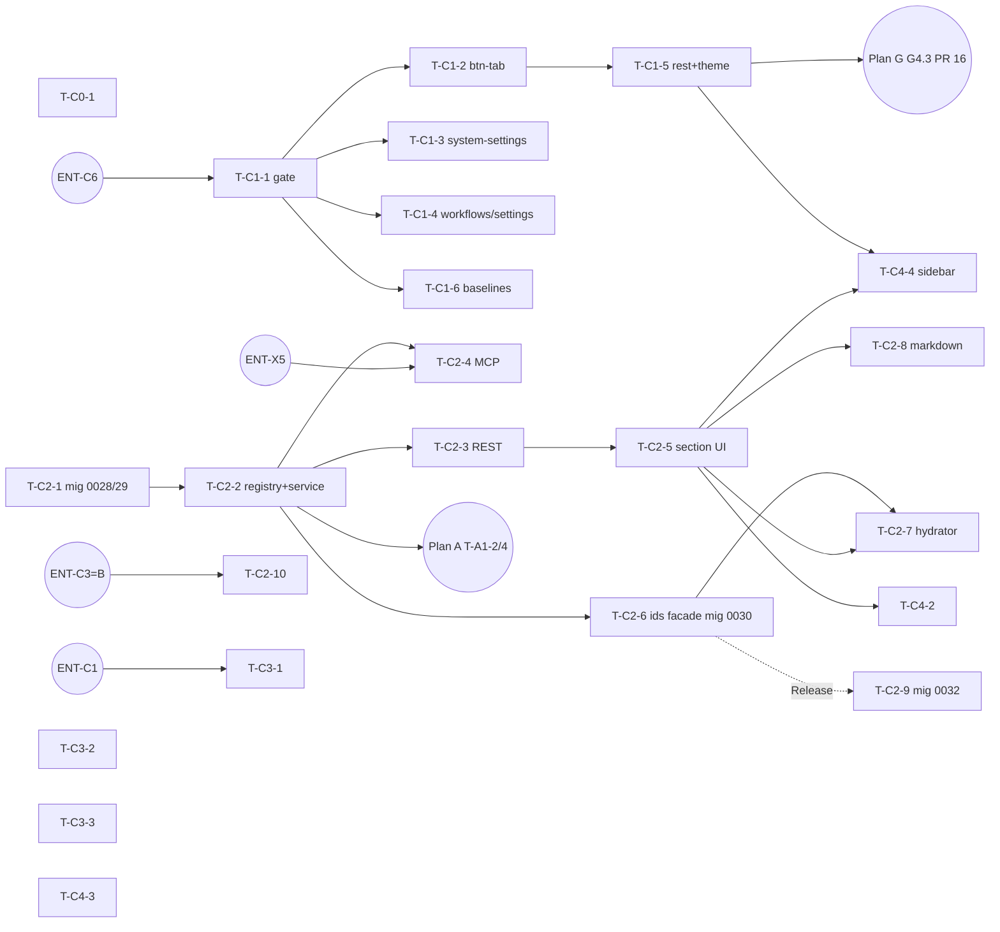

# Plan C — UI/UX

> **Reiner Umsetzungsplan.** Kein Code, keine Migration, kein ADR-Statuswechsel. Jede
> `datei:zeile`-Angabe ist gegen `origin/main @ b175c970` geprüft. Live-Messwerte tragen Check-IDs
> `C-L<nr>`: C-L1..C-L9 vom e2e-tester (`docs/test-reports/plan-review-2026-10-21/plan-c/ui-live-checks.md`,
> Screenshots im selben Ordner), C-L10..C-L21 eigene lesende API-/Code-Checks
> (`.../plan-c/live-checks.md`, `.../plan-c/c1-button-geometry-scan.txt`).
> Review-Befunde sind **direkt in den Tasks korrigiert**; §12 verweist je Befund auf die Task-ID.
> **Belege:** Alles unter `docs/test-reports/` ist gitignored (`.gitignore:91`); DoD-Nachweise stehen im
> PR-Text bzw. als CI-Artefakt (vorläufig, ENT-X3 = C). Nach ENT-X3 = B gehen neue DoD-Artefakte nach
> `docs/se/reports/` bzw. `docs/reviews/` (Index §f.6). QS-Adressen in Verifikationsbefehlen nur als `$QS_URL`.
> **Vorrang:** Planbasis > [Plan-Index](2026-10-21-backlog-umsetzung-index.md) > dieser Plan. Offene
> Nutzerentscheidungen heißen `ENT-*` ([Entscheidungsliste](2026-10-21-entscheidungen-offen.md));
> Stellen mit „vorläufig, ENT-…“ tragen deren Empfehlung bis zur Entscheidung.

| Feld | Wert |
|---|---|
| **Basis** | Planbasis `docs/superpowers/specs/2026-10-21-backlog-umsetzungsplaene-design.md` §1 Q1, §2 Plan C, §4 O2/O3 |
| **Issues** | #598 (W4a), #1258, #186, #1094, #1287, #1257 (CLOSED 2026-10-15, PR #1331), #801, #946, #85; Übergaben aus Plan G: #1379 (G4.4), #1405 R1-04 |
| **Besitz** | Plan C/WP C2 **besitzt Q1** (generischer 3-Ebenen-Präferenzdienst). Plan A (T-A1-4) registriert nur seine Schlüssel `memory.enabled`, `memory.disabled_slots`, `memory.allow_user_opt_out` (vorläufig, ENT-A5 = A). |
| **Nicht-Teil** | G4.1–G4.3 (spezifiziert Plan G, hier nur referenziert = C4), BluePencil-Hub/-Dialoge (Plan D/D1), Memory-Schalter-UI (Plan A/T-A1-7) |
| **Migrationen** | siehe [Plan-Index §e](2026-10-21-backlog-umsetzung-index.md#e-konsolidierte-migrationsvergabe-bindend) und §14. Dieser Plan legt an: `auth_tenancy` · `0028_preferencevalue`, `0029_preferencevalue_rls` (T-C2-1) · `0030_backfill_show_readable_ids` (T-C2-6) · `0032_drop_userdisplaypreference_show_readable_ids` (T-C2-9, contract). Keine `persistence`-Migration. |

---

## 1. Ziel und Nicht-Ziele (i)

**Ziel**

1. **C0:** Der Top-Level-Fehlerrahmen zeigt nie mehr eine rohe `error.message`, sondern eine neutrale Meldung plus Referenz-ID, die auch in der Konsole steht (#598 W4a).
2. **C1:** Je Route höchstens **3 Button-Höhen** (32/36/44 px = `--btn-h-sm/md/lg`) und **2 Radien** (`--radius-btn`, `--radius-full`); Icon-Buttons haben die eigene Höhe `--btn-h-xs: 24px` (WCAG 2.5.8) und zählen nicht zu den 3 Höhen (vorläufig, ENT-C6 = B). Die Messung wird zum Gate: statischer Ratchet-Check plus E2E-Gate je Route. Deckel werden nur gesenkt (#1258, Rest von #186, #1405 R1-04).
3. **C2:** Ein serverseitiger, generischer Präferenzdienst **Q1** mit Ebenen global → Workspace → User, Schlüsselregister, REST und MCP. Verbraucher: lesbare IDs (#1094-Rest: Workspace-/Global-Ebene und Laden beim App-Start), Markdown-Toolbar (#1287), Sidebar-Gruppen (C4), Memory-Schlüssel (Plan A).
4. **C3:** Inspector-Rest aus #801: TestCase bekommt die Trace-Link-Liste wie alle anderen Detailrouten, Diff-/Versions-Panel vollständig übersetzt, unbeschrifteter Button im Glossar-Inspector behoben.
5. **C4:** A11y-/i18n-Reste aus C-L6/C-L9 (Sidebar 1366×768, Profil-Typnamen, /reviews-Leerzustand) und Abschluss #1379; G4.1–G4.3 laufen unter Plan G.

**Nicht-Ziele**

- Keine Migration von `TreeDisplayConfig`/`create_form_json` (#1257/#1263) in Q1 (vorläufig, ENT-C2 = A: nicht migrieren).
- Kein Umbau von `users/me/preferences/` (workspace-gebunden, `optional_artifact_visibility`) und `users/me/notification-preferences/` (geschlossenes Vokabular, nicht tenant-gebunden) — beide bleiben (O3, §2.3; vorläufig, ENT-C5 = A).
- Kein Client-Fehler-Logendpunkt für C0 (die Referenz korreliert nur Screenshot ↔ Browser-Konsole; `ponytail:` Upgrade-Pfad = Endpoint, wenn Support Server-Korrelation braucht).
- Kein Trace-Widget **im** Inspector, solange ENT-C1 nicht anders entschieden ist.
- Keine Änderung am BluePencil-Layer (#946 → Plan D/D1).

---

## 2. Entscheidungen (ii)

### 2.1 Planbasis, unverändert zitiert

> **Q1** Ein generischer **3-Ebenen-Präferenzdienst** (global → Workspace → User, serverseitig, REST+MCP) — Nutzer: #1094 IDs, #1287 Markdown-Toolbar, #1257 Nav-Baum, A1 Memory-Schalter

> | C0 | `ErrorBoundary` rendert `error.message` roh (Sicherheitsbefund W4a) → neutrale Meldung + Referenz-ID | #598 |
> | C1 | Button-Standard: ≤3 Höhen, ≤2 Radien je Route (QS: 19 Höhen, 7 Radien), Ratchet-Deckel senken | #1258, #186 |
> | C2 | Präferenzdienst Q1 + Verbraucher: IdChip-Sichtbarkeit serverseitig, Markdown-Toolbar (`MarkdownField`-Wrapper), Nav-Baum | #1094, #1287, #1257 |
> | C3 | Inspector (Version/History/Diff) für ADR, Risk, Issue, TestCase, Need, Glossary + Trace-Links-Widget | #801 |
> | C4 | Formular-/A11y-Härtung aus Plan G4 | siehe G |
>
> Schließen/umformulieren: #186 neu schneiden (Epic abgearbeitet), #946 durch BluePencil ersetzt (Rest nur falls BluePencil zentrale Löschung/Audit nicht kann), #85 veraltet, #1094 Rest über C2.

> **O2:** Ob BluePencil zentrale Löschung, Audit-Log und RBAC (F9–F11 aus #946) abdeckt, ist ungeprüft.
> **O3:** Wirkung des Präferenzdienstes Q1 auf bestehende Endpunkte (`users/me/preferences/` ist workspace-scoped, `notification-preferences` hat geschlossenes Vokabular) — Migrationspfad klären.

Reihenfolge laut Planbasis: C0 = Welle 0, Q1 und C1 = Welle 1, C2/C3 = Welle 2 (C4 mit G4 in Welle 2).

### 2.2 Entscheidungs-Konflikte (nicht umgebogen, siehe §11)

- **K-1 (C3 vs. REQ-L2-RF-037):** Planbasis fordert ein „Trace-Links-Widget" im Inspector. Der Code blendet es bewusst aus, weil Trace-Links in `<TraceSpine>` + `<TraceLinkPanel>` des Detailbereichs leben („Eine Fläche, eine Aufgabe", `RightSidebar.tsx:48-56`). → **ENT-C1**.
- **K-2 (Q1 vs. #1257):** Planbasis nennt #1257 als Q1-Verbraucher. #1257 ist bereits mit eigenem 3-Ebenen-Store gebaut und geschlossen (C-L13). → **ENT-C2**.

### 2.3 Antwort auf O2 (Fakten) und O3 (Entscheidung ENT-C5)

- **O2:** BluePencil-Sidecar (`origin/main:deploy/bluepencil/server.js`) kann zentrale Löschung (F9): `POST /notes/bulk-delete` mit `ids` **oder** `filter` (inkl. `session`) und Pflicht `confirm:true` (`:1642`, `:1647`). Historie als `journal.jsonl` (`:1760`, `op` + `removed`), **nicht** in der Audit-App (F11 teilweise). RBAC (F10), Tenant-Trennung (N4) und Retention fehlen **by design** (QS-only, `docs/bluepencil-integration.md:32-35`). → C-L21, **ENT-C4**.
- **O3 (vorläufige Empfehlung, ENT-C5 = A; Planbasis O3 verlangt eine Klärung, daher Nutzerentscheidung):** Q1 übernimmt **nur** `show_readable_ids` aus `users/me/display-preferences/` (Fassade, Antwortform unverändert, T-C2-6). `visible_metrics`, `users/me/preferences/` (User×Workspace) und `notification-preferences` (tenantlos, 4 Arten) bleiben eigene Stores: andere Ebene bzw. andere Semantik; eine Migration brächte nur Churn.

---

## 3. Ist-Stand (iii, verifiziert)

### 3.1 C0 — ErrorBoundary
- `frontend/src/components/NavigationShell/ErrorBoundary.tsx:75-77` rendert `{this.state.error?.message ?? unknownErrorLabel}`; `:47` loggt nach `console.error`. Ausgeliefert im QS-Bundle (C-L10). Kein `ErrorBoundary.test.tsx`.
- Einbindung `NavigationShell.tsx:151-156` (Props `errorTitle`, `reloadLabel`, `backLabel`, `unknownErrorLabel`).
- `crypto.randomUUID` fehlt auf HTTP-Origins wie der QS; die Codebasis hat drei eigene Fallbacks (`CsvImport.tsx:93-110`, `canvas-geometry.ts:20-24`, `DiagramGraphEditorPage.tsx:54`).
- #598 W2/W3 sind erledigt: `MetricsDashboard.tsx:204-209` nutzt `var(--color-metric-*)`, `:663` `t("metrics.help.…")`. Mit C0 ist #598 vollständig.

### 3.2 C1 — Buttons
- Tokens existieren: `styles/tokens.css:822-825` (`--btn-h-sm 32px`, `--btn-h-md 36px`, `--btn-h-lg 44px`, `--radius-btn: var(--radius-sm)` = 6 px); `--radius-md` 12 px, `--radius-full` 9999 px (`:803-806`).
- `.btn-*` nutzt die Tokens (`global.css:103-116`), **aber** `.btn-tab` nutzt `--radius-md` und keine Höhe (`global.css:278-297`) → 27 px / 12 px auf fast jeder Route (C-L1).
- Live je Route (C-L1): `/requirements` 3 Höhen/3 Radien, `/system-settings` 4/4, `/settings` 4/6, `/workflows` 6/3, `/` 4/4. Ziel verfehlt auf 4 von 5.
- Statisch (C-L19): 78 Button-CSS-Regeln in 39 Dateien weichen von den Tokens ab; Spitzen `WorkflowEditor.module.css` (8), `DiagramGraphEditor.module.css` (5).
- Ratchet: `design-system-ratchet.baseline.json` `button-missing-design-system-class` `maxViolations: 18`, **alle 18** in `components/SystemSettings/*`. `ui-ratchet.test.ts:747` `STYLE_BRACE_BASELINE = 3` misst nur Inline-Styles. **Geometrie wird nirgends gemessen.**
- E2E-Gate-Rahmen existiert: `e2e/tests/ui-konzept-gates.spec.ts` (Routentabelle `:59-84`, h1 + Scrollcontainer).
- Theme-Toggle (C-L9/C-L20): `SidebarNavigation.tsx:835-839` `btn-ghost ${styles.footerBtn}`; `global.css` `.btn-ghost:hover:not(:disabled)` (`--color-surface-raised`, im Hell-Theme weiß) schlägt `.footerBtn:hover` (`SidebarNavigation.module.css:653-656`) per Spezifität.
- #1405 R1-04: „Neue Baseline" nur im Overflow (`BaselinesView.tsx:353-359`, bewusst laut Kommentar `:335-339`); E2E nutzen den Overflow-Pfad (`waterkettle-scenario.spec.ts:439-440`, `stakeholder-needs.spec.ts:183-198`, `waterkettle-fullblown.spec.ts:746`).

### 3.3 C2 — Präferenzen
- Sechs Präferenzstores (C-L12). Bereits 3-stufig: `TreeDisplayConfig` (`auth_tenancy/models.py:591-676`, global/workspace) + `UserDisplayPreference.tree_display_fields` / `create_form_fields` (`:558`, `:566`); Service `application/tree_display_config_service.py`.
- Lesbare IDs: `UserDisplayPreference.show_readable_ids` (`models.py:547`), Service `application/display_preference_service.py:36,74,94`, Route `rest_api/urls.py:494`. **Nur User-Ebene** (C-L14).
- Frontend lädt den Serverwert **nur auf `/profile`**: einziger Leser `IdentifiersSection.tsx:68-90`; `useReadableIdsVisible.ts` ist localStorage-Store. Ein neues Gerät zeigt den Default, bis `/profile` besucht wird, obwohl die UI „gilt auf allen Geräten" zusagt (C-L4).
- Kein generischer Dienst (C-L11: `/api/v1/preferences/` 404).
- Workspace-Ebene der Baum-Konfig ist mit **WRITE** (Editor) schreibbar (`tree_display_config_service.py:299`), Global mit `ROLE_ADMIN` (`:317`); MCP `tree_display_config` liegt nicht in `_GOVERNANCE_TOOL_NAMESPACES` (`tool_registry.py:651-668`), REST-Global hat `AdminScopeRequiredMixin`.
- JSON-Dokument je Ebene mit Read-Modify-Write ohne Sperre (`tree_display_config_service.py:285-330`): parallele Schreiber verschiedener Item-Typen können sich überschreiben.
- Markdown: genau **ein** Editor `RequirementEditors/MarkdownPreview.tsx` (351 Z., Textarea-Ref `:81`, Einfüge-Logik `:194-235`, Bearbeiten/Vorschau `:267-280`); einziger Aufrufer `shared/ArtifactForm/widgets/MarkdownTabGroup.tsx:60`. Keine Format-Toolbar (C-L5).
- Sidebar: 5 Gruppen (`SidebarNavigation.tsx:40-65`), 27 Links, bei 1366×768 nur 11 sichtbar (C-L6).

### 3.4 C3 — Inspector
- Version + Diff sind auf allen 7 Routen vorhanden (C-L2) → Planbasis-Annahme widerlegt.
- `hideTraceLinks` auf Requirement, Need, Risk, ADR, Issue, TestCase, Architecture, Goals (`RightSidebar.tsx:56,355,458`), weil Trace-Links im Detailbereich leben: Risk/ADR/Issue/Need haben `<TraceLinkPanel>` (`RiskEditors.tsx:210`, `AdrEditors.tsx:352`, `IssueEditors.tsx:212`, `NeedsEditors.tsx:566`), Requirement `ReqTraceLinkPanel`. **TestCase hat nur `<TraceSpine>`** (`TestCaseEditors.tsx:306`) — keine Liste mit Link-Typ/Outdated (C-L16, TC-001 hat einen `verifies`-Link).
- Englisch in DE-UI (C-L9): `ArtifactDiff.tsx:64-77` `ENTITY_LABELS`, `:186-191` `STATUS_LABELS`, `:475` `… Diff`, `:482` `Close`, `:492` `From:`, `:512` `To:`; Backend-Label `application/artifact_diff_service.py:231` `"Creation baseline"` (mit additivem `is_creation_baseline`).
- Unbeschrifteter Button im Glossar-Inspector (C-L9): einzige Route mit sichtbarem `TracePanel`; Kandidat `TracePanel.tsx:342-352` (Zeilenbutton ohne Text, wenn `chipLabel` und `title` leer). Ursache lesend nicht bestimmbar.

### 3.5 C4 — Rest
- Profil: `UserProfileSettings.tsx:27-34` `VISIBILITY_LABELS` hart Englisch.
- `/reviews`: `ReviewsView.tsx:1065-1068` `reviews.selectPrompt` typfest „Anforderung…"; Typlabels existieren als `reviews.type.<type>` (`:789`).
- #1379 nicht reproduzierbar (C-L7), Plan G G4.4 übergibt den Abschluss an C4.

### 3.6 Issues-Status
- #186: alle 18 Kinder CLOSED (Kommentar 2026-09-18); Rest = Button-Konsolidierung = C1/#1258.
- #85: Punkte 1/3/4/6 laut Kommentar erledigt; Punkte 5/7 jetzt widerlegt (C-L17, C-L18).
- #946: Spezifikation nie gebaut; Fähigkeit über BluePencil (C-L21).
- #1257: CLOSED (PR #1331, C-L13).

---

## 4. Arbeitspakete (iv)

Konventionen: **BT** `<pfade>` = Backend-Testmakro aus [Plan-Index §f.3](2026-10-21-backlog-umsetzung-index.md#f3-lokale-testbefehle-und-passwort-variable-qr-t23) (Superuser `DB_USER=reqogniloom`, Passwort `DBPW` aus der Env-Datei des laufenden Stacks), `<pfade>` relativ zu `backend/` → erwartet letzte Zeile `N passed` ohne `failed`/`error`. **FT** `<pfad>` = `docker exec reqogniloom-frontend-1 sh -c 'cd /app && npx vitest run <pfad>'` → `Tests  N passed`. **E2E** nur gezielt: `cd e2e && npx playwright test <spec> [--grep …]` (voller Lauf nur nach Nutzerfreigabe). Lint/Typen: `npm run lint` und `npx tsc --noEmit -p tsconfig.json` in `frontend/` → Exit 0. CI-Checks nur aus Index §f.2 (`lint` = nur Frontend-ESLint).

**Gemeinsame DoD-Zeilen (gelten für jede Task, auf die sie zutreffen):**
- **Neue Liste/Route mit Mehrfachergebnis:** deterministisch sortiert (`order_by` mit eindeutigem Tiebreaker bzw. Sortierung nach Schlüssel); nach Plan G PR 6 macht `UnorderedObjectListWarning` den Test rot (KA-ALL-10).
- **Neue REST-View/Schemaänderung:** `serializer_class` oder `@extend_schema`; der PR aktualisiert `backend/rest_api/tests/openapi_warning_baseline.json` (entsteht mit Plan E P1-7; nur Shrink); Merge seriell (Index §d.2, §f.5).
- **MCP-Tool neu/geändert:** `python manage.py export_tool_manifest`; Zahl in `README.md`, `docs/api/MCP-SURFACE.md`, `clients/registry.yaml` angleichen, `python3 scripts/clients/render.py` (erzeugt `docs/clients/antigravity(.de).md`); `.meta-config/project.yaml` über `agent-meta-manager`; `pytest docs/agent-templates dist -q` und `BT mcp_server/tests/test_tool_manifest_drift.py` grün; Merge über die globale Tool-Queue (Index §d.2, §f.1). Nur Deltas nennen, Tests prüfen Mengen-Zugehörigkeit.
- **Migration:** Name + Index §e; Nummer = höchste der App auf `main` + 1 beim Merge; Rollback und Tests nennen Migrations**namen** (`migrate <app> <name-der-vorgänger-migration>`, `MigrationExecutor` mit Namen bzw. `loader.graph.leaf_nodes()`); `CreateModel` + RLS-Policy im selben PR, `persistence/tests/test_rls_coverage.py` Pflicht.

### WP C0 — ErrorBoundary ohne Leck (#598 W4a) · Welle 0

#### T-C0-1 Neutrale Meldung plus Referenz
- **Rolle:** developer
- **Dateien:** ändern `frontend/src/components/NavigationShell/ErrorBoundary.tsx`, `ErrorBoundary.module.css`, `NavigationShell.tsx:151-156`, `i18n/locales/{de,en}.json`; neu `frontend/src/components/NavigationShell/ErrorBoundary.test.tsx`.
- **Schnittstelle:**
  ```ts
  interface ErrorBoundaryProps {
    children: ReactNode;
    reloadLabel?: string; backLabel?: string; errorTitle?: string;
    hintLabel?: string;        // replaces unknownErrorLabel (removed)
    referenceLabel?: string;   // "Referenz" / "Reference"
  }
  interface ErrorBoundaryState { hasError: boolean; referenceId?: string }  // error object no longer kept in state
  ```
  `getDerivedStateFromError()` erzeugt `referenceId = Date.now().toString(36) + "-" + Math.random().toString(36).slice(2, 8)` (kein `crypto.randomUUID`, fehlt auf HTTP-Origins, §3.1). `componentDidCatch` loggt `console.error("[ErrorBoundary] Unhandled error", { referenceId }, error, errorInfo)`. Render: `<h2>{errorTitle}</h2><p>{hintLabel}</p><p data-testid="error-reference">{referenceLabel}: <code>{referenceId}</code></p>`, Buttons unverändert (`error-reload-btn`, `error-back-btn`).
- **i18n:** `errors.boundaryHint` DE „Bitte laden Sie die Seite neu. Bleibt der Fehler, nennen Sie dem Support die Referenz.“ / EN „Please reload the page. If the error persists, give support the reference.“; `errors.reference` DE „Referenz“ / EN „Reference“. `errors.unknown` bleibt (Parität, keine Löschung nötig).
- **TDD (zuerst rot):** `ErrorBoundary.test.tsx`: (1) ein Kind wirft `new Error("FATAL: password authentication failed for user reqogniloom at 10.0.0.5")` → `screen.queryByText(/password|10\.0\.0\.5/)` ist `null`; (2) `error-reference` hat Text `/^Referenz: [a-z0-9]+-[a-z0-9]{6}$/` mit DE-i18n; (3) `console.error` wurde mit einem Objekt aufgerufen, dessen `referenceId` dem angezeigten Wert gleicht; (4) Back-Button setzt `hasError` zurück. Echtes Rendering mit `@testing-library/react`, kein Mock der Komponente.
- **DoD:** Tests grün; `grep -n "error?.message" frontend/src/components/NavigationShell/ErrorBoundary.tsx` → keine Ausgabe; i18n-Parität grün.
- **Verifikation:** `FT src/components/NavigationShell/ErrorBoundary.test.tsx src/test/i18n-parity.test.ts` → `Tests  … passed`. Nach Deploy lesend: Bundle-Grep wie C-L10 findet `error?.message` im ErrorBoundary-Render nicht mehr.

### WP C1 — Button-Standard (#1258, #186-Rest, #1405 R1-04) · Welle 1

#### T-C1-1 Messung wird Gate (statisch + E2E)
- **Rolle:** senior-developer (Ratchet-Framework), tester (E2E); Geometrie-Standard (ENT-C6) von `design-system-architect`/`ui-ux-designer` vorbereitet, Nutzer bestätigt
- **Eintritt:** ENT-C6 entschieden (Index §b, „vor PR-C2“). Bis dahin gilt die Empfehlung B als **vorläufige** Fassung dieser Task (vorläufig, ENT-C6 = B); PR-C2 merged erst nach Entscheidung.
- **Dateien:** ändern `frontend/src/test/design-system-ratchet.test.ts` (neuer Check), `design-system-ratchet.baseline.json`; ändern `e2e/tests/ui-konzept-gates.spec.ts` (dritter Gate-Block).
- **Höhenskala (vorläufig, ENT-C6 = B):** `--btn-h-xs: 24px` (Icon-Buttons, Trefferfläche WCAG 2.5.8; Token selbst kommt mit T-C1-2), `--btn-h-sm/md/lg`. Plan G G4.3 nutzt `--btn-h-xs`; `--target-min` ist dort nur Alias darauf (KA-G-05).
- **Statischer Check `button-geometry-off-token`:** Scanner über `src/**/*.css`, Selektor-Regex `(btn|button|Button|tab\b|Tab\b|toggle|Toggle|chip|Chip|pill|Pill|segment|Segment)` ohne Pseudoklassen-Varianten; Verstoß = `border-radius` ∉ {`var(--radius-btn)`, `var(--radius-full)`} **oder** `height`/`min-height` ∉ `var(--btn-h-*)` (inkl. `--btn-h-xs`). Fingerprint `button-geometry-off-token::<datei>::<selektor>`. Baseline = gemessener Stand beim Merge (Referenz C-L19: 78); `known` listet jeden Fingerprint, `note`: „Fix by using --btn-h-sm/md/lg and --radius-btn/--radius-full; never raise this ceiling.“ `issue: "#1258"`.
- **E2E-Gate:** je Route aus `ROUTES` (`:59-84`) Test `[C1] <label>: ≤3 button heights, ≤2 radii` — gezählt werden Höhen **ohne Icon-Buttons** (gerundete Höhe 24 px = `--btn-h-xs` zählt gesondert und nicht gegen die 3; vorläufig, ENT-C6 = B). Messung über `button, [role="button"]`, sichtbar (`offsetWidth>0`), **ausgenommen** Elemente innerhalb `[data-testid="workflow-canvas"]`, `.react-flow`, `[data-testid^="diagram-canvas"]` und Rows mit `role="button"` in `[data-testid$="-tree"]` (Begründung im Spec-Kommentar: Canvas-Knoten/Baumzeilen sind keine Buttons im Sinne des Standards). Höhen auf ganze px gerundet; Radius aus `border-top-left-radius`.
- **TDD:** Der neue Check muss mit Baseline 0 **rot** sein (zeigt die 78 Fingerprints), danach Rebaseline mit `DESIGN_SYSTEM_REBASELINE=1`. E2E-Gate darf beim Einführen rot sein; es wird mit `test.fixme` für Routen markiert, die noch über dem Ziel liegen, und die Liste schrumpft mit jedem C1-PR (Ratchet in E2E-Form, Liste `C1_PENDING_ROUTES`).
- **Konfliktdatei:** `frontend/src/test/design-system-ratchet.baseline.json` (gilt für T-C1-1 … T-C1-6): Entwicklung parallel, **Merge seriell PR-C2 → PR-C5 → PR-C12 → PR-C13; danach Plan G PR 16** (Index §d.2, QR-T21). Deckel nur senken.
- **DoD:** `FT src/test/design-system-ratchet.test.ts` grün; `cd e2e && npx playwright test tests/ui-konzept-gates.spec.ts --grep "\[C1\]"` → alle nicht-`fixme`-Routen passed; ein Icon-Button mit `height: var(--btn-h-xs)` erzeugt **keinen** Verstoß (Testfall im Ratchet-Test).

#### T-C1-2 Token-Lücken schließen (global)
- **Rolle:** developer
- **Dateien:** `frontend/src/styles/global.css` (`.btn-tab` `:278-297`), `styles/tokens.css` (neues Token neben `--btn-h-sm` `:822`).
- **Änderung:** `.btn-tab` bekommt `min-height: var(--btn-h-sm)`, `:first-child`/`:last-child` nutzen `var(--radius-btn)` statt `--radius-md`. Einziges neues Token: `--btn-h-xs: 24px` (vorläufig, ENT-C6 = B; bei ENT-C6 = A entfällt es und Icon-Buttons nutzen `var(--target-min)` aus Plan G; bei C kein Token).
- **TDD:** `src/test/design-tokens.test.ts` um Fälle „`.btn-tab` liest `--btn-h-sm` und `--radius-btn`" und „`--btn-h-xs` ist `24px`" erweitern (CSS-Textprüfung wie bestehende Fälle) → zuerst rot.
- **Konfliktdatei:** Ratchet-Baseline (Queue siehe T-C1-1), `tokens.css`/`global.css` (C1 vor Plan G G4.3).
- **DoD:** Ratchet-Deckel `button-geometry-off-token` −2; Sichtprüfung Markdown-Bearbeiten/Vorschau (C-L5-Screenshot als Vergleich).

#### T-C1-3 `/system-settings` auf 0 bekannte Verstöße
- **Rolle:** developer
- **Dateien:** die 7 Dateien aus `button-missing-design-system-class.known` (`SystemSettings/{BannerSection,EnforcementFlipDialog,EnforcementModePanel,MemoryManagementSection,MemoryVisualizationSection,MismatchReviewTable,SystemSettings,WorkspaceAdminSection}.tsx` und deren `.module.css`).
- **Änderung:** Tabs → `btn-tab`; Pager/Scope-/View-Umschalter → `btn-secondary btn-sm`; Lösch-/Schließen-Aktionen → `btn-danger`; ad-hoc Füllungen in den CSS-Modulen löschen. `data-testid` bleiben unverändert.
- **TDD:** Baseline `button-missing-design-system-class.maxViolations` auf **0** setzen → Test rot, bis alle 18 behoben.
- **DoD:** `maxViolations: 0`, `known: []`; E2E-Gate `/system-settings` aus `C1_PENDING_ROUTES` entfernt.

#### T-C1-4 `/workflows`, `/settings`, `/` (Streuungs-Spitzen)
- **Rolle:** developer
- **Dateien:** `WorkflowEditor/WorkflowEditor.module.css` (8 Regeln laut C-L19: `.toolbarButton` `height:32px` → `--btn-h-sm`, `.iconButton/.editActionButton` → `--radius-btn`, `.initializeButton/.btnPrimary/.btnGhost` `--radius-md` → `--radius-btn`; `.toggleTrack/.toggleThumb` sind Schalter → als `exemptions` mit Grund „switch track, not a button" eintragen), `WorkspaceSettings/*.module.css` (C-L19-Liste), `DashboardViews/*.module.css`.
- **DoD:** Deckel gesenkt um die Zahl behobener Fingerprints; E2E-Gate für `/workflows`, `/settings`, `/` grün und aus `C1_PENDING_ROUTES` entfernt.

#### T-C1-5 Restliche Module und Theme-Toggle
- **Rolle:** junior-developer (mechanisch, je PR ≤ 10 Dateien)
- **Dateien:** übrige Einträge der Scan-Liste (`c1-button-geometry-scan.txt`), insbesondere `SidebarNavigation.module.css` (`.burgerButton` `height:40px` → `--btn-h-md`, `.optionalToggleBtn/.switcherToggleBtn` → `--radius-btn`, `.footerBtn` `:642` → `--radius-btn`).
- **Theme-Toggle-Fix (C-L20):** `.footerBtn:hover:not(:disabled), .footerBtnActive { background: var(--color-nav-hover-bg); color: var(--color-nav-text); }` — gleiche Spezifität wie die `.btn-ghost`-Hover-Regel, Modul-CSS lädt danach.
- **TDD:** `src/test/sidebar-theme-agnostic-overlays.test.ts` um Prüfung „`.footerBtn` überschreibt `:hover:not(:disabled)`" erweitern → zuerst rot.
- **DoD:** `button-geometry-off-token.maxViolations` = Anzahl begründeter `exemptions` + 0 offene; `C1_PENDING_ROUTES` leer.

#### T-C1-6 „Neue Baseline" sichtbar (#1405 R1-04)
- **Rolle:** developer
- **Dateien:** `frontend/src/components/BaselinesView/BaselinesView.tsx:340-360` (Aktion von `overflowActions` nach `secondaryActions`, `testId` bleibt `create-baseline-btn`, Kommentar `:335-339` anpassen: sichtbar, aber nicht primär); E2E `waterkettle-scenario.spec.ts:439-440`, `stakeholder-needs.spec.ts:183-198`, `waterkettle-fullblown.spec.ts:746` (Overflow-Klick entfällt).
- **TDD:** neuer Fall in vorhandenem `BaselinesView`-Test (oder neu `src/components/BaselinesView/BaselinesView.header.test.tsx`): `getByTestId("create-baseline-btn")` ist ohne Öffnen des Overflow-Menüs sichtbar.
- **DoD:** gezielte E2E `npx playwright test tests/stakeholder-needs.spec.ts tests/waterkettle-scenario.spec.ts` passed.

### WP C2 — Präferenzdienst Q1 und Verbraucher (#1094, #1287) · Q1 Welle 1, Verbraucher Welle 2

#### Q1-Spezifikation (Besitz Plan C)

**Datenmodell** (`backend/auth_tenancy/models.py`, neben `TreeDisplayConfig`):
```python
PREFERENCE_SCOPE_GLOBAL = "global"; PREFERENCE_SCOPE_WORKSPACE = "workspace"; PREFERENCE_SCOPE_USER = "user"

class PreferenceValue(TenantScopedModel):
    """One stored value of one registered preference key on one level (Q1)."""
    scope = models.CharField(max_length=16, choices=...)
    workspace = models.ForeignKey("persistence.Workspace", null=True, blank=True, on_delete=models.CASCADE, related_name="preference_values")
    user = models.ForeignKey("persistence.User", null=True, blank=True, on_delete=models.CASCADE, related_name="preference_values")
    key = models.CharField(max_length=128)
    value = models.JSONField()
    class Meta:
        db_table = "at_preference_value"
        constraints = [
            UniqueConstraint(fields=["tenant", "key"], condition=Q(scope="global"), name="uq_prefval_global"),
            UniqueConstraint(fields=["tenant", "workspace", "key"], condition=Q(scope="workspace"), name="uq_prefval_workspace"),
            UniqueConstraint(fields=["tenant", "user", "key"], condition=Q(scope="user"), name="uq_prefval_user"),
            CheckConstraint(condition=Q(scope="global", workspace__isnull=True, user__isnull=True)
                                     | Q(scope="workspace", workspace__isnull=False, user__isnull=True)
                                     | Q(scope="user", workspace__isnull=True, user__isnull=False),
                            name="ck_prefval_scope_target"),
        ]
        indexes = [Index(fields=["tenant", "key"], name="idx_prefval_tenant_key")]
```
Eine Zeile je Schlüssel und Ebene (statt JSON-Dokument je Ebene wie bei `TreeDisplayConfig`): Schreiben ist ein Upsert auf einen Unique-Index, parallele Schreiber verschiedener Schlüssel überschreiben sich nicht (Befund R7). „Keine Zeile" = „geerbt", nie „leer". User-Ebene ist **kontoweit je Tenant** (nicht je Workspace) — so wirkt der Memory-Schalter auf alle Aktivitäten des Nutzers (Plan A).

**Schlüsselregister** (`backend/application/preference_registry.py`, Code, kein DB-Katalog):
```python
ValueType = Literal["bool", "enum", "str_list"]
Mode = Literal["override", "union"]
@dataclass(frozen=True)
class PreferenceKey:
    key: str                                   # "<namespace>.<name>", [a-z0-9_.]{3,128}
    value_type: ValueType
    default: Any
    levels: frozenset[str]                     # subset of {"global","workspace","user"}
    mode: Mode = "override"
    choices: tuple[str, ...] | None = None     # enum values / allowed list items
    validator: Callable[[Any], None] | None = None   # raises persistence.errors.ValidationError
    ui_editor: Literal["checkbox", "select"] | None = None  # None = not rendered by the generic section
    owner: str = ""                            # plan/WP for docs, e.g. "C2", "A1"
def register_preference_key(spec: PreferenceKey) -> None   # duplicate key -> ImproperlyConfigured
def get_preference_key(key: str) -> PreferenceKey           # unknown -> ValidationError
def all_preference_keys() -> tuple[PreferenceKey, ...]       # sorted by key
```
Registrierung in `AppConfig.ready()` der besitzenden App (Q1-Kernschlüssel in `auth_tenancy/apps.py`, Plan A in `memory/apps.py`).

**Auflösungsregel je Schlüssel:**
- `override`: erster gesetzter Wert in `user > workspace > global` (nur Ebenen aus `levels`), sonst `default`. `source` = Ebene bzw. `"default"`.
- `union` (Listen): Vereinigung aller gesetzten Ebenen plus `default`, Reihenfolge nach `choices` (sonst Einfügeordnung), ohne Duplikate. `source` = `"merged"`. Damit gilt „Minimum gewinnt" für Abschaltlisten (eine Ebene schaltet ab, keine schaltet wieder an).
- Kombinationen über **mehrere** Schlüssel/Stores (Plan A: `WorkspaceMemorySettings.enabled` × `memory.enabled`) rechnet der Verbraucher selbst über `levels_for()`; Q1 kennt keine schlüsselübergreifenden Regeln.

**Startregister (C2):**

| Schlüssel | Typ | Default | Ebenen | Modus | UI | Besitzer |
|---|---|---|---|---|---|---|
| `ui.ids.show_readable` | bool | `true` | global, workspace, user | override | checkbox | C2 (T-C2-6) |
| `ui.markdown.toolbar` | enum `auto\|on\|off` | `"auto"` | global, workspace, user | override | select | C2 (T-C2-8) |
| `ui.sidebar.collapsed_groups` | str_list ⊆ `overview,requirements,architecture,test,admin` | `[]` | user | override | – | C4 (T-C4-4) |
| `memory.enabled` | bool | `true` | user | override | – | Plan A T-A1-4 (registriert in `memory/apps.py`) |
| `memory.disabled_slots` | str_list (Validator gegen `MEMORY_CONSUMER_SLOTS`) | `[]` | global, workspace, user | union | – | Plan A T-A1-4 (registriert in `memory/apps.py`; vorläufig, ENT-A5 = A) |
| `memory.allow_user_opt_out` | bool | `true` | workspace | override | – | Plan A T-A1-4 (registriert in `memory/apps.py`; vorläufig, ENT-A5 = A) |

Memory-Zeilen (vorläufig, ENT-A5 = A): Die Workspace-Memory-Ebene liegt als Q1-Schlüssel vor; `WorkspaceMemorySettings` und `/memory/me/settings/` sind in Plan A nur Fassaden über `PreferenceService`. Bei ENT-A5 = B entfallen die Ebene `workspace` von `memory.disabled_slots` und der Schlüssel `memory.allow_user_opt_out` (Plan A hält sie dann als REST-only-Ausnahme). **Q1 erlaubt Schlüssel-Validatoren je Schlüssel** (Feld `validator`, Anforderung Plan A); `MEMORY_CONSUMER_SLOTS` liefert Plan A.

**Berechtigungen:**

| Ebene | Lesen | Schreiben |
|---|---|---|
| user | nur eigener Wert (`ctx.user_id` ist die Grenze) | jeder Authentifizierte für sich selbst |
| workspace | jedes Mitglied mit READ auf den Workspace | `Operation.WORKSPACE_CONFIG` (ADMIN-Tier, `auth_tenancy/services/authorization.py:116,128`) |
| global | jeder Authentifizierte des Tenants | `ROLE_ADMIN` + `AdminScopeRequiredMixin` (REST) bzw. `_GOVERNANCE_TOOL_NAMES` (MCP) |

Workspace- und Global-Schreibvorgänge erzeugen einen Audit-Eintrag `op="update"`, `entity_type="preference_value"`, `details={"scope","workspace_id","key","old","new"}` über `ServiceBase._audit` (keine Audit-Migration; kollidiert nicht mit Plan E `audit 0016`). User-Ebene: kein Audit (Selbstbedienung wie `display-preferences`).

**REST-Vertrag** (alle unter `/api/v1/`, Fehler-Envelope `build_error_response`):

```text
GET   preference-values/registry/                               -> 200 {"keys":[{"key","type","choices","default","levels","mode","ui_editor"}]}
GET   users/me/preference-values/effective/[?keys=a,b]          -> 200 {"workspace_id":null,"values":{"<key>":{"value":…,"source":"user|global|default|merged"}}}
GET   workspaces/{workspace_id}/preference-values/effective/[?keys=]  -> 200 same shape, workspace level included
GET   users/me/preference-values/                               -> 200 {"scope":"user","workspace_id":null,"values":{<only set keys>}}
PATCH users/me/preference-values/       {"values":{"ui.markdown.toolbar":"off","ui.ids.show_readable":null}}  -> 200 level after write
GET   workspaces/{workspace_id}/preference-values/              -> 200 {"scope":"workspace","workspace_id":"…","values":{…}}
PATCH workspaces/{workspace_id}/preference-values/              -> 200 | 403 PERMISSION_DENIED (no WORKSPACE_CONFIG)
GET   system/preference-values/                                 -> 200 {"scope":"global","workspace_id":null,"values":{…}}
PATCH system/preference-values/                                 -> 200 | 403 PERMISSION_DENIED (no admin / non-ADMIN-tier key)
```
- `null` als Wert = Zurücksetzen (Zeile löschen). Ein PATCH ist atomar (`transaction.atomic`): ein ungültiger Schlüssel → nichts wird geschrieben.
- 400 `VALIDATION_ERROR`, `details=[{"field":"values.<key>","errors":[…]}]` für: unbekannter Schlüssel, falscher Typ, Wert ∉ `choices`, Ebene nicht in `levels` („key 'memory.enabled' cannot be set at level 'workspace'"), Validator-Fehler, `values` fehlt oder kein Objekt, `keys`-Filter mit unbekanntem Schlüssel.
- 401 ohne Anmeldung; 404 für fremden/unbekannten Workspace (RLS + bestehende Workspace-Auflösung).
- Workspace-Views in `auth_tenancy/resource_scope.py` `_WORKSPACE_VIA_REQUEST` (wie `TreeDisplayConfigWorkspaceView`, `:301-306`), User/System/Registry in `_TENANT_SCOPED` (`:360-380`).

**MCP-Vertrag** (`backend/mcp_server/tools/preference.py`, Gruppe `preference`):

| Tool | Parameter | Wirkung | Gate |
|---|---|---|---|
| `preference.registry` | – | wie REST registry | read-exempt (`TENANT_SCOPED_READ_TOOLS`) |
| `preference.get` | `scope?: "effective"\|"user"\|"workspace"\|"global"` (Default `effective`), `workspace_id?`, `keys?: string[]` | wie REST GET | read-exempt; mit `workspace_id` narrowt der Dispatcher auf den Workspace (Muster `workspace_scope.py:363-370`) |
| `preference.set` | `values: object` | **nur** User-Ebene | WRITE-gated (Standard) |
| `preference.set_default` | `scope: "workspace"\|"global"`, `workspace_id?`, `values` | Workspace/Global | in `_GOVERNANCE_TOOL_NAMES` → ADMIN-Tier; Service prüft zusätzlich wie REST |

Die Trennung `set`/`set_default` vermeidet die bei `tree_display_config.set` vermutete Tier-Lücke (Befund R6). `export_tool_manifest` aktualisiert **nur** das Manifest `docs/agent-templates/tool-manifest.json`. `docs/api/MCP-SURFACE.md`, `README.md`, `clients/registry.yaml` (+ `python3 scripts/clients/render.py`) und `.meta-config/project.yaml` (über `agent-meta-manager`) werden nach der gemeinsamen MCP-DoD-Zeile (§4, KA-ALL-03) nachgezogen. **Delta: +4 Tools, +1 Präfix `preference`.**

**Service-Fassade** (`backend/application/preference_service.py`, Layer 2):
```python
class PreferenceService(ServiceBase):
    def effective(self, ctx: AuthContext, *, workspace_id: UUID | None = None, keys: list[str] | None = None) -> dict[str, Any]
    def get_level(self, ctx: AuthContext, *, scope: str, workspace_id: UUID | None = None) -> dict[str, Any]
    def set_level(self, ctx: AuthContext, *, scope: str, values: dict[str, Any], workspace_id: UUID | None = None) -> dict[str, Any]

# context-free entry points for non-request callers (Plan A injection policy, Celery):
@dataclass(frozen=True)
class PreferenceLevels:
    global_: Any; workspace: Any; user: Any      # each the stored value or UNSET
UNSET: Final = object()
def levels_for(*, tenant_id: UUID, workspace_id: UUID | None, user_id: UUID | None, key: str) -> PreferenceLevels
def resolve_for(*, tenant_id: UUID, workspace_id: UUID | None, user_id: UUID | None, key: str) -> tuple[Any, str]  # (value, source)
```
`levels_for`/`resolve_for` setzen den Tenant per Kontextmanager und stellen den vorherigen Wert im `finally` wieder her (auch bei Exception): vorher `TenantContext.is_set()` prüfen und ggf. den alten Wert merken, danach `TenantContext.set_tenant(<alt>)` bzw. `TenantContext.clear_tenant()` (`persistence/tenancy.py:52,83,92`; Index §f.8, QR-T26/QR-S14). Sie lesen in **einer** Query (`key=…` und `scope IN (…)`). Fehler (DB weg) werden **nicht** geschluckt — der Verbraucher entscheidet (Plan A: `policy_unavailable`, fail-safe).

**Frontend-Hook** (`frontend/src/api/preference-values.ts`, `frontend/src/queries/preferences.ts`):
```ts
export type PreferenceScope = "user" | "workspace" | "global";
export interface EffectivePreference { value: unknown; source: "user" | "workspace" | "global" | "default" | "merged" }
export const preferenceValuesApi = {
  registry(): Promise<{ keys: PreferenceKeySpec[] }>;
  effective(workspaceId?: string | null): Promise<{ workspace_id: string | null; values: Record<string, EffectivePreference> }>;
  getLevel(scope: PreferenceScope, workspaceId?: string): Promise<PreferenceLevel>;
  patchLevel(scope: PreferenceScope, values: Record<string, unknown | null>, workspaceId?: string): Promise<PreferenceLevel>;
};
export const preferenceKeys = { effective: (ws: string | null) => ["preferences", "effective", ws] as const, level: (s: PreferenceScope, ws?: string) => ["preferences", "level", s, ws ?? null] as const };
export function useEffectivePreferences(workspaceId: string | null): UseQueryResult<…>;   // staleTime 5 min
export function usePreferenceValue<T>(key: string, fallback: T): T;                       // fallback until loaded / on error
export function usePatchPreferenceLevel(scope: PreferenceScope, workspaceId?: string): UseMutationResult<…>; // invalidates "preferences"
```
Degradation: Laden fehlgeschlagen → `fallback` (= Registry-Default im Code), Render wird nie blockiert; Fehler zeigt nur die Einstellungsseite.

#### T-C2-1 Modell und Migrationen
- **Rolle:** database-engineer
- **Dateien:** `auth_tenancy/models.py` (Modell oben), neu `auth_tenancy/migrations/0028_preferencevalue.py` (CreateModel), `0029_preferencevalue_rls.py` (ENABLE+FORCE RLS + Policy `at_preference_value_tenant_isolation`, Form byte-gleich zu `0026_treedisplayconfig_rls.py`). Namen/Nummern laut Index §e.
- **Migrationsregel:** `0028` hängt an `0027_create_form_config`; Plan E/E3 folgt in Welle 3 mit `0031_user_mfa` (Index §e). Nummer = höchste `auth_tenancy`-Nummer auf `main` + 1 beim Merge; weicht sie ab, nimmt der PR max+1 und aktualisiert Index §e im selben PR (Befund R15).
- **Rollback:** Revert + `python manage.py migrate auth_tenancy 0027_create_form_config` — CreateModel/RunSQL haben Rückrichtung; Daten der Tabelle gehen verloren (nur neue Werte; `show_readable_ids` siehe T-C2-6).
- **TDD:** neu `auth_tenancy/tests/test_preference_value_model.py`: zweite globale Zeile gleichen Schlüssels → `IntegrityError`; `scope="user"` ohne `user` → `IntegrityError`; `persistence/tests/test_rls_coverage.py` muss ohne `0029_preferencevalue_rls` rot sein (Pflicht-Check, Index §e Regel 5).
- **DoD:** `BT auth_tenancy/tests/test_preference_value_model.py persistence/tests/test_rls_coverage.py` grün; `python manage.py makemigrations --check --dry-run` → `No changes detected`; Rückwärts-Probe `migrate auth_tenancy 0027_create_form_config` → `migrate auth_tenancy` rund.

#### T-C2-2 Register und Service
- **Rolle:** senior-developer
- **Dateien:** neu `application/preference_registry.py`, `application/preference_service.py`, ändern `auth_tenancy/apps.py` (Kernschlüssel registrieren).
- **TDD:** neu `application/tests/test_preference_service.py` (echte DB, keine Mocks): Auflösung override je Ebene inkl. `source`; union über global+user; Ebene nicht erlaubt → `ValidationError`; Reset per `None` löscht Zeile; Viewer-Rolle auf `set_level(scope="workspace")` → `PermissionDeniedError`; Editor ebenso (WORKSPACE_CONFIG); Admin erlaubt; Global ohne `ROLE_ADMIN` → `PermissionDeniedError`; Audit-Eintrag bei Workspace-Schreiben vorhanden, bei User-Schreiben nicht; zwei Tenants sehen sich nicht (RLS); `levels_for()` liefert `UNSET` für fehlende Ebenen; `register_preference_key` doppelt → `ImproperlyConfigured`; `test_levels_for_restores_previous_tenant` (Tenant A gesetzt, `levels_for(tenant_id=B)` → danach wieder A; ohne vorherigen Tenant → danach `is_set()` falsch); `test_levels_for_restores_previous_tenant_on_exception` (unbekannter Schlüssel wirft → Tenant trotzdem wiederhergestellt); Validator je Schlüssel wird beim Schreiben aufgerufen (Fehler → `ValidationError`, nichts geschrieben).
- **DoD:** `BT application/tests/test_preference_service.py` grün.

#### T-C2-3 REST
- **Rolle:** developer
- **Dateien:** neu `rest_api/preference_views.py` (6 Views: Registry, UserEffective, WorkspaceEffective, UserLevel, WorkspaceLevel, GlobalLevel; `HasOperationPermission`; `WorkspaceLevel.required_operation` als Property: GET→`Operation.READ`, PATCH→`Operation.WORKSPACE_CONFIG`; `GlobalLevel` mit `AdminScopeRequiredMixin`; Serializer mit `UnknownFieldRejectionMixin`), ändern `rest_api/urls.py` (neue Pfade direkt nach `:543`), `auth_tenancy/resource_scope.py`.
- **TDD:** neu `rest_api/tests/test_preference_views.py` mit `APIClient`: alle Statuscodes aus dem Vertrag; atomarer PATCH (ein falscher Schlüssel → kein Wert geschrieben); Schema-Test `GET /api/schema/` enthält die 6 Pfade. `rest_api/tests/test_architecture.py` (No-ORM-Ratchet) bleibt grün.
- **DoD:** `BT rest_api/tests/test_preference_views.py rest_api/tests/test_architecture.py` grün. **OpenAPI-Ratchet:** alle 6 Views mit `serializer_class` oder `@extend_schema`; der PR aktualisiert `backend/rest_api/tests/openapi_warning_baseline.json` (nur Shrink), Merge seriell (Index §d.2, KA-ALL-04). **Sortierung:** `registry.keys` und `values` nach Schlüssel sortiert (deterministisch, KA-ALL-10). Live lesend nach Deploy: `curl -s -H "Authorization: Bearer $TOKEN" "$QS_URL/api/v1/preference-values/registry/"` → 200 mit `ui.markdown.toolbar` (Gegenprobe zu C-L11).

#### T-C2-4 MCP
- **Rolle:** developer
- **Dateien:** neu `mcp_server/tools/preference.py`; ändern `mcp_server/tool_registry.py` (Gruppe neben `:1108`, `preference.get`/`preference.registry` in Read-Exempt-Liste neben `:598`, `preference.set_default` in `_GOVERNANCE_TOOL_NAMES`), `mcp_server/workspace_scope.py` (`TENANT_SCOPED_READ_TOOLS`), `docs/agent-templates/tool-manifest.json` (per `export_tool_manifest`), `docs/api/MCP-SURFACE.md`, `README.md`, `clients/registry.yaml`, `docs/clients/antigravity.md`, `docs/clients/antigravity.de.md` (beide per `render.py`), `.meta-config/project.yaml` (nur über `agent-meta-manager`), `mcp_server/tests/test_entity_surface_parity.py`.
- **Eintritt:** ENT-X5 entschieden (lokal geänderte `.meta-config/project.yaml`; ohne Entscheidung macht PR-C4 als erster Tool-PR `test_meta_tool_count_drift.py` rot).
- **TDD:** neu `mcp_server/tests/test_preference_tool_group.py`: AUTHOR-Tier-Key eines Admin-Besitzers ruft `preference.set_default(scope="global")` → Tier-Fehler; `preference.set` mit `scope`-Feld → Validierungsfehler (unbekannter Parameter); `preference.get` mit fremdem `workspace_id` → Zugriffsfehler.
- **DoD:** `BT mcp_server/tests/test_preference_tool_group.py mcp_server/tests/test_tool_manifest_drift.py mcp_server/tests/test_entity_surface_parity.py` grün; gemeinsame MCP-DoD-Zeile (§4) erfüllt: `pytest docs/agent-templates dist -q` grün, `python3 scripts/clients/render.py --check` Exit 0; Tests prüfen `"preference.set_default" in tool_names` (Mengen-Zugehörigkeit), keine Gesamtzahl; QS-Prüfung „vorher + 4“ (`jq '.tool_count' docs/agent-templates/tool-manifest.json`). Merge über die globale Tool-Queue (Index §d.2).

#### T-C2-5 Generische Einstellungs-Sektion (drei Orte)
- **Rolle:** frontend-component-engineer
- **Dateien:** neu `frontend/src/api/preference-values.ts` (+ `.test.ts`), `frontend/src/queries/preferences.ts` (+ `.test.ts`), `frontend/src/components/shared/PreferenceLevelSection/PreferenceLevelSection.tsx` (+ `.module.css`, `.test.tsx`); einhängen in `UserProfileSettings/UserProfileSettings.tsx`, `WorkspaceSettings/WorkspaceSettings.tsx`, `SystemSettings/SystemSettings.tsx` (jeweils neben der bestehenden `TreeDisplaySection`).
- **Props:** `interface PreferenceLevelSectionProps { scope: PreferenceScope; workspaceId?: string; excludeKeys?: readonly string[] }`. Rendert nur Schlüssel mit `ui_editor` und `scope ∈ levels`; je Schlüssel Editor (Checkbox/Select), Hinweis „Geerbt von {{source}}“ bzw. „Hier gesetzt“, Button „Zurücksetzen“ (PATCH `null`). Auf `/profile` `excludeKeys={["ui.ids.show_readable"]}` (dort bleibt `IdentifiersSection`).
- **data-testid:** `preference-section-${scope}`, `preference-input-${key}`, `preference-reset-${key}`, `preference-source-${key}`, `preference-error`.
- **i18n:** `preferences.title` „Darstellung“/„Display“; `preferences.inherited` „Geerbt von {{source}}“/„Inherited from {{source}}“; `preferences.setHere` „Hier gesetzt“/„Set here“; `preferences.reset` „Zurücksetzen“/„Reset“; `preferences.source.{default,global,workspace,user}` „Standard/System/Workspace/Persönlich“ bzw. „Default/System/Workspace/Personal“; `preferences.key.ui.ids.show_readable` „Lesbare IDs anzeigen“/„Show readable IDs“; `preferences.key.ui.markdown.toolbar` „Formatierungsleiste in Markdown-Feldern“/„Formatting toolbar in Markdown fields“; `preferences.choice.ui.markdown.toolbar.{auto,on,off}` „Automatisch (ab 3 Zeilen)/Immer/Nie“ bzw. „Automatic (3+ lines)/Always/Never“.
- **TDD:** `PreferenceLevelSection.test.tsx` mit MSW-artigem Fetch-Stub auf Netzwerkebene (vorhandenes Muster der API-Tests): Rendering nur erlaubter Ebenen, PATCH-Body bei Änderung, Fehlermeldung bei 403, Zurücksetzen sendet `null`.
- **DoD:** `FT src/components/shared/PreferenceLevelSection src/api/preference-values.test.ts src/queries/preferences.test.ts src/test/i18n-parity.test.ts` grün.

#### T-C2-6 Lesbare IDs auf Q1 (Fassade, Backfill)
- **Rolle:** senior-developer
- **Mandat:** vorläufig, ENT-C5 = A (nur `show_readable_ids` wandert nach Q1).
- **Dateien:** ändern `application/display_preference_service.py` (`show_readable_ids` lesen = `resolve_for(..., workspace_id=None)` → user > global > default; schreiben = `set_level(scope="user")`; `visible_metrics` unverändert auf der Spalte); neu `auth_tenancy/migrations/0030_backfill_show_readable_ids.py` (Index §e) (RunPython: je `UserDisplayPreference` mit `show_readable_ids=False` eine `PreferenceValue(scope="user", key="ui.ids.show_readable", value=False)`; **Rückrichtung** schreibt alle User-Werte zurück in die Spalte und löscht die Zeilen, damit ein Revert keine Nutzerwahl verliert).
- **Vertrag:** `GET/PATCH /api/v1/users/me/display-preferences/` bytegleich (Form und Statuscodes, `display_preference_views.py:25-30`).
- **TDD:** `rest_api/tests/test_display_preference_views.py` bleibt unverändert grün (Regressionsnetz); neu `auth_tenancy/tests/test_backfill_show_readable_ids.py` (Migration vor/zurück mit `MigrationExecutor` über Namen: Ziel `("auth_tenancy", "0029_preferencevalue_rls")` → `("auth_tenancy", "0030_backfill_show_readable_ids")`, keine nackten Nummern); neu in `test_preference_service.py`: globaler Wert `false` + kein User-Wert → `display-preferences` liefert `false`.
- **DoD:** genannte Tests grün; Spalte `show_readable_ids` wird nirgends mehr gelesen (`grep -rn "\.show_readable_ids" backend --include=*.py | grep -v migrations | grep -v tests` → nur Fassaden-Kommentar).

#### T-C2-7 Laden beim App-Start (#1094-Rest, Befund R1)
- **Rolle:** frontend-component-engineer
- **Dateien:** neu `frontend/src/components/PreferencesHydrator.tsx` (+ `.test.tsx`), ändern `frontend/src/App.tsx` (innerhalb `WorkspaceProvider`, neben `LinkTypeProvider`, `App.tsx:129-134`), `hooks/useReadableIdsVisible.ts` (Kommentar: Server-Hydrierung jetzt beim Start), `UserProfileSettings/IdentifiersSection.tsx` (Hinweistext unverändert korrekt).
- **Schnittstelle:** `export function PreferencesHydrator(): null` — ruft `useEffectivePreferences(activeWorkspace?.id ?? null)` nur bei angemeldetem Nutzer und schreibt `values["ui.ids.show_readable"].value` per `setReadableIdsVisible()` in den Store. Bei Fehler bleibt der Cache-Wert (kein Render-Bruch).
- **TDD:** `PreferencesHydrator.test.tsx`: Store `true` (localStorage), Server liefert `false` → nach Laden zeigt ein `<IdChip>` keine lesbare ID; Server-Fehler → Store unverändert.
- **DoD:** Test grün; gezielte E2E `npx playwright test tests/requirement-editor.spec.ts --grep "readable"` (neuer Fall: localStorage leeren, Profilwert `false` per API-Setup, `/requirements` zeigt keinen `REQ-`-Text in Chips) passed.

#### T-C2-8 Markdown-Formatierungsleiste (#1287)
- **Rolle:** frontend-component-engineer
- **Dateien:** neu `frontend/src/components/shared/MarkdownField/MarkdownField.tsx`, `MarkdownToolbar.tsx`, `markdown-format.ts` (+ `.test.ts`), `MarkdownField.test.tsx`, `MarkdownField.module.css`; ändern `RequirementEditors/MarkdownPreview.tsx` (neue Props `showToolbar?: boolean`, `onToggleToolbar?: () => void`; Leiste über der Textarea, nutzt den vorhandenen `textareaRef`), `shared/ArtifactForm/widgets/MarkdownTabGroup.tsx:60` (`<MarkdownField>` statt `<MarkdownPreview>`).
- **Schnittstellen:**
  ```ts
  export type MarkdownAction = "bold" | "italic" | "heading" | "bulletList" | "numberedList" | "link" | "code";
  export function applyMarkdownFormat(value: string, selStart: number, selEnd: number, action: MarkdownAction): { value: string; selStart: number; selEnd: number };
  export interface MarkdownFieldProps { id: string; value: string; onChange: (next: string) => void; disabled?: boolean; artifactId?: string | null }
  export function MarkdownField(props: MarkdownFieldProps): JSX.Element; // resolves ui.markdown.toolbar
  ```
  `auto` = Leiste sichtbar, wenn `value.split("\n").length >= 3`; `on`/`off` fest. Der Umschalter im Editor-Kopf schreibt die **User-Ebene** (`usePatchPreferenceLevel("user")`, Wert `on`/`off`).
- **data-testid:** `md-toolbar`, `md-toolbar-${action}`, `md-toolbar-toggle`.
- **i18n:** `markdown.toolbar.label` „Formatierung“/„Formatting“; `markdown.toolbar.{bold,italic,heading,bulletList,numberedList,link,code}` „Fett/Kursiv/Überschrift/Aufzählung/Nummerierte Liste/Link/Code“ bzw. „Bold/Italic/Heading/Bulleted list/Numbered list/Link/Code“; `markdown.toolbar.show` „Formatierungsleiste einblenden“/„Show formatting toolbar“; `markdown.toolbar.hide` „Formatierungsleiste ausblenden“/„Hide formatting toolbar“. Buttons `btn-icon` mit `aria-label` (Vertrag `global.css:131-145`), Icons aus `lucide-react`.
- **TDD:** `markdown-format.test.ts` (reine Funktion: Auswahl umschließen, leere Auswahl, Listenpräfix je Zeile, Link-Vorlage `[text](url)`); `MarkdownField.test.tsx`: `auto` mit 1 Zeile → keine `md-toolbar`, mit 3 Zeilen → sichtbar; Klick „Fett“ ruft `onChange` mit `**…**`; Umschalter sendet PATCH `{"values":{"ui.markdown.toolbar":"off"}}`.
- **DoD:** Tests grün; Design-Ratchet unverändert oder gesenkt; gezielte E2E `npx playwright test tests/requirement-editor.spec.ts --grep "toolbar"` passed.

#### T-C2-9 Contract (≥ 1 Release nach T-C2-6)
- **Rolle:** database-engineer
- **Mandat:** vorläufig, ENT-C5 = A.
- **Dateien:** neu `auth_tenancy/migrations/0032_drop_userdisplaypreference_show_readable_ids.py` (Index §e; RemoveField; Rückrichtung AddField default `True` + RunPython aus `PreferenceValue`), `auth_tenancy/models.py:547`. `dependencies` = zuletzt gemergte `auth_tenancy`-Migration (Standardfall `0031_user_mfa` aus Plan E; merged der Contract vor E3.1, tauschen 0031/0032 laut Index §e Regel 1).
- **Rollback:** Revert + `python manage.py migrate auth_tenancy <name-der-vorgänger-migration>` (Standardfall `0031_user_mfa`, sonst `0030_backfill_show_readable_ids`); die Rückrichtung füllt die Spalte aus `PreferenceValue`.
- **DoD:** `BT auth_tenancy/tests rest_api/tests/test_display_preference_views.py` grün; Rückwärts-Probe wie Rollback rund.

#### T-C2-10 Baum-/Formular-Konfig angleichen (nur bei ENT-C3 = B)
- **Rolle:** senior-developer
- **Dateien:** `application/tree_display_config_service.py:299` und `create_form_config_service.py` (analoge Stelle): `WORKSPACE_CONFIG` statt WRITE; Schreibpfad mit `select_for_update()` auf die Zeile (Befund R7); MCP: Tool-level Prüfung im Handler `scope in {"workspace","global"}` → `required_scope_operation=WORKSPACE_CONFIG` über den vorhandenen Backstop (`tool_registry.py` `_required_scope_operation`) bzw. eigenes `*.set_default`-Tool.
- **Eintritt:** ENT-C3 entschieden (Empfehlung B; laut Entscheidungsliste **nicht** vorläufig umsetzbar für PR-C11). Q1 selbst arbeitet vorläufig mit „Workspace-Admin“ (vorläufig, ENT-C3 = B, für PR-C3 erlaubt).
- **MCP:** Kommt ein eigenes `*.set_default`-Tool hinzu (Delta +1 Tool je Gruppe), gilt die gemeinsame MCP-DoD-Zeile (§4) inkl. ENT-X5 und Tool-Queue; die reine Handler-Prüfung ändert die Tool-Zahl nicht.
- **TDD:** in `test_tree_display_config_service.py`/`test_tree_display_config_tool_group.py`: Editor auf Workspace-Ebene → `PermissionDeniedError`; AUTHOR-Key auf Global → Tier-Fehler.
- **DoD:** Tests grün; CHANGELOG nennt „Editoren können Workspace-Baum-/Formular-Defaults nicht mehr ändern" als **Breaking**.

### WP C3 — Inspector-Rest (#801) · Welle 2

#### T-C3-1 TestCase bekommt die Trace-Link-Liste (bei ENT-C1 = B)
- **Rolle:** developer
- **Dateien:** `frontend/src/components/TestCaseEditors/TestCaseEditors.tsx` (nach `<TraceSpine>` `:306-312` und vor dem Formular: `{item && activeWorkspace && <TraceLinkPanel workspaceId={activeWorkspace.id} artifactId={item.artifact_id ?? item.id} />}` — gleiche Platzierung wie `RiskEditors.tsx:210`); `RightSidebar` behält `hideTraceLinks`.
- **Eintritt:** ENT-C1 entschieden (Empfehlung B, laut Entscheidungsliste **nicht** vorläufig umsetzbar); Task-Text beschreibt die Empfehlung B.
- **TDD:** `src/test/TestCaseEditors.test.tsx`: mit einem `verifies`-Link im API-Stub ist `trace-type-verifies` sichtbar und `trace-link-delete-<id>` vorhanden.
- **DoD:** Test grün; gezielte E2E `npx playwright test --grep "test case.*trace"` (neuer Fall in vorhandener TestCase-Spec) passed. Live nach Deploy: TC-001 zeigt `verifies` (Gegenprobe C-L16).

#### T-C3-2 Diff/Version vollständig übersetzt
- **Rolle:** developer
- **Dateien:** `frontend/src/components/ArtifactDiff/ArtifactDiff.tsx:64-77,186-191,475,482,492,512`, `shared/ArtifactInspector/VersionPanel.tsx` (Label über `is_creation_baseline` statt Backend-String), `i18n/locales/{de,en}.json`. Backend `artifact_diff_service.py:231` bleibt (API-Feld, englisch, additiv; Client übersetzt).
- **i18n:** `diff.status.{added,removed,modified,unchanged}` „Hinzugefügt/Entfernt/Geändert/Unverändert“ bzw. „Added/Removed/Modified/Unchanged“; `diff.title` „{{entity}}: Änderungen“/„{{entity}} diff“; `diff.close` „Schließen“/„Close“; `diff.from` „Von:“/„From:“; `diff.to` „Bis:“/„To:“; `diff.entity.<kind>` für die 12 `ArtifactKind`; `sidebar.version.creationBaseline` „Erstellungsstand“/„Creation baseline“.
- **TDD:** neu `src/components/ArtifactDiff/ArtifactDiff.i18n.test.tsx`: mit `de` rendert kein Text aus `{"Added","Removed","Modified","Unchanged","Close","From:","To:"," Diff"}`; `language-mix-settings.test.ts`-Muster wiederverwenden.
- **DoD:** Tests + i18n-Parität grün.

#### T-C3-3 Jeder Inspector-Button hat einen Namen
- **Rolle:** developer
- **Dateien:** `shared/ArtifactInspector/TracePanel.tsx:342-352` (Fallback-Text `link.otherArtifact.uid ?? t("sidebar.trace.untitled")`, `aria-label` = `${chipLabel} – ${title}`), neu `shared/ArtifactInspector/RightSidebar.a11y.test.tsx`.
- **i18n:** `sidebar.trace.untitled` „Ohne Titel“/„Untitled“.
- **TDD:** für `kind ∈ {glossary, requirement, risk}`: jedes `getAllByRole("button")` hat einen nicht-leeren zugänglichen Namen (`toHaveAccessibleName()`); TracePanel-Zeile mit leerem Titel → Name nicht leer.
- **DoD:** Test grün. Wenn die echte Ursache (C-L9) woanders liegt, deckt der Test sie auf (Test rendert `GlossaryDetailPanel`) und die Task korrigiert dort.

### WP C4 — Formular-/A11y-/i18n-Rest · Welle 2 (G4.1–G4.3 = Plan G)

#### T-C4-1 #1379 abschließen
- **Rolle:** e2e-tester (lesend), dann Issue-Kommentar über `git`/Orchestrator
- **Inhalt:** C-L7 wiederholen inkl. Zustände „ausgewählt" und „KI-Vorschlag" auf `/reviews` (hell/dunkel), Kontrast per Pixelprobe ≥ 4,5:1 → #1379 mit Verweis auf `5dafa8ae`/`b83c29d9` und C-L7 schließen; < 4,5:1 → Folge-Task hier (Token in `tokens.css`, kein Hex).
- **DoD:** Messprotokoll im Issue-Kommentar #1379 bzw. PR-Text (vorläufig, ENT-X3 = C; `docs/test-reports/` ist gitignored); nach ENT-X3 = B zusätzlich unter `docs/se/reports/`. QS-Adresse nur als `$QS_URL`. Issue-Status gesetzt.

#### T-C4-2 Profil-Typnamen übersetzt
- **Rolle:** junior-developer
- **Dateien:** `UserProfileSettings/UserProfileSettings.tsx:27-34` → `t("profile.visibility.<feature>")`; i18n `profile.visibility.{adr,risk,issue,diagrams,icds,metrics}` DE „ADR (Architekturentscheidungen)/Risiken/Issues/Diagramme/ICDs (Schnittstellendokumente)/Kennzahlen“, EN wie bisher.
- **TDD:** `src/test/UserPreferences.test.tsx` erweitern: DE rendert „Risiken“, nicht „Risks“.

#### T-C4-3 `/reviews`-Leerzustand typgerecht, Zähler beschriftet
- **Rolle:** junior-developer
- **Dateien:** `Reviews/ReviewsView.tsx:1065-1068` → `t("reviews.selectPromptTyped", { type: t(\`reviews.type.${selectedArtifactType}\`) })`; Zähler im Titel mit `aria-label={t("reviews.countLabel", { count })}`.
- **i18n:** `reviews.selectPromptTyped` DE „{{type}} aus der Liste auswählen, um Details anzuzeigen.“ / EN „Select an item ({{type}}) from the list to view details.“; `reviews.countLabel` DE „{{count}} offene Einträge“ / EN „{{count}} open items“.
- **TDD:** neuer Fall in vorhandenem Reviews-Test: Typ `adr` → `review-detail-empty` enthält „ADR“, nicht „Anforderung“.

#### T-C4-4 Sidebar-Gruppen einklappbar (C-L6)
- **Rolle:** frontend-component-engineer
- **Dateien:** `NavigationShell/SidebarNavigation.tsx:640-660` (Gruppenkopf wird `<button aria-expanded aria-controls>`), `SidebarNavigation.module.css`, Q1-Schlüssel `ui.sidebar.collapsed_groups` (User-Ebene, über `usePreferenceValue`/`usePatchPreferenceLevel`). Die Gruppe mit der aktiven Route ist nie eingeklappt.
- **data-testid:** `sidebar-group-toggle-${group.id}`. **i18n:** `nav.groupCollapse` „{{group}} einklappen“/„Collapse {{group}}“, `nav.groupExpand` „{{group}} ausklappen“/„Expand {{group}}“.
- **TDD:** `src/test/SidebarNavigation.test.tsx`: Klick klappt ein, PATCH sendet `["admin"]`; aktive Route in eingeklappter Gruppe → Gruppe offen.
- **DoD:** gezielte E2E bei 1366×768: nach Einklappen von „admin" und „test" sind alle Links von „overview" bis „architecture" ohne Scrollen sichtbar.

#### T-C4-5 G4-Referenz
- G4.1 Feldlängen, G4.2 Pflichtfelder, G4.3 Trefferflächen ≥ 24 px laufen nach Plan G (`plan-g-qa-haertung.md:418-488`). Reihenfolge: **G4.3 (Plan G PR 16) erst nach PR-C12 (C1 vollständig, T-C1-2…T-C1-5)** (gleiche Dateien `tokens.css`/`global.css`, Ratchet-Baseline; Index §d.2). G4.3 nutzt `--btn-h-xs` bzw. `--target-min` als Alias (vorläufig, ENT-C6 = B; G-seitig zusätzlich ENT-G4).

### Issue-Abschlüsse (kein Code)

| Issue | Empfehlung | Beleg |
|---|---|---|
| #186 | **Schließen** mit Abschlusskommentar; Rest ist #1258/C1 | 18/18 Kinder CLOSED (Kommentar 2026-09-18), C-L1, C-L19 |
| #85 | **Schließen** (veraltet, alle 7 Punkte erledigt oder widerlegt) | Kommentar 2026-09-27 (1/3/4/6), C-L17 (5), C-L18 (7), #2 = Betriebskonfiguration |
| #946 | **Schließen**, ersetzt durch BluePencil; Folge-Issue nur bei ENT-C4 = B | C-L21, §2.3 |
| #598 | nach PR-C1 **schließen** | W1/W4b/W2/W3 erledigt (§3.1), W4a = T-C0-1 |
| #1094 | nach PR-C7b **schließen** | T-C2-6 (PR-C7a), T-C2-7 (PR-C7b) |
| #1287 | nach PR-C8 schließen | T-C2-8 |
| #1258 | nach PR-C12 schließen (C1 vollständig, Index §b) | E2E-Gate grün, `C1_PENDING_ROUTES` leer, Ratchet-Deckel 0 offen |
| #801 | nach PR-C9/C10 schließen (Scope laut ENT-C1) | C-L2, C-L16 |
| #1379 | per T-C4-1 | C-L7 |

**Folge-Issue-Skizze #946 (nur ENT-C4 = B), im BluePencil-Upstream-Repo, nicht in ReqogniLoom:** „Hub produktionsfähig: Authentifizierung gegen ReqLo-JWT, Rolle `admin` für Lesen/Löschen, Tenant-Feld + Trennung, Audit-Weiterleitung (Webhook in die Audit-App), Retention-Purge (resolved > 90 d, alle > 180 d)". Abnahme: F9–F11 + N4 aus #946.

---

## 5. Abhängigkeiten (v)

- **Task → Task:** ENT-C6 → T-C1-1 → T-C1-2…T-C1-6 (Gate zuerst; Ratchet-Baseline Merge seriell PR-C2 → PR-C5 → PR-C12 → PR-C13). T-C2-6 (PR-C7a) → T-C2-7 (PR-C7b). T-C2-1 → T-C2-2 → {T-C2-3, T-C2-4, T-C2-6} → T-C2-5 → {T-C2-7, T-C2-8, T-C4-4}. T-C2-6 → (1 Release) → T-C2-9. ENT-C3 → T-C2-10. ENT-C1 → T-C3-1. T-C1-5 und T-C4-4 ändern beide `SidebarNavigation.*` → seriell.
- **Plan → Plan:** Plan A T-A1-2/T-A1-4 brauchen PR-C3 (Q1-Kern, `levels_for`, `register_preference_key`); Plan A registriert die Memory-Schlüssel inkl. Workspace-Ebene (vorläufig, ENT-A5 = A). Plan G G4.3 (PR 16) nach PR-C12 (C1 vollständig); Geometrie-Token laut ENT-C6 (vorläufig B: `--btn-h-xs`). Plan E E3.1 nimmt `auth_tenancy 0031_user_mfa` nach PR-C7a (Index §e). Tool-PR PR-C4 hängt an ENT-X5. Plan G G5.2 ändert `NavigationShell.tsx` → nach PR-C1 (C0 ändert `:151-156`). Plan D/D1 übernimmt BluePencil-Hub; Plan F1 (GlossaryTerm `artifact_id`) beeinflusst T-C3-3 nicht (Test deckt beide Zustände ab).

---

## 6. Parallelisierungs-Matrix (xii)

Obergrenze **4 gleichzeitige Agenten über alle Pläne** (Host-RAM, Index §d; Plan C belegt in Welle 1 die Slots 3 und 4, in Welle 2 Slot 3). Gleiche Datei/Migration ⇒ Entwicklung parallel erlaubt, **Merge seriell** in der Queue-Reihenfolge des Index §d.2.

| Task | Voraussetzungen | parallel zu (Entwicklung) | Konfliktdateien / Migrationen (Merge seriell) | Rolle | max. Agenten |
|---|---|---|---|---|---|
| T-C0-1 | – | T-C1-1, T-C2-1, T-C2-2 | `NavigationShell.tsx:151-156` (G5.2), i18n | developer | 1 |
| T-C1-1 | ENT-C6 | T-C0-1, T-C2-* | `design-system-ratchet.baseline.json` (Queue PR-C2 → PR-C5 → PR-C12 → PR-C13 → G PR 16), `design-system-ratchet.test.ts`, `ui-konzept-gates.spec.ts` | senior-developer + tester | 1 |
| T-C1-2 | T-C1-1 | T-C1-3, T-C2-* | `design-system-ratchet.baseline.json` (Queue), `global.css`, `tokens.css` (G4.3, T-C1-5) | developer | 1 |
| T-C1-3 | T-C1-1 | T-C1-2, T-C1-4 | `design-system-ratchet.baseline.json` (Queue), `SystemSettings/*` (T-C2-5 `SystemSettings.tsx` → seriell danach) | developer | 1 |
| T-C1-4 | T-C1-1 | T-C1-2, T-C1-3 | `design-system-ratchet.baseline.json` (Queue), `WorkflowEditor.module.css`, `WorkspaceSettings/*.module.css` (T-C2-5 `WorkspaceSettings.tsx` nur TSX → ok) | developer | 1 |
| T-C1-5 | T-C1-2 | T-C2-3, T-C2-4 | `design-system-ratchet.baseline.json` (Queue), `SidebarNavigation.module.css` (T-C4-4) | junior-developer | 1 |
| T-C1-6 | T-C1-1 | alle | `design-system-ratchet.baseline.json` (Queue), `BaselinesView.tsx` (Index §d.2: C/G vor F vor B6), 3 E2E-Specs | developer | 1 |
| T-C2-1 | – | T-C0-1, T-C1-* | **auth_tenancy `0028_preferencevalue`, `0029_preferencevalue_rls`** (Index §e), `models.py` | database-engineer | 1 |
| T-C2-2 | T-C2-1 | T-C1-* | `preference_*.py`, `auth_tenancy/apps.py` | senior-developer | 1 |
| T-C2-3 | T-C2-2 | T-C2-4, T-C2-6 | `rest_api/urls.py` (Queue Index §d.2), `resource_scope.py`, `openapi_warning_baseline.json` (nur Shrink, seriell) | developer | 1 |
| T-C2-4 | T-C2-2, ENT-X5 | T-C2-3, T-C2-6 | `tool_registry.py`, `workspace_scope.py`, Manifest + Doku-Zähler (`README.md`, `MCP-SURFACE.md`, `clients/registry.yaml`, `.meta-config/project.yaml`) — globale Tool-Queue (Index §d.2) | developer | 1 |
| T-C2-5 | T-C2-3 | T-C2-6, T-C3-* | `UserProfileSettings.tsx` (T-C4-2), `SystemSettings.tsx`, `WorkspaceSettings.tsx`, i18n | frontend-component-engineer | 1 |
| T-C2-6 | T-C2-2 | T-C2-3, T-C2-4 | **auth_tenancy `0030_backfill_show_readable_ids`**, `display_preference_service.py` | senior-developer | 1 |
| T-C2-7 | T-C2-5, T-C2-6 (PR-C7a gemergt) | T-C2-8, T-C3-* | `App.tsx`, `useReadableIdsVisible.ts` | frontend-component-engineer | 1 |
| T-C2-8 | T-C2-5 | T-C2-7, T-C3-* | `MarkdownPreview.tsx`, `MarkdownTabGroup.tsx`, i18n | frontend-component-engineer | 1 |
| T-C2-9 | T-C2-6 + 1 Release | – | **auth_tenancy `0032_drop_userdisplaypreference_show_readable_ids`** (contract) | database-engineer | 1 |
| T-C2-10 | ENT-C3=B, T-C2-2 | T-C3-* | `tree_display_config_service.py`, `create_form_config_service.py`, `tool_registry.py` (T-C2-4 → seriell) | senior-developer | 1 |
| T-C3-1 | ENT-C1 | T-C3-2, T-C3-3 | `TestCaseEditors.tsx` | developer | 1 |
| T-C3-2 | – | T-C3-1, T-C3-3 | `ArtifactDiff.tsx`, `VersionPanel.tsx`, i18n | developer | 1 |
| T-C3-3 | – | T-C3-1, T-C3-2 | `TracePanel.tsx` | developer | 1 |
| T-C4-1 | – | alles | – (lesend) | e2e-tester | 1 |
| T-C4-2 | T-C2-5 | T-C4-3 | `UserProfileSettings.tsx`, i18n | junior-developer | 1 |
| T-C4-3 | – | T-C4-2 | `ReviewsView.tsx`, i18n | junior-developer | 1 |
| T-C4-4 | T-C2-5, T-C1-5 | T-C3-* | `SidebarNavigation.tsx/.module.css` | frontend-component-engineer | 1 |

**i18n-Dateien** (`de.json`/`en.json`) ändern fast alle Frontend-Tasks: parallel bearbeitbar, aber **Merge seriell** mit Rebase (JSON-Konflikte).



**Migrationskette `auth_tenancy` (seriell, Index §e):** `0027_create_form_config` → `0028_preferencevalue` → `0029_preferencevalue_rls` (PR-C3, W1) → `0030_backfill_show_readable_ids` (PR-C7a, W2) → `0031_user_mfa` (Plan E P3-2, W3) → (≥ 1 Release nach 0030) `0032_drop_userdisplaypreference_show_readable_ids` (PR-C16; merged der Contract vor E3.1, tauschen 0031/0032).

---

## 7. Phasen und PR-Grenzen (xiii)

Alle PRs gegen `main` (Branch von `origin/main`), grün auf den realen CI-Jobs aus Index §f.2: `lint` (nur Frontend-ESLint), `frontend-test`, `backend-test` (Sets laut Spalte), `requirements-drift-check`, `secret-scan`; `e2e` (`playwright.yml`, 4 Shards in CI; lokal nur gezielte Spec) wo genannt; Tool-PRs zusätzlich `agent-templates-test` und `client-artifacts` (Pfadtreffer `clients/**`, `docs/clients/**`). Kein `build`-/`dependency-check`-Check (gibt es nicht; `dependency-check` = manueller Paved-Road-Lauf, Ergebnis im PR-Kommentar, nur bei Abhängigkeitsänderung).
**PR-Größe:** Richtwert ≤ 400 geänderte Zeilen Produktivcode (ohne Tests/Migrationen), Obergrenze 600 → Split; additive und brechende Änderungen nie im selben PR (Index §f.7). Migrationen expand/contract, rückwärtskompatibel zum vorigen Release.
**Secrets:** `secret-scan` prüft bis zum Merge von KA-D-03 (Plan D) nur `reqlo_`-Keys; Env-Geheimnisse deckt er nicht ab. Kein `git add -A`/`git add .`, nur explizite Pfade (Index §h).
**Rollback mit Migration:** immer Revert + `python manage.py migrate <app> <name-der-vorgänger-migration>` (Namen, nie nackte Nummern; Index §e Regel 4).

### P1 — Welle 0: Sicherheitsfix
- **Ziel:** #598 W4a geschlossen.
- **Eintritt:** `origin/main` ⊇ `b175c970`.
- **Austritt:** `FT src/components/NavigationShell/ErrorBoundary.test.tsx` → `4 passed`; `grep -c "error?.message" frontend/src/components/NavigationShell/ErrorBoundary.tsx` → `0`.

| PR | Branch | Titel | Tasks | Reihenf. | grün auf | Rollback | Größe | Reviewer |
|---|---|---|---|---|---|---|---|---|
| PR-C1 | `fix/598-error-boundary-leak` | `fix(ui): hide raw error messages in the error boundary` | T-C0-1 | 1 | lint, frontend-test, secret-scan | Revert | ~80 | code-reviewer, security-auditor |

### P2 — Welle 1: Q1-Kern und Button-Gate
- **Ziel:** Q1 serverseitig nutzbar (REST+MCP), Button-Messung als Gate, `/system-settings` sauber.
- **Eintritt:** Welle-1-Start laut Index §b (PR-C2…PR-C5 teilen keine Datei mit PR-C1, P1 muss nicht gemergt sein); **PR-C2: ENT-C6 entschieden** (vorläufig B, Index §b); **PR-C4: ENT-X5 entschieden**; PR-C3 vorläufig mit ENT-C2 = A und ENT-C3 = B (Q1 = Workspace-Admin) erlaubt.
- **Austritt:** `BT application/tests/test_preference_service.py rest_api/tests/test_preference_views.py mcp_server/tests/test_preference_tool_group.py mcp_server/tests/test_tool_manifest_drift.py persistence/tests/test_rls_coverage.py` → `N passed`; `pytest docs/agent-templates dist -q` grün; `FT src/test/design-system-ratchet.test.ts` grün mit `button-missing-design-system-class.maxViolations: 0`; Live lesend: `curl -s -H "Authorization: Bearer $TOKEN" "$QS_URL/api/v1/preference-values/registry/"` → 200.

| PR | Branch | Titel | Tasks | Reihenf. | grün auf | Rollback | Größe | Reviewer |
|---|---|---|---|---|---|---|---|---|
| PR-C2 | `chore/1258-button-geometry-gate` | `test(ui): gate button heights and radii per route` | T-C1-1 | 1 (nach ENT-C6) | lint, frontend-test, e2e | Revert | ~250 | code-reviewer, ui-reviewer |
| PR-C3 | `feat/q1-preference-service` | `feat(prefs): three-level preference service with registry` | T-C2-1, T-C2-2, T-C2-3 | 1 (parallel PR-C2) | backend-test set-1-core (inkl. `test_rls_coverage.py`), set-2-api (inkl. OpenAPI-Ratchet), requirements-drift-check, secret-scan | Revert + `migrate auth_tenancy 0027_create_form_config` | ~550 (> Richtwert; über 600 → T-C2-3 als Folge-PR abtrennen) | code-reviewer, security-auditor, database-engineer |
| PR-C4 | `feat/q1-preference-mcp-tools` | `feat(mcp): preference tool group` | T-C2-4 | nach PR-C3 und ENT-X5; globale Tool-Queue | backend-test set-3-mcp, agent-templates-test, client-artifacts | Revert inkl. Manifest und Doku-Zähler | ~250 | code-reviewer, security-auditor |
| PR-C5 | `fix/1258-button-standard-system-settings` | `fix(ui): unify buttons on system settings and tab strips` | T-C1-2, T-C1-3 | nach PR-C2 (Ratchet-Queue) | lint, frontend-test, e2e | Revert | ~300 | code-reviewer, ui-reviewer |

### P3 — Welle 2: Verbraucher, Button-Rest, Inspector, A11y
- **Ziel:** #1094, #1287, #1258, #801 (Scope ENT-C1) erledigt.
- **Eintritt:** P2-Austritt; ENT-C1 entschieden (für PR-C10), ENT-C3 entschieden (für PR-C11); PR-C7a/PR-C7b/PR-C16 vorläufig mit ENT-C5 = A.
- **Reihenfolge (Index §d.1 Slot 3):** PR-C6 → PR-C7a → PR-C7b ∥ PR-C8 → PR-C9/C10/C11 → PR-C12 → PR-C13 → PR-C14 → PR-C15. Ratchet-Queue PR-C12 → PR-C13 → Plan G PR 16.
- **Austritt:** `ui-konzept-gates.spec.ts --grep "\[C1\]"` alle Routen passed, `C1_PENDING_ROUTES` leer; `FT src/components/shared src/test` grün; Live lesend: `curl -s -H "Authorization: Bearer $TOKEN" "$QS_URL/api/v1/users/me/preference-values/effective/"` enthält `ui.markdown.toolbar`; UI-Check: neue Sitzung ohne localStorage zeigt Profilwert der lesbaren IDs sofort.

| PR | Branch | Titel | Tasks | Reihenf. | grün auf | Rollback | Größe | Reviewer |
|---|---|---|---|---|---|---|---|---|
| PR-C6 | `feat/q1-preference-settings-ui` | `feat(ui): generic preference section on three levels` | T-C2-5 | 1 | lint, frontend-test | Revert | ~400 | code-reviewer, ui-reviewer |
| PR-C7a | `feat/1094-readable-ids-preference-backend` | `feat(prefs): serve readable-id visibility from preference service` | T-C2-6 (Fassade, Migration `0030_backfill_show_readable_ids`) | 2 | backend-test set-1-core, set-2-api | Revert + `migrate auth_tenancy 0029_preferencevalue_rls` (Rückrichtung von 0030 schreibt Werte zurück in die Spalte) | ~150 | code-reviewer, database-engineer |
| PR-C7b | `feat/1094-readable-ids-hydrate-on-start` | `feat(ui): hydrate readable-id visibility on app start` | T-C2-7 (Hydrator) | nach PR-C7a | lint, frontend-test, e2e | Revert | ~150 | code-reviewer |
| PR-C8 | `feat/1287-markdown-toolbar` | `feat(editor): optional markdown formatting toolbar` | T-C2-8 | 2 (parallel PR-C7a/b) | lint, frontend-test, e2e | Revert | ~450 (> Richtwert; über 600 → `markdown-format.ts` + Tests vorab abtrennen) | code-reviewer, ui-reviewer |
| PR-C9 | `fix/801-inspector-i18n-a11y` | `fix(ui): translate diff panel and name inspector buttons` | T-C3-2, T-C3-3 | parallel | lint, frontend-test | Revert | ~250 | code-reviewer, accessibility-specialist |
| PR-C10 | `feat/801-testcase-trace-links` | `feat(ui): show trace link list on test case detail` | T-C3-1 | nach ENT-C1 | lint, frontend-test, e2e | Revert | ~60 | code-reviewer |
| PR-C11 | `fix/tree-config-workspace-admin` | `fix(prefs): require workspace admin for tree defaults` | T-C2-10 | nur bei ENT-C3 = B (brechend für Editoren, eigener PR) | backend-test set-1-core, set-2-api, set-3-mcp (+ agent-templates-test bei neuem Tool) | Revert | ~150 | code-reviewer, security-auditor |
| PR-C12 | `fix/1258-button-standard-rest` | `fix(ui): move remaining buttons onto size and radius tokens` | T-C1-4, T-C1-5 (bei > 600 Z. in 2 PRs je Dateigruppe splitten: Editoren / Settings+Shell) | nach PR-C5 (Ratchet-Queue) | lint, frontend-test, e2e (Gate-Spec) | Revert | ~500 (> Richtwert, Split-Kandidat) | code-reviewer, ui-reviewer |
| PR-C13 | `fix/1405-baseline-create-visible` | `fix(ui): show create baseline action in page header` | T-C1-6 | nach PR-C12 (Ratchet-Queue; Entwicklung parallel) | lint, frontend-test, e2e (3 Specs) | Revert | ~60 | code-reviewer |
| PR-C14 | `fix/c4-profile-reviews-i18n` | `fix(ui): translate profile labels and typed review prompt` | T-C4-2, T-C4-3 | nach PR-C6 | lint, frontend-test | Revert | ~120 | code-reviewer |
| PR-C15 | `feat/c4-sidebar-collapsible-groups` | `feat(nav): collapsible sidebar groups saved per user` | T-C4-4 | nach PR-C6, PR-C12 | lint, frontend-test, e2e | Revert (Schlüssel bleibt inert) | ~200 | code-reviewer, accessibility-specialist |

### P4 — Contract (release-gebunden, Index §b)
| PR | Branch | Titel | Tasks | Eintritt | grün auf | Rollback | Reviewer |
|---|---|---|---|---|---|---|---|
| PR-C16 | `chore/drop-show-readable-ids-column` | `chore(prefs): drop legacy show_readable_ids column` | T-C2-9 (`0032_drop_userdisplaypreference_show_readable_ids`) | ein Release mit PR-C7a ausgeliefert | backend-test set-1-core, set-2-api | Revert + `migrate auth_tenancy <name-der-vorgänger-migration>` (Standardfall `0031_user_mfa`; Rückrichtung füllt die Spalte aus `PreferenceValue`) | code-reviewer, database-engineer |

---

## 8. Rollout, Feature-Flags und Fallback (vi)

| Baustein | Schalter | Verhalten bei nicht verfügbarer Komponente |
|---|---|---|
| C0 | – | – (rein clientseitig) |
| C1 Gate | `C1_PENDING_ROUTES` im Spec | Routen über Ziel sind `fixme`, nicht rot; Liste schrumpft je PR |
| Q1 Lesen (Frontend) | – | Effective-GET schlägt fehl → Registry-Default im Code; lesbare IDs aus localStorage-Cache; nie Render-Block |
| Q1 Lesen (Plan A) | – | `levels_for` wirft → Plan A setzt `policy_unavailable` (keine Injektion, fail-safe) |
| Q1 Schreiben | – | 4xx sichtbar im Abschnitt `preference-error`; optimistische Werte werden zurückgerollt |
| `display-preferences` | – | Vertrag unverändert; Revert von PR-C7a + `migrate auth_tenancy 0029_preferencevalue_rls` (Rückrichtung von `0030_backfill_show_readable_ids`) schreibt Werte in die Spalte |
| Markdown-Leiste | Q1 `ui.markdown.toolbar` (Default `auto`) | Preference nicht geladen → `auto` |
| Sidebar-Gruppen | Q1 `ui.sidebar.collapsed_groups` (Default `[]`) | nichts eingeklappt = heutiges Verhalten |

---

## 9. Risiken und Gegenmaßnahmen (vii)

| Risiko | Gegenmaßnahme |
|---|---|
| Migrationsblätter `auth_tenancy` (C `0028`–`0030`, Plan E `0031_user_mfa`, Contract `0032`) | Vergabe und Reihenfolge laut Index §e; Rebase-Schritt vor Merge (`ls backend/auth_tenancy/migrations \| tail -1`, Nummer = max+1, `dependencies` auf zuletzt gemergte); `makemigrations --check` im PR |
| Button-Gate C1 macht Plan G G4.3 (24-px-Icon-Buttons) rot | Höhenskala mit `--btn-h-xs` (vorläufig, ENT-C6 = B), E2E zählt Icon-Buttons gesondert; PR-C2 merged erst nach ENT-C6 |
| Ratchet-Baseline-Konflikte zwischen C1-PRs | Merge seriell PR-C2 → PR-C5 → PR-C12 → PR-C13 → G PR 16; jeder PR rebased und senkt nur |
| Fremder Tenant bleibt nach `levels_for`/`resolve_for` im Thread (Celery) | Kontextmanager mit Wiederherstellung im `finally` (T-C2-2-Tests) |
| E2E-Gate flackert durch dynamische Buttons (Dialoge, Lazy-Load) | Messung nach `networkidle` + feste Ausnahmeselektoren mit Begründung; Gate nur sichtbare Buttons |
| C1 verändert Optik vieler Seiten | je PR Screenshot-Vergleich der betroffenen Routen (c2-*.png als Referenz); `btn-*`-Klassen statt neuer Werte |
| Q1 wird zur Ablage für alles | Register im Code mit Besitzer; neue Schlüssel nur per Review; `str_list`/`enum` mit `choices` |
| Union-Modus missverstanden (Wiederanschalten unmöglich) | im Register-Docstring und `GET registry` (`mode`) sichtbar; Plan A nutzt bewusst Union für Abschaltlisten |
| Fassade `display-preferences` driftet | bestehende View-Tests bleiben unverändert grün (Regressionsnetz) |
| MCP-Zähler kollidiert mit Plan A/B/F | `export_tool_manifest` schreibt nur das Manifest; Doku-Zähler (`README.md`, `MCP-SURFACE.md`, `clients/registry.yaml` + `render.py`, `.meta-config/project.yaml`) nach gemeinsamer MCP-DoD-Zeile (§4) im letzten Rebase nachziehen; globale Tool-Queue (Index §d.2); PR-C4 erst nach ENT-X5 |
| i18n-JSON-Konflikte | Merge seriell, Parität-Test im PR |

---

## 10. Aufwand (viii, grob)

| WP | Tage | Annahmen |
|---|---|---|
| C0 | 0,5 | 1 Komponente, 1 Testdatei |
| C1 | 4–5 | 78 Regeln / 39 Dateien (C-L19), 18 SystemSettings-Buttons, E2E-Gate neu |
| C2 (Q1-Kern + REST + MCP) | 3 | Muster aus #1257 übertragbar |
| C2 (Verbraucher: UI-Sektion, IDs, Markdown) | 3–3,5 | ein Markdown-Editor, ein Aufrufer |
| C2-T10 | 0,5 | nur bei ENT-C3=B |
| C3 | 1,5 | ohne ENT-C1 Option C |
| C4 (eigene Tasks) | 1,5 | G4 separat in Plan G (3–4 d) |
| **Summe** | **≈ 14–15,5** | ohne G4 |

---

## 11. Entscheidung nötig (ix)

Maßgeblich ist die [Entscheidungsliste](2026-10-21-entscheidungen-offen.md); diese Tabelle fasst nur die Plan-C-Sicht zusammen. Die bisherigen Plan-IDs E-C1…E-C4 heißen jetzt ENT-C1…ENT-C4 (KA-C-15).

| ID | Frage | Optionen | Empfehlung |
|---|---|---|---|
| **ENT-C6** (QR-T09) | Button-Geometrie C1 vs. Trefferflächen G4.3 | **A** `var(--target-min)` als zulässige Icon-Höhe · **B** Token `--btn-h-xs: 24px`, Gate „≤ 3 Höhen ohne Icon-Buttons“ · **C** keine Ausnahme | **B** — im Plan **vorläufig** eingearbeitet (T-C1-1, T-C1-2); PR-C2 merged erst nach Entscheidung (nicht vorläufig umsetzbar). Entscheider `design-system-architect`/`ui-ux-designer`, Nutzer bestätigt |
| **ENT-C5** (Planbasis O3, QR-T24) | Migrationspfad bestehender Präferenz-Endpunkte | **A** nur `show_readable_ids` nach Q1 · **B** zusätzlich `visible_metrics` · **C** alle User-Präferenzen langfristig nach Q1 | **A** — vorläufig (T-C2-6, T-C2-9, §2.3) |
| **ENT-A5** (QR-T11, Besitz Plan A) | Workspace-Memory-Ebene als Q1-Schlüssel? | **A** Q1-Schlüssel (`memory.disabled_slots` inkl. `workspace`, `memory.allow_user_opt_out`) · **B** Plan-A-Ausnahme REST-only | **A** — Registerzeilen vorläufig (Q1-Spezifikation); Q1-Kern unabhängig davon |
| **ENT-X5** | Lokal geänderte `.meta-config/project.yaml` | **A** vorher sauber committen · **B** verwerfen · **C** Zählerabgleich gesammelt | **A** — blockiert PR-C4 (nicht vorläufig) |
| **ENT-X3** | Live-Belege versionieren? | **A** anonymisiert versionieren · **B** künftige DoD-Artefakte nach `docs/se/reports/` · **C** nur PR-Text/CI-Artefakt | **B** (+ A für Altbelege); bis dahin vorläufig **C** (Kopf, T-C4-1) |
| **ENT-C1** (Konflikt K-1) | Trace-Links „im Inspector" (Planbasis C3, #801) vs. REQ-L2-RF-037 „eine Fläche" | **A** TracePanel im Inspector auf allen 7 Routen einblenden (doppelte Anzeige zu TraceSpine/TraceLinkPanel) · **B** Inspector bleibt ohne Trace; einzige Lücke TestCase bekommt `TraceLinkPanel` im Detailbereich (T-C3-1) · **C** Trace-CRUD überall aus dem Detailbereich in den Inspector verschieben (groß, ~3 d) | **B** — nicht vorläufig; PR-C10 erst nach Entscheidung |
| **ENT-C2** (Konflikt K-2) | #1257 Nav-Baum und #1263 Create-Form in Q1 migrieren? | **A** nicht migrieren; Q1 für Skalar-/Listen-Schlüssel, Baum/Formular bleiben eigene 3-Ebenen-Stores mit Feldkatalog · **B** migrieren (Daten + 4 Endpunkte als Fassade, ~3 d, hohe Testlast) | **A** — vorläufig (PR-C3-Umfang) |
| **ENT-C3** | Wer darf Workspace-Defaults setzen? Q1 = Workspace-Admin; Baum/Formular heute = Editor | **A** so lassen (inkonsistent) · **B** Baum/Formular auf Workspace-Admin + MCP-Tier-Prüfung angleichen (T-C2-10, Breaking für Editoren) · **C** Q1 ebenfalls Editor | **B** — vorläufig für PR-C3 (Q1 = Workspace-Admin), nicht vorläufig für PR-C11 |
| **ENT-C4** (verknüpft mit ENT-D2) | BluePencil in Produktion? | **A** nein, QS-only → #946 schließen ohne Folge-Issue · **B** ja → Folge-Issue im BluePencil-Upstream (RBAC, Tenant, Audit, Retention) | **A** — vorläufig; setzt den Rahmen für ENT-D2 (Hub-Auth, Plan D). Bei A bleibt die Hub-Auth-Frage trotzdem offen (Sicherheitsreview empfiehlt B) |

---

## 12. Review-Befunde (x)

| # | Schwere | Beleg | Auswirkung | Korrigiert in |
|---|---|---|---|---|
| R1 | hoch | `IdentifiersSection.tsx:68-90` einziger Server-Leser; C-L4 | Neues Gerät zeigt falsche ID-Sichtbarkeit bis `/profile` besucht wird; UI-Zusage „alle Geräte" falsch | T-C2-7 |
| R2 | hoch | `CsvImport.tsx:93-110` (randomUUID fehlt auf HTTP), QS ist HTTP | Naive Referenz-ID per `crypto.randomUUID` würde den Fehlerrahmen selbst crashen | T-C0-1 (Generator ohne crypto) |
| R3 | hoch | C-L10 | Rohe Fehlermeldung live auf QS | T-C0-1 |
| R4 | mittel | C-L2 | Planbasis-Scope C3 veraltet (Inspector existiert) | WP C3 neu geschnitten |
| R5 | mittel | `TestCaseEditors.tsx:306,366`, C-L16 | TestCase ohne Link-Liste/CRUD | T-C3-1 (ENT-C1) |
| R6 | mittel | `tool_registry.py:651-668`, `tree_display_config_service.py:317` (Kandidat) | Globaler Baum-Default per AUTHOR-Key über MCP setzbar, REST verbietet es | Q1: getrenntes `preference.set_default` (T-C2-4); Baum: T-C2-10 (ENT-C3) |
| R7 | mittel | `tree_display_config_service.py:285-330` | Lost Update bei parallelem Schreiben des JSON-Dokuments | Q1: Zeile je Schlüssel + Upsert (T-C2-1/2); Baum: `select_for_update` in T-C2-10 |
| R8 | mittel | `tree_display_config_service.py:299` | Editor setzt Workspace-Default für alle Mitglieder | Q1: WORKSPACE_CONFIG (T-C2-2/3); Baum: T-C2-10 (ENT-C3) |
| R9 | mittel | `ArtifactDiff.tsx:64-77,186-191,475-512`, `artifact_diff_service.py:231`, C-L9 | Englisch in DE-UI | T-C3-2 |
| R10 | mittel | `design-system-ratchet.baseline.json`, `ui-ratchet.test.ts:747` | Button-Geometrie ungemessen; grüne CI ohne Aussage | T-C1-1 |
| R11 | niedrig | `global.css:278-297` | `.btn-tab` 27 px/12 px auf fast jeder Route | T-C1-2 |
| R12 | niedrig | 18 `known` in `SystemSettings/*` | `/system-settings`-Wildwuchs (#1258-Anker) | T-C1-3 |
| R13 | niedrig | C-L20 | Theme-Toggle weiß nach Klick | T-C1-5 |
| R14 | niedrig | `BaselinesView.tsx:353-359` | Anlegen nur im Overflow (#1405 R1-04) | T-C1-6 |
| R15 | niedrig | `auth_tenancy` 0027 + Plan E | Zwei Migrationsblätter möglich | T-C2-1 Migrationsregel; Vergabe Index §e (C `0028`–`0030`, E `0031_user_mfa`) |
| R16 | niedrig | `TracePanel.tsx:342-352`, C-L9 | Unbeschrifteter Button | T-C3-3 |
| R17 | niedrig | `UserProfileSettings.tsx:27-34` | Englische Typnamen | T-C4-2 |
| R18 | niedrig | `ReviewsView.tsx:1065-1068` | Leerzustand falscher Typ | T-C4-3 |
| R19 | niedrig | C-L6 | 16 von 27 Links unter der Falz | T-C4-4 |
| R20 | info | Fassade `display_preference_service.py` | Revert nach Q1-Schreiben verlöre Nutzerwahl | `0030_backfill_show_readable_ids` mit Rückschreib-Rückrichtung (T-C2-6) |

**Querreview-Befunde (Stufe 2)** — korrigiert in Stufe 2 über die genannten Korrekturaufträge:

| Befund | Schwere | Inhalt (kurz) | Korrigiert in (Task/Stelle) | KA |
|---|---|---|---|---|
| QR-T01 | kritisch | Migrationsvergabe plan-übergreifend | Kopf „Migrationen“, §14, T-C2-1, T-C2-6, T-C2-9, §6 | KA-ALL-01, KA-C-01 |
| QR-T03 | hoch | `auth_tenancy`-Lücke/Annahme „E vor C“ | T-C2-1 Migrationsregel, §6 Kette, §14 | KA-C-01 |
| QR-T04 | hoch | Rollback mit nackten Nummern | T-C2-1, T-C2-6 (Test), T-C2-9, PR-C3, PR-C7a, PR-C16, §8 | KA-ALL-02, KA-C-02 |
| QR-T08 | hoch | Manifest ≠ Doku-Zähler | T-C2-4 (Absatz, Dateien, DoD), §4 MCP-DoD, §9 | KA-ALL-03, KA-C-03 |
| QR-T09 | hoch | Button-Gate ↔ G4.3 | T-C1-1, T-C1-2, §1 Ziel 2, §5, T-C4-5 (vorläufig, ENT-C6) | KA-C-05 |
| QR-T11 | mittel | Memory-Workspace-Ebene außerhalb Q1 | Q1-Startregister (vorläufig, ENT-A5) | KA-C-07 |
| QR-T12 | mittel | OpenAPI-Ratchet für neue Views | T-C2-3 DoD, §4 | KA-ALL-04, KA-C-12 |
| QR-T17 | mittel | erfundene CI-Checks | §7 Vorspann, PR-Tabellen „grün auf“ | KA-ALL-06 |
| QR-T18 | mittel | Belege in gitignored Ordner | Kopf-Hinweis, T-C4-1 DoD (vorläufig, ENT-X3) | KA-ALL-07 |
| QR-T21 | mittel | Ratchet-Baseline parallel geändert | T-C1-1 Konfliktdatei, §6 Matrix, §7 Reihenfolge | KA-C-06 |
| QR-T22 | niedrig | Fehlbelege `authorization.py`, MCP-SURFACE | Q1-Berechtigungen, T-C2-4 | KA-C-03, KA-C-04 |
| QR-T23 | niedrig | erfundene Passwort-Variable | §4 Konventionen (`BT` → Index §f.3) | KA-ALL-05, KA-C-11 |
| QR-T24 | niedrig | O3 als „Fakten“ statt Entscheidung | §2.3, §1 Nicht-Ziele (vorläufig, ENT-C5) | KA-C-08 |
| QR-T26 / QR-S14 | niedrig | Tenant-Kontext ohne Wiederherstellung | Q1-Service-Fassade, T-C2-2 TDD | KA-C-09 |
| QR-T27 | niedrig | PR-Größe/gemischte PRs | §7 Vorspann, PR-C7 → PR-C7a/PR-C7b | KA-ALL-08, KA-C-10 |
| QR-S03 | hoch | `secret-scan` deckt Env-Geheimnisse nicht | §7 Vorspann (Secrets) | KA-ALL-09 |
| QR-S19 | – | `CreateModel` + RLS im selben PR | T-C2-1, §4 Migrations-DoD | KA-ALL-01 |
| Tech. Review §5 (G2.1) | – | deterministische Listen | §4 gemeinsame DoD, T-C2-3 | KA-ALL-10 |
| Index §g | – | nicht existierende Rollen | T-C2-5, T-C2-7, T-C2-8, T-C4-4, §6 | KA-ALL-11, KA-C-13 |

---

## 13. Widerlegte Annahmen der Planbasis und der Issues (xi)

| Annahme | Quelle | Befund | Beleg |
|---|---|---|---|
| Inspector (Version/Diff) fehlt bei ADR/Risk/Issue/TestCase/Need/Glossary | Planbasis C3, #801 | vorhanden auf allen 7 Routen; nur Trace-Links bewusst ausgeblendet | C-L2, `RightSidebar.tsx:48-56` |
| #1257 Nav-Baum ist Q1-Verbraucher (offen) | Planbasis Q1/C2 | geschlossen, eigener 3-Ebenen-Store live | C-L13, PR #1331 |
| IdChip-Sichtbarkeit muss serverseitig werden | Planbasis C2, #1094-Kommentar | serverseitig seit #1096; Rest = Laden beim Start + Workspace/Global-Ebene | C-L4, C-L14 |
| „QS: 19 Höhen, 7 Radien" je Route | Planbasis C1 | Gesamtwert; je Route 3–6 Höhen / 3–6 Radien | C-L1 |
| `STYLE_BRACE_BASELINE` zementiert den Button-Wildwuchs | #1258 | misst nur Inline-Styles (Wert 3); Geometrie wird gar nicht gemessen | `ui-ratchet.test.ts:747` |
| Markdown braucht zentralen Wrapper über viele Felder | #1287 | es gibt genau einen Editor mit einem Aufrufer; Wrapper ist dünn | `MarkdownTabGroup.tsx:60` |
| Kontrast `/reviews` 1,18:1 | #1379 / Plan G G4 | nicht reproduzierbar | C-L7 |
| #85 Pagination fehlt, Dashboard-Zähler veraltet | #85 | Pagination vorhanden; Query-Invalidierung vorhanden | C-L17, C-L18 |
| #598 W2/W3 offen | #598 | erledigt (Tokens, i18n) | `MetricsDashboard.tsx:204-209,663` |
| BluePencil-Fähigkeit F9 ungeprüft | Planbasis O2 | F9 ja, F11 teilweise (Journal), F10/N4/Retention nein (by design) | C-L21 |
| Sidebar `overflow:hidden`, nicht scrollbar | #186-Kommentar 2026-10-13 | scrollt (scrollHeight 1618 / client 484), nur schwacher Hinweis | C-L6 |

---

## 14. Migrationen

Migrationen: siehe [Plan-Index §e](2026-10-21-backlog-umsetzung-index.md#e-konsolidierte-migrationsvergabe-bindend) (bindend; keine eigene Reservierung). Ist-Stand `b175c970`: `auth_tenancy` höchste `0027_create_form_config`.
Dieser Plan legt an (Nummer = höchste Nummer der App auf `main` + 1 beim Merge; `dependencies` zeigen auf die zuletzt gemergte Migration; `CreateModel` und RLS-Policy im selben PR; `persistence/tests/test_rls_coverage.py` ist Pflicht-Check):

| App | Name (Index §e) | Task / PR | Welle | Art | Rollback-Ziel (Name) |
|---|---|---|---|---|---|
| auth_tenancy | `0028_preferencevalue` | T-C2-1 / PR-C3 | 1 | expand (CreateModel) | `0027_create_form_config` |
| auth_tenancy | `0029_preferencevalue_rls` | T-C2-1 / PR-C3 | 1 | RunSQL (reversibel), mit 0028 | `0027_create_form_config` |
| auth_tenancy | `0030_backfill_show_readable_ids` | T-C2-6 / PR-C7a | 2 | data (RunPython, beidseitig) | `0029_preferencevalue_rls` |
| auth_tenancy | `0032_drop_userdisplaypreference_show_readable_ids` | T-C2-9 / PR-C16 | release-gebunden | contract (≥ 1 Release nach 0030) | Vorgänger beim Merge (Standardfall `0031_user_mfa`) |

`0031_user_mfa` gehört Plan E (E3.1, Welle 3, nach PR-C7a). Merged der Contract vor E3.1, tauschen 0031/0032 (Index §e Regel 1). Keine `persistence`-Migration; die frühere Puffer-Reservierung ist ersatzlos gestrichen.

---

## 15. Änderungsprotokoll Stufe 2

Integration der [Korrekturaufträge](2026-10-21-korrekturauftraege.md) (Abschnitt C und KA-ALL) am 2026-10-21. „vorläufig“ = Empfehlung der Entscheidungsliste eingearbeitet und im Text als „vorläufig, ENT-…“ markiert.

| Auftrag | Task-ID / Stelle | Status | Anmerkung |
|---|---|---|---|
| KA-ALL-01 | Kopf „Migrationen“, §14, T-C2-1, T-C2-6, T-C2-9, §6 Matrix + Kette | erledigt | Index-Namen; Puffer-Reservierungen gestrichen |
| KA-ALL-02 | T-C2-1, T-C2-6 (Test), T-C2-9, PR-C3, PR-C7a, PR-C16, §7 Vorspann, §8 | erledigt | nur Migrationsnamen |
| KA-ALL-03 | §4 MCP-DoD, T-C2-4, T-C2-10 | erledigt | Delta +4 Tools, +1 Präfix; PR-C4 an ENT-X5 gebunden |
| KA-ALL-04 | §4, T-C2-3 | erledigt | Baseline entsteht mit Plan E P1-7 |
| KA-ALL-05 | §4 Konventionen | erledigt | `BT` → Index §f.3 |
| KA-ALL-06 | §7 Vorspann, alle PR-Tabellen | erledigt | nur Jobs aus Index §f.2; `client-artifacts`/`agent-templates-test` für PR-C4 |
| KA-ALL-07 | Kopf, T-C4-1, `$QS_URL` in T-C2-3/P2/P3, `qs_base` ohne Adresse | vorläufig (ENT-X3 = C) | Umstellung auf `docs/se/reports/` nach ENT-X3 = B |
| KA-ALL-08 | §7 Vorspann, PR-C3/PR-C8/PR-C12 | erledigt | Split-Hinweise bei > 600 |
| KA-ALL-09 | §7 Vorspann | erledigt | |
| KA-ALL-10 | §4, T-C2-3 | erledigt | Q1 hat keine paginierten Listen; Sortierung nach Schlüssel |
| KA-ALL-11 | T-C2-5, T-C2-7, T-C2-8, T-C4-4, §6, T-C1-1, §11 | erledigt | `se-architect`/`se-critic`/`ux-designer` kamen in Plan C nicht vor |
| KA-C-01 | Kopf, T-C2-1, T-C2-6, T-C2-9, §6, §9, §12 R15, §14 | erledigt | 0028/0029/0030/0032 |
| KA-C-02 | PR-C3, PR-C7a, PR-C16, T-C2-1, T-C2-9 | erledigt | |
| KA-C-03 | T-C2-4, §9 | erledigt | |
| KA-C-04 | Q1-Berechtigungen | erledigt | `auth_tenancy/services/authorization.py:116,128` geprüft |
| KA-C-05 | T-C1-1, T-C1-2, §1 Ziel 2, §5, T-C4-5, P2-Eintritt | vorläufig (ENT-C6 = B) | PR-C2 merged erst nach Entscheidung |
| KA-C-06 | T-C1-1, §6 Matrix (T-C1-1…T-C1-6), §7 P3 | erledigt | PR-C13 jetzt nach PR-C12 |
| KA-C-07 | Q1-Startregister, Kopf „Besitz“, §5 | vorläufig (ENT-A5 = A) | |
| KA-C-08 | §2.3, §1 Nicht-Ziele, T-C2-6, T-C2-9 | vorläufig (ENT-C5 = A) | |
| KA-C-09 | Q1-Service-Fassade, T-C2-2 TDD | erledigt | Wiederherstellung über `TenantContext.is_set()`/`set_tenant`/`clear_tenant` |
| KA-C-10 | §7 P3 PR-C7a/PR-C7b, §5, §6, Issue-Tabelle | erledigt | |
| KA-C-11 | §4 Konventionen | erledigt | |
| KA-C-12 | T-C2-3 | erledigt | |
| KA-C-13 | §6 Matrix, T-C2-5/7/8, T-C4-4, T-C1-1 | erledigt | |
| KA-C-14 | §5 Plan→Plan, T-C4-5 | erledigt | |
| KA-C-15 | §1, §2.2, §4, §6, §7, §10, §11 | erledigt | E-C1…E-C4 → ENT-C1…ENT-C4; neu ENT-C5, ENT-C6 |

**Summe:** 26 Aufträge — 22 erledigt, 4 vorläufig, 0 abgelehnt.
**Zusätzlich angeglichen:** #1258 schließt nach PR-C12 statt PR-C5 (C1 vollständig laut Index §b).
