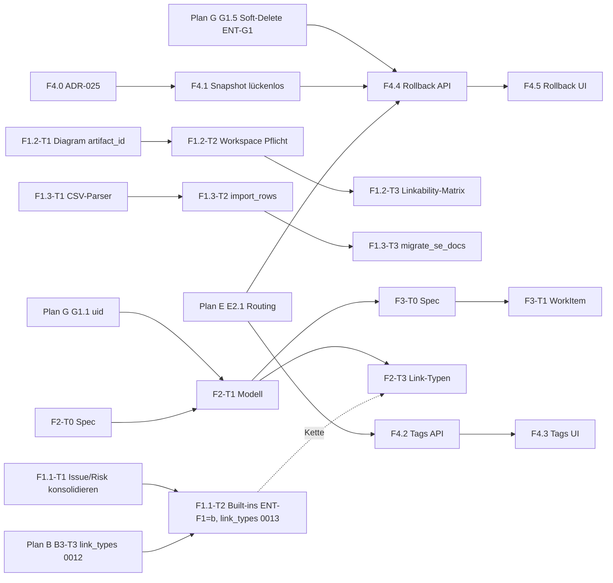

# Plan F — Dokument-Artefakte & WorkItem (F1–F3), Baselines (F4)

> **Reiner Umsetzungsplan.** Kein Code, keine Migration ist hier umgesetzt.
> Grundlage: Planbasis `docs/superpowers/specs/2026-10-21-backlog-umsetzungsplaene-design.md` (§1, §2 Plan F, §3 Wellen 3/4),
> Konzept `docs/concepts/2026-10-16-dokument-artefakte-workitem.md` (auf `origin/main`, identisch mit dem Volltext in #1374),
> Issue #50 inkl. der drei Kommentare (Governance-Analyse zum Rollback).
> Arbeitsbaum = `origin/main` `b175c970` (HEAD identisch). Jede `datei:zeile`-Angabe ist dagegen verifiziert.
> Live-Belege: `docs/test-reports/plan-review-2026-10-21/plan-f/live-checks.md` (Check-IDs `F-L1` … `F-L14`), QS v1.8.0-beta.22 (`dc7ee14`).
> **Belege:** Belege unter `docs/test-reports/` sind gitignored (`.gitignore:91`); DoD-Nachweise stehen im PR-Text bzw. als
> CI-Artefakt (vorläufig, ENT-X3 = C). Nach ENT-X3 = B gehen neue DoD-Artefakte nach `docs/se/reports/` bzw. `docs/reviews/`
> (Index §f.6). QS-Adressen in Verifikationsbefehlen nur als `$QS_URL` (Workspace-ID als `$Z`).
> **Vorrang:** Planbasis > [Plan-Index](2026-10-21-backlog-umsetzung-index.md) > dieser Plan. Offene Nutzerentscheidungen heißen
> `ENT-*` ([Entscheidungsliste](2026-10-21-entscheidungen-offen.md)); Stellen mit „vorläufig, ENT-…“ tragen deren Empfehlung bis
> zur Entscheidung. Die Plan-internen IDs ENT-F0…ENT-F6 sind ENT-F0…ENT-F6 (§ix).
> **Migrationen:** siehe [Plan-Index §e](2026-10-21-backlog-umsetzung-index.md#e-konsolidierte-migrationsvergabe-bindend) und
> Abschnitt „Migrationen“ am Ende dieses Plans (nur Namen + Index-Verweis, keine eigene Reservierung).
> `graphify-out/` existiert im Arbeitsbaum nicht; Navigation per gezieltem Grep/Read.
>
> **Tiefe je Stufe (Auftrag):** F1 und F4 voll ausdetailliert. F2 und F3 auf Entscheidungs-/Schnittstellenebene mit Task-Skelett;
> beide Stufen enden mit der Entscheidung „eigener Spec nötig" (Planbasis: „Jede Stufe F1–F3 bekommt einen eigenen Spec").
> Für F1 ist dieser Plan der Spec (Begründung §(i)).

---

## (i) Ziel und Nicht-Ziele

**Ziel.**

1. **F1 — Voraussetzungen** (Welle 3): Es gibt genau **einen** Validierungspfad für Trace-Links. Issue-/Risk-Linkvokabeln laufen durch den
   Workspace-Katalog statt durch tote Service-Whitelists (F1-Befund). Alle Artefakt-Rückgrat-Typen (`GlossaryTerm`, `Diagram`, `Icd`) sind
   nachweislich verlinkbar und geben ihre Artefakt-ID nach außen (F9-Rest). Markdown kommt verlustfrei durch den Import; die Doku-Migration nutzt
   einen nativen Zeilenpfad statt CSV-Text (F5).
2. **F4 — Baselines** (Welle 3): Baselines tragen **Tags/Labels**. Ein **additiver Rollback** stellt den Inhalt einer Baseline als **neue Version**
   je Artefakt wieder her — ausschließlich über ein freigegebenes Änderungsantrag-Objekt (`ChangeRequest`, CCB). Die Baseline-Tabellen werden dabei
   nur gelesen; der Immutability-Trigger bleibt unverändert. Voraussetzung ist ein **lückenloser Snapshot** (Warnung `baseline/state_capture.py:117-127`).
3. **F2 — Document** (Welle 4): Entscheidungs-/Schnittstellenrahmen für `Document` + Lebenszyklus auf der vorhandenen Workflow-Maschinerie,
   Link-Typen `documented-in`, `evidences`, `depends-on`, Feld-Freeze F-1…F-7, Gates G-1…G-4, REST-/MCP-Gruppe, Events, Scopes. Ergebnis: eigener Spec + Task-Skelett.
4. **F3 — WorkItem** (Welle 4): Rahmen für `WorkItem`, `work_item.resume`, Checkpoints, Inline-Verweise I-1…I-5 und die Abgrenzung Memory ↔ Loom.
   Ergebnis: eigener Spec + Task-Skelett.

**Nicht-Ziele.**

- **Projektion/Adoption** (Konzept §7, Stufe S3: MD-Generator, PR-Zustellung, `Source`/`ImportRun`/`SourceBinding`, `owner_mode`, `projection_mode`)
  — steht in keinem Planbasis-WP F1–F3. Behandlung: Entscheidung **ENT-F5** (§ix); bis dahin sind F-4 und F-7 sowie G-3 inert spezifiziert.
- `Task`-Typ (Konzept T1) und Text-Spans (T2) — vom Konzept selbst vertagt.
- Neue Link-Typen über die drei Konzept-Typen hinaus — außer dem optionalen Issue/Risk-Satz in F1.1-T2 (nur bei ENT-F1 = b).
- Baseline-Rollback **ohne** CR-Freigabe; Rückgängigmachen per UPDATE/DELETE auf `bl_*`-Tabellen; Wiederherstellung von Workflow-Zuständen;
  Rollback durch Agent-Prinzipale (`actor_type="agent"`, QR-S09).
- Ereignis-/Outbox-Erweiterung für `GlossaryTerm`/`Diagram`/`Icd` — besitzt **Plan A** (T-A2-4, `application 0036_alter_domaineventoutbox_event_type`). Plan F verweist nur.
  Der Rollback (F4.4) führt **keinen** eigenen EventType ein: er schreibt über die Domain-Services, deren bestehende `*_UPDATED`-Events
  über die Outbox laufen (Plan-A-Projektoren indexieren damit automatisch nach).
- Link-Typen `validates`/`performs` und der **generische Subtyp-Mechanismus** (Subtyp-Register in `link_types/catalog.py`) — besitzt **Plan B** (B2-T1, B3-T2, B3-T3; KA-B-08). F2 registriert nur `Document → kind` (KA-F-02).
- `uid`-Receiver, Workspace-FK-Backfill, Soft-Delete-Vertrag — besitzt **Plan G** (G1.1 `register_uid_signals`, G1.3, G1.5 / ENT-G1). F2/F3 registrieren ihre Modelle dort.
- ETag/If-Match-Vertrag inkl. 409/412-Helfer `optimistic_lock_response` — besitzt **Plan E** (E2.4–E2.6). Neue Ressourcen in F2/F3/F4 setzen `etag_supported` gemäß E2.5-Regel (KA-E-12).

**Warum F1 keinen eigenen Spec braucht (Abweichung begründet, nicht umgebogen):** Die Live- und Code-Prüfung zeigt, dass F9 zu ~80 % bereits
umgesetzt ist (§xi) und F1/F5 je ein Defekt mit klarer Ursache sind. Der verbleibende Umfang ist ein Bugfix-Paket ohne neue Modelle; dieser Plan
legt Verträge und Tests vollständig fest. Will der Nutzer formal einen F1-Spec, ist §(iv) WP F1 wörtlich übernehmbar (siehe Entscheidung ENT-F0;
Vorläufig: nein — P1 startet erst nach ENT-F0).

---

## (ii) Entscheidungen (aus der Planbasis, unverändert zitiert)

Planbasis §2 Plan F:

| WP | Inhalt | Issues |
|---|---|---|
| F1 | „Stufe 1 (Voraussetzungen): Issue-/Risk-Linkvokabeln in zentrale Validierung (F1-Befund), GlossaryTerm/Diagram/Icd bekommen `artifact_id` und sind verlinkbar (F9), native Ingestion statt CSV (F5)" | #1374 |
| F2 | „Stufe 2: `Document` + Workflow auf vorhandener Maschinerie + `documented-in`, `evidences`, `depends-on`; Freigabe = Feld-Freeze" | #1374 |
| F3 | „Stufe 3: `WorkItem`, `work_item.resume`, Checkpoints, Inline-Verweise `[[Term]]`. Abgrenzung: Memory = „was war", Loom = „wo steht das Vorhaben"" | #1374 |
| F4 | „Baselines: Rollback **additiv** (neue Version aus Snapshot, Immutability-Trigger unberührt, mit CR-Freigabe), Tags/Labels" | #50 |

„Jede Stufe F1–F3 bekommt einen eigenen Spec." — Planbasis §2.
Reihenfolge Planbasis §3: **Welle 3:** „… F1, F4." **Welle 4:** „F2, F3, …".
Besitzer gemeinsamer Bausteine (Brief): Link-Typ-Katalog-Erweiterungen = Plan B (`validates`, `performs`) und **Plan F (`documented-in`, `evidences`, `depends-on`)**.

Konzept-Entscheidungen E1–E12 (#1374 §0) gelten für F2/F3 als Eingabe; Konflikte mit dem Ist-Stand stehen als ENT-F2…ENT-F4 in §(ix), nicht umgebogen.

---

## (iii) Ist-Stand (verifiziert)

### F1 — Linkvokabeln Issue/Risk

| Befund | Beleg |
|---|---|
| `ISSUE_LINK_TYPES = {"related-to","blocks","blocked-by","caused-by","resolves"}`, `IssueService.create_tracelink` prüft diese Whitelist und ruft danach `TraceLinkService.create_trace_link` | `backend/application/issue_service.py:50`, `:762-797` |
| `RISK_LINK_TYPES = {"threatens","mitigated-by","related-to"}`, `RiskService.create_tracelink` analog | `backend/application/risk_service.py:50`, `:722-757` |
| Die Methoden heißen `create_tracelink`, **nicht** `link_issue`/`link_risk` (Konzept-Bezeichnung falsch; auch im Konzept-Checkout `a602811d` so) | `git grep "def link_issue" a602811d` → leer |
| Zentrale Validierung ist der **Workspace-Katalog**: `_check_link_pair` → `link_types.catalog.validate_link_pair`; unbekannter Key → `ValidationError("Unknown link type …")` | `backend/application/trace_link_service.py:410-480`, `backend/link_types/catalog.py:98-152` |
| Keines der 7 Vokabeln steht im Katalog (11 Built-ins) → jeder Aufruf scheitert nach der Service-Whitelist an der Katalogprüfung | `backend/link_types/builtin.py:90-410`; live `F-L2` |
| **Kein** Transport ruft `create_tracelink` (REST/MCP/Frontend): einzige Aufrufer sind Tests, die `TraceLinkService` per `MagicMock` ersetzen (der Defekt ist dadurch unsichtbar) | `grep -rn create_tracelink backend frontend/src` → nur `application/tests/test_issue_service.py:777-840`, `test_risk_service.py:768-830` |
| Präzedenzfall: `AdrService.create_tracelink`/`ADR_LINK_TYPES` wurde aus genau diesem Grund als totes Feature entfernt | `backend/application/adr_service.py:609-622` |
| Re-Exporte der Konstanten | `backend/application/services_step3.py:20-69`, `backend/application/services.py:264-267` |
| Generischer Pfad funktioniert: `references` erlaubt `Issue->*` und `*->Issue`, `mitigates` `Risk->Requirement/ArchitectureElement` | `builtin.py:329-386`, `:304-328`; live `F-L2` |
| SE-Anforderungen versprechen die Vokabeln weiterhin | `docs/se/L1/Gesamtsystem/L2/ApplicationServiceSystem/Components/COMP-AS-015_IssueService/L3_COMP-AS-015_IssueService_Requirements.md`, `…/COMP-AS-014_RiskService/L3_COMP-AS-014_RiskService_Requirements.md` (REQ-L3-ISSUE-006, REQ-L3-RISK-006) |

### F1 — Verlinkbarkeit GlossaryTerm / Diagram / Icd (F9)

| Befund | Beleg |
|---|---|
| Alle drei haben ein `artifact`-OneToOne (nullable): GlossaryTerm (CASCADE), Diagram (SET_NULL), Icd (SET_NULL) | `backend/persistence/models.py:2469-2491`; `backend/diagram/models.py:125-140`; `backend/icd/models.py:107-118` |
| Migration der Spalten + Backfill bestehender Zeilen | `persistence/migrations/0072_glossary_changerequest_artifact_fk.py`, `0073_backfill_artifact_backing.py` |
| Registry der Artefakt-Rückgrat-Typen enthält alle drei (und `ChangeRequest`) | `backend/persistence/artifact_backing.py:33-47` |
| `ensure_artifact` auf allen Create-/Write-Pfaden | `application/glossary_service.py:195,285,310`; `icd/icd_manager.py:95,130,406`; `diagram/manager.py:99,324`; `diagram/traceability_connector.py:104` |
| Entity-ID → Artifact-ID-Auflösung für alle Registry-Typen | `application/trace_link_service.py:194-260` (Schritt 11), `persistence/artifact_backing.py:130-200` |
| Glossar gibt `global_uuid` (= Artifact-ID) aus; Inline-Token `[[glossary:<uuid>@<rev>]]` mit Usage-Link existiert (#1266) | `rest_api/serializers.py:2562-2620`; `application/glossary_reference_service.py:1-46` |
| Icd gibt `artifact_id` aus | `rest_api/icd_views.py:344-389`; live `F-L5` (95/95) |
| **Rest-Lücke 1:** Diagram-REST (`list`, `retrieve`) und MCP (`diagram.get`/`query`) geben **kein** `artifact_id` aus; OpenAPI `GET /diagrams/{id}/` hat keinen Response-Body | `rest_api/diagram_views.py:113-125`, `:250-265`; `diagram/mcp_artifact_provider.py:231-238`; `mcp_server/tools/diagram.py:86-97`; live `F-L7` |
| **Rest-Lücke 2:** Diagram-Create erlaubt `workspace_id` leer → ohne Workspace keine Artifact-Zeile (`Artifact.workspace` NOT NULL) → nie verlinkbar, keine Historie | `rest_api/diagram_views.py:186-197`; MCP `diagram.create` `required` ohne `workspace_id` (Manifest); `diagram/models.py:111-115` (Kommentar „stays at forever") |
| `uses-term`/`documents`/`traces`/`implements` sind seit der Katalog-Konsolidierung **abgelöst** (→ `references` bzw. `allocated-to`); `documents: Diagram→*` heißt heute `diagram-ref` (system-owned, Reconciler) | `link_types/builtin.py:55-83`, `:388-410` |
| Live: Glossar 5/5 mit `global_uuid`, 3/5 mit `references`-Link; ICD-Artefakt mit 39 Links | `F-L3`, `F-L4`, `F-L5` |

### F1 — CSV-Transport (F5)

| Befund | Beleg |
|---|---|
| `ImportService._parse_csv` entfernt **jede physische Zeile**, die mit `#` beginnt — vor dem CSV-Parsing und ohne Rücksicht auf mehrzeilige, gequotete Felder | `backend/application/import_service.py:950-993` (Filter `:968-972`) |
| Zweck des Filters ist nur der Kommentar-Kopf der eigenen Export-Datei (erste Zeile) | `backend/application/export_service.py:382` (`# terminology_profile: …`) |
| Folge auch für **REST-CSV-Import** (`POST /workspaces/{id}/import/csv/`): eine Beschreibung mit Zeile `# Überschrift` verliert die Zeile bzw. bricht das Quoting | `rest_api/views.py:9641`; live `F-L7` (Pfad), Schreibprobe `F-L14` nicht erlaubt |
| `migrate_se_docs` umgeht das per `_csv_safe` (`\n#` → `\n #`) und schreibt das Leerzeichen dauerhaft in die Daten (Docstring räumt es ein) | `application/management/commands/migrate_se_docs.py:66-80`, `:237-247` |
| `_MAX_ROWS = 1000` je Aufruf; `migrate_se_docs` stückelt selbst (`_MAX_ROWS_PER_CALL`) | `import_service.py:71`, `:376-380`; `migrate_se_docs.py:128-131` |
| „All-or-Nothing pro Batch" nur noch für DB-Fehler: Validierung ist seit ADR-014/#1195 zeilenweise (Teilerfolg 207) | `import_service.py:384-470` |

### F4 — Baselines

| Befund | Beleg |
|---|---|
| `BaselineSnapshot` (Kopf) + `BaselineDeltaIndexEntry` (Einträge mit `state` JSON); `name` unique je Workspace | `backend/baseline/models.py:36-114`, `:116-187` |
| Trigger `bl_raise_immutable`: `BEFORE UPDATE OR DELETE` auf beiden Tabellen; INSERT ist frei | `baseline/migrations/0001_initial.py:159-193` |
| DELETE-Ausnahme nur per transaktionslokalem GUC `app.baseline_admin_delete` (Admin-Purge); UPDATE wirft immer | `baseline/migrations/0011_baseline_admin_delete_trigger.py:1-80`; `application/baseline_facade.py:885` |
| **Folgerung:** Tags können **keine Spalte** am Snapshot sein (jede Tag-Änderung wäre ein UPDATE) → eigene Tabelle | ebd. |
| Snapshot-Erfassung: Warnung „A field that is not captured here is a field whose drift is structurally invisible" | `baseline/state_capture.py:117-127` (Issue nennt `:106-127`, Zeilen verschoben) |
| **Lücke:** Requirement-Snapshot ohne `rationale`, `source`, `acceptance_criteria_items`, `level_source`; Artifact-Hülle ohne `owner`, `reporter`, `priority`, `stakeholder` (nur `custom_fields`, `parent`) | `state_capture.py:149-183`, `:221-235`; Felder `persistence/models.py:1534-1680`, `:1266-1330`; live `F-L12` |
| Projekt-Scope erfasst GlossaryTerm doppelt (Artifact-Hülle als `item` **und** `glossary_term`); Icd/ChangeRequest/Interview-Artefakte nur als Hülle | `baseline/delta_index_builder.py:98-129`; `state_capture.py:221-235` |
| Diff vergleicht nur Keys, die in **beiden** Snapshots stehen → neue Capture-Keys sind rückwärtskompatibel | `baseline/diff_engine.py:221-251` |
| Drift je Artefakt gegen Baselines existiert (Mitgliedschaft + Drift) | `application/baseline_facade.py:969-1060` |
| `ChangeRequest` mit `baseline`-FK, `ccb_approval`-Workflow (draft → submitted → under_review → approved/rejected → implemented), SoD-Gate, Affected-Items mit `version_before`/`state_before` aus **demselben** `capture_states` | `persistence/models.py:3693-3787`, `:3788-3870`; `application/change_request_service.py:558-683`, `:746-775`, `:926-978`, `:980-1060` |
| Affected-Items haben **keine** REST-/MCP-Oberfläche (nur Service) | `grep set_affected_items` → nur `change_request_service.py`; live `F-L7` |
| CR-Status lebt im `WorkflowItemState` (nicht in einer CR-Spalte); `transition_status(…, expected_version=…)` beantwortet konkurrierende Übergänge mit 409 (AUD-2026-09-282) | `application/change_request_service.py:558-600` |
| Detailrouten des `BaselineViewSet` sind als `ResourceScope.WORKSPACE` mit `entity_key="baseline"` klassifiziert (Objekt-Workspace, fail-closed); Lookup `baseline.models.BaselineSnapshot` | `auth_tenancy/resource_scope.py:200-225` (Eintrag `:219`); `application/workspace_lookup.py:106-108` |
| `BaselineSnapshot.workspace_id` ist `NOT NULL`; Preset-Gate der Detailrouten nutzt den Objekt-Workspace (`_check_preset(request, workspace_id=str(item.workspace_id))`) | `baseline/models.py:62`; `rest_api/views.py:4747-4756`, `:4819`, `:5008` |
| Agent-Prinzipal erkennbar über `AuthContext.actor_type == "agent"` (`is_agent`), nur `ApiKey.principal_type="agent"` erzeugt ihn | `auth_tenancy/context.py:65-69`, `:143-146`; `auth_tenancy/models.py:147-149` |
| Item-Level-Rechte: `EffectivePermissionService.resolve_effective_permission(…, artifact_id=…, level="read"/"write")` (Item-Regel schränkt nur ein) | `application/effective_permission_service.py:114-175` |
| Baseline-REST: `PATCH` → 405, `DELETE` → 403 `BASELINE_IMMUTABLE`, `purge` (Admin) | `rest_api/views.py:5047-5097` |
| UI: Compare existiert (Issue-Punkt 2 erledigt), Detail-Panel, Create-Form | `frontend/src/components/BaselinesView/BaselinesView.tsx:460-720`, `BaselinesPanels.tsx:210-300` |
| QS: 0 Baselines, 0 ChangeRequests in beiden Demo-Workspaces | `F-L9`, `F-L10` |

### F2/F3 — Maschinerie

| Befund | Beleg |
|---|---|
| Workflow-Defaults für 14 Item-Typen; Nicht-Requirement-Typen nutzen **einen festen** Schema-Key (`adr_default` …), nur `Requirement` ist tier-abhängig | `workflow/definition_store.py:713-930`; `application/workspace_provisioning.py:45-59`, `:62-100`; live `F-L8` |
| Item-Typ-Registry ist **fünffach** dupliziert | `workflow/state_reader.py:52-78`; `workflow/services.py:1253-1268`; `application/workspace_provisioning.py:45-59`; `workflow/management/commands/provision_workflow_definitions.py:76ff.`; `workflow/migrations/0004_backfill_entity_workflow_definitions.py:27ff.` |
| Unbekannter `item_type` wird von `workflow-defaults` mit 200 beantwortet | live `F-L8` |
| Freigabe-Erkennung in Vorbedingungen ist an den Zustandsnamen `approved` gebunden | `workflow/precondition_rules.py:106-147` |
| Goal nutzt bereits deutsche Zustände `Entwurf/Freigegeben/Archiviert` | `workflow/definition_store.py:921-930` |
| Domänenmodelle liegen in `persistence/models.py` (z. B. `Adr` `:3158`), nicht in `application/models.py` | — |
| API-Key-Scopes sind **Stufen** (`read_only`/`author`/`admin` + Legacy), keine Ressourcen-Scopes | `auth_tenancy/models.py:72-96` |
| Ältere, nicht umgesetzte Spec „Dokument-Sicht" belegt den Namen `Document` (+ `DocumentSection`) und bindet Baseline-Scope `document` daran | `docs/superpowers/specs/2026-09-03-dokumentensicht-design.md` (Status „Draft"), `docs/superpowers/plans/2026-09-03-dokumentensicht.md`; `grep "class Document" backend` → leer |
| Baseline-Scope `document` = Artefakt + Nachfahren (nicht ein Dokument-Artefakt) | `baseline/models.py:47-58` |
| Trace-Link-Liste ignoriert `link_type`/`target_id` still | live `F-L11`; `rest_api/views.py:3841ff.` |

---

## (iv) Arbeitspakete

Konventionen für alle Tasks (wie Plan B):

- **Testbefehl Backend:** Makro `BT <pfade>` aus [Index §f.3](2026-10-21-backlog-umsetzung-index.md#f3-lokale-testbefehle-und-passwort-variable-qr-t23)
  (Superuser `DB_USER=reqogniloom`, Passwort `DB_PASSWORD` aus der Env-Datei des laufenden Stacks, nie ausschreiben; Pfade relativ zu `backend/`).
- **Testbefehl Frontend:** `docker exec reqogniloom-frontend-1 sh -c 'cd /app && npx vitest run <pfad>'` → `VITEST <pfad>` (Index §f.3).
- „Grün" = letzte pytest-Zeile `N passed` ohne `failed`/`error`; Vitest `Tests  N passed`.
- **TDD:** jeder Task beginnt mit dem genannten **fehlschlagenden** Test gegen echte DB und echte Services. Mocks nur für Dritt-Systeme.
- Fehlerform REST (Bestand): `{"error":{"code":"<CODE>","message":"…","details":[…]}}`.
- Nach Code-Änderung: `graphify update .` (sobald ein Graph angelegt ist).
- **Tool-PR (DoD-Zeile, KA-ALL-03, Index §f.1):** `python manage.py export_tool_manifest`; Zahl in `README.md`, `docs/api/MCP-SURFACE.md`,
  `clients/registry.yaml` angleichen, `python3 scripts/clients/render.py` (erzeugt `docs/clients/antigravity(.de).md`); `.meta-config/project.yaml`
  über `agent-meta-manager` (nach ENT-X5); `pytest docs/agent-templates dist -q` (Repo-Wurzel) und `BT mcp_server/tests/test_tool_manifest_drift.py` grün;
  Merge über die globale Tool-Queue (Index §d.2). Plan F nennt **nur Deltas** („+1 Tool“); Ist-Zahl per `jq '.tool_count' docs/agent-templates/tool-manifest.json` vorher/nachher.
- **REST-PR (DoD-Zeile, KA-ALL-04, Index §f.5):** Neue Views/Actions mit `serializer_class` oder `@extend_schema` (Request/Response); der PR
  aktualisiert `backend/rest_api/tests/openapi_warning_baseline.json` (entsteht mit Plan E P1-7; nur Shrink); Merge seriell (Index §d.2).
- **Listen-DoD (KA-ALL-10):** Jede neue Listen-/Paginierungsroute sortiert deterministisch (`order_by` mit eindeutigem Tiebreaker, z. B. `id`);
  nach Plan G PR 6 (G2.1) macht `UnorderedObjectListWarning` den Test rot.
- **Zähler (KA-ALL-03/QR-T25):** Tests prüfen Mengen-Zugehörigkeit (`"blocks" in keys`), keine Gesamtzahl (Link-Typen, Regeln, Registry-Typen);
  QS-Prüfungen nennen „vorher + Delta“.
- **Migrations-PR:** `python manage.py makemigrations --check --dry-run` → `No changes detected`; Rückwärts-Probe
  `migrate <app> <name-der-vorgänger-migration>` → `migrate <app>` (nur Namen, Index §e Regel 4); Migrationstests per `MigrationExecutor`
  mit Migrationsnamen bzw. `loader.graph.leaf_nodes()`. Neue `TenantScopedModel`-Tabelle: `CreateModel` + RLS-Policy im selben PR,
  `BT persistence/tests/test_rls_coverage.py` grün (prüft alle Apps).

### WP F1 — Voraussetzungen (Welle 3)

#### F1.1-T1 — Issue-/Risk-Linkpfad auf den Katalog konsolidieren · Rolle: `developer` · Review: `code-reviewer`

- **Ansatz:** Root-Cause statt Whitelist-Erweiterung: es gibt keinen zweiten Validierungspfad mehr. Wie bei ADR (`adr_service.py:609-622`)
  werden die toten Helfer entfernt; Issue-/Risk-Links laufen ausschließlich über `TraceLinkService.create_trace_link` → Katalog.
- **Dateien (ändern):**
  - `backend/application/issue_service.py` — `ISSUE_LINK_TYPES` (`:50`) und `create_tracelink` (`:760-797`) löschen; an deren Stelle
    Kommentarblock analog `adr_service.py:609-622` („Issue TraceLinks are created through the generic TraceLinkService … `references` (Issue is a wildcard on both sides) …"). `__all__` (`:798-802`) bereinigen. Konstruktor-Parameter `trace_link_service` bleibt (Hausmuster).
  - `backend/application/risk_service.py` — `RISK_LINK_TYPES` (`:50`), `create_tracelink` (`:720-757`), `__all__` analog; Kommentar nennt `mitigates`.
  - `backend/application/services_step3.py:20-69`, `backend/application/services.py:264-267` — Re-Exporte entfernen.
  - `backend/application/tests/test_issue_service.py:773-840`, `backend/application/tests/test_risk_service.py:764-830` — die Mock-Klassen
    `TestIssueCreateTracelink`/`TestRiskCreateTracelink` löschen (Befund R-F1-2).
  - SE-Doku (Rolle `requirements`, gleicher PR): REQ-L3-ISSUE-006 / REQ-L3-RISK-006 in den beiden L3-Requirements-Dateien und den zwei
    Architecture-Dateien auf „Links über den Workspace-Link-Typ-Katalog (`references`, `mitigates`; ab ENT-F1=b zusätzlich `blocks`, `resolves`, `threatens`)" umformulieren.
- **Vokabel-Abbildung (dokumentiert im Kommentar und in REQ-L3-…-006):** `related-to` → `references`; `mitigated-by` → `mitigates`
  (Richtung Risk → Ziel; die Gegenrichtung ist das Upstream-Label „wird gemindert durch"); `blocks`/`blocked-by`/`resolves`/`caused-by`/`threatens` →
  bei ENT-F1 = a `references` mit `rationale`, bei ENT-F1 = b eigene Built-ins (F1.1-T2).
- **REST/MCP-Vertrag:** unverändert (Methoden waren nie exponiert). Nutzerweg bleibt
  `POST /api/v1/trace-links/` `{"source_id":"<issue-id>","target_id":"<artifact-id>","link_type":"references","rationale":"blocks"}` → `201`;
  `{"link_type":"blocks", …}` → `400 {"error":{"code":"VALIDATION_ERROR","message":"Unknown link type 'blocks'. Valid types in this workspace: …"}}` (bei ENT-F1 = a).
- **TDD (zuerst rot):** neu `backend/application/tests/test_issue_risk_links_central_validation_1374.py` (echte DB, provisionierter Workspace):
  1. `test_issue_service_has_no_private_link_vocabulary` — `hasattr(IssueService, "create_tracelink") is False`, `hasattr(RiskService, "create_tracelink") is False`,
     `from application.services import ISSUE_LINK_TYPES` → `ImportError` (rot vor der Änderung).
  2. `test_issue_to_requirement_references_link_created` — `TraceLinkService().create_trace_link(source_id=issue.id, target_id=req.id, link_type="references", ctx=ctx)` → Link existiert, `source_artifact.artifact_type == "Issue"`.
  3. `test_risk_mitigates_requirement_created` — analog `mitigates`.
  4. `test_unknown_issue_vocabulary_rejected_by_catalog` — `link_type="blocks"` → `ValidationError` mit „Unknown link type 'blocks'" (bei ENT-F1 = b: stattdessen Erfolg, Test wird in F1.1-T2 umgestellt).
  5. REST-Durchstich `backend/rest_api/tests/test_issue_links_rest_1374.py::test_post_trace_link_issue_references_201`.
- **DoD:** Tests grün; `BT application/tests/test_issue_service.py application/tests/test_risk_service.py application/tests/test_issue_risk_links_central_validation_1374.py rest_api/tests/test_issue_links_rest_1374.py` grün;
  `grep -rn "ISSUE_LINK_TYPES\|RISK_LINK_TYPES\|def create_tracelink" backend --include=*.py` → keine Treffer.
- **Verifikation:** obiger `BT` → `… passed`; QS nach Deploy (lesend): `GET $QS_URL/api/v1/workspaces/$Z/link-type-definitions/` → `count` unverändert gegenüber vorher (Delta 0, bei ENT-F1 = a).
- **Hinweis Vorläufigkeit:** PR-F1 ist laut ENT-F1 „vorläufig ja“ (unabhängig von a/b); P1-Start wartet dennoch auf ENT-F0.

#### F1.1-T2 — Issue-/Risk-Vokabeln als Katalog-Built-ins (nur bei ENT-F1 = b) · Rolle: `developer` · Review: `code-reviewer`

- **Voraussetzung:** F1.1-T1; **ENT-F1 = b entschieden** (Vorläufig: nein für PR-F2); Migrationskette `link_types` nach
  `0010_workspace_definition_workspace_fk` (Plan G G1.4, PR 4), `0011_seed_validates_link_type` (Plan B PR-B8) und
  `0012_seed_performs_and_satisfies_function_pair` (Plan B B3-T3, PR-B13) — Name/Nummer laut Index §e.
- **Dateien (ändern):** `backend/link_types/builtin.py` (drei Einträge + Docstring-Tabelle `:12-28`; Kopfzeile ohne Absolutzahl bzw. „+3“ im Changelog-Satz),
  `backend/traceability/types.py` (`LinkType.BLOCKS`, `RESOLVES`, `THREATENS`), `frontend/src/constants/traceLinkLabels.ts` (`FALLBACK_TRI_LABELS`),
  Tests `backend/link_types/tests/test_builtin.py` und `backend/mcp_server/tests/test_link_type_tool_group.py` — feste Anzahl-Assertions durch
  Mengen-Zugehörigkeit ersetzen (`{"blocks","resolves","threatens"} <= keys`, KA-F-07).
- **Definitionen (gepinnt, Lehre R-B2-2 aus Plan B):**
  ```python
  "blocks": {"label": {"de": {"downstream": "blockiert", "upstream": "wird blockiert durch", "neutral": "Blockade"},
                       "en": {"downstream": "blocks", "upstream": "is blocked by", "neutral": "Blocker"}},
             "allowed_pairs": _pairs(("Issue", "*")), "coverage_relevant": False, "suspect_rule": "none",
             "impact_weight": 0.5, "manual_creatable": True, "system_owned": False, "active": True, "built_in": True},
  "resolves": {"label": {"de": {"downstream": "löst", "upstream": "wird gelöst durch", "neutral": "Lösung"},
                         "en": {"downstream": "resolves", "upstream": "is resolved by", "neutral": "Resolution"}},
               "allowed_pairs": _pairs(("*", "Issue")), "coverage_relevant": False, "suspect_rule": "none",
               "impact_weight": 0.3, "manual_creatable": True, "system_owned": False, "active": True, "built_in": True},
  "threatens": {"label": {"de": {"downstream": "bedroht", "upstream": "wird bedroht durch", "neutral": "Bedrohung"},
                          "en": {"downstream": "threatens", "upstream": "is threatened by", "neutral": "Threat"}},
                "allowed_pairs": _pairs(("Risk", "*")), "coverage_relevant": False, "suspect_rule": "none",
                "impact_weight": 0.5, "manual_creatable": True, "system_owned": False, "active": True, "built_in": True},
  ```
  `blocked-by` = Upstream-Label von `blocks`; `mitigated-by` = Upstream von `mitigates`; `caused-by` und `related-to` → `references` (kein eigener Typ).
- **Migration (neu, Index §e):** `backend/link_types/migrations/0013_seed_issue_risk_link_types.py` — Form von `0008` (Tenant-Arming, Global + je Workspace,
  `is_customized=True`-Zeilen unberührt), Definitionen gepinnt (liest `BUILTIN_LINK_TYPES` nicht live). `dependencies` = zuletzt gemergte
  `link_types`-Migration (erwartet `0012_seed_performs_and_satisfies_function_pair`). Reverse: löscht nur die drei Keys **ohne** verlinkte TraceLinks;
  existieren Links → `RuntimeError` mit Anzahl.
- **TDD (zuerst rot):** `backend/link_types/tests/test_issue_risk_link_types_1374.py` — `validate_link_pair(ws,"blocks","Issue","Requirement",manual=True)` ok;
  `("Requirement","Issue")` → `ValidationError` mit `Allowed: Issue->*`; Migrationstest per `MigrationExecutor` mit Migrationsnamen
  (Stand `0012_seed_performs_and_satisfies_function_pair` → Workspace ohne Zeile; nach `0013_seed_issue_risk_link_types` → drei Zeilen, customized-Zeilen unverändert).
  Nach Plan G G1.4 hat `workspace_id` eine FK: Migrations- und Seed-Tests legen **echte `Workspace`-Zeilen** an (kein `uuid4()`, KA-G-10).
  F1.1-T1-Test 4 erwartet nun `201`/Erfolg.
- **DoD:** Tests grün; `BT link_types/tests mcp_server/tests/test_link_type_tool_group.py application/tests/test_issue_risk_links_central_validation_1374.py` grün;
  Migrations-PR-Zeile (Konventionen); Rückwärts-Probe `migrate link_types 0012_seed_performs_and_satisfies_function_pair` → `migrate link_types`.
  Kein MCP-Tool-Delta (Link-Typen sind Daten; `link_type.*`-Tools unverändert).
- **Verifikation QS (lesend):** `GET $QS_URL/api/v1/workspaces/$Z/link-type-definitions/` → Zählung = vorher + 3; `blocks … pairs=['Issue->*']`.

#### F1.2-T1 — Diagram gibt seine Artefakt-ID aus (REST, MCP, OpenAPI) · Rolle: `developer` · Review: `code-reviewer`

- **Dateien (ändern):**
  - `backend/rest_api/diagram_views.py:113-125` (`_diagram_to_dict`) und `:250-265` (`retrieve`) — additiv
    `"artifact_id": str(diagram.artifact_id) if diagram.artifact_id else None` und `"global_uuid"` (gleicher Wert, Parität zu Requirement/Glossar #1261/#1270).
  - `backend/rest_api/serializers_diagram.py` — neu `DiagramResponseSerializer` (`id, name, diagram_type, description, workspace_id, artifact_id, global_uuid, current_revision, version_count, created_at`, plus Detailfelder `payload_format, content, version_number`) nur für `extend_schema(responses=…)` von `list`/`retrieve`/`create` (Befund R-F9-3).
  - `backend/mcp_server/tools/diagram.py:86-97` (`_diagram_header_to_dict`) und `backend/diagram/mcp_artifact_provider.py:231-238` — `artifact_id`, `global_uuid` additiv.
  - `frontend/src/api/diagrams.ts` (Typ des Diagramm-Objekts) — `artifact_id: UUID | null; global_uuid: UUID | null` (optional lesend).
- **REST-Vertrag:** `GET /api/v1/diagrams/{id}/` → `200 {"id":"…","name":"…", …, "artifact_id":"<uuid>|null","global_uuid":"<uuid>|null"}`; Liste analog. Rein additiv.
- **TDD (zuerst rot):** `backend/rest_api/tests/test_diagram_artifact_id_1374.py` — Diagramm mit Workspace anlegen (REST `POST /api/v1/diagrams/`),
  `GET` Detail/Liste → `artifact_id` gesetzt und `== Artifact.objects.get(diagram=…).id`; danach
  `POST /api/v1/trace-links/` `{"source_id":"<requirement>","target_id":"<artifact_id>","link_type":"references"}` → `201`.
  `backend/mcp_server/tests/test_diagram_tool_artifact_id_1374.py` — `diagram.get` liefert `artifact_id`.
- **DoD:** Tests grün; `BT rest_api/tests/test_diagram_crud_views.py rest_api/tests/test_diagram_artifact_id_1374.py mcp_server/tests/test_diagram_tool_artifact_id_1374.py mcp_server/tests/test_tool_manifest_drift.py` grün;
  Tool-PR-Zeile (Konventionen) mit **Delta 0 Tools, 0 Präfixe** — Manifest neu exportieren, Doku-Zähler unverändert;
  REST-PR-Zeile: `DiagramResponseSerializer` per `@extend_schema` auf `list`/`retrieve`/`create`, `openapi_warning_baseline.json` schrumpft (Diagram-Einträge entfallen) — Shrink im selben PR.
  Liste `GET /api/v1/diagrams/` deterministisch sortiert (Listen-DoD).
- **Verifikation:** `GET /api/schema/?format=json` → `paths["/api/v1/diagrams/{id}/"].get.responses["200"].content` vorhanden, Schema enthält `artifact_id`.

#### F1.2-T2 — Diagram-Anlage nur mit Workspace (kein unverlinkbares Diagramm mehr) · Rolle: `developer` · Review: `code-reviewer`

- **Sichtbare Verhaltensänderung (benannt):** `POST /api/v1/diagrams/` ohne `workspace_id` → **400** statt 201; MCP `diagram.create` ohne `workspace_id` → JSON-RPC `-32602`.
- **Dateien (ändern):** `backend/rest_api/diagram_views.py:186-197` (Pflicht + `parse_workspace_id`, Fehler `VALIDATION_ERROR` „workspace_id is required"),
  `backend/mcp_server/tools/diagram.py` (`required` um `workspace_id` ergänzen, Schema `:110-125`), `backend/diagram/manager.py` (`create_diagram(..., workspace_id: uuid.UUID)` ohne Default `None`, `:266`), Aufrufer per
  `grep -rn "create_diagram(" backend --include=*.py` (inkl. Tests) anpassen.
- **Bestand:** neu `backend/diagram/management/commands/report_unbacked_diagrams.py` — zählt je Tenant Diagramme mit `workspace_id IS NULL` oder `artifact_id IS NULL`
  (Ausgabe `tenant=<uuid> without_workspace=<n> without_artifact=<n>`), schreibt nichts. Ein Zuordnen fremder Diagramme zu Workspaces ist Fachentscheidung des Betreibers (Runbook-Zeile in `deploy/README.md`, Rolle `documenter`).
- **TDD (zuerst rot):** `backend/rest_api/tests/test_diagram_requires_workspace_1374.py::test_create_without_workspace_is_400`, `::test_create_with_workspace_has_artifact`;
  `backend/mcp_server/tests/test_diagram_create_requires_workspace_1374.py`; `backend/diagram/tests/test_report_unbacked_diagrams.py` (zwei Zeilen, eine ohne Workspace → Zählung 1/1).
- **DoD:** Tests grün; `BT diagram/tests rest_api/tests/test_diagram_crud_views.py mcp_server/tests -k diagram` grün; Frontend erzeugt Diagramme bereits mit Workspace (`grep -rn "diagramsApi.create\|createDiagram" frontend/src` prüfen, `VITEST src/components/Diagram` grün).
  Tool-PR-Zeile (Konventionen) mit **Delta 0 Tools** (geändertes Input-Schema `diagram.create` → Manifest neu exportieren); REST-PR-Zeile (400-Antwort im Schema, Baseline nur Shrink).
  Eigener PR **PR-F3b** (Breaking, Release-Note), nie zusammen mit dem additiven PR-F3a (KA-F-03).
- **Verifikation:** `POST` ohne `workspace_id` gegen lokalen Stack → `400`; QS lesend: `python manage.py report_unbacked_diagrams` durch Betreiber.

#### F1.2-T3 — Verlinkbarkeits-Matrix aller Rückgrat-Typen als Regressionstest · Rolle: `tester` · Review: `code-reviewer`

- **Datei (neu):** `backend/rest_api/tests/test_artifact_backing_linkability_matrix_1374.py` — parametrisiert über **`ARTIFACT_TYPE_MODELS`** (`persistence/artifact_backing.py:33-47`, damit neue Typen wie `Document`/`WorkItem` automatisch einbezogen werden):
  je Typ ein Objekt über den **Service** anlegen, dann `POST /api/v1/trace-links/` mit der **Entity-ID** (nicht Artifact-ID) als Ziel und `link_type="references"` (Quelle: `Issue`, Wildcard-Paar) → `201`;
  für Typen ohne passendes `references`-Paar erwartet der Test `400` mit „Allowed:" und listet den Typ in einer expliziten Ausnahme-Konstante mit Begründung.
- **DoD:** Test grün; jeder Registry-Typ ist entweder verlinkbar oder mit Begründung ausgenommen (keine stille Lücke).
- **Verifikation:** `BT rest_api/tests/test_artifact_backing_linkability_matrix_1374.py` → `0 failed`; Anzahl `passed` = `len(ARTIFACT_TYPE_MODELS)`
  minus dokumentierte Ausnahmen (keine feste Zahl, KA-F-07; die Matrix wächst mit `Document`/`WorkItem` automatisch).

#### F1.3-T1 — CSV-Parser: nur führende Kommentarzeilen entfernen · Rolle: `developer` · Review: `code-reviewer`

- **Root-Cause-Fix** in `backend/application/import_service.py:966-972`: statt aller Zeilen mit `#` nur den **Kopfblock** vor der Header-Zeile entfernen:
  ```python
  lines = csv_text.splitlines(keepends=True)
  start = 0
  while start < len(lines) and lines[start].lstrip("").startswith("#"):
      start += 1
  clean_text = "".join(lines[start:])
  ```
  Docstring `:953-957` → „Skips leading comment lines (ExportService header) before the CSV header."
- **REST-Vertrag:** `POST /api/v1/workspaces/{id}/import/csv/` unverändert; neu ist nur, dass eingebettete Markdown-Zeilen erhalten bleiben (Bugfix, kein Breaking Change).
- **TDD (zuerst rot):** `backend/application/tests/test_import_service_markdown_1374.py`
  1. `test_quoted_multiline_markdown_heading_survives` — CSV mit `description="Intro\n# Heading\n- item"` → gespeicherte Beschreibung exakt gleich.
  2. `test_export_comment_header_still_skipped` — Export-Datei (`ExportService`) mit `# terminology_profile: …` → Re-Import ok, keine Unknown-Column-Warnung.
  3. `test_comment_line_after_header_is_data` — `#` am Zeilenanfang **nach** dem Header in einer ungequoteten Zelle → wird als Daten gelesen (Regression gegen alten Filter dokumentiert).
- **DoD:** Tests grün; `BT application/tests -k "import_service or csv"` und `rest_api/tests -k import_csv` grün.
- **Verifikation:** Testlauf → `3 passed` plus Bestand grün.

#### F1.3-T2 — Nativer Zeilenpfad `ImportService.import_rows` · Rolle: `senior-developer` · Review: `code-reviewer`

- **Schnittstelle (neu, gleiche Pipeline):**
  ```python
  def import_rows(
      self,
      rows: Sequence[Mapping[str, str]],
      entity_type: str,
      workspace_id: UUID | str,
      ctx: AuthContext,
      artifact_type_tag: str = "",
      *,
      max_rows: int = _MAX_ROWS,
  ) -> ImportResult: ...
  ```
  `import_csv` wird zu: BOM-Strip → `_parse_csv` → `self._import_parsed(rows_with_numbers, header_fields, warnings, …)`.
  `import_rows` nummeriert die Zeilen ab 1, leitet `header_fields` aus der Vereinigung der Keys ab und ruft dieselbe `_import_parsed`
  (Validierung, Attribut-Gate #881, Dedupe ADR-014 §3, atomarer Insert). **Kein** zweiter Validierungsweg.
- **Dateien (ändern):** `backend/application/import_service.py:299-552` (Extraktion `_import_parsed`, neue Methode, `__all__`).
- **TDD (zuerst rot):** `backend/application/tests/test_import_rows_native_1374.py` — `import_rows([{"title":"A","description":"# H\nText","uid":"REQ-X-1"}], "Requirement", ws, ctx)` → 1 importiert, Beschreibung exakt;
  zweiter Aufruf → `duplicate_count 1` (Dedupe greift); Zeile ohne `title` → `failed_count 1`, Rest importiert (207-Semantik); `len(rows) > max_rows` → `ValidationError`.
- **DoD:** Tests grün; alle bestehenden `import_csv`-Tests grün (`BT application/tests -k import rest_api/tests -k import`).
- **Verifikation:** Testlauf grün; `grep -n "_import_parsed" backend/application/import_service.py` → 3 Treffer (Definition + zwei Aufrufer).

#### F1.3-T3 — `migrate_se_docs` auf nativen Pfad, `_csv_safe` entfernen, Atomarität je Quelldatei · Rolle: `developer` · Review: `code-reviewer`

- **Dateien (ändern):** `backend/application/management/commands/migrate_se_docs.py` — `_csv_safe` (`:237-247`) und CSV-Aufbau entfernen; Aufruf `importer.import_rows(rows, entity_type, workspace_id, ctx)` (`:1130`);
  Gruppierung **je Quelldatei** (eine Datei = ein Aufruf = eine Transaktion; ein fehlerhaftes Dokument kippt nicht die anderen). Docstring-Abschnitt „Known ImportService quirk" (`:66-80`) ersetzen durch Verweis auf F1.3-T1.
  `_MAX_ROWS_PER_CALL` bleibt als Schutz (Dateien > 1000 Abschnitte werden gestückelt, mit WARNING).
- **Bestandsdaten:** Mit `_csv_safe` importierte Beschreibungen enthalten `\n #`. Kein automatischer Rückbau (nicht unterscheidbar von gewollter Einrückung); der Befehl erhält `--repair-hash-indent --dry-run|--apply`, der nur Artefakte mit `uid` aus `docs/se` (deterministisch abgeleitet) und genau dem Muster `\n #` korrigiert, über `RequirementService.update_requirement(..., change_reason="F5 repair")` (neue Version, kein Roh-UPDATE).
- **TDD (zuerst rot):** `backend/application/tests/test_migrate_se_docs_native_1374.py` — Temp-Docs-Baum mit Heading-Zeilen im Body → importierte Beschreibung exakt; eine kaputte Datei + eine gute → gute importiert, kaputte als WARNING gemeldet;
  `--repair-hash-indent --dry-run` meldet N, schreibt nichts; `--apply` erzeugt je Artefakt eine neue Version.
- **DoD:** Tests grün; `BT application/tests -k migrate_se_docs` grün; `grep -n "_csv_safe" backend -r` → keine Treffer.
- **Verifikation:** `python manage.py migrate_se_docs --dry-run` auf lokalem Stack → Zusammenfassung ohne CSV-Fehler.

### WP F4 — Baselines: Tags und additiver Rollback (Welle 3)

#### F4.0 — ADR „Additiver Baseline-Rollback mit CCB-Freigabe" · Rolle: laut ENT-X4 + Nutzer · Review: laut ENT-X4

- **Rollen (vorläufig, ENT-X4 = A):** Text `documenter`, Review `concept-reviewer`, Statuswechsel Nutzer (`se-architect`/`se-critic` sind in
  diesem Repo nicht installiert, Index §g.1). **Eintritt:** ENT-X4 entschieden (Vorläufig: nein).
- **Datei (neu):** `docs/se/ADR/ADR-025_additiver_baseline_rollback.md` — **ADR-025** laut Index §e (ADR-Nummern); Nummer beim Merge gegen
  `ls docs/se/ADR/` prüfen (höchste + 1; Stand `b175c970`: ADR-024). Status `proposed`, `affected_reqs: [REQ-L2-BL-001, REQ-L2-BL-002, REQ-L2-BL-012]`.
- **Inhalt (MADR):** Kontext (#50 Kommentar 2, Trigger `0001:159-193`, Warnung `state_capture.py:117-127`); Alternativen: (a) Trigger-Bypass per GUC (rejected: Immutability-Zusage),
  (b) additiv ohne Freigabe (rejected: Planbasis „mit CR-Freigabe"), (c) **additiv + CR-Pflicht** (gewählt); Entscheidung = Regeln R1–R9 aus F4.4
  (inkl. Sperre gegen Doppelausführung, Item-Rechte, Ausschluss von Agent-Prinzipalen, Größenlimit; QR-S09); Konsequenzen inkl. „Workflow-Zustände werden nicht zurückgesetzt".
- **DoD:** ADR liegt vor, Review-Protokoll unter `docs/se/reviews/REVIEW_<datum>_adr-025.md` (Reviewer laut ENT-X4). Statuswechsel nur durch Rolle laut ENT-X4 + Nutzer.

#### F4.1 — Snapshot lückenlos machen (Voraussetzung für Rollback) · Rolle: `senior-developer` · Review: `code-reviewer`

- **Ansatz:** Ein Meta-Test erzwingt Vollständigkeit; danach werden die fehlenden Felder ergänzt. Neue Keys sind für den Diff rückwärtskompatibel (`diff_engine.py:227-236`).
- **Dateien (ändern):** `backend/baseline/state_capture.py`
  - Requirement (`:163-183`): `rationale`, `source`, `acceptance_criteria_items`, `level_source`.
  - Artifact-Hülle (`:149-158`, Merge `:221-235`): `owner_id`, `reporter_id` (als String-UUID), `priority`, `stakeholder` als Keys `owner`, `reporter`, `priority`, `stakeholder`.
  - Icd unter `entity_type="item"` (Artifact-Typ `Icd`): Vertragsfelder wie `_capture_icd_versions` (gemeinsame Hilfsfunktion), damit Icd-Inhalt im Projekt-Scope sichtbar ist (Befund R-F4-2).
  - GlossaryTerm unter `item`: bleibt Hülle; Rollback nutzt den `glossary_term`-Eintrag (dokumentiert im Docstring).
- **Datei (neu):** `backend/baseline/restorable_fields.py` — einzige Quelle:
  ```python
  RESTORABLE_FIELDS: dict[str, tuple[str, ...]]  # artifact_type -> captured keys a rollback may write back
  NON_RESTORABLE: dict[str, dict[str, str]]       # artifact_type -> {field: reason}, e.g. {"level": "derived (ADR-005)", "status": "workflow governance", "uid": "identity", "version": "lock", "suspect": "derived", "lifecycle_status": "via reactivate"}
  ```
  Abdeckung: `Requirement`, `StakeholderNeed`, `ArchitectureElement`, `TestCase`, `Adr`, `Risk`, `Issue`, `GlossaryTerm`.
- **TDD (zuerst rot):** `backend/baseline/tests/test_state_capture_completeness_1374.py`
  1. `test_capture_covers_every_editable_field` — je Typ: `{f.name for f in Model._meta.concrete_fields if f.editable}` minus Systemspalten (`id, tenant, created_*, modified_*, artifact, workspace, embedding`) ⊆ `captured keys ∪ NON_RESTORABLE[type]`; rot heute für Requirement (`rationale, source, acceptance_criteria_items, level_source`).
  2. `test_capture_includes_artifact_system_fields` — `owner/reporter/priority/stakeholder` im State.
  3. `test_icd_item_entry_carries_contract` — Projekt-Baseline mit 1 ICD → `item`-State hat `semantic_description`.
  4. `test_old_snapshot_diff_unaffected` — Diff zwischen einem Snapshot ohne neue Keys und einem mit → keine Feldänderung gemeldet.
  5. `test_restorable_fields_subset_of_capture` — `RESTORABLE_FIELDS[t] ⊆ captured keys(t)` für alle Typen.
- **DoD:** Tests grün; `BT baseline/tests application/tests -k "baseline or change_request"` grün (CR nutzt dieselbe Capture, `change_request_service.py:926-955`).
  Keine Migration, kein neues Tool, keine neue Route.
- **Verifikation:** Testlauf grün; Meta-Test schlägt fehl, sobald ein neues editierbares Feld ohne Capture-Eintrag hinzukommt (bewusst).

#### F4.2 — Baseline-Tags: Datenmodell, REST, MCP · Rolle: `senior-developer` · Review: `code-reviewer` + `security-auditor` (RLS)

- **Datenmodell (neu, `backend/baseline/models.py`):**
  ```python
  class BaselineTag(TenantScopedModel):
      baseline = models.ForeignKey(BaselineSnapshot, on_delete=models.CASCADE, related_name="tags")
      workspace_id = models.UUIDField(db_index=True)   # denormalised copy of baseline.workspace_id (never request data, QR-S09)
      label = models.CharField(max_length=64)          # stored as entered, compared case-insensitively
      class Meta:
          db_table = "bl_baseline_tag"
          constraints = [models.UniqueConstraint(Lower("label"), "baseline", name="uq_bl_tag_baseline_label_ci")]
          indexes = [models.Index(fields=["workspace_id", "label"], name="idx_bl_tag_ws_label")]
  ```
  Eigene Tabelle, **kein** Immutability-Trigger: Tags sind Metadaten, nicht Inhalt; `bl_baseline_snapshot` wird nie geändert. Admin-Purge löscht Tags per CASCADE (Collector, gleiche Transaktion).
- **Workspace-Bindung (QR-S09 a, KA-F-04):** `BaselineTag.workspace_id` wird **ausschließlich** im Service aus `baseline.workspace_id` abgeleitet
  (`BaselineSnapshot.workspace_id` ist `NOT NULL`, `baseline/models.py:62`); kein Request-Feld `workspace_id` im Tag-Pfad, Serializer ignoriert es.
  Der `?tag=`-Filter wirkt nur zusammen mit dem Workspace-Filter der Liste (`workspace_id` aus Query/URL wie heute) und joint über `baseline`,
  nicht über die denormalisierte Spalte allein. Optional (Entscheidung im PR, Default: nur Service + Test): DB-Trigger
  `bl_tag_workspace_matches_baseline` (`BEFORE INSERT OR UPDATE`, wirft bei Abweichung).
- **Migrationen (Index §e):** `baseline 0012_baselinetag` (CreateModel; Reverse: DeleteModel) und `baseline 0013_baseline_tag_rls_policy`
  (Muster `baseline/migrations/0008_baseline_gate_waiver_rls.py`, ENABLE+FORCE RLS, Reverse: Policy droppen) **im selben PR** (Regel e.5);
  `dependencies` = zuletzt gemergte `baseline`-Migration (erwartet `0011_baseline_admin_delete_trigger`).
- **Validierung:** `label` 1–64 Zeichen nach `strip()`, Regex `^[\w][\w .:+#/-]*$` (Unicode-Wortzeichen), max. **20** Tags je Baseline; Duplikate (case-insensitiv) werden zusammengeführt.
- **Service:** `application/baseline_facade.py` neu `set_tags(baseline_id, labels: list[str], ctx) -> list[str]` (ersetzt die Menge, Audit `operation="update"`, `entity_type="Baseline"`, `details={"tags_before": […], "tags_after": […]}`), `list_baselines(..., tag: str | None = None)`; `create_baseline(..., tags: list[str] | None = None)`.
  RBAC: `set_tags` = Operation `UPDATE` (Editor) im **Workspace der Baseline**; Preset-Gate wie Baselines (minimal → 404). Ein gefencter API-Key
  (`api_key_workspace_ids`) ohne den Workspace der Baseline wird vom Fence abgewiesen (403, MCP `-32001`).
- **REST:**
  - `PUT /api/v1/baselines/{id}/tags/` Body `{"tags":["Release","RC1"]}` → `200 {"id":"…","tags":["RC1","Release"]}` (sortiert, case-insensitiv);
    Fehler `400 VALIDATION_ERROR` (Format/Anzahl, `details` je Label), `403 PERMISSION_DENIED`, `404 NOT_FOUND`.
    Detail-Action am `BaselineViewSet` mit `pk` → fällt unter die bestehende Klassifikation `entity_key="baseline"` (`auth_tenancy/resource_scope.py:219`,
    Objekt-Workspace, fail-closed); Preset-Gate mit Objekt-Workspace: `self._check_preset(request, workspace_id=str(baseline.workspace_id))`
    (Muster `rest_api/views.py:4819`). `@extend_schema(request=BaselineTagsRequestSerializer, responses={200: BaselineTagsResponseSerializer})`.
    **If-Match:** Tag-Ersatz ist ein idempotentes PUT ohne eigene Version; die Action wertet kein Entity-Tag aus und wird im Schema ohne
    `If-Match` deklariert (Action-Attribut `etag_supported=False`, damit der E2.6-Hook sie wie eine Ressource ohne ETag beschreibt: STRONG → 412).
  - `GET /api/v1/baselines/?workspace_id=…&tag=Release` filtert (case-insensitiv), Sortierung unverändert deterministisch (`-created_at`, Tiebreaker `id`, Listen-DoD);
    `BaselineSerializer`/`BaselineSummarySerializer` (`rest_api/serializers.py:1745`, `:1808`) erhalten `tags: list[str]` read-only; `POST /api/v1/baselines/` akzeptiert optional `tags`.
  - Alle über `BaselineFacade`; keine ORM-Abfrage im View (ADR-01).
- **MCP:** neues Tool `baseline.set_tags` (`{"id": "<uuid>", "tags": ["…"]}` → `{"id","tags"}`), `baseline.list` neuer optionaler Parameter `tag`, `baseline.create` optional `tags` (`backend/mcp_server/tools/baseline.py`).
  **Delta: +1 Tool, 0 Präfixe** (Gruppe `baseline` besteht).
- **TDD (zuerst rot):**
  - `backend/baseline/tests/test_baseline_tag_model_50.py` — Tag anlegen/ändern ohne UPDATE auf `bl_baseline_snapshot` (`CaptureQueriesContext`: kein `UPDATE "bl_baseline_snapshot"`), Unique case-insensitiv, Purge entfernt Tags;
    `test_tag_workspace_derived_from_baseline` (Service setzt `workspace_id` = `baseline.workspace_id`, ein mitgeschicktes abweichendes `workspace_id` wird ignoriert).
  - `backend/rest_api/tests/test_baseline_tags_rest_50.py` — PUT 200/400/403/404, Filter `?tag=` (kein Treffer aus fremdem Workspace bei gleichem Label), Create mit Tags, Minimal-Preset → 404,
    `test_fenced_key_cannot_tag_foreign_workspace_baseline` (gefencter Key, Baseline in Workspace B → 403), `test_put_tags_with_strong_if_match_is_412`.
  - `backend/mcp_server/tests/test_baseline_set_tags_tool_50.py` (inkl. gefencter Key → `-32001`).
  - RLS: `backend/baseline/tests/test_baseline_tag_rls_50.py` (zweiter Tenant sieht keine Tags; Muster der bestehenden RLS-Tests).
- **DoD:** Tests grün; Migrations-PR-Zeile inkl. `BT persistence/tests/test_rls_coverage.py` (KA-F-13); Rückwärts-Probe `migrate baseline 0011_baseline_admin_delete_trigger` → `migrate baseline`;
  `BT baseline/tests rest_api/tests -k baseline mcp_server/tests -k baseline mcp_server/tests/test_tool_manifest_drift.py rest_api/tests/test_resource_scope_coverage.py` grün;
  Tool-PR-Zeile (+1 Tool); REST-PR-Zeile (OpenAPI-Baseline nur Shrink); Listen-DoD.
- **Verifikation QS (nach Deploy, lesend):** `GET $QS_URL/api/schema/?format=json` → `components.schemas.Baseline.properties.tags` vorhanden; Pfad `/api/v1/baselines/{id}/tags/` mit `put`;
  `jq '.tool_count'` des ausgelieferten Manifests = vorher + 1.

#### F4.3 — Baseline-Tags im UI · Rolle: `frontend-component-engineer` · Review: `code-reviewer` + `ui-reviewer`

- **Dateien:** `frontend/src/api/baselines.ts` (`Baseline.tags: string[]`, `setTags(id, tags)`, `list({workspace_id, tag})`), `frontend/src/components/BaselinesView/useBaselinesData.ts` (Mutation + Filter),
  neu `frontend/src/components/BaselinesView/BaselineTagsEditor.tsx` (+ `BaselineTagsEditor.module.css`, nur `var(--…)`-Tokens, kein Inline-`style`), Einbindung im Detail-Panel (`BaselinesView.tsx:460ff.`), Filter-Select über der Liste (`:410`), optionales Tag-Feld im Create-Form (`:525ff.`).
- **data-testid:** `baseline-tags`, `baseline-tag-chip`, `baseline-tag-remove-btn`, `baseline-tag-input`, `baseline-tag-add-btn`, `baseline-tag-save-btn`, `baseline-tag-filter`, `baseline-create-tags-input`, `baseline-tag-error`.
- **i18n (verschachtelt unter `baselines`, DE/EN):** `tags` „Tags"/„Tags"; `tagAdd` „Tag hinzufügen"/„Add tag"; `tagRemove` „Tag {{label}} entfernen"/„Remove tag {{label}}"; `tagPlaceholder` „z. B. Release, RC1"/„e.g. Release, RC1"; `tagFilter` „Nach Tag filtern"/„Filter by tag"; `tagFilterAll` „Alle Tags"/„All tags"; `tagSave` „Tags speichern"/„Save tags"; `tagInvalid` „Ungültiges Tag: {{label}}"/„Invalid tag: {{label}}"; `tagLimit` „Höchstens {{max}} Tags"/„At most {{max}} tags".
- **TDD (zuerst rot):** `frontend/src/components/BaselinesView/BaselineTagsEditor.test.tsx` (Hinzufügen, Entfernen, 400-Fehler sichtbar, Tastatur: Enter fügt hinzu); `BaselinesView.container.test.tsx` neuer Fall „filter by tag"; `src/test/i18n-parity.test.ts` grün.
- **DoD:** `VITEST src/components/BaselinesView src/test/i18n-parity.test.ts src/test/ui-ratchet.test.ts src/test/design-system-ratchet.test.ts` grün; gezielte E2E-Spec `e2e/tests/baselines-tags.spec.ts` (neu: Tag setzen, filtern) grün.
  **CSS/Ratchet (KA-F-12):** Button-Selektoren in `BaselineTagsEditor.module.css` unterliegen dem C1-Geometrie-Check (Höhenskala `var(--btn-h-*)`, vorläufig ENT-C6 = B)
  und dem Design-System-Ratchet (`frontend/src/test/design-system-ratchet.baseline.json`, Deckel nur senken). `BaselinesView.tsx` merged nach Plan C PR-C13 und Plan G PR 15 (Index §d.2).
- **Verifikation:** Browser (Dev-Stack): Tag „Release" setzen → Liste mit `?tag=Release` zeigt nur diese Baseline; Screenshot im PR.

#### F4.4 — Additiver Rollback: Service, REST, MCP · Rolle: `senior-developer` · Review: `code-reviewer` + `security-auditor` (Governance-Pfad)

- **Regeln (ADR-025):**
  - **R1 Additiv:** Baseline-Tabellen nur `SELECT`; jede Wiederherstellung ist eine **neue Version** über den Domain-Service des Typs (inkl. `ArtifactVersion`, Audit). Der Trigger `bl_raise_immutable` bleibt unverändert.
  - **R2 CR-Pflicht (Freigabe):** Ausführung nur mit einem `ChangeRequest` im Zustand `approved`, dessen `baseline_id` = Ziel-Baseline **und** dessen
    Workspace = `baseline.workspace_id` (sonst `400 VALIDATION_ERROR`); `affected_items` nicht leer. Die bestehenden CCB-Gates (Rollen, SoD,
    `change_reason`) gelten unverändert. SoD ist heute rigor-gated (`approval_workflows`, Extended); in Standard kann Requestor = Approver sein —
    diese Eigenschaft steht ausdrücklich in ADR-025 (Konsequenzen) und §(vii), sie wird nicht stillschweigend hingenommen.
  - **R3 Plan-Bindung:** Beim Antrag werden die betroffenen Items als Affected-Items mit `version_before` erfasst (vorhandener Mechanismus). Bei Ausführung muss je Item die aktuelle Version = `version_before` sein; sonst `409 ROLLBACK_PLAN_STALE` mit Liste.
  - **R4 Umfang:** wiederhergestellt werden `RESTORABLE_FIELDS` (F4.1); soft-gelöschte Items werden per `reactivate` reaktiviert — Erkennung über
    `Artifact.lifecycle_status` (einziges Soft-Delete-Flag, `workflow/services.py:983-994`), Vertrag laut Plan G G1.5 (vorläufig, ENT-G1 = A: GH-443,
    `GET` 200 + `status:"outdated"`); fehlende Trace-Links der Baseline werden neu angelegt (INSERT über `TraceLinkService.create_trace_link`, `manual=True`,
    system-owned Typen wie `diagram-ref` übersprungen und gemeldet).
    **Nicht** wiederhergestellt: Workflow-Zustand, `level`, `uid`, Felder, die im (älteren) Snapshot fehlen (`unrestorable_fields`), nach der Baseline
    neu angelegte Artefakte (nur gemeldet; vorläufig, ENT-F6 = a).
  - **R5 Atomar + Sperre gegen Doppelausführung (QR-S09 b):** `apply` läuft in **einer** Transaktion (`transaction.atomic()`):
    1. `ChangeRequest.objects.select_for_update().get(pk=change_request_id)` (Tenant über `TenantContext`/RLS) — ein zweiter, paralleler `apply`
       auf denselben CR wartet auf diese Zeilensperre;
    2. **danach** Status und `WorkflowItemState.version` des CR lesen (der Status lebt im `WorkflowItemState`, `change_request_service.py:558-600`):
       `implemented` → `409 ROLLBACK_ALREADY_APPLIED`; jeder andere Status ≠ `approved` → `409 ROLLBACK_NOT_APPROVED`;
    3. Schreibvorgänge (R1, R4) in fester Reihenfolge nach `item_id` (keine Deadlocks zwischen Items);
    4. `ChangeRequestService.transition_status(cr_id, "implemented", ctx, expected_version=<unter Sperre gelesene Version>)` **in derselben Transaktion**
       (zweite Verteidigungslinie gegen konkurrierende CCB-Übergänge, AUD-2026-09-282).
    Ein Fehler in 1–4 → Rollback der Transaktion, nichts geschrieben, CR bleibt `approved`.
  - **R6 Abschluss + Audit:** nach Erfolg steht der CR auf `implemented` (füllt `state_after`, `change_request_service.py:957-978`); Audit `operation="update"`,
    `entity_type="Baseline"`, `details={"rollback_change_request": "<id>", "restored": n, "reactivated": m, "links_recreated": k, "actor_type": "user"}`
    in derselben Transaktion. Die Einzelversionen tragen ihre normalen Audit-Einträge der Domain-Services; die Domain-Events (`*_UPDATED`) laufen über die
    Outbox (Plan A, keine neue EventType, keine `application`-Migration). Abgelehnte Apply-Versuche (403/409/400) schreiben nichts und loggen WARNING mit
    CR-ID, User und Fehlercode.
  - **R7 Item-Rechte (QR-S09 c):** `preview` und `request` enthalten nur Items, auf die der Aufrufer **READ** hat
    (`EffectivePermissionService.resolve_effective_permission(…, artifact_id=…, level="read")`, `application/effective_permission_service.py:129`);
    gesperrte Items erscheinen weder in `items` noch in `summary`-Zählungen noch in `links_to_recreate`. `apply` prüft vor dem ersten Schreibvorgang
    **WRITE** je Affected-Item für den ausführenden Nutzer; fehlt es bei mindestens einem → `403 PERMISSION_DENIED` (`details` = nur die für den
    Aufrufer lesbaren Item-IDs plus Anzahl der übrigen), nichts geschrieben.
  - **R8 Nur Menschen führen aus (QR-S09 d):** `apply` (REST und MCP `baseline.rollback_apply`) nur für `ctx.actor_type == "user"`
    (`AuthContext.is_agent` ist False, `auth_tenancy/context.py:143-146`); Agent-Prinzipale (`ApiKey.principal_type="agent"`) → `403 PERMISSION_DENIED`
    bzw. MCP `-32001`. `preview` (Read-only-Scope) und `request` (erzeugt nur einen CR im Zustand `draft`, Freigabe bleibt im CCB) sind für Agenten erlaubt.
  - **R9 Massen-Rollback-Grenze:** `MAX_ROLLBACK_ITEMS = 2000` (Konstante in `baseline_rollback_service.py`); `request` und `apply` prüfen die Anzahl der
    Affected-Items → `400 ROLLBACK_TOO_LARGE`. Apply läuft unter dem `statement_timeout` des Stacks; kein Hintergrund-Job (bewusst synchron, ADR-025).
- **Datei (neu):** `backend/application/baseline_rollback_service.py`
  ```python
  @dataclass(frozen=True)
  class RollbackItem:
      item_id: str                 # Artifact id (or glossary entity id)
      artifact_type: str
      action: Literal["restore", "reactivate", "unchanged", "unsupported", "created_since"]
      field_changes: dict[str, dict[str, Any]]   # {field: {"current": v, "baseline": v}}
      unrestorable_fields: list[str]
      current_version: int | None

  @dataclass(frozen=True)
  class RollbackPlan:
      baseline_id: UUID
      items: list[RollbackItem]
      links_to_recreate: list[dict[str, str]]    # {"source_id","target_id","link_type"}
      skipped_links: list[dict[str, str]]        # system-owned / unknown type now

  class BaselineRollbackService(ServiceBase):
      def preview(self, baseline_id: UUID, ctx: AuthContext) -> RollbackPlan: ...
      def request(self, baseline_id: UUID, ctx: AuthContext, *, title: str | None = None, change_reason: str) -> ChangeRequest: ...
      def apply(self, baseline_id: UUID, change_request_id: UUID, ctx: AuthContext) -> RollbackResult: ...
  ```
  `request` nutzt nur vorhandene Service-Methoden: `ChangeRequestService.create_change_request` → `set_affected_items(item_ids aus plan.items mit action ∈ {restore, reactivate})` → `link_baseline(cr_id, ctx, baseline_id)`; Beschreibung enthält die Plan-Zusammenfassung (Zählungen).
  `apply` schreibt je Typ über `RequirementService.update_requirement`, `StakeholderNeedService.update`, `ArchitectureService.update_architecture_element`, `TestService.update_test_case`, `AdrService.update_adr`, `RiskService.update_risk`, `IssueService.update_issue`, `GlossaryService.update`
  (jeweils `expected_version=current_version`, `change_reason=f"Rollback to baseline '{name}' (CR {cr_id})"`), Artifact-Systemfelder über `ArtifactAttributeGateway().write(ctx, item_type, entity, AttributeValues(core=…))` (`application/artifact_attribute_gateway.py`, gleicher Pfad wie REST/MCP), `acceptance_criteria_items` über den bestehenden Setter in `requirement_service.py:995-1034`; Reaktivierung über `WorkflowFacade.reactivate` (`application/workflow_facade.py:175`); Links über `TraceLinkService.create_trace_link`.
  Fehlt einem Service ein Parameter für ein `RESTORABLE_FIELDS`-Feld, wird das Feld in `NON_RESTORABLE` mit Grund geführt (Meta-Test F4.1 Nr. 5 hält beide Listen konsistent) — kein Roh-UPDATE.
- **REST (`BaselineViewSet`, `rest_api/views.py:4707ff.`, Aktionen über `BaselineFacade`-Delegation an den neuen Service):**
  - `GET /api/v1/baselines/{id}/rollback-preview/` → `200 {"baseline_id":"…","summary":{"restore":12,"reactivate":1,"unchanged":300,"unsupported":4,"created_since":7,"links_to_recreate":3},"items":[{"item_id":"…","artifact_type":"Requirement","action":"restore","field_changes":{"title":{"current":"B","baseline":"A"}},"unrestorable_fields":[],"current_version":5}],"links_to_recreate":[…],"skipped_links":[…]}`; Rolle Viewer.
  - `POST /api/v1/baselines/{id}/rollback-request/` Body `{"change_reason":"Release 1.2 wiederherstellen","title":"optional"}` → `201 {"change_request_id":"…","status":"draft","affected_items":12}`; Rolle Editor; `400` ohne `change_reason` oder wenn der Plan nichts wiederherstellt (`code: ROLLBACK_EMPTY`).
  - `POST /api/v1/baselines/{id}/rollback/` Body `{"change_request_id":"…"}` → `200 {"restored":12,"reactivated":1,"links_recreated":3,"change_request_status":"implemented","skipped":[…]}`; Rolle Editor;
    Fehler: `404 NOT_FOUND` (Baseline/CR), `400 VALIDATION_ERROR` (CR gehört zu anderer Baseline/Workspace), `400 ROLLBACK_TOO_LARGE` (R9),
    `409 ROLLBACK_NOT_APPROVED` (CR nicht `approved`), `409 ROLLBACK_ALREADY_APPLIED` (CR bereits `implemented`, auch der zweite parallele Aufruf, R5),
    `409 ROLLBACK_PLAN_STALE` (`details` = Items mit `version_before`/`current_version`), `403 PERMISSION_DENIED` (Rolle, fehlendes Item-WRITE R7, Agent-Prinzipal R8).
  - Alle drei sind Detail-Actions mit `pk` → bestehende Klassifikation `BaselineViewSet → entity_key="baseline"` (`auth_tenancy/resource_scope.py:219`,
    Objekt-Workspace, fail-closed; gefencte Keys werden am Fence abgewiesen); Preset-Gate mit Objekt-Workspace
    `self._check_preset(request, workspace_id=str(baseline.workspace_id))` (Minimal → 404). Plan E E2.1 (P1-1, Routing; vorläufig ENT-E3 = A) wird
    vorausgesetzt (gleiche ViewSet-Datei, Merge-Reihenfolge §xiii).
  - Je Action `@extend_schema(request=…, responses={200/201: …, 400/403/404/409: ErrorEnvelope})` mit eigenen Serializern
    (`BaselineRollbackPreviewSerializer`, `BaselineRollbackRequestSerializer`, `BaselineRollbackResultSerializer`); OpenAPI-Baseline nur Shrink (KA-F-06).
    `If-Match`: POST-Actions bekommen nur das Syntax-Gate aus E2.4 (`validate_if_match` in `initial`); fachlicher Konfliktschutz ist R3/R5, nicht ETag.
  - Neue Fehlercodes `ROLLBACK_NOT_APPROVED`, `ROLLBACK_ALREADY_APPLIED`, `ROLLBACK_PLAN_STALE`, `ROLLBACK_EMPTY`, `ROLLBACK_TOO_LARGE` in `rest_api/error_codes` bzw. der bestehenden Fehlercode-Tabelle inkl. DE/EN-Meldungen.
- **MCP (`backend/mcp_server/tools/baseline.py`):** `baseline.rollback_preview` (read_only-Scope), `baseline.rollback_request`, `baseline.rollback_apply`
  (nur `actor_type="user"`, R8) — gleiche Payloads. **Delta: +3 Tools, 0 Präfixe.**
- **PR-Schnitt (KA-ALL-08, ~600 Z.):** **PR-F11a** Service (`baseline_rollback_service.py` + Service-Tests, kein Transport) vor **PR-F11b** REST + MCP
  (Actions, Serializer, Fehlercodes, Tools, Manifest).
- **TDD (zuerst rot), echte DB:** `backend/application/tests/test_baseline_rollback_service_50.py`
  1. `test_preview_lists_changed_fields` — Requirement nach Baseline geändert → `restore` mit Feld-Diff.
  2. `test_apply_requires_approved_cr` — CR `draft` → `409 ROLLBACK_NOT_APPROVED`-Exception; nichts geschrieben.
  3. `test_apply_restores_new_version_and_keeps_history` — CR durch CCB auf `approved` (Requestor ≠ Approver), `apply` → Requirement-Titel = Baseline-Wert, `version` +1, `ArtifactVersion` neu, alte Version weiter abrufbar.
  4. `test_apply_never_writes_baseline_tables` — `CaptureQueriesContext`: kein `UPDATE`/`DELETE` auf `bl_%`.
  5. `test_reactivates_soft_deleted_item`, `test_recreates_missing_trace_link`, `test_skips_system_owned_link_type`.
  6. `test_stale_plan_conflict` — Item nach `request` erneut geändert → `ROLLBACK_PLAN_STALE`, nichts geschrieben.
  7. `test_created_since_items_untouched` — nach Baseline neu angelegtes Requirement bleibt aktiv, steht als `created_since` im Ergebnis.
  8. `test_missing_snapshot_field_is_reported_not_guessed` — Delta-Eintrag ohne `rationale` → `unrestorable_fields == ["rationale"]`, Wert unverändert.
  9. `test_cr_transitions_to_implemented_with_state_after`.
  10. `test_concurrent_apply_same_cr_only_one_succeeds` — zwei Threads, `@pytest.mark.django_db(transaction=True)`, gleicher freigegebener CR:
      genau ein Aufruf erfolgreich, der zweite `ROLLBACK_ALREADY_APPLIED`; je Item genau **eine** neue Version (QR-S09 b).
  11. `test_apply_rejects_cr_of_other_workspace` — CR aus Workspace B, Baseline in A → `ValidationError`, nichts geschrieben.
  12. `test_preview_hides_item_permission_none` — Item mit Item-Regel `none` für den Aufrufer fehlt in `items` und in allen `summary`-Zählungen (R7).
  13. `test_apply_without_item_write_is_denied_and_writes_nothing` (R7).
  14. `test_agent_key_cannot_apply_rollback` — `actor_type="agent"` → `PermissionDeniedError`, nichts geschrieben (R8).
  15. `test_rollback_too_large_rejected` — `MAX_ROLLBACK_ITEMS` per `monkeypatch` auf 2, drei Affected-Items → `ROLLBACK_TOO_LARGE` (R9).
  16. `test_apply_writes_single_audit_entry_with_cr_id` (R6).
  REST: `backend/rest_api/tests/test_baseline_rollback_rest_50.py` (Statuscodes oben inkl. 409 `ROLLBACK_ALREADY_APPLIED`, Minimal → 404, Viewer darf Preview, nicht Apply,
  `test_fenced_key_cannot_rollback_foreign_workspace_baseline` → 403). MCP: `backend/mcp_server/tests/test_baseline_rollback_tools_50.py`
  (inkl. `test_mcp_rollback_apply_agent_key_is_32001`).
- **Eintritt:** F4.0 (ADR-025 `proposed`), F4.1 gemergt; Plan E P1-1 (E2.1) gemergt; **ENT-G1 entschieden** und Plan G PR 5 (G1.5) gemergt
  (Reaktivierungs-Vertrag; Entscheidungsliste: Vorläufig nein); vorläufig ENT-F6 = a.
- **DoD:** Tests grün; `BT baseline/tests application/tests -k "baseline or change_request or rollback" rest_api/tests -k baseline mcp_server/tests -k baseline mcp_server/tests/test_tool_manifest_drift.py rest_api/tests/test_resource_scope_coverage.py` grün;
  Tool-PR-Zeile (+3 Tools, PR-F11b); REST-PR-Zeile (PR-F11b); keine Migration; ADR-025 mindestens `review`.
- **Verifikation QS (nach Deploy, lesend):** `GET $QS_URL/api/schema/?format=json` → Pfade `/api/v1/baselines/{id}/rollback-preview/`, `/rollback-request/`, `/rollback/`;
  `jq '.tool_count'` = vorher + 3; Ausführung nur im Abnahmetest auf Sandbox (schreibend, nicht QS).

#### F4.5 — Rollback im UI · Rolle: `frontend-component-engineer` · Review: `code-reviewer` + `ui-reviewer`

- **Dateien:** `frontend/src/api/baselines.ts` (`rollbackPreview`, `rollbackRequest`, `rollbackApply`), neu `frontend/src/components/BaselinesView/BaselineRollbackPanel.tsx` (+ `.module.css`), Einbindung im Detail-Panel;
  Bestätigung über `components/shared/ConfirmDialog` mit Anzahl („{{count}} Artefakte werden als neue Version wiederhergestellt"). Link zum CR (bestehende CR-Ansicht).
- **Ablauf:** „Rollback vorbereiten" → Vorschau-Tabelle (Aktion, Typ, Feld-Diffs, nicht wiederherstellbare Felder) → „Änderungsantrag erstellen" (`change_reason` Pflicht) → Hinweis „CR muss freigegeben werden" mit CR-Status → bei `approved`: „Rollback ausführen".
- **data-testid:** `baseline-rollback-panel`, `baseline-rollback-preview-btn`, `baseline-rollback-preview-table`, `baseline-rollback-item-row`, `baseline-rollback-reason-input`, `baseline-rollback-request-btn`, `baseline-rollback-cr-link`, `baseline-rollback-cr-status`, `baseline-rollback-apply-btn`, `baseline-rollback-error`, `baseline-rollback-result`.
- **i18n (`baselines.rollback`, DE/EN):** `title` „Auf Baseline zurücksetzen"/„Roll back to baseline"; `preview` „Vorschau berechnen"/„Compute preview"; `actionRestore` „Wiederherstellen"/„Restore"; `actionReactivate` „Reaktivieren"/„Reactivate"; `actionUnchanged` „Unverändert"/„Unchanged"; `actionUnsupported` „Nicht unterstützt"/„Not supported"; `actionCreatedSince` „Nach Baseline angelegt (bleibt)"/„Created after baseline (kept)"; `unrestorable` „Nicht wiederherstellbar: {{fields}}"/„Not restorable: {{fields}}"; `reason` „Begründung"/„Reason"; `request` „Änderungsantrag erstellen"/„Create change request"; `awaitApproval` „Der Änderungsantrag muss freigegeben werden ({{status}})."/„The change request must be approved ({{status}})."; `apply` „Rollback ausführen"/„Run rollback"; `confirm` „{{count}} Artefakte werden als neue Version wiederhergestellt. Fortfahren?"/„{{count}} artifacts will be restored as new versions. Continue?"; `stale` „Seit dem Antrag geändert — bitte neuen Antrag stellen."/„Changed since the request — please create a new request."; `done` „{{restored}} wiederhergestellt, {{reactivated}} reaktiviert, {{links}} Links neu angelegt."/„{{restored}} restored, {{reactivated}} reactivated, {{links}} links recreated."; `notApproved` „Änderungsantrag ist nicht freigegeben."/„Change request is not approved.".
- **TDD (zuerst rot):** `frontend/src/components/BaselinesView/BaselineRollbackPanel.test.tsx` (Vorschau rendert Aktionen; Apply-Button erst bei `approved`; 409-Stale-Meldung; ConfirmDialog mit Anzahl).
- **Fehlerfälle im UI:** `409 ROLLBACK_ALREADY_APPLIED` → Hinweis „bereits ausgeführt“ + CR-Status neu laden; `403` (Item-Rechte/Agent) → `baseline-rollback-error`;
  i18n-Schlüssel zusätzlich `alreadyApplied` „Rollback wurde bereits ausgeführt."/„Rollback has already been applied."; `tooLarge` „Zu viele Artefakte ({{count}}, höchstens {{max}})."/„Too many artifacts ({{count}}, at most {{max}}).".
  Der Apply-Button ist nach dem ersten Klick bis zur Antwort deaktiviert (kein Doppel-Submit; Serverschutz bleibt R5).
- **DoD:** `VITEST src/components/BaselinesView src/test/i18n-parity.test.ts src/test/ui-ratchet.test.ts src/test/design-system-ratchet.test.ts` grün; gezielte E2E `e2e/tests/baselines-rollback.spec.ts` (Baseline → Änderung → Antrag → Freigabe als zweiter Nutzer → Rollback → Titel = Baseline-Wert) grün.
  CSS/Ratchet wie F4.3 (KA-F-12): C1-Geometrie-Check, Ratchet nur senken; `BaselinesView.tsx` nach Plan C PR-C13 und Plan G PR 15.
- **Verifikation:** Browser-Durchlauf auf Dev-Stack; Screenshots (Vorschau, Bestätigung, Ergebnis) im PR.

### WP F2 — Document + Workflow + drei Link-Typen (Welle 4) — Entscheidungs-/Schnittstellenebene

**Entscheidung: eigener Spec nötig.** Ablage `docs/superpowers/specs/<datum>-f2-dokument-artefakt-design.md`, Ersteller `concept-specifier` + `senior-developer`,
Review `concept-reviewer` (Index §g.1). Eintritt: ENT-F2, ENT-F4, ENT-F5 entschieden (alle „Vorläufig: nein“); F1 abgeschlossen; Plan B B3-T2 (generisches
Subtyp-Register) und B3-T3 gemergt (Link-Kette); Plan G G1.1 und G1.5 (ENT-G1) gemergt. Begleitendes ADR „Document-Artefakt": Nummer = höchste in
`docs/se/ADR/` + 1 beim Merge (nach ADR-025; ADR-026 ist bei ENT-B2 = b für Plan B vorgesehen, Index §e), Text/Review/Status laut ENT-X4 + Nutzer.

**Festgelegte Schnittstellen (verbindlich für den Spec, aus Ist-Stand abgeleitet):**

| Thema | Festlegung | Begründung/Beleg |
|---|---|---|
| Ort | `persistence/models.py` `Document(TenantScopedModel)`, `db_table="pl_document"`, `artifact` OneToOne (CASCADE, wie Requirement), `workspace` FK; Artifact-Typ `Document`; Registrierung in `ARTIFACT_TYPE_MODELS` (`artifact_backing.py:33`) | Hausmuster; Konzept `application/models.py` veraltet (R-F2-3) |
| Felder | `uid`, `title`(255), `kind` (Choices `Spec, Plan, AuditReport, Review, Conclusion, Concept, Guide`), `description`, `body` (Markdown), `doc_date`, `frozen_at`, `frozen_fields` (JSON-Liste), `version` (Optimistic Lock). **Kein** `lifecycle_state`-Feld: Zustand lebt in `WorkflowItemState` (`status` im Serializer, Hausmuster). Quell-/Projektionsfelder erst mit ENT-F5 | Konzept §4.4 abzüglich S3 |
| `uid` | lokal `DOC-NNN` über Plan G G1.1: `Document` in die Modellliste von `register_uid_signals()` (`application/local_uid.py`, `pre_save`-Receiver, `raw=True` no-op) aufnehmen und Präfix `"Document": "DOC"` in `UID_PREFIXES` (`application/local_uid.py:26`) eintragen; Constraint `uq_document_workspace_uid` nach G1.3-Muster (`uq_%workspace_uid`) in `persistence 0122_document`; Test in `application/tests/test_local_uid_all_paths.py` (Plan G) um `Document` erweitern. Konzept-Form `doc:<repo>:<pfad>` → Feld `source_path` (ENT-F5) | G1.1/G1.3 |
| Workflow | Schema `document_default` mit Zuständen `Entwurf → In Prüfung → Freigegeben → Abgelöst`, `Archiviert`; `state_meta`: `Freigegeben {"freeze_on_enter": true}`, `Abgelöst`/`Archiviert {"is_outdated_equivalent": true}`; Freigabe-Erkennung über das neue Flag, **nicht** über `_APPROVAL_TARGET_STATES` (sonst greift die Goal-Freigabe `Freigegeben` in fremde Regeln) | `precondition_rules.py:106`, `definition_store.py:921-930` |
| Registry | alle fünf Item-Typ-Registries (§iii) + neuer Drift-Test `workflow/tests/test_item_type_registries_consistent.py` (gleiche Menge in allen fünf) | R-F2-1 |
| Freeze F-1…F-7 | F-1 beim Eintritt `Freigegeben`: `frozen_at`, `frozen_fields = ["title","description","body","kind"]` (+ Anker ab F3); F-2 frei: Status, `owner/reporter/priority/stakeholder/custom_fields`, alle Kanten ohne Textanker; F-3 Schreibversuch → `409 {"error":{"code":"FIELD_FROZEN","details":[{"field":"title"}]}}` (Reihenfolge: Syntax-Gate `validate_if_match` aus Plan E E2.4 in `initial` → 400/412 für malformed/weak zuerst; dann F-3; dann Versionsprüfung → 412/409 über `optimistic_lock_response`); F-5 Übergang `Freigegeben → In Prüfung` hebt Freeze auf, Version +1, Freigabestand über `ArtifactVersion`/Baseline nachweisbar; F-6 Ablösung = neues Document + Zustand `Abgelöst` + `references`-Link mit `rationale="supersedes"`; F-4/F-7 inert bis ENT-F5 | Konzept §5.3 |
| Gates G-1…G-4 | als Vorbedingungsregel 9 in `workflow/precondition_rules.py` (Fehlercode `DOCUMENT_GATE_FAILED`, `details` je Gate); G-1/G-2 werten WorkItems aus (bis F3: keine Items ⇒ erfüllt); G-3 bis ENT-F5 erfüllt (`owner_mode` = loom); G-4 Pflichtfelder je `kind` aus `presets.registry` (neuer Schlüssel `document_mandatory_fields_by_kind`), Tier-abhängig wie Regel 5 | `precondition_rules.py:251ff.` |
| Link-Typen | `documented-in`: Paare `Requirement|StakeholderNeed|ArchitectureElement|Adr|Risk|Issue|Goal → Document`, `suspect_rule "target_change_flags_source"`, `coverage_relevant False`; `evidences`: `Document → Requirement|ArchitectureElement|StakeholderNeed`, `suspect_rule "target_change_flags_source"`, `coverage_relevant False` (Test-Coverage bleibt exklusiv `verifies`); `depends-on`: `WorkItem → WorkItem` (bis F3 inert, wie `references`-Kommentar `builtin.py:342-348`); `references` additiv `("Document","*")`, `("*","Document")`. Kind-Einschränkung von `evidences` (Conclusion/Review/AuditReport): **F2 registriert `Document → kind` im generischen Subtyp-Register aus Plan B B3-T2** (`link_types/catalog.py`, KA-B-08/KA-F-02); Wire-Format `Document:<kind>` (bestehende Notation `Typ:Subtag`, `normalize_artifact_type`); **keine** Änderung an der B-Validierung. Test `test_subtype_register_lists_document_kind`, `test_evidences_rejects_document_kind_spec` | Konzept §6.2; Katalog normalisiert `Typ:Subtag` (`catalog.py:40-48`) |
| Migrationen | Namen laut Index §e: `persistence 0122_document`, `0123_document_rls_policy` (selber PR), `link_types 0014_seed_document_link_types` (drei Typen gepinnt + `references`-Merge, Reverse wie B2-T1; bei ENT-F1 = a wird es `0013_…`), `workflow 0024_seed_document_workflow_definitions` (Muster `0004`), `application 0037_alter_domaineventoutbox_event_type_documents` | Abschnitt „Migrationen“ |
| REST | `/api/v1/documents/` (GET, POST), `/{id}/` (GET, PATCH, DELETE = Soft-Delete nach Plan G G1.5, vorläufig ENT-G1 = A: `DELETE` → 204, `GET` → 200 + `status:"outdated"`, `change_reason` per Body oder `?change_reason=` über `parse_change_reason` aus G1.5, `@extend_schema` mit Query-Parameter; bei `frozen_at` → `409 FIELD_FROZEN`), `/{id}/transitions/`, `/workflow-history/`, `/versions/`, `/diff/`, `/reactivate/` (vorhandene Mixins); **ETag (KA-F-08, vorläufig ENT-E2 = A):** `etag_supported=True` nur mit `Document.version` + `expected_version` im Service + `except OptimisticLockError → self.optimistic_lock_response(request, exc, lang)` vor dem generischen `except` (Plan E E2.4/E2.5-Regel; der statische Test `test_every_etag_view_routes_optimistic_lock_through_helper` deckt die neue View ab); sonst `etag_supported=False` mit ehrlicher 412-Zusage (E2.6); Liste deterministisch sortiert (`-modified_at`, `id`); Trace-Link-Liste erhält den Filter `link_type` (R-X-1) | Konzept §8.3 ohne S3-Routen |
| MCP | Gruppe `document.*`: `create, read, query, update, transition, versions, diff, outdate, reactivate` (GenericCrud-Muster), Read-only-Keys lesen; **Delta: +9 Tools, +1 Präfix `document`** (Spec bestätigt Zahl) | Konzept §8.2 |
| Events | `DOCUMENT_CREATED/UPDATED/DELETED/STATE_CHANGED`, `DOCUMENT_PUBLISHED` (Eintritt `Freigegeben`) im Outbox-Enum (`application/models.py:63ff.`, eigene Choices-Migration `0037`, nach Plan A PR-A19); Emission im Service in derselben Transaktion wie der Schreibvorgang (Outbox-Muster); F2-T7 ergänzt `Document` in der Quellen-Registry von `application/artifact_indexer.py` (Plan A T-A2-3); Projektoren tolerieren Outbox-Zeilen mit `tenant_id NULL` (O-2, Plan A T-A2-4, `test_projector_skips_outbox_row_without_tenant` bleibt grün) | Plan A T-A2-3/T-A2-4 |
| Scopes | gemäß ENT-F4 (Empfehlung a: Abbildung auf Key-Stufen `read_only`/`author`/`admin`) | §ix |
| Oberflächen-Vollständigkeit | Suche (Plan A A3 `_TableSpec`), Artefakt-Baum, Baseline-Capture (F4.1-Meta-Test erzwingt Capture für `Document`), Attribut-Definitionen (`entity_type=Document`), Kommentare, Memory-Digest, Notifications | Konzept §8.1 |

**Task-Skelett F2 (Detail im Spec):**

| ID | Inhalt | Rolle |
|---|---|---|
| F2-T0 | Spec + ADR „Document-Artefakt", Entscheidungen ENT-F2/ENT-F4/ENT-F5 eingearbeitet | concept-specifier, senior-developer (ADR-Text/Status laut ENT-X4) |
| F2-T1 | Modell + Migrationen `persistence 0122_document`, `0123_document_rls_policy` (selber PR, `test_rls_coverage.py` Pflicht, KA-F-13); G1.1-Registrierung (`register_uid_signals`, `UID_PREFIXES`), G1.3-Constraint; Registry `ARTIFACT_TYPE_MODELS` | senior-developer (+ database-engineer Review) |
| F2-T2 | Workflow-Schema, fünf Registries + Drift-Test, `workflow 0024_seed_document_workflow_definitions`; `workflow-defaults` mit unbekanntem `item_type` → `404 NOT_FOUND` (R-F2-2) | senior-developer |
| F2-T3 | Link-Typen + `link_types 0014_seed_document_link_types`; Subtyp-Register `Document → kind` (KA-F-02); Tests Mengen-Zugehörigkeit; Seed-Tests mit echten `Workspace`-Zeilen | developer |
| F2-T4 | `application/document_service.py` mit Freeze F-1/F-2/F-3/F-5/F-6, Gate-Regel 9, `expected_version` | senior-developer |
| F2-T5 | REST + OpenAPI (Ratchet nur Shrink) + ETag-Regel (KA-F-08) + Soft-Delete-Vertrag G1.5 + Trace-Link-Filter `link_type`; Listen sortiert | developer |
| F2-T6 | MCP `document.*` + Tool-PR-Zeile (+9 Tools, +1 Präfix) | developer |
| F2-T7 | Events (`application 0037_alter_domaineventoutbox_event_type_documents`), Indexer-Registry (Plan A), Suche, Baum, Baseline-Capture, Attribute, Digest | developer |
| F2-T8 | Frontend `DocumentsView` (Liste, Detail, Editor mit `MarkdownField` aus Plan C C2, Freeze sichtbar), i18n `documents.*`, data-testids; C1-Geometrie-Check + Ratchet nur senken | frontend-component-engineer |

### WP F3 — WorkItem, Agenten-Zustand, Inline-Verweise (Welle 4) — Entscheidungs-/Schnittstellenebene

**Entscheidung: eigener Spec nötig.** Ablage `docs/superpowers/specs/<datum>-f3-workitem-design.md`, Ersteller `concept-specifier` + `senior-developer`,
Review `concept-reviewer`. Eintritt: F2 gemergt; ENT-F3 entschieden (Vorläufig: nein).

Querschnitt wie F2 (verbindlich): `uid` `WI-NNN` über `register_uid_signals()` + `UID_PREFIXES["WorkItem"] = "WI"` (Plan G G1.1) und Constraint
`uq_work_item_workspace_uid` (G1.3-Muster); Soft-Delete-Vertrag G1.5 (ENT-G1); ETag-Regel KA-F-08 (`version` + `expected_version` +
`optimistic_lock_response`, sonst `etag_supported=False`); Events über die Outbox mit eigener Choices-Migration, Indexer-Registry (Plan A T-A2-3),
O-2-Toleranz; Listen deterministisch sortiert (Resume: `ordinal`, Tiebreaker `id`); RLS je Tabelle im selben PR.

| Thema | Festlegung | Begründung/Beleg |
|---|---|---|
| Modell | `persistence/models.py` `WorkItem(TenantScopedModel)`, `pl_work_item`, `artifact` OneToOne, `document` FK (**Pflicht**, `on_delete=PROTECT`; E11), `kind` (`Phase, Step, Milestone, OpenPoint, Checkpoint`), `ordinal`, `title`, `body`, `progress` (0–100, null), `blocked_reason`, `next_action`, `last_activity_at`, `last_actor`, `evidence_ref`, `approved_by`, `approved_at`, `due_date`, `exit_criteria`, `uid` (`WI-NNN`), `version`. Zustand in `WorkflowItemState` (kein `item_state`-Feld) | Hausmuster wie F2 |
| Workflow tier-abhängig (E8) | drei Schemas `work_item_minimal` (`todo → in_progress → done`, `dropped`), `work_item_standard` (+`blocked`), `work_item_extended` (+`in_review`, Übergang `in_review → done` nur `approver`, setzt `approved_by/approved_at`); Provisionierung wie `Requirement` über die Workspace-Stufe (`workspace_provisioning.py:62-100` erhält `work_item_preset`) | heute nur Requirement tier-abhängig (`F-L8`) |
| Vorbedingungen | `blocked` erfordert `blocked_reason`; `done` in extended erfordert Freigabe; G-1/G-2 aus F2 werden aktiv | Konzept §5.2, §5.4 |
| Links | `link_types 0015_merge_work_item_pairs` (Index §e; bei ENT-F1 = a `0014_…`): `decomposes` + `("Document","WorkItem")`, `("WorkItem","WorkItem")`; `references` + `("WorkItem","*")`; `depends-on` aus F2 wird nutzbar | Konzept §6.2 (alte Typen `implements/traces` → `references`) |
| Resume (§9.2) | `GET /api/v1/work-items/resume/?workspace_id=&document_id=&actor=` und MCP `work_item.resume` → `{"checkpoint": {…}|null, "open_items": [{"id","uid","kind","status","progress","next_action","blocked_reason","last_actor","last_activity_at","links":[…]}]}` sortiert nach `ordinal`, Tiebreaker `id`; `work_item.checkpoint` legt `Checkpoint`-Item mit `next_action` an; Heartbeat = `last_activity_at` bei jeder Item-Aktion (A-3); Konflikte über `version`/ETag (A-2, Plan E E2.4/E2.5-Regel, `optimistic_lock_response`) | Konzept §9 |
| Regeln | `DOC-P5` (verwaister Arbeitsstand), `DOC-P7` (toter Inline-Verweis) als RuleEngine-Regeln, Tier über `severity_for_tier` | Konzept §6.6 |
| Inline-Verweise I-1…I-5 | Anker-Register `pl_inline_anchor` (`source_artifact`, `field`, `target_artifact`, `link`, `token`), Migrationen `persistence 0126_inline_anchor`, `0127_inline_anchor_rls_policy` (selber PR); Synchronisation im Service-Speicherpfad (I-1/I-2); Link-Löschung mit Ankern → `409 ANCHORS_PRESENT {"details":{"count":n}}`, erneuter Aufruf mit `?confirm_anchor_count=n` entfernt Anker + Link (I-3); Kanten ohne Anker zulässig (I-4); Ziel gelöscht → Anker bleibt, `DOC-P7` (I-5). Grammatik gemäß ENT-F3 | `glossary_reference_service.py` (#1266) |
| Memory-Abgrenzung | Loom speichert Arbeitsstand (Items, Zustände, Kanten); Honcho/Memory erhält nur den Digest `/artifacts/{id}/memory/digest/` (Port aus Plan A A0b, kein neuer Speicher); MCP-Toolbeschreibungen von `work_item.*` und `memory.*` nennen die Abgrenzung wörtlich | Planbasis F3, Konzept §9.3 |
| Events | `ITEM_STATE_CHANGED`, `ITEM_BLOCKED` (`application 0038_alter_domaineventoutbox_event_type_work_items`, nach `0037`); Outbox-Emission im Service, Indexer-Registry, O-2-Toleranz wie F2 | Konzept §8.4 |
| MCP | Gruppe `work_item.*` (8 Tools, s. F3-T6): **Delta +8 Tools, +1 Präfix `work_item`** | Konzept §9 |

**Task-Skelett F3:**

| ID | Inhalt | Rolle |
|---|---|---|
| F3-T0 | Spec, ENT-F3 eingearbeitet | concept-specifier, senior-developer |
| F3-T1 | Modell + `persistence 0124_work_item`, `0125_work_item_rls_policy` (selber PR, `test_rls_coverage.py`, KA-F-13), G1.1/G1.3-Registrierung, Registries | senior-developer (+ database-engineer Review) |
| F3-T2 | drei Workflow-Schemas, tier-abhängige Provisionierung, `workflow 0025_seed_work_item_workflow_definitions` | senior-developer |
| F3-T3 | `link_types 0015_merge_work_item_pairs`; G-1/G-2 aktiv; Seed-Tests mit echten `Workspace`-Zeilen | developer |
| F3-T4 | `application/work_item_service.py` inkl. Resume/Checkpoint/Heartbeat, `expected_version` | senior-developer |
| F3-T5 | REST `/api/v1/work-items/` (+ transitions/versions/diff/resume); ETag-Regel KA-F-08; OpenAPI nur Shrink; Listen sortiert | developer |
| F3-T6 | MCP `work_item.*` (`create, read, query, update, transition, set_progress, checkpoint, resume`) + Tool-PR-Zeile (+8 Tools, +1 Präfix) | developer |
| F3-T7 | Inline-Anker-Register (`persistence 0126_inline_anchor`, `0127_inline_anchor_rls_policy`) + Resolver + I-1…I-5 + `DOC-P7` | senior-developer |
| F3-T8 | Events `application 0038_alter_domaineventoutbox_event_type_work_items`, `DOC-P5`, Memory-Digest-Anbindung | developer |
| F3-T9 | Frontend: Items im Dokument, Zustands-Chips, Resume-Panel, `[[`-Autovervollständigung, Begriffsleiste mit Drag & Drop; C1-Check + Ratchet nur senken | frontend-component-engineer |

---

## (v) Abhängigkeiten

Task → Task:
- F1.1-T2 → F1.1-T1. F1.2-T2 → F1.2-T1 (gleiche Dateien). F1.2-T3 → F1.2-T1, F1.2-T2. F1.3-T2 → F1.3-T1; F1.3-T3 → F1.3-T2.
- F4.1 → F4.0 (Review-Stand egal, Inhalt gleich). F4.3 → F4.2. F4.4 → F4.1, F4.0. F4.5 → F4.4. F4.2 ⟂ F4.1 (verschiedene Dateien; gleiche App-Migrationskette nur F4.2).
- F2-T1 → F2-T0; F2-T2..T7 → F2-T1; F2-T8 → F2-T5. F3-T* → F2 komplett + F3-T0.

Plan → Plan:
- **Plan B** B2-T1/B3-T3 (`link_types 0011_seed_validates_link_type`, `0012_seed_performs_and_satisfies_function_pair`, `builtin.py`) → **vor** F1.1-T2 (`0013`) und F2-T3 (`0014`) (Migrationskette, gleiche Datei; Index §e). B3-T2 (generisches Subtyp-Register, KA-B-08) → vor F2-T3; F2 registriert nur `Document → kind` (KA-F-02).
- **Plan G** G1.1 (`register_uid_signals`, `UID_PREFIXES`) → vor F2-T1/F3-T1; G1.3 (Constraint-Muster) → F2-T1/F3-T1 übernehmen es; G1.4 (`link_types 0010_workspace_definition_workspace_fk`) → Migrationskette vor F1.1-T2, Seed-Tests mit echten `Workspace`-Zeilen (KA-G-10); G1.5 (Soft-Delete, ENT-G1) → F2-T5/F3-T5 DELETE-Vertrag und F4.4 Reaktivierung; G2.1 (PR 6) → alle neuen Listen sortiert.
- **Plan E** E2.1 (P1-1, Baseline-Routing, vorläufig ENT-E3 = A) → vor F4.2/F4.4 mergen; E2.4–E2.6 (`validate_if_match`, `optimistic_lock_response`, ETag-Regel KA-E-12, vorläufig ENT-E2 = A) → F2-T5/F3-T5; E2.7 (P1-7, OpenAPI-Ratchet) → jeder F-REST-PR aktualisiert `openapi_warning_baseline.json` (nur Shrink).
- **Plan A** T-A2-3/T-A2-4: unabhängig von F1 (Event-Payloads tragen `entity_id`, Plan A §T-A2-4 „Abstimmung"); einziger Dateikonflikt `application/models.py` (Outbox-Enum) mit F2-T7/F3-T8 → `application 0036_alter_domaineventoutbox_event_type` (A, PR-A19) vor `0037`/`0038` (F; bei ENT-G3 = B je +1). F2-T7/F3-T8 ergänzen die Indexer-Registry (`application/artifact_indexer.py`) und A3 `_TableSpec`. F4 erzeugt keine neue EventType. A0b Memory-Port → F3-T8.
- **Plan C** C2 (`MarkdownField`) → F2-T8; C1 (Geometrie-Check, PR-C2 → PR-C5 → PR-C12 → PR-C13) und `BaselinesView.tsx` (PR-C13) → vor F4.3/F4.5 (KA-F-12); C3 (Inspector) unabhängig.
- **Plan G** PR 15 (`BaselinesView.tsx`) → vor PR-F10/PR-F12; danach Plan B PR-B20.



---

## (vi) Rollout, Feature-Flags, Fallback

| WP | Rollout | Flag | Verhalten bei fehlender Komponente |
|---|---|---|---|
| F1.1 | Code-Entfernung, keine Migration (ENT-F1 = a); bei b `link_types 0013_seed_issue_risk_link_types` beim Deploy | – | Customized Workspace ohne neue Typen (b) → `400` mit gültigen Typen (kein stilles Erweitern) |
| F1.2 | additive Felder; Create-Pflicht ist sichtbare Änderung (Release-Notes) | – | Diagramm ohne Artifact (Altbestand) → `artifact_id: null`; `report_unbacked_diagrams` zählt |
| F1.3 | reiner Code | – | Datei-Fehler in `migrate_se_docs` → nur diese Datei fällt aus, WARNING |
| F4.1 | Capture erweitert; alte Snapshots bleiben gültig | – | Alter Snapshot ohne Feld → Rollback meldet `unrestorable_fields` |
| F4.2/F4.3 | `baseline 0012_baselinetag`, `0013_baseline_tag_rls_policy` beim Deploy | Preset-Feature `baselines` (Minimal → 404) | Tag-Speichern scheitert → UI zeigt `baseline-tag-error`, Baseline unverändert |
| F4.4/F4.5 | Endpunkte sofort aktiv, aber nur mit freigegebenem CR wirksam; Apply nur für menschliche Prinzipale (R8), gesperrt je CR (R5) | Preset `baselines`; CR-Workflow `ccb_approval` (auf allen Stufen provisioniert, `change_request_service.py:621-631`) | `ccb_approval` fehlt → `WorkflowDefinitionError` (sichtbar, kein Bypass); Fehler mitten im Apply → Transaktion zurück, CR bleibt `approved` |
| F2/F3 | gemäß Spec; neue Typen erscheinen erst nach `workflow 0024_…`/`0025_…` | – | Workspace ohne Document-Workflow → Create `409 WORKFLOW_NOT_CONFIGURED` (Spec) |

Rückbau: Migrationen umkehrbar (Tabellen/Policies droppen; Seed-Reverse bricht bei vorhandenen Links ab statt still zu löschen). Rollback-Ergebnisse sind selbst neue Versionen und per erneutem Rollback auf eine spätere Baseline umkehrbar.

---

## (vii) Risiken und Gegenmaßnahmen

| Risiko | Gegenmaßnahme |
|---|---|
| Rollback schreibt unvollständigen Stand, weil Snapshot Felder nicht erfasst | F4.1-Meta-Test vor F4.4; `unrestorable_fields` statt Raten (R4) |
| Rollback überschreibt parallele Änderungen | R3 (`version_before`), `expected_version` je Service-Aufruf, `409 ROLLBACK_PLAN_STALE` |
| Rollback wird zur Governance-Umgehung | R2 CR-Pflicht inkl. SoD und Workspace-Gleichheit CR/Baseline; Audit-Eintrag mit CR-ID (R6); Viewer nur Vorschau; Agent-Prinzipale dürfen nicht ausführen (R8, QR-S09 d) |
| SoD nur in Extended erzwungen (Standard: Requestor darf selbst freigeben) | Restrisiko ausdrücklich in ADR-025 (Konsequenzen); Folge-Entscheidung für Nutzer, falls Rollback SoD unabhängig vom Tier verlangen soll |
| Doppelausführung eines freigegebenen CR (QR-S09 b) | R5: `select_for_update()` auf den CR, Statusprüfung unter Sperre, `transition_status(expected_version=…)` in derselben Transaktion; Test `test_concurrent_apply_same_cr_only_one_succeeds` |
| Sichtbarkeit/Überschreiben gesperrter Items (QR-S09 c) | R7: Preview/Request nur READ-Items, Apply prüft WRITE je Item, sonst 403 ohne Schreibvorgang |
| Cross-Workspace-Tags (QR-S09 a) | Tag-`workspace_id` nur aus `baseline.workspace_id`; Objekt-Workspace in Preset-Gate und `resource_scope`; Fence-Test |
| Massen-Rollback (Projekt-Scope, >1000 Items) blockiert lange | Vorschau zeigt Zählung; Apply in einer Transaktion mit `statement_timeout` des Stacks; R9 `MAX_ROLLBACK_ITEMS = 2000`, darüber `400 ROLLBACK_TOO_LARGE` |
| Entfernung von `create_tracelink` bricht unbekannte Plugins | Methoden waren nie über REST/MCP erreichbar; Python-Import nur intern; Release-Notes |
| Diagram-Create-Pflicht bricht externe Clients | Release-Notes; Fehlermeldung nennt Feld; Frontend sendet Workspace bereits |
| CSV-Parser-Änderung liest bisher verworfene `#`-Zeilen als Daten | Test F1.3-T1 Nr. 3 dokumentiert; nur Zeilen **nach** dem Header betroffen, dort war das Verwerfen der Fehler |
| Name `Document` kollidiert mit Dokumentensicht-Spec und Baseline-Scope `document` | ENT-F2 vor F2-T0 |
| Fünffach duplizierte Workflow-Registry driftet | Drift-Test F2-T2 |
| Migrationsnummern-Kollisionen zwischen Plänen | Index §e bindend (Name + Reihenfolge); Nummer = max+1 beim Merge; Abhängigkeiten zeigen auf die jeweils letzte gemergte Migration |
| Manifest-/Zähl-Drift (Tools, Link-Typen) | Tool-PR-Zeile (Index §f.1), globale Tool-Queue; Tests prüfen Mengen-Zugehörigkeit; nur Deltas im Plan |
| `.env.bak*`-Geheimnisse im Arbeitsbaum | `secret-scan` prüft bis KA-D-03 nur `reqlo_`-Keys; kein `git add -A`/`git add .` (Phasen-Vorspann) |

---

## (viii) Aufwand je WP (grob)

Annahmen: ein Entwickler, Dev-Stack läuft, CI grün; Personentage inkl. Tests und Review-Schleife.

| WP | Aufwand | Annahme |
|---|---|---|
| F1.1 | 1–1,5 d (+1 d bei ENT-F1 = b) | Löschung + Doku; Built-ins nach 0008-Vorlage |
| F1.2 | 1,5–2 d | additive Felder, ein Pflichtfeld, ein Report-Befehl, Matrix-Test |
| F1.3 | 2–3 d | Pipeline-Extraktion ist der Hauptanteil |
| F4.0–F4.1 | 2–3 d | ADR + Capture-Erweiterung + Meta-Test |
| F4.2–F4.3 | 3–4 d | neue Tabelle mit RLS, REST/MCP, UI |
| F4.4–F4.5 | 7–9 d | Service über 8 Typen, CR-Integration, UI, E2E; +1 d für QR-S09 (Sperre, Item-Rechte, Agent-Ausschluss, Nebenläufigkeitstest) |
| F2 | Spec 2 d + Umsetzung 12–16 d | Modell, Workflow, Freeze, Gates, REST/MCP, UI |
| F3 | Spec 2 d + Umsetzung 15–20 d | tier-abhängiger Workflow, Resume, Anker-Synchronisation, Editor-Bedienung |

---

## (ix) Entscheidung nötig

Die Plan-IDs ENT-F0…ENT-F6 sind in der [Entscheidungsliste](2026-10-21-entscheidungen-offen.md) als **ENT-F0…ENT-F6** geführt (KA-F-10); maßgeblich ist
die Liste. Vorläufig-Status laut Liste: ENT-F0 nein (blockiert PR-F1…F6), ENT-F1 nein für PR-F2 / ja für PR-F1, ENT-F2…ENT-F5 nein (Welle 4),
ENT-F6 ja (Plan arbeitet mit a). Weitere ENT-Bezüge dieses Plans: ENT-X3 (Belege, vorläufig C), ENT-X4 (ADR-Rollen, vorläufig A, F4.0 startet erst nach
Entscheidung), ENT-X5 (`project.yaml` vor Tool-PRs), ENT-E2 (ETag-Umfang, vorläufig A), ENT-E3 (E2.1, vorläufig A), ENT-G1 (Soft-Delete, blockiert F4.4/F2-T5),
ENT-G3 (Outbox, verschiebt `application`-Nummern bei B), ENT-C6 (Button-Höhenskala, vorläufig B), ENT-B2 (ADR-026-Belegung).

| ID | Frage | Optionen | Empfehlung |
|---|---|---|---|
| **ENT-F0** | Planbasis verlangt je Stufe einen Spec; F1 ist nach Prüfung ein Bugfix-Paket (F9 weitgehend erledigt) | a) Dieser Plan gilt als F1-Spec; b) separater F1-Spec vor Umsetzung | **a** — Inhalt vollständig hier, ein zweites Dokument wäre Kopie |
| **ENT-F1** (Entscheidungs-Konflikt F1) | Planbasis: „Issue-/Risk-Linkvokabeln in zentrale Validierung". Realität: Vokabeln stecken in nie aufgerufenem Code; der zentrale Katalog deckt `related-to`/`mitigated-by` bereits ab (`references`, `mitigates`) | a) Konsolidieren ohne neue Typen (nur F1.1-T1); b) Konsolidieren + drei Built-ins `blocks`, `resolves`, `threatens` (F1.1-T2; `blocked-by`/`mitigated-by` als Upstream-Labels, `caused-by`/`related-to` → `references`) | **b** — erfüllt die Entscheidung wörtlich mit minimaler Katalog-Erweiterung; Semantik „blockiert/löst/bedroht" ist in `references` nicht auswertbar |
| **ENT-F2** | `Document` (#1374, Artefakt mit Lebenszyklus) vs. Dokumentensicht-Spec 2026-09-03 (`Document` + `DocumentSection` als Lese-Sicht, Draft, nicht umgesetzt) vs. Baseline-Scope `document` (= Artefakt-Teilbaum) | a) #1374-`Document` ersetzt die Dokumentensicht-Spec (Status → „superseded"); Baseline-Scope `document` akzeptiert in F2 zusätzlich ein `Document` (Dokument + `decomposes`-Kinder); b) beide Modelle koexistieren, #1374-Typ erhält anderen Namen; c) Dokumentensicht zuerst umsetzen, #1374 baut darauf auf | **a** — ein Begriff, ein Modell; Sicht-Funktionen der alten Spec (Nummerierung, Markdown-Lesemodus) werden Teil der F2-UI |
| **ENT-F3** (Entscheidungs-Konflikt F3) | Konzept: `[[Begriff]]`, „keine UUIDs im Text"; Bestand (#1266, live aktiv `F-L13`): gespeichertes Token `[[glossary:<uuid>@<rev>]]` | a) Eingabe/Anzeige `[[Begriff]]` bzw. Chip, Speicherung kanonisch im bestehenden Token-Format (erweitert um weitere Zieltypen `[[req:<uuid>]]` …), Auflösung über einen Resolver; b) neue Speicherform `[[slug]]` + Anker-Register, Migration aller #1266-Tokens; c) zwei Grammatiken parallel | **a** — Konzept selbst: „Kein neues Ankerformat erfinden, wo schon eines existiert"; Autor sieht nie eine UUID |
| **ENT-F4** | Konzept-Scopes `documents:read/write/project/adopt` vs. Stufenmodell der API-Keys (`read_only`/`author`/`admin`) | a) Abbildung auf Stufen: read → `read_only`, write → `author`, project/adopt → `admin`; b) neue feingranulare Ressourcen-Scopes (Schema-Änderung `ApiKey`, Plan-E-Bezug) | **a** |
| **ENT-F5** | Projektion/Adoption/Source-Bindung (Konzept S3) steht in keinem Planbasis-WP | a) eigenes WP „F5 Projektion" nach F3 mit eigenem Spec; b) in F2 aufnehmen | **a** — F2 bleibt beherrschbar; F-4/F-7/G-3 sind bis dahin inert spezifiziert |
| **ENT-F6** | Rollback und nach der Baseline neu angelegte Artefakte | a) unberührt lassen, nur melden; b) optional per Flag soft-löschen | **a** — „additiv" wörtlich; Soft-Delete wäre ein eigener, sichtbarer Folgeschritt |

---

## (x) Review-Befunde

| ID | Schwere | Beleg | Auswirkung | Korrigiert in |
|---|---|---|---|---|
| R-F1-1 | mittel | `issue_service.py:762-797`, `risk_service.py:722-757`; kein Transport-Aufrufer | Konzept wertet als „CRITICAL, betrifft jede Finding→Issue-Kante" — tatsächlich toter Code, der eine SE-Anforderung vortäuscht | F1.1-T1 (entfernt, REQ-L3-…-006 umformuliert), F1.1-T2 (ENT-F1 = b) |
| R-F1-2 | hoch | `test_issue_service.py:777-840`, `test_risk_service.py:768-830` (`MagicMock` für `TraceLinkService`) | Mock-Tests bestätigen ein Verhalten, das real immer scheitert | F1.1-T1 (Tests gelöscht, Echt-DB-Test `test_issue_risk_links_central_validation_1374.py`) |
| R-F9-1 | mittel | `diagram_views.py:113-125`, `:250-265`; `mcp_server/tools/diagram.py:86-97` | Client kennt den Link-Endpunkt eines Diagramms nicht | F1.2-T1 |
| R-F9-2 | hoch | `diagram_views.py:186-197`; Manifest `diagram.create` | Diagramme ohne Workspace sind dauerhaft unverlinkbar und ohne Historie | F1.2-T2 |
| R-F9-3 | niedrig | live `F-L7` | OpenAPI `GET /diagrams/{id}/` ohne Response-Schema | F1.2-T1 (`DiagramResponseSerializer`) |
| R-F9-4 | mittel | `artifact_backing.py:33-47` | Kein Test garantiert Verlinkbarkeit für **jeden** Registry-Typ; künftige Typen (Document/WorkItem) könnten still fehlen | F1.2-T3 |
| R-F5-1 | hoch | `import_service.py:968-972` | Datenverlust/Quoting-Bruch auch im REST-CSV-Import, nicht nur in der Doku-Migration | F1.3-T1 |
| R-F5-2 | mittel | `migrate_se_docs.py:66-80`, `:237-247` | Dauerhaftes ` #` in gespeicherten Beschreibungen | F1.3-T3 (`_csv_safe` entfernt, `--repair-hash-indent`) |
| R-F4-1 | hoch | `state_capture.py:149-183`; live `F-L12` | Rollback würde `rationale`, `source`, AC-Items, Owner/Priorität still verlieren; Drift dieser Felder heute unsichtbar | F4.1 |
| R-F4-2 | mittel | `delta_index_builder.py:98-129`, `state_capture.py:221-235` | Icd-Inhalt im Projekt-Scope unsichtbar; Glossar doppelt erfasst | F4.1 (Icd-Capture; Rollback nutzt `glossary_term`-Eintrag) |
| R-F4-3 | hoch | `0001_initial.py:159-193` | Tags als Spalte am Snapshot unmöglich (UPDATE-Trigger) | F4.2 (eigene Tabelle `bl_baseline_tag`) |
| R-F4-4 | mittel | `change_request_service.py:777-880`; live `F-L7` | Affected-Items ohne REST/MCP → Rollback-Antrag nicht über bestehende Oberflächen bildbar | F4.4 (`rollback-request` setzt sie im Service) |
| R-F4-5 | mittel | #50 Kommentar 2 vs. Planbasis | Kommentar empfiehlt „additiv jetzt, CCB optional"; Planbasis entschied „mit CR-Freigabe" — Nutzerentscheidung gilt | F4.4 R2 |
| R-F2-1 | mittel | fünf Registries (§iii) | Neuer Item-Typ wird leicht an einer Stelle vergessen | F2-T2 (Drift-Test) |
| R-F2-2 | niedrig | live `F-L8` | `workflow-defaults/{unbekannt}/…` antwortet 200 | F2-T2 (404) |
| R-F2-3 | mittel | `persistence/models.py:3158` u. a. | Konzept platziert Modelle in `application/models.py` | F2-Festlegung „Ort", F3 analog |
| R-F2-4 | mittel | `builtin.py:55-83` | Konzept-Vokabular `traces/implements/documents/uses-term/copy-of/parent-child` ist abgelöst | F2-Festlegung „Link-Typen", F3 „Links" |
| R-F2-5 | mittel | `precondition_rules.py:106-147` | Freigabe-Erkennung per Zustandsname würde Goal-`Freigegeben` mitziehen | F2-Festlegung „Workflow" (`freeze_on_enter`) |
| R-X-1 | niedrig | live `F-L11`; `views.py:3841ff.` | `link_type`/`target_id` an `/trace-links/` still ignoriert — Kennzahlen/Verifikation unmöglich | F2-T5 (Filter `link_type`); Plan-F-Verifikationen nutzen `artifact_id` |

**Querreview-Befunde (Stufe 2):** jede Zeile „korrigiert in Stufe 2, KA-…“.

| ID | Schwere | Kurz | Korrigiert in |
|---|---|---|---|
| QR-T01 | kritisch | persistence-Nummern 0130–0139 kollidieren/Puffer | Abschnitt „Migrationen“, F2-T1, F3-T1, F3-T7, (xii), (xiii) — korrigiert in Stufe 2, KA-F-01/KA-ALL-01 |
| QR-T02 | kritisch | link_types-Kette 0012–0014 falsch gezählt | F1.1-T2 (`0013`), F2-T3 (`0014`), F3-T3 (`0015`), (v), (xii) — korrigiert in Stufe 2, KA-F-01 |
| QR-T04 | hoch | Rollback-Befehle mit Nummern | (xiii) Rollback-Spalten (Namen), F1.1-T2-/F4.2-DoD — korrigiert in Stufe 2, KA-ALL-02 |
| QR-T08 | hoch | Tool-Zähler/Doku-Guards | Konventionen „Tool-PR“, F1.2-T1/T2, F4.2, F4.4, F2/F3 MCP — korrigiert in Stufe 2, KA-F-05/KA-ALL-03 |
| QR-T10 | mittel | Subtyp-Mechanismus B3-T2 ↔ F2 | F2 Link-Typen, (v) — korrigiert in Stufe 2, KA-F-02 |
| QR-T12 | mittel | OpenAPI-Ratchet | Konventionen „REST-PR“, F1.2-T1, F4.2, F4.4, F2-T5, F3-T5 — korrigiert in Stufe 2, KA-F-06/KA-ALL-04 |
| QR-T13 | mittel | ETag-Vertrag F2/F3 | F2 REST, F3 Querschnitt, F2-T5/F3-T5 — korrigiert in Stufe 2, KA-F-08 (vorläufig ENT-E2 = A) |
| QR-T17 | mittel | Fehlbelege CI-Jobs | (xiii) Vorspann + „grün auf“ — korrigiert in Stufe 2, KA-ALL-06 |
| QR-T18 | mittel | Belege gitignored | Kopf-Hinweis Belege — korrigiert in Stufe 2, KA-ALL-07 (vorläufig ENT-X3 = C) |
| QR-T21 | mittel | Ratchet-Konfliktdatei | F4.3, F4.5, F2-T8, F3-T9, (xii) — korrigiert in Stufe 2, KA-F-12 |
| QR-T23 | niedrig | `$POSTGRES_SUPERUSER_PASSWORD` | Konventionen → `BT` (Index §f.3) — korrigiert in Stufe 2, KA-ALL-05 |
| QR-T25 | niedrig | Absolutzahlen (Link-Typen, Matrix „13 passed“) | F1.1-T1/T2, F1.2-T3, P1-Austritt — korrigiert in Stufe 2, KA-F-07 |
| QR-T27 | niedrig | gemischter PR-F3, Größe | PR-F3a/F3b, PR-F11a/b, PR-F18a/b, PR-F24a/b — korrigiert in Stufe 2, KA-F-03/KA-ALL-08 |
| QR-S03 | hoch | `secret-scan` nur `reqlo_` | (xiii) Vorspann, (vii) — korrigiert in Stufe 2, KA-ALL-09 |
| QR-S09 | mittel | Tags Cross-Workspace, Doppel-Apply, Item-Sperren, Agent-Keys | F4.2 (Workspace-Bindung), F4.4 R5/R7/R8/R9, Tests 10–16, (vii) — korrigiert in Stufe 2, KA-F-04 |
| QR-S19 | niedrig | RLS getrennt von CreateModel | F4.2, F2-T1, F3-T1, F3-T7 (selber PR, `test_rls_coverage.py`) — korrigiert in Stufe 2, KA-F-13 |
| Techn. §5 | advisory | unsortierte Listen | Konventionen „Listen-DoD“, F4.2, F2-T5, F3 — korrigiert in Stufe 2, KA-F-11/KA-ALL-10 |

---

## (xi) Widerlegte Annahmen der Planbasis / des Konzepts

1. **F9 „GlossaryTerm/Diagram/Icd haben kein `artifact_id`"** — widerlegt: Spalten seit `0072`, Backfill `0073`, `ensure_artifact` auf allen Write-Pfaden, Registry `artifact_backing.py:33-47`; live Glossar 5/5, ICD 95/95 (`F-L3`, `F-L5`). Rest-Lücken nur bei Diagram (F1.2).
2. **„`uses-term` existiert, ist aber faktisch tot"** — widerlegt: `uses-term` ist als Typ abgelöst (`builtin.py:66`) und in `references` (`*->GlossaryTerm`) aufgegangen; live 3/5 Glossarterme verlinkt (`F-L4`); #1266-Tokens erzeugen Usage-Links.
3. **„`documents: Diagram → *` zeigt auf einen Nicht-Endpunkt"** — widerlegt: `documents` → `references`; Diagram→* heißt `diagram-ref` (system-owned, Reconciler `diagram/traceability_connector.py`), Diagram ist Rückgrat-Typ.
4. **F1 „`IssueService.link_issue`/`RiskService.link_risk`"** — Namen falsch (`create_tracelink`); **„betrifft jede Finding→Issue-Kante"** widerlegt: kein Transport ruft sie; der generische Pfad mit `references` (Issue-Wildcard) funktioniert.
5. **F1 „validiert hart gegen die 14 Enum-Werte"** — veraltet: Validierung über den Workspace-Katalog `link_types.catalog.validate_link_pair`.
6. **F5 „All-or-Nothing pro Batch"** — teilweise widerlegt: zeilenweise Validierung mit Teilerfolg (ADR-014, #1195); nur DB-Fehler kippen den Batch. Bestätigt bleibt der `#`-Defekt (sogar breiter als beschrieben, R-F5-1).
7. **Konzept B3 „`ChangeRequest` ohne `artifact_id`, nicht verlinkbar"** — widerlegt (`persistence/models.py:3708-3716`, Registry).
8. **Konzept „98 Schemata"** — veraltet: 100 Schemata, 357 Pfade (`F-L7`).
9. **Konzept „`Document`/`WorkItem` in `application/models.py`"** — Hausmuster ist `persistence/models.py`.
10. **Konzept „`workflow-defaults/{item_type}/{preset}` liefert Defaults je Rigor-Preset für jeden Typ"** — nur `Requirement` ist tier-abhängig; alle anderen Typen haben **einen** festen Schema-Key (`F-L8`). WorkItem (E8) braucht deshalb Requirement-artige Provisionierung (F3).
11. **Konzept-Scopes `documents:*`** — es gibt keine Ressourcen-Scopes, nur Stufen (`auth_tenancy/models.py:72-96`) → ENT-F4.
12. **#50 „Compare-Button deaktiviert"** — widerlegt (bereits im Issue-Kommentar 1; `BaselinesPanels.tsx:210-300`).
13. **#50 Kommentar 1 „Rollback muss Trigger überbrücken"** — widerlegt durch Kommentar 2 und Code (INSERT trigger-frei); Grundlage für R1.
14. **Zitat `state_capture.py:106-127`** — Zeilen verschoben, heute `:117-127`.
15. **#50 Kommentar 2 „`tags` ist nicht nötig"** — keine Widerlegung, sondern Gegenargument; die Nutzerentscheidung „Tags/Labels" gilt (F4.2).

---

## (xii) Parallelisierungs-Matrix

Obergrenze **4 gleichzeitige Agenten** (Host-RAM ~5,8 GiB; volle Testläufe nie parallel).

| Task | Voraussetzungen | parallel zu | Konflikt-Dateien / Migrationen / Tabellen | Agent-Rolle |
|---|---|---|---|---|
| F1.1-T1 | ENT-F0 | F1.2-T1, F1.3-T1, F4.0 | `issue_service.py`, `risk_service.py`, `services*.py`, SE-Doku COMP-AS-014/015 | developer (+ requirements für Doku) |
| F1.1-T2 | F1.1-T1, ENT-F1 = b, Plan B PR-B13 (B3-T3), Plan G PR 4 (G1.4) | F1.2-*, F1.3-*, F4.1 | `link_types/builtin.py`, Migration `link_types 0013_seed_issue_risk_link_types`, `traceability/types.py`, `traceLinkLabels.ts` (Index-Queue `builtin.py`: G → B → F; **nicht** parallel zu Plan B B2-T1/B3-T3, Plan F F2-T3) | developer |
| F1.2-T1 | ENT-F0 | F1.1-T1, F1.3-T1, F4.0, F4.1 | `diagram_views.py`, `serializers_diagram.py`, `mcp_server/tools/diagram.py`, `mcp_artifact_provider.py`, `tool-manifest.json` (globale Tool-Queue), `openapi_warning_baseline.json` (Shrink, seriell) | developer |
| F1.2-T2 | F1.2-T1 | F1.1-*, F1.3-*, F4.1 | gleiche Dateien wie F1.2-T1, `diagram/manager.py`, neues Command | developer |
| F1.2-T3 | F1.2-T2 | F1.3-*, F4.* | neue Testdatei | tester |
| F1.3-T1 | ENT-F0 | F1.1-*, F1.2-*, F4.0, F4.1 | `import_service.py` | developer |
| F1.3-T2 | F1.3-T1 | F1.1-*, F1.2-*, F4.* | `import_service.py` | senior-developer |
| F1.3-T3 | F1.3-T2 | F1.1-*, F1.2-*, F4.* | `migrate_se_docs.py` | developer |
| F4.0 | ENT-X4 | alle F1 | `docs/se/ADR/ADR-025_*` | laut ENT-X4 (vorläufig A: documenter + concept-reviewer + Nutzer) |
| F4.1 | F4.0 (Inhalt) | F1.*, F4.2 | `baseline/state_capture.py`, neu `baseline/restorable_fields.py` | senior-developer |
| F4.2 | Plan E P1-1 (E2.1) | F1.*, F4.1 | `baseline/models.py`, Migrationen `baseline 0012_baselinetag`, `0013_baseline_tag_rls_policy`, `baseline_facade.py`, `rest_api/views.py` (BaselineViewSet; W3-Queue PR-F9 → PR-F11b), `serializers.py`, `mcp_server/tools/baseline.py`, `tool-manifest.json`, `openapi_warning_baseline.json` | senior-developer (+ database-engineer, security-auditor Review) |
| F4.3 | F4.2; Plan C PR-C13, Plan G PR 15 | F4.4 | `api/baselines.ts`, `useBaselinesData.ts`, `BaselinesView.tsx` (C/G vor F vor B6), neu `BaselineTagsEditor.*`, `design-system-ratchet.baseline.json`, i18n | frontend-component-engineer |
| F4.4 | F4.1, F4.0, Plan E P1-1, Plan G PR 5 (ENT-G1) | F4.3 | neu `baseline_rollback_service.py`, `baseline_facade.py`, `rest_api/views.py` (BaselineViewSet; **nicht** parallel zu F4.2), `mcp_server/tools/baseline.py`, `tool-manifest.json`, `openapi_warning_baseline.json`, Fehlercode-Tabelle | senior-developer |
| F4.5 | F4.4 | – (F4.3 vorher gemergt wegen `BaselinesView.tsx`) | `api/baselines.ts`, `BaselinesView.tsx`, neu `BaselineRollbackPanel.*`, `design-system-ratchet.baseline.json`, i18n | frontend-component-engineer |
| F2-T0 | F1 fertig, ENT-F2/ENT-F4/ENT-F5 | F4.* | Spec/ADR | concept-specifier + senior-developer |
| F2-T1 | F2-T0, Plan G G1.1/G1.3, Plan B PR-B14 (persistence-Kette) | F2-T3 (nach Kette) | `persistence/models.py`, Migrationen `persistence 0122_document`, `0123_document_rls_policy`, `artifact_backing.py`, `application/local_uid.py` (**persistence-Kette**: nicht parallel zu anderen persistence-Migrationen) | senior-developer (+ database-engineer) |
| F2-T2 | F2-T1 | F2-T3, F2-T4 | `workflow/*` (fünf Registries), Migration `workflow 0024_seed_document_workflow_definitions` | senior-developer |
| F2-T3 | F2-T1, F1.1-T2 bzw. Plan B PR-B13, Plan B B3-T2 | F2-T2 | `link_types/builtin.py`, `link_types/catalog.py` (Subtyp-Register), Migration `link_types 0014_seed_document_link_types` | developer |
| F2-T4..T8 | F2-T1..T3; ENT-E2; ENT-G1 | untereinander laut Spec | `document_service.py`, `precondition_rules.py`, `rest_api/*` (`urls.py`-Queue, OpenAPI-Baseline), `mcp_server/*` (Tool-Queue), `application/models.py` + Migration `application 0037_alter_domaineventoutbox_event_type_documents` (nach PR-A19), `application/artifact_indexer.py`, Frontend | senior-developer / developer / frontend-component-engineer |
| F3-T* | F2 komplett, ENT-F3 | laut Spec | Migrationen `persistence 0124_work_item`, `0125_work_item_rls_policy`, `0126_inline_anchor`, `0127_inline_anchor_rls_policy`, `workflow 0025_seed_work_item_workflow_definitions`, `link_types 0015_merge_work_item_pairs`, `application 0038_alter_domaineventoutbox_event_type_work_items` | senior-developer / developer / frontend-component-engineer |

Empfohlene Belegung (max. 4, Index §d.1 Welle 3 Slot 3): **P1** F1.1-T1 ∥ F1.2-T1 ∥ F1.3-T1 ∥ F4.0; danach F1.2-T2 ∥ F1.3-T2 ∥ F4.1 ∥ (F1.1-T2 sobald Kette frei);
**P2** F4.2 ∥ F1.2-T3 ∥ F1.3-T3, dann F4.4 ∥ F4.3, dann F4.5; **P3/P4** gemäß F2-/F3-Spec. Plan F belegt plan-übergreifend **einen** Slot je Welle
(Index §d.1); die Parallelität oben gilt nur, wenn der Index weitere Slots freigibt.

```
P1: F1.1-T1 ──> F1.1-T2 (ENT-F1=b, nach PR-B13/G PR 4)
    F1.2-T1 ──> F1.2-T2 ──> F1.2-T3
    F1.3-T1 ──> F1.3-T2 ──> F1.3-T3
    F4.0 (ENT-X4) ─> F4.1 ─────────┐
P2: [E P1-1] ──> F4.2 ──> F4.3     │
    [E P1-1, G PR 5] ─> F4.4 <─────┘ ──> F4.5
P3: [ENT-F2,ENT-F4,ENT-F5] ──> F2-T0 ──> F2-T1 ──> F2-T2..T8
P4: [ENT-F3] ──> F3-T0 ──> F3-T1 ──> F3-T2..T9
```

---

## (xiii) Phasen und PR-Grenzen

**Vorspann (für alle Phasen):**
- Lokale Pflicht vor jedem PR: nur betroffene Module (`BT <pfade>`, Index §f.3), keine vollständige Suite (CI deckt die Matrix ab).
- **Reale CI-Jobs (Index §f.2, KA-ALL-06):** `lint` = **nur Frontend-ESLint** (kein Python-Linter; läuft ohne Pfadfilter, ist aber nur für Frontend-PRs aussagekräftig),
  `backend-test` (`set-1-core` inkl. pip-audit, `set-2-api`, `set-3-mcp`, `set-4-features`), `requirements-drift-check`, `agent-templates-test`,
  `frontend-test` (inkl. npm audit), `workflow-lint`, `restore-smoke`, `secret-scan`; `e2e` (`playwright.yml`, 4 Shards); `client-artifacts` nur bei
  Pfadtreffer (`clients/**`, `docs/clients/**`, `dist/**`). `build`/`dependency-check` sind **keine** CI-Jobs (`dependency-check` = manueller
  Paved-Road-Lauf `dependency-auditor`, Plan F fügt keine Abhängigkeit hinzu). Lokal: gezielte E2E-Spec; voller E2E-Lauf nur nach Nutzerfreigabe (U-6).
- **`secret-scan` (KA-ALL-09):** prüft bis zum Merge von KA-D-03 nur `reqlo_`-Keys; Env-Geheimnisse deckt er nicht ab. Kein `git add -A`/`git add .`, nur explizite Pfade.
- **PR-Größe (KA-ALL-08):** Richtwert ≤ 400 geänderte Zeilen Produktivcode (ohne Tests/Migrationen), Obergrenze 600 → Split; additive und brechende
  Änderungen nie im selben PR.
- **Merge-Queues (Index §d.2):** `rest_api/views.py` W3: PR-F9 → PR-F11b; globale Tool-Queue: PR-F3a, PR-F3b, PR-F9, PR-F11b (W3), PR-F18b, PR-F24b (W4);
  `openapi_warning_baseline.json`: jeder REST-PR, nur Shrink, seriell; `BaselinesView.tsx`/Ratchet: Plan C PR-C13, Plan G PR 15 → PR-F10 → PR-F12 → Plan B PR-B20;
  `link_types`: G PR 4 → B PR-B8 → B PR-B13 → PR-F2 → PR-F16 → PR-F23; `persistence`: … → B PR-B14 → PR-F14 → PR-F22 → PR-F25 → B PR-B19;
  `application`: A PR-A19 → PR-F19 → PR-F26; `urls.py`: F2/F3-REST-PRs seriell, eigener alphabetischer Block.
- **Reviewer (Index §g.2):** Migration/Modell: `code-reviewer` + `database-engineer` (+ `security-auditor` bei RLS); Frontend-UI: `code-reviewer` + `ui-reviewer`
  (bzw. `ui-ux-designer`); ADR: Rolle laut ENT-X4 + Nutzer.

### Phase P1 — Voraussetzungen F1 (Welle 3)

- **Ziel:** ein Link-Validierungspfad; jedes Rückgrat-Artefakt verlinkbar und adressierbar; Markdown verlustfrei importierbar.
- **Eintritt:** `origin/main` CI grün; **ENT-F0 entschieden** (Vorläufig: nein); für PR-F2 zusätzlich ENT-F1 = b sowie Plan G PR 4 (G1.4), Plan B PR-B8 und PR-B13 gemergt.
- **Austritt (messbar):** `grep -rn "ISSUE_LINK_TYPES\|RISK_LINK_TYPES\|def create_tracelink\|_csv_safe" backend --include=*.py` → leer;
  `BT rest_api/tests/test_artifact_backing_linkability_matrix_1374.py` → `0 failed`, alle Registry-Typen `passed` bzw. dokumentiert ausgenommen (keine feste Zahl, KA-F-07);
  QS nach Deploy: `GET $QS_URL/api/schema/?format=json` → `paths["/api/v1/diagrams/{id}/"].get.responses["200"]` mit Schema inkl. `artifact_id`.

| PR | Branch | Titel | Tasks | Merge-Reihenfolge | grün auf | Rollback | Größe | Reviewer |
|---|---|---|---|---|---|---|---|---|
| PR-F1 | `fix/issue-risk-links-central-catalog` | `fix(traceability): route issue and risk links via catalog` | F1.1-T1 | 1 | `set-1-core`, `set-2-api` | Revert; keine Migration | ~150 Z. (+ Doku) | code-reviewer |
| PR-F2 | `feat/link-types-blocks-resolves-threatens` | `feat(link-types): add blocks, resolves and threatens` | F1.1-T2 (nur ENT-F1 = b) | nach PR-F1 und `link_types`-Kette (G PR 4 → PR-B8 → PR-B13) | `lint`, `frontend-test`, `set-3-mcp`, `set-4-features` | Revert + `migrate link_types 0012_seed_performs_and_satisfies_function_pair` (Reverse bricht bei vorhandenen Links ab) | ~200 Z. | code-reviewer + database-engineer |
| PR-F3a | `fix/diagram-expose-artifact-id` | `fix(diagram): expose artifact id in REST and MCP` | F1.2-T1 (additiv) | beliebig; Tool-Queue | `set-2-api`, `set-3-mcp`, `agent-templates-test`, `lint`, `frontend-test` | Revert; keine Migration | ~200 Z. | code-reviewer |
| PR-F3b | `fix/diagram-require-workspace` | `fix(diagram)!: require workspace on diagram create` | F1.2-T2 (Breaking, Release-Note) | nach PR-F3a; Tool-Queue | `set-2-api`, `set-3-mcp`, `set-4-features`, `agent-templates-test` | Revert; keine Migration; Create-Pflicht ist dokumentierte Änderung | ~150 Z. | code-reviewer |
| PR-F4 | `test/artifact-backing-linkability-matrix` | `test(traceability): pin linkability of every backed type` | F1.2-T3 | nach PR-F3b | `set-2-api` | Revert | ~120 Z. | code-reviewer |
| PR-F5 | `fix/csv-import-keep-markdown-headings` | `fix(import): keep markdown heading lines in quoted CSV fields` | F1.3-T1 | beliebig | `set-1-core`, `set-2-api` | Revert | ~60 Z. | code-reviewer |
| PR-F6 | `feat/native-row-import-se-docs` | `feat(import): add native row import for SE doc migration` | F1.3-T2, F1.3-T3 (`Refs #1374`) | nach PR-F5 | `set-1-core`, `set-2-api` | Revert; `--repair-hash-indent` erzeugt nur neue Versionen | ~450 Z. (über Richtwert: bei > 400 Produktivzeilen in PR-F6a T2 / PR-F6b T3 teilen) | code-reviewer |

### Phase P2 — Baselines F4 (Welle 3)

- **Ziel:** Tags und additiver Rollback mit CR-Freigabe.
- **Eintritt:** Plan E P1-1 (E2.1, BaselineViewSet-Routing; vorläufig ENT-E3 = A) gemergt; Plan E P1-7 (OpenAPI-Ratchet) gemergt; ENT-X4 entschieden und
  F4.0 als ADR `proposed`; für PR-F11a/b zusätzlich ENT-G1 entschieden und Plan G PR 5 (G1.5) gemergt; **Sicherheitsgate vor Welle 3: QR-S09 im Plan
  umgesetzt** (F4.2 Workspace-Bindung, F4.4 R5/R7/R8/R9).
- **Austritt (messbar):** QS-Schema (`$QS_URL/api/schema/?format=json`) enthält `/api/v1/baselines/{id}/tags/` (`put`), `/rollback-preview/`, `/rollback-request/`, `/rollback/`; `components.schemas.Baseline.properties.tags`;
  `jq '.tool_count'` = vorher + 4; E2E `baselines-tags.spec.ts` und `baselines-rollback.spec.ts` grün; `BT baseline/tests/test_state_capture_completeness_1374.py application/tests/test_baseline_rollback_service_50.py` grün
  (inkl. `test_concurrent_apply_same_cr_only_one_succeeds`); ADR-025 mindestens `review`.

| PR | Branch | Titel | Tasks | Merge-Reihenfolge | grün auf | Rollback | Größe | Reviewer |
|---|---|---|---|---|---|---|---|---|
| PR-F7 | `docs/adr-025-additive-baseline-rollback` | `docs(adr): propose additive baseline rollback via CCB` | F4.0 | 1 (nach ENT-X4) | `secret-scan` | Revert | ~120 Z. | laut ENT-X4 (vorläufig A: concept-reviewer) + Nutzer |
| PR-F8 | `fix/baseline-capture-completeness` | `fix(baseline): capture every editable field in snapshots` | F4.1 | 2 | `set-1-core`, `set-4-features` | Revert; alte Snapshots unberührt | ~300 Z. | code-reviewer |
| PR-F9 | `feat/baseline-tags-api` | `feat(baseline): add tags to baselines via REST and MCP` | F4.2 | parallel zu PR-F8; `views.py`-Queue vor PR-F11b; Tool-Queue | `set-1-core` (`test_rls_coverage.py`), `set-2-api` (OpenAPI-Ratchet), `set-3-mcp`, `set-4-features`, `agent-templates-test` | Revert + `migrate baseline 0011_baseline_admin_delete_trigger` | ~400 Z. | code-reviewer + database-engineer + security-auditor (RLS) |
| PR-F10 | `feat/baseline-tags-ui` | `feat(ui): edit and filter baseline tags` | F4.3 | nach PR-F9; nach Plan C PR-C13 und Plan G PR 15 | `lint`, `frontend-test`, `e2e` (+ gezielte Spec lokal) | Revert | ~350 Z. | code-reviewer + ui-reviewer |
| PR-F11a | `feat/baseline-rollback-service` | `feat(baseline): add additive rollback service gated by CR` | F4.4 (Service, R1–R9) | nach PR-F8 | `set-1-core`, `set-4-features` | Revert; keine Migration | ~400 Z. | code-reviewer + security-auditor |
| PR-F11b | `feat/baseline-rollback-api` | `feat(baseline): expose baseline rollback via REST and MCP` | F4.4 (REST, MCP, Fehlercodes) | nach PR-F11a und PR-F9 (`views.py`); Tool-Queue | `set-2-api` (OpenAPI-Ratchet, `test_resource_scope_coverage.py`), `set-3-mcp`, `agent-templates-test` | Revert; keine Migration; ausgeführte Rollbacks sind normale Versionen | ~300 Z. | code-reviewer + security-auditor |
| PR-F12 | `feat/baseline-rollback-ui` | `feat(ui): guide baseline rollback through change request` | F4.5 (`Closes #50`) | nach PR-F10, PR-F11b | `lint`, `frontend-test`, `e2e` (+ gezielte Spec lokal) | Revert | ~450 Z. (bei > 400 Produktivzeilen Panel/API-Wrapper teilen) | code-reviewer + ui-reviewer |

### Phase P3 — Document F2 (Welle 4)

- **Ziel:** `Document` mit Lebenszyklus, Freeze und drei Link-Typen auf allen Oberflächen.
- **Eintritt:** P1 abgeschlossen; ENT-F2, ENT-F4, ENT-F5 entschieden; F2-Spec `approved` durch Nutzer; Plan G G1.1 und G1.5 (ENT-G1), Plan B B3-T2 und PR-B13, Plan B PR-B14
  (persistence-Kette), Plan A PR-A19 (`application`-Kette, für PR-F19) und Plan C C2 (`MarkdownField`, für PR-F20) gemergt.
- **Austritt:** QS `GET $QS_URL/api/v1/documents/?workspace_id=$Z` → `200`; `GET $QS_URL/api/v1/workflow-defaults/Document/document_default/` → `"initialized":true`;
  `GET $QS_URL/api/v1/workspaces/$Z/link-type-definitions/` enthält `documented-in`, `evidences`, `depends-on` (Zählung = vorher + 3); Linkability-Matrix (PR-F4) umfasst `Document`;
  `jq '.tool_count'` = vorher + 9, Präfixe + 1.

| PR | Branch | Titel | Tasks | Merge-Reihenfolge | grün auf | Rollback | Größe | Reviewer |
|---|---|---|---|---|---|---|---|---|
| PR-F13 | `docs/f2-document-artifact-spec` | `docs(spec): specify document artifact and lifecycle` | F2-T0 | 1 | `secret-scan` | Revert | – | concept-reviewer + Nutzer |
| PR-F14 | `feat/document-model` | `feat(documents): add Document artifact model with RLS` | F2-T1 | 2 (nach PR-B14) | `set-1-core` (`test_rls_coverage.py`) | Revert + `migrate persistence 0121_quality_assessment_rls_policy` (bzw. zuletzt gemergte Vorgängerin) | ~300 Z. | code-reviewer + database-engineer + security-auditor |
| PR-F15 | `feat/document-workflow` | `feat(workflow): add document lifecycle and registry guard` | F2-T2 | 3 | `set-1-core`, `set-4-features` | Revert + `migrate workflow 0023_we_item_state_workspace_fk_cascade` | ~350 Z. | code-reviewer + database-engineer |
| PR-F16 | `feat/link-types-document` | `feat(link-types): add documented-in, evidences, depends-on` | F2-T3 | nach PR-F14 | `lint`, `frontend-test`, `set-3-mcp`, `set-4-features` | Revert + `migrate link_types 0013_seed_issue_risk_link_types` (bei ENT-F1 = a: `0012_seed_performs_and_satisfies_function_pair`) | ~250 Z. | code-reviewer + database-engineer |
| PR-F17 | `feat/document-service-freeze` | `feat(documents): freeze released documents and gate release` | F2-T4 | nach PR-F15, PR-F16 | `set-1-core`, `set-4-features` | Revert | ~400 Z. | code-reviewer |
| PR-F18a | `feat/document-rest` | `feat(documents): expose documents via REST` | F2-T5 | nach PR-F17; `urls.py`-Queue | `set-2-api` (OpenAPI-Ratchet, `test_optimistic_lock_status_mapping.py`) | Revert | ~350 Z. | code-reviewer |
| PR-F18b | `feat/document-mcp` | `feat(documents): add document MCP tool group` | F2-T6 | nach PR-F18a; Tool-Queue | `set-3-mcp`, `agent-templates-test`, ggf. `client-artifacts` | Revert | ~300 Z. | code-reviewer |
| PR-F19 | `feat/document-surfaces` | `feat(documents): wire documents into search, tree, events` | F2-T7 | nach PR-F18a; nach Plan A PR-A19 | `set-1-core`, `set-2-api`, `set-4-features` | Revert + `migrate application 0036_alter_domaineventoutbox_event_type` | ~400 Z. | code-reviewer |
| PR-F20 | `feat/documents-ui` | `feat(ui): add documents view with lifecycle and freeze` | F2-T8 | nach PR-F18a | `lint`, `frontend-test`, `e2e` (+ gezielte Spec) | Revert | ≤ 600 Z. (Split laut Spec bei > 400) | code-reviewer + ui-reviewer |

### Phase P4 — WorkItem F3 (Welle 4)

- **Ziel:** WorkItems als Agenten-Zustandsspeicher, Resume, Inline-Verweise.
- **Eintritt:** P3 abgeschlossen; ENT-F3 entschieden; F3-Spec `approved`.
- **Austritt:** MCP `work_item.resume` liefert für ein Testdokument reproduzierbar Checkpoint + offene Items (zweimal gleicher Aufruf → identische Antwort); I-1…I-5-Tests grün;
  `DOC-P5`/`DOC-P7` im Regelkatalog (`GET $QS_URL/api/v1/audit/rules/`, Mengen-Zugehörigkeit); `jq '.tool_count'` = vorher + 8, Präfixe + 1.

| PR | Branch | Titel | Tasks | Merge-Reihenfolge | grün auf | Rollback | Größe | Reviewer |
|---|---|---|---|---|---|---|---|---|
| PR-F21 | `docs/f3-workitem-spec` | `docs(spec): specify work items and inline references` | F3-T0 | 1 | `secret-scan` | Revert | – | concept-reviewer + Nutzer |
| PR-F22 | `feat/work-item-model` | `feat(work-items): add WorkItem model and tiered workflow` | F3-T1, F3-T2 | 2 (nach PR-F14, PR-F15) | `set-1-core` (`test_rls_coverage.py`), `set-4-features` | Revert + `migrate persistence 0123_document_rls_policy`, `migrate workflow 0024_seed_document_workflow_definitions` | ~400 Z. | code-reviewer + database-engineer + security-auditor |
| PR-F23 | `feat/work-item-links` | `feat(link-types): allow work item decomposition pairs` | F3-T3 | nach PR-F22 | `set-3-mcp`, `set-4-features` | Revert + `migrate link_types 0014_seed_document_link_types` | ~150 Z. | code-reviewer + database-engineer |
| PR-F24a | `feat/work-item-service` | `feat(work-items): add resume, checkpoints and heartbeat` | F3-T4 | nach PR-F23 | `set-1-core` | Revert | ~350 Z. | code-reviewer |
| PR-F24b | `feat/work-item-api` | `feat(work-items): expose work items via REST and MCP` | F3-T5, F3-T6 | nach PR-F24a; `urls.py`- und Tool-Queue | `set-2-api` (OpenAPI-Ratchet), `set-3-mcp`, `agent-templates-test` | Revert | ~400 Z. | code-reviewer |
| PR-F25 | `feat/inline-anchors` | `feat(documents): sync inline anchors with trace links` | F3-T7 | nach PR-F24b | `set-1-core` (`test_rls_coverage.py`), `set-2-api`, `set-4-features` | Revert + `migrate persistence 0125_work_item_rls_policy` | ~400 Z. | code-reviewer + database-engineer + security-auditor |
| PR-F26 | `feat/work-item-events-rules` | `feat(work-items): emit item events and DOC-P5 rule` | F3-T8 | nach PR-F24b; nach PR-F19 | `set-1-core`, `set-4-features` | Revert + `migrate application 0037_alter_domaineventoutbox_event_type_documents` | ~300 Z. | code-reviewer |
| PR-F27 | `feat/work-items-ui` | `feat(ui): show work items, resume panel and term sidebar` | F3-T9 (`Closes #1374` nur bei ENT-F5 = a mit angelegtem Folge-Issue „F5 Projektion") | nach PR-F25 | `lint`, `frontend-test`, `e2e` (+ gezielte Spec) | Revert | ≤ 600 Z. (Split laut Spec bei > 400) | code-reviewer + ui-reviewer |

Regel: kein PR enthält zwei unabhängige Features; alle Migrationen additiv (expand) und mit dem vorigen Release lauffähig. Rollback-Spalten nennen die
erwartete Vorgänger-Migration laut Index §e; maßgeblich ist beim Merge die **zuletzt gemergte** Migration der App (Index §e Regel 2/4).

---

## Migrationen (ersetzt „Migrations-Reservierung“, KA-ALL-01)

Migrationen: siehe [Plan-Index §e](2026-10-21-backlog-umsetzung-index.md#e-konsolidierte-migrationsvergabe-bindend). Dieser Plan legt an:

| App · Name (Index §e) | Task / PR | Bedingung |
|---|---|---|
| `link_types` · `0013_seed_issue_risk_link_types` | F1.1-T2 / PR-F2 | nur bei ENT-F1 = b; nach PR-B13 |
| `baseline` · `0012_baselinetag` + `0013_baseline_tag_rls_policy` | F4.2 / PR-F9 | nach Plan E P1-1; beide im selben PR |
| `persistence` · `0122_document` + `0123_document_rls_policy` | F2-T1 / PR-F14 | nach PR-B14; selber PR |
| `workflow` · `0024_seed_document_workflow_definitions` | F2-T2 / PR-F15 | – |
| `link_types` · `0014_seed_document_link_types` | F2-T3 / PR-F16 | nach `0013` (bei ENT-F1 = a wird sie `0013`) |
| `application` · `0037_alter_domaineventoutbox_event_type_documents` | F2-T7 / PR-F19 | nach Plan A PR-A19 (bei ENT-G3 = B: `0038`) |
| `persistence` · `0124_work_item` + `0125_work_item_rls_policy` | F3-T1 / PR-F22 | nach PR-F14; selber PR |
| `workflow` · `0025_seed_work_item_workflow_definitions` | F3-T2 / PR-F22 | nach PR-F15 |
| `link_types` · `0015_merge_work_item_pairs` | F3-T3 / PR-F23 | nach PR-F16 (bei ENT-F1 = a: `0014`) |
| `persistence` · `0126_inline_anchor` + `0127_inline_anchor_rls_policy` | F3-T7 / PR-F25 | nach PR-F22; selber PR |
| `application` · `0038_alter_domaineventoutbox_event_type_work_items` | F3-T8 / PR-F26 | nach PR-F19 (bei ENT-G3 = B: `0039`) |

Nummer = höchste Nummer der App auf `main` + 1 beim Merge; `dependencies` zeigen auf die zuletzt gemergte Migration der App. `CreateModel` und
RLS-Policy im selben PR; `persistence/tests/test_rls_coverage.py` ist Pflicht-Check (prüft alle Apps, auch `baseline`). Kein Puffer-Block (früher
`persistence 0136–0139` gestrichen); ein späteres F5 (Projektion, ENT-F5) nimmt max+1. F1.2, F1.3, F4.1, F4.4: keine Migration.
Rückwärts-Probe und Rollback nur mit Migrationsnamen (Index §e Regel 4).

---

## Änderungsprotokoll Stufe 2

Integration der [Korrekturaufträge](2026-10-21-korrekturauftraege.md) (Abschnitt F und alle KA-ALL) am 2026-10-21/22. „vorläufig“ = Empfehlung der
Entscheidungsliste eingearbeitet und im Text als „vorläufig, ENT-…“ markiert; wo die Liste „Vorläufig: nein“ führt, trägt die Task das
Eintrittskriterium „ENT-… entschieden“ (ENT-F0, ENT-F1 für PR-F2, ENT-F2…F5, ENT-G1, ENT-X4, ENT-X5).

| Auftrag | Task-ID / Stelle | Status | Anmerkung |
|---|---|---|---|
| KA-ALL-01 | Abschnitt „Migrationen“, Kopf, F1.1-T2, F4.2, F2/F3-Festlegungen und Skelette, (v), (vi), (xii), (xiii) | erledigt | Index-Namen; RLS im selben PR; `test_rls_coverage.py` Pflicht |
| KA-ALL-02 | (xiii) Rollback-Spalten, F1.1-T2, F4.2, Konventionen „Migrations-PR“ | erledigt | nur Namen; Migrationstests über Namen/`leaf_nodes()` |
| KA-ALL-03 | Konventionen „Tool-PR“, F1.2-T1/T2, F4.2, F4.4, F2 MCP, F3 MCP, (vii) | erledigt | nur Deltas (+0/+0, +1, +3, +9/+1, +8/+1); `project.yaml` nach ENT-X5 |
| KA-ALL-04 | Konventionen „REST-PR“, F1.2-T1/T2, F4.2, F4.4, F2-T5, F3-T5 | erledigt | |
| KA-ALL-05 | Konventionen (Makro `BT`, Index §f.3) | erledigt | `$POSTGRES_SUPERUSER_PASSWORD` entfernt |
| KA-ALL-06 | (xiii) Vorspann und Spalten „grün auf“ | erledigt | `lint` nur Frontend-PRs; kein `build`/`dependency-check`; `e2e` statt „E2E (gezielt)“ |
| KA-ALL-07 | Kopf „Belege“, Verifikationen mit `$QS_URL` | vorläufig (ENT-X3 = C) | Umstellung auf `docs/se/reports/` nach ENT-X3 = B; `$H` ersetzt |
| KA-ALL-08 | (xiii) Vorspann; Splits PR-F3a/b, PR-F11a/b, PR-F18a/b, PR-F24a/b; Hinweise PR-F6/F12/F20/F27 | erledigt | |
| KA-ALL-09 | (xiii) Vorspann, (vii) | erledigt | |
| KA-ALL-10 | Konventionen „Listen-DoD“, F1.2-T1, F4.2, F2 REST, F3 Querschnitt | erledigt | |
| KA-ALL-11 | F4.0, F4.3, F4.5, F2-T0/T8, F3-T0/T9, (xii), (xiii) | vorläufig (ENT-X4 = A) | `frontend-component-engineer`, `ui-reviewer`, `concept-specifier`; ADR-Rollen „laut ENT-X4 + Nutzer“ |
| KA-F-01 | F1.1-T2, F2/F3, (v), (vi), (xii), (xiii), „Migrationen“ | erledigt | link_types 0013/0014/0015, persistence 0122–0127, Puffer gestrichen; ENT-F1 = a-Fallback benannt |
| KA-F-02 | F2 Link-Typen, (i), (v), F2-T3 | erledigt | `Document → kind` im Register aus B3-T2, Wire-Format `Document:<kind>` |
| KA-F-03 | F1.2-T2, (xiii) PR-F3a/PR-F3b | erledigt | |
| KA-F-04 | F4.2 (Workspace-Bindung, `resource_scope`, Preset-Gate), F4.4 R2/R5–R9, Tests 10–16, REST/MCP-Tests, (iii), (vi), (vii) | erledigt | Sperre per `select_for_update()` + `transition_status(expected_version)`; Audit; nur `actor_type="user"`; Grenze 2000 |
| KA-F-05 | Konventionen, F1.2-T1/T2, F4.2, F4.4, F2-T6, F3-T6 | erledigt | |
| KA-F-06 | F1.2-T1 (`DiagramResponseSerializer`), F4.2, F4.4 (`@extend_schema` je Action) | erledigt | |
| KA-F-07 | F1.1-T1/T2, F1.2-T3, P1-Austritt, P3/P4-Austritt | erledigt | Mengen-Zugehörigkeit; „vorher + Delta“ |
| KA-F-08 | F2 REST, F3 Querschnitt/Resume, F2-T5, F3-T5 | vorläufig (ENT-E2 = A) | `version` + `expected_version` + `optimistic_lock_response`, sonst `etag_supported=False` |
| KA-F-09 | F4.0, PR-F7, F4.3/F4.5, PR-F10/F12/F20/F27, F2-T8/F3-T9 | vorläufig (ENT-X4 = A) | wie KA-ALL-11 |
| KA-F-10 | (ix) Vorspann, alle K-F-Verweise im Text | erledigt | ENT-F0…ENT-F6 → ENT-F0…ENT-F6; Eintritte nennen ENT-ID |
| KA-F-11 | F4.2 (`?tag=`-Liste), F2-T5, F3 (Resume/Listen) | erledigt | |
| KA-F-12 | F4.3, F4.5, F2-T8, F3-T9, (v), (xii), (xiii) Queue | erledigt | C1-Check (Höhenskala vorläufig ENT-C6 = B), Ratchet nur senken, `BaselinesView.tsx` nach PR-C13/G PR 15 |
| KA-F-13 | F4.2, F2-T1, F3-T1, F3-T7, „Migrationen“ | erledigt | `test_rls_coverage.py` deckt auch `baseline` ab (kein eigenes Pendant nötig) |
| KA-F-14 | F4.0 | erledigt | ADR-025 laut Index; Nummer beim Merge gegen `docs/se/ADR/` prüfen |

**Summe:** 25 Aufträge (14 KA-F + 11 KA-ALL) — 21 erledigt, 4 vorläufig, 0 abgelehnt.
**Zusätzlich angeglichen:** Plan-E-Helfer `optimistic_lock_response` und Syntax-Gate-Reihenfolge (F2 F-3); Soft-Delete-Vertrag/`parse_change_reason` (Plan G G1.5)
und `register_uid_signals`/`UID_PREFIXES` (G1.1) für F2/F3; Outbox/Indexer-Registry/O-2 (Plan A) für F2/F3, F4 ohne neue EventType; neue Fehlercodes
`ROLLBACK_ALREADY_APPLIED`, `ROLLBACK_TOO_LARGE`; Aufwand F4.4–F4.5 +1 d; Eintritt F4.4 an ENT-G1/G PR 5 gebunden (Index §c).
**Offen gegenüber Index (nicht in diesem Plan lösbar):** Index §d.2 nennt PR-F3, PR-F11, PR-F18, PR-F24 ungeteilt — nach den Splits gelten PR-F3a/b, PR-F11b
(`views.py`-Queue), PR-F18b, PR-F24b (Tool-Queue); Index-Update durch den Index-Besitzer.
