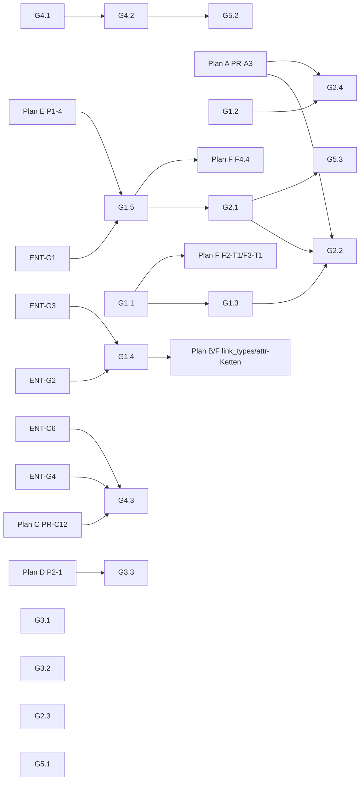

# Plan G — QA-Härtung (qa-beta22)

> **Reiner Umsetzungsplan. Kein Code, keine Migration, keine Config-Änderung.**
> Grundlage: Planbasis `docs/superpowers/specs/2026-10-21-backlog-umsetzungsplaene-design.md`
> §2 „Plan G", Issues #1379–#1412 (Bodies gelesen), Arbeitsbaum `b175c970` (= `origin/main`),
> lesende Checks gegen die QS (beta.22). Rohbelege:
> `docs/test-reports/plan-review-2026-10-21/plan-g/live-checks.md` (Check-IDs `G-L1`…`G-L17`).
> graphify-Graph existiert in diesem Arbeitsbaum nicht (`graphify-out/` fehlt) — Navigation
> daher gezielt per Grep/Read; jede `datei:zeile` gegen `b175c970` verifiziert (auch die in Stufe 2 neu eingeführten).
> **Belege:** Belege unter `docs/test-reports/` sind gitignored (`.gitignore:91`); DoD-Nachweise stehen im PR-Text bzw. als
> CI-Artefakt (vorläufig, ENT-X3 = C). Nach ENT-X3 = B gehen neue DoD-Artefakte nach `docs/se/reports/` bzw. `docs/reviews/`
> (Index §f.6). QS-Adressen in Verifikationsbefehlen nur als `$QS_URL`.
> **Vorrang:** Planbasis > [Plan-Index](2026-10-21-backlog-umsetzung-index.md) > dieser Plan. Offene Nutzerentscheidungen heißen
> `ENT-*` ([Entscheidungsliste](2026-10-21-entscheidungen-offen.md)); Stellen mit „vorläufig, ENT-…“ tragen deren Empfehlung bis
> zur Entscheidung. Wo die Liste „Vorläufig: nein“ führt (ENT-G1…ENT-G4, ENT-C6), startet die betroffene PR erst nach Entscheidung.
> **Migrationen:** siehe [Plan-Index §e](2026-10-21-backlog-umsetzung-index.md#e-konsolidierte-migrationsvergabe-bindend) und §13
> (nur Namen + Index-Verweis, keine eigene Reservierung).

| Feld | Wert |
|---|---|
| **Status** | proposed — 4 Nutzerentscheidungen offen (ENT-G1…ENT-G4, §10); PR 16 zusätzlich an ENT-C6 (Plan C) gebunden |
| **Bezug** | #1381 #1386 #1402 #1403 · #1399 #1400 #1401 · #1387 #1389 #1391 · #1379 #1392 #1393 #1394 #1395 · #1404–#1412 |
| **Messbasis der Issues** | QA-Sandbox (beta.21 `78b50ec`, 2026-10-17) — **nicht** das QS-System dieses Plans |
| **Welle** | G1 = Welle 0; G2–G4 = Welle 2; G5 = mitlaufend (Planbasis §3; Index §b) |
| **Querbezug** | G4 = Plan C WP C4 (Plan C referenziert, Plan G spezifiziert). Kontrast-/DOM-Live-Messung: `e2e-tester` von Plan C |
| **Migrationen** | Index §e: `persistence` · `0116_entity_workspace_fk_backfill`, `0117_uid_workspace_unique_constraints` (G1.3, W0), `0119_requirement_list_index` (G2.2, W2); `link_types` · `0010_workspace_definition_workspace_fk` und `attribute_definitions` · `0010_workspace_definition_workspace_fk` (G1.4, W0); `application` · `0036_outbox_workspace_fk` **nur bei ENT-G3 = B** (§13) |

---

## 0. Ziel und Nicht-Ziele

**Ziel.** Die 24 QA-Befunde der Runde `qa-beta22` so abarbeiten, dass (1) fachliche Schlüssel
(`uid`) und Workspace-Bezüge in der Datenbank abgesichert sind, (2) Listen deterministisch und
bei Wachstum O(Seitengröße) bleiben, (3) Betrieb (Compose, Logs, Images) reproduzierbar und
ruhig ist, (4) Formulare Pflicht und Länge erkennbar machen und Trefferflächen WCAG 2.5.8
erfüllen, (5) die Low-Befunde je einzeln entschieden sind (Fix oder begründetes Schließen).

**Nicht-Ziele.**
- Kein neuer Soft-Delete-Mechanismus (der Vertrag GH-443 bleibt, s. §1 E-Bestand; vorläufig, ENT-G1 = A).
- Kein Umbau der Paginierung auf Cursor/Offset (`offset` bleibt nicht unterstützt, §3 G5).
- Keine Erzwingung des HNSW-Plans per `enable_seqscan=off` im Produktivpfad.
- Kein Memory-Umbau (Plan A besitzt Memory/Projektion; G5 dokumentiert nur).
- Keine Key-Prinzipal-/Auth-Änderung (Plan E WP E1 besitzt den Key-Fence). `Authorization: Bearer <API-Key>`
  ist by design (REQ-L2-AT-002, `backend/auth_tenancy/rest.py:358-363`); G5.3 schreibt das nur per Test fest (#1407 R3-08).
- Keine Deklaration der Listen-Query-Parameter `status`/`include_deleted` im OpenAPI (API-Vertrag = Plan E WP E2;
  Auftrag an Plan E in §4.1).
- Keine Button-Höhen-Konsolidierung (Plan C WP C1); G4 setzt nur die 24-px-Untergrenze.
- BluePencil-Dialog-ARIA (#1406 R2-09) — Fremdkomponente, Plan D WP D1.

## 1. Entscheidungen (aus der Planbasis, unverändert zitiert)

Planbasis §2 Plan G:

| Bündel | Issues |
|---|---|
| G1 Datenintegrität: Soft-Delete-Vertrag, ReqIF-Import mit `uid`+Embedding, `uid`-Eindeutigkeit für alle Typen, 323 hängende `workspace_id` ohne FK | #1381, #1386, #1402, #1403 |
| G2 Performance: HNSW-Index-Nutzung, `(workspace_id, created_at)`-Index, Schreibpfad-Kaltstart | #1399, #1400, #1401 |
| G3 Betrieb: Compose-Projektname, Celery-Logflut (51k Zeilen), Image-Digest-Pins | #1387, #1389, #1391 |
| G4 Formulare/A11y: Kontrast `/reviews` (1,18:1), `maxlength`, Pflichtfelder (`required`/`aria-required`), Treffergröße ≥24 px | #1379, #1392–#1395 |
| G5 Sammel-Lows | #1404–#1412 |

Planbasis §3: „Welle 0 (klein, parallel): C0, D2 (Promptfoo), **G1**, E2, E1." — „Welle 2: …,
**G2–G4**, D1." Planbasis Plan C: „C4 | Formular-/A11y-Härtung aus Plan G4 | siehe G".

**Bestehende, bindende Projektentscheidungen, die Plan G berührt (nicht Teil dieser Sitzung):**
- **GH-443 Soft-Delete-Vertrag:** „`DELETE` 204 → `GET` 200 + `status == "outdated"`"
  (`backend/rest_api/mixins/workflow_state.py` Docstring von `get_status`; OpenAPI-Beschreibung
  live, G-L3).
- **O-2 (RLS-Spec #1136, `docs/audit/2026-10/1136-rls-coverage-spec.md:412-416, 731-732`):**
  „Orphan-Politik bestätigt — `tenant_id` bleibt NULL, **kein Delete**, Count + WARNING" — gilt für
  Outbox-Zeilen ohne auflösbaren Workspace (`backend/application/event_bus.py:1170-1196`).
- **Betreiberentscheidung 2026-10-08** (Waisen in `we_*` dürfen gelöscht werden;
  `backend/workflow/workspace_orphans.py:15-16`) — gilt nur für `we_item_state`/`we_engine_definition`.
- **REQ-L2-AT-002** (API-Key-Authentisierung, `docs/se/traceability-matrix.md:295`): ein `reqlo_`-Key darf auch als
  `Authorization: Bearer <key>` kommen (`backend/auth_tenancy/rest.py:360-361`).

## 2. Ist-Stand

### 2.1 Eigener Check pro Issue

Verdikt-Skala: **BESTÄTIGT** (live oder Code), **TEILWEISE** (Kern stimmt, Teilaussage falsch/
überholt), **WIDERLEGT** (für den aktuellen Stand), **NICHT PRÜFBAR lesend** (dann „nur Code-belegt").

| Issue | Verdikt | Beleg |
|---|---|---|
| #1381 Soft-Delete | **TEILWEISE** — 200 nach DELETE ist dokumentierter Vertrag (GH-443), nicht Fehler; echter Defekt: ArchitectureElement-Ausreißer (404) mit überholter Begründung, `change_reason` im OpenAPI nicht deklariert. Live nicht prüfbar (keine gelöschten Artefakte, G-L2) | `rest_api/views.py:1685-1700` (Req-Vertrag), `:2914-2941` (Arch 404, Begründung „no status mirror"); Begründung überholt: `ArchitectureElementSerializer` nutzt `WorkflowStateSerializerMixin` (`rest_api/serializers.py:1264-1266`), Overlay `outdated` generisch (`workflow/state_reader.py:143`); Arch-404 entsteht in `application/architecture_service.py:426-429`; OpenAPI G-L3 |
| #1386 ReqIF ohne `uid`/Embedding | **BESTÄTIGT (Code) + erweitert** — Import umgeht Allokator und Embedding; zusätzlich legt `seed_toothbrush` StakeholderNeeds ohne `uid` an | `application/reqif_import_service.py:1325-1379` (Create ohne `uid`), `:1398-1399` („uid is NOT set from ReqIF"), `:1073` (`entity.save()`, kein Embedding); `auth_tenancy/management/commands/seed_toothbrush.py:166-173`; live **needs 0/20 `uid`** (G-L4), Requirements 880/880 |
| #1402 `uid`-Eindeutigkeit | **BESTÄTIGT (Code)** — nur `uq_requirement_workspace_uid`; `pl_testcase`, `pl_architecture_element`, `pl_stakeholder_need` haben keine Workspace-Spalte | `persistence/models.py:1726-1730`; TestCase-Meta `:2224-2232` (nur `idx_testcase_uid_btree`); Adr/Risk/Issue `workspace_id` UUIDField `:3195, :3329, :3616`; TestRun `workspace` FK `:2337`; live 0 Duplikate (G-L4) |
| #1403 hängende `workspace_id` | **BESTÄTIGT (Code), Zahlen NICHT PRÜFBAR** — drei UUID-Spalten ohne FK, Workspace-Löschung räumt sie nicht ab; **Entscheidungs-Konflikt** für die Outbox (O-2, ENT-G3) | `link_types/models.py:58`, `attribute_definitions/models.py:72`, `application/models.py:126`; Kaskade `application/workspace_service.py:765-817` ohne diese Tabellen |
| #1399 HNSW ungenutzt | **BESTÄTIGT als Messung, kein Produktdefekt bei heutiger Größe** — Seq Scan ist bei ~2k Zeilen planerkorrekt; Iterative Scan existiert | `application/vector_port.py:213-236`, `application/pgvector_ann.py` (iterative scan, #977) |
| #1400 Listen-Index | **TEILWEISE WIDERLEGT** — Composite-Indizes `(tenant, workspace[, artifact_type])` existieren seit `0034`; der Requirements-Liste fehlt jedes `ORDER BY` ⇒ nicht-deterministische Paginierung (gravierender als der Index) | `persistence/models.py:1430-1438`, `persistence/migrations/0034_add_composite_indexes.py:23,31`; `application/requirement_service.py:1190-1219` (kein `order_by`); live G-L6 |
| #1401 Kaltstart Schreibpfad | **NICHT PRÜFBAR lesend (nur Code-belegt)** — Create bettet synchron ein; QS nutzt Ollama (kein Preload, kein `keep_alive`) | `application/requirement_service.py:470-471`; `llm_adapter/embedding_service.py:298-301` (`/api/embeddings`, Body ohne `keep_alive`); Preload nur für sentence-transformers `llm_adapter/apps.py:158-185`; Worker-Recycling `backend/Dockerfile:261` (`--max-requests 1000`); live G-L8/G-L9 |
| #1387 Compose-Herkunft | **NICHT PRÜFBAR lesend (nur Code-belegt)** — `make test-backend` startet über `depends_on` Postgres im selben Projekt mit anderem Dateisatz | `Makefile:29, 81-82`; `testing/docker-compose.test.yml:54-56` |
| #1389 Celery-Logflut | **BESTÄTIGT (Code)** — 3 INFO-Zeilen je 5-s-Zyklus = 51.840/24 h | `application/event_bus.py:1199-1201`; `reqogniloom/settings.py:961-964` |
| #1391 Digest-Pins | **BESTÄTIGT (Code)**; Honcho/Qdrant bereits digest-gepinnt; Dependabot-Docker deckt `backend/`, `frontend/`, Compose nicht ab | `backend/Dockerfile:8,63`; `frontend/Dockerfile:44`; `deploy/docker-compose.yml:272,373,567,1199,1215,1576`; gepinnt `:1232,1527`; `.github/dependabot.yml:19-25` (`directory: "/"`) |
| #1379 Kontrast `/reviews` | **WIDERLEGT für beta.22** — Farbe gesetzt (nach beta.21 eingeführt) | `frontend/src/components/Reviews/ReviewsView.module.css:79-98`; deployed CSS G-L10 |
| #1392 `maxlength` | **BESTÄTIGT** — Create-Dialoge ohne `maxLength`; Attributdefinition liefert keine Länge | `frontend/src/components/AdrEditors/AdrEditors.tsx:390-399`; `…/ArtifactForm/fields/TextField.tsx:32`; G-L11, G-L12 |
| #1393 Pflichtfelder | **TEILWEISE** — Create-Dialoge ohne `required`/Marker bestätigt; Änderungsgrund trägt bereits `aria-required="true"` + Sternchen (auch in beta.21) | `AdrEditors.tsx:384-399`; `…/ArtifactForm/ArtifactFormActions.tsx:72-83`; `…/ArtifactForm/ArtifactForm.module.css:121-124`; beta.21: `git show 78b50ec:…/ArtifactForm.tsx` Zeile 1049 |
| #1394 Radio/Checkbox 13 px | **BESTÄTIGT (Code)** — keine Größenregel für native Inputs | kein Treffer `input[type=checkbox]` in `frontend/src/styles/global.css`; DOM-Messung: Plan-C-e2e |
| #1395 Icon-Buttons < 24 px | **BESTÄTIGT (Code)** | `RequirementEditors/RequirementList.module.css:60-63` (22×22); `shared/IdChip/IdChip.module.css:30-32` (`min-height: var(--space-5)` = 20 px, `tokens.css:764`); `shared/ArtifactForm/ArtifactForm.module.css:88-99` (`padding: 0`); `shared/TraceSpine/TraceSpine.module.css:123-134` |
| #1404 R10-07/08 | R10-07 **Folgebefund von #1387** (Postgres-Recreate zur Laufzeit) + Traceback statt Einzeiler (`application/tasks.py:47-48`); R10-08 **BESTÄTIGT** (katex 0.16.47, Fix 0.18.2; G-L17) | s. links |
| #1405 R1-03…07 | **nur Code-belegt** — R1-05 bestätigt: unbekannte Route → `Navigate to "/"` | `frontend/src/components/NavigationShell/NavigationShell.tsx:240`; übrige DOM-Punkte: Plan-C-e2e |
| #1406 R2-07…09 | R2-07 **BESTÄTIGT (Code)** Divider-Inline-Style; R2-08 nur Code-belegt; R2-09 Fremdkomponente | `components/SplitView/SplitView.tsx:613-624` |
| #1407 R3-06…09 | R3-06 **BESTÄTIGT, by design** (G-L13); R3-07 **BESTÄTIGT (Code)** `change_reason` nur aus Body; R3-08 **by design** (REQ-L2-AT-002: `reqlo_`-Key im `Authorization: Bearer` wird als API-Key validiert, gleiche Prüfung wie `X-API-Key`; OpenAPI dokumentiert es); R3-09 **BESTÄTIGT** (G-L14) | `rest_api/views.py:937,1703,8892`; `rest_api/serializers.py:409-433`; R3-08: `auth_tenancy/rest.py:358-363`, OpenAPI-Beschreibung `reqogniloom/settings.py:721-740`, MCP gleiche Priorität `mcp_server/protocol_handler.py:364-369` |
| #1408 R4-05 | **kein Defekt erkennbar** — die im Body genannten Tool-/Präfix-Zahlen sind deckungsgleich mit dem Manifest zum Messzeitpunkt (Ist-Zahl: `jq '.tool_count' docs/agent-templates/tool-manifest.json`, Index §f.1) | `docs/agent-templates/tool-manifest.json` |
| #1409 R5-05 | **NICHT REPRODUZIERT** (G-L15); Mitglieds-User-Einträge in Workspace-Projektion sind beabsichtigt | `application/memory_admin_service.py:319-351` |
| #1410 R6-07 | **NICHT PRÜFBAR**; Beispiele sind QA-Sonden („L6-Probe (QA)", „QA-MCP-create") | Issue-Body |
| #1411 R8-07/08 | **umgebungsbedingt** — FTS-Indexausdruck passt zur Query, ungenutzt nur wegen Tabellengröße; 4 Gunicorn-Worker | `persistence/migrations/0002_fulltext_indexes.py:22-30` vs. `application/search_service.py:171-172,770`; `backend/Dockerfile:261` |
| #1412 R9-05…07 | **by design** — `scope_artifact_id` ist `CharField(blank, default="")`; Project-Baselines ohne Wurzelartefakt; `InterviewSession.artifact` ist `null=True` | `baseline/models.py:231`; `persistence/models.py:3055-3061` |

### 2.2 Kernbefunde im Code (für die WPs)

- **Allokator nur in Services.** `generate_local_uid` (`application/local_uid.py:43`) wird von 8
  Services aufgerufen (`adr_service.py:224`, `architecture_service.py:179`,
  `requirement_service.py:427`, `test_service.py:255`, `issue_service.py:252`,
  `risk_service.py:266`, `stakeholder_need_service.py:175`, `test_run_service.py:86`); jeder
  Pfad, der Modelle direkt anlegt (ReqIF-Import, Seeds), erhält keine `uid`. Präfixe stehen in
  `UID_PREFIXES` (`application/local_uid.py:26`).
- **Bewährte Muster vorhanden:** denormalisierte Workspace-FK + partieller Unique-Constraint
  (`persistence/migrations/0055_requirement_workspace_uid_constraint.py`), FK-Nachrüstung mit
  Waisen-Vorschritt (`workflow/migrations/0023_we_item_state_workspace_fk_cascade.py`,
  `workflow/workspace_orphans.py`), `SET LOCAL row_security = off` in Datenmigrationen
  (`persistence/migrations/0081_migrate_trace_link_types.py:83`), RLS-Policy-DDL für `lt_*`
  (`link_types/migrations/0002_rls_policies.py`), uid-Backfill per
  AWMS-Plan (`attribute_definitions/migration_plans/backfill_requirement_uid.yaml`,
  `python manage.py attribute_migrate --plan … --apply`), Embedding-Backfill
  (`application/management/commands/backfill_embeddings.py`).
- **Paginierung:** `BaseEntityViewSet._paginate` (`rest_api/views.py:608-655`, 16 Aufrufer) reicht
  unsortierte QuerySets an `StandardPagination` (`rest_api/serializers.py:409`).
- **Query-Parameter-Helfer existieren bereits** in `rest_api/query_params.py` (`parse_include_deleted` `:110`,
  importiert in `rest_api/views.py:169-173`) — G1.5 ergänzt diese Datei, legt sie nicht neu an.

## 3. Arbeitspakete

Rollen: `senior-developer` (Migrationen, Risiko-Pfade), `developer` (Standard),
`junior-developer` (CSS/Doku), `devops-engineer` (Compose/Images), `tester` (Testläufe),
`code-reviewer`, `security-auditor`, `database-engineer` (Migrations-Review), `accessibility-specialist` (G4-Prüfung).
Testbefehle laufen im Test-Stack (`make test-backend` bzw. gezielt
`docker compose -f deploy/docker-compose.yml -f testing/docker-compose.test.yml --project-directory . run --rm --no-deps backend-test pytest <pfad>`;
nach G3.1 ist `--no-deps` Default im Makefile). Gegen den laufenden Dev-Stack gilt ausschließlich das Makro `BT`
aus [Index §f.3](2026-10-21-backlog-umsetzung-index.md#f3-lokale-testbefehle-und-passwort-variable-qr-t23) (RLS-Tests brauchen den Superuser).
Volle Suiten nie parallel. CI-Set-Zuordnung der Testpfade: Index §f.4.

### WP G1 — Datenintegrität (Welle 0)

#### G1.1 `uid` und Workspace-Bezug auf **jedem** Erzeugungspfad (#1386, #1402-Voraussetzung)

- **Rolle:** senior-developer.
- **Ansatz (Root-Cause statt Pfad-Patch):** ein `pre_save`-Receiver für die 8 `uid`-Modelle vergibt
  `uid` (wenn leer, nur bei `_state.adding`) und setzt die denormalisierte Workspace-FK aus
  `artifact.workspace_id` (wenn das Modell sie hat und sie leer ist). Damit decken Seed, ReqIF-Import
  und künftige Pfade den Allokator ab; die Services bleiben unverändert (ihr explizites `uid` gewinnt).
- **Dateien:**
  - ändern `backend/application/local_uid.py` — neu:
    `UID_MODELS: tuple[str, ...]` (Model-Labels `"persistence.Requirement"`, `"persistence.StakeholderNeed"`,
    `"persistence.ArchitectureElement"`, `"persistence.TestCase"`, `"persistence.TestRun"`, `"persistence.Adr"`,
    `"persistence.Risk"`, `"persistence.Issue"`),
    `def assign_local_uid(sender: type[models.Model], instance: models.Model, raw: bool = False, **kwargs: Any) -> None`
    und `def register_uid_signals() -> None` (verbindet `pre_save` für jedes Modell aus `UID_MODELS` per
    `apps.get_model(label)`, `dispatch_uid=f"local_uid:{label}"`; `raw=True` (Fixtures) → no-op).
    `item_type` = Klassenname (`type(instance).__name__`, Schlüssel in `UID_PREFIXES`).
    Workspace-Quelle: `instance.workspace_id`, wenn das Modell ein Feld `workspace`/`workspace_id` hat und es gesetzt ist,
    sonst `instance.artifact.workspace_id`.
  - **Erweiterungsvertrag (bindend für Plan F F2-T1/F3-T1):** Ein neues `uid`-Modell trägt sich an **genau zwei**
    Stellen ein: Label in `UID_MODELS` und Präfix in `UID_PREFIXES` (Plan F: `"persistence.Document"` / `"Document": "DOC"`,
    `"persistence.WorkItem"` / `"WorkItem": "WI"`). Constraint nach G1.3-Muster (`uq_<tabelle>_workspace_uid`) in der
    eigenen `CreateModel`-Migration. Keine weitere Registrierung, kein Service-Code nötig.
  - ändern `backend/application/apps.py:28-40` — `register_uid_signals()` in `ready()`.
  - ändern `backend/application/reqif_import_service.py:1398-1399` — Docstring-Satz
    „the local, readable uid is NOT set from ReqIF" präzisieren: „…not *copied* from ReqIF; it is
    allocated locally by `application.local_uid.assign_local_uid`". `reqif_uid` bleibt unverändert.
  - neu `backend/attribute_definitions/migration_plans/backfill_stakeholder_need_uid.yaml` (Kopie von
    `backfill_requirement_uid.yaml`, `scope.item_type: StakeholderNeed`, `id: 2026-10-need-uid-backfill`).
- **Kein REST/MCP-Vertragswechsel:** `uid` bleibt read-only (`rest_api/serializers.py:781`); neu ist
  nur, dass importierte/seeded Artefakte eine `uid` tragen.
- **TDD (zuerst rot):**
  1. `backend/application/tests/test_local_uid_all_paths.py::test_reqif_import_assigns_local_uid` —
     echter ReqIF-Import (vorhandene Fixture aus `application/tests/test_reqif_import_service.py`)
     ⇒ jede neue Requirement/StakeholderNeed hat `uid` `REQ-NNN`/`NEED-NNN`, `reqif_uid` unverändert.
  2. `…::test_direct_orm_create_assigns_uid_and_workspace` — `TestCase.objects.create(artifact=…)`
     ohne `uid` ⇒ `uid == "TC-001"`; zweites ⇒ `TC-002`; explizites `uid="X-1"` bleibt.
  3. `…::test_seed_toothbrush_needs_have_uid` — `call_command("seed_toothbrush", …)` ⇒ 0 Needs ohne `uid`.
  4. `…::test_raw_fixture_load_does_not_allocate` — `raw=True` ⇒ kein `UidSequence`-Schreibzugriff.
  5. `…::test_uid_models_and_prefixes_in_sync` — jedes Modell aus `UID_MODELS` hat einen Eintrag in `UID_PREFIXES`
     und ein Feld `uid`; Mengen-Prüfung, keine Gesamtzahl (Plan F erweitert beide Mengen).
- **DoD:** 5 Tests grün; `pytest backend/application/tests/test_local_uid*.py backend/application/tests/test_reqif_import_service.py backend/auth_tenancy/tests -q` grün; kein Service-Aufruf geändert.
- **Verifikation:**
  `docker compose … run --rm --no-deps backend-test pytest application/tests/test_local_uid_all_paths.py -q`
  → `5 passed`. Nach Deploy (Betreiber): `python manage.py attribute_migrate --plan attribute_definitions/migration_plans/backfill_stakeholder_need_uid.yaml --tenant <uuid>` (Dry-Run) → Bericht „would update N rows"; mit `--apply` → `failed == 0`; danach `curl -s -H "X-API-Key: $KEY" "$QS_URL/api/v1/needs/?workspace_id=$W1&page_size=100"` → alle Einträge mit `uid`.

#### G1.2 ReqIF-Import bettet importierte Requirements ein (#1386)

- **Rolle:** developer.
- **Dateien:**
  - neu `backend/application/embedding_backfill.py` — `def embed_rows(model_name: str, ids: list[UUID]) -> int`
    (Kern aus `backfill_embeddings.Command._embed_batch`, `application/management/commands/backfill_embeddings.py:267`, herausgezogen; Command ruft danach diese Funktion).
  - ändern `backend/application/management/commands/backfill_embeddings.py:267-…` — delegiert an `embed_rows`.
  - ändern `backend/application/tasks.py` — `@shared_task(name="application.embed_rows") def embed_rows_task(model_name: str, ids: list[str], tenant_id: str) -> int`
    (armiert Tenant wie `backfill_embeddings` via `persistence.middleware.set_request_tenant`; Wiederherstellung im `finally`, Index §f.8).
  - ändern `backend/application/reqif_import_service.py` (`import_reqif`, `:684`) — sammelt IDs neu
    angelegter/geänderter Requirements; am Ende `transaction.on_commit(lambda: embed_rows_task.delay("requirement", ids, str(tenant_id)))`;
    Broker-Fehler ⇒ `logger.warning` + Import bleibt erfolgreich.
- **Fallback:** Celery/Broker nicht erreichbar ⇒ Import 200 wie heute, Vektoren fehlen; Betreiber
  holt nach mit `python manage.py backfill_embeddings --model requirement --tenant <uuid>`.
- **TDD:** `backend/application/tests/test_reqif_import_embedding.py::test_import_enqueues_embedding_after_commit`
  (Settings-Test hat `CELERY_TASK_ALWAYS_EAGER=True`, `reqogniloom/settings_test.py:110`; mit
  `mock`-Embedding-Provider aus dem Projekt ⇒ nach `TransactionTestCase`-Import `embedding IS NOT NULL`
  für alle importierten Requirements); `::test_import_survives_broker_failure` (`embed_rows_task.delay`
  wirft `OperationalError` ⇒ Import-Ergebnis `succeeded > 0`, WARNING geloggt).
- **DoD:** beide Tests grün; `backfill_embeddings`-Tests unverändert grün.
- **Verifikation:** `pytest application/tests/test_reqif_import_embedding.py application/tests/test_backfill_embeddings*.py -q` → alle grün.

#### G1.3 `uid`-Eindeutigkeit per DB für alle 8 Tabellen (#1402)

- **Rolle:** senior-developer; Review: database-engineer.
- **Voraussetzung:** G1.1 (setzt die neue Workspace-FK auf jedem Pfad).
- **Datenmodell:**
  - `TestCase`, `ArchitectureElement`, `StakeholderNeed`: neues Feld
    `workspace = models.ForeignKey("persistence.Workspace", on_delete=models.CASCADE, null=True, blank=True, related_name="+", help_text="denormalized copy of artifact.workspace_id; backs uq_*_workspace_uid (#1402)")`
    — exakt das Muster von `Requirement.workspace` (`persistence/models.py:1548-1560`).
  - Partielle Constraints (Bedingung wie `:1726-1730`: `~Q(uid=None) & ~Q(uid="")`):
    `uq_testcase_workspace_uid`, `uq_architecture_element_workspace_uid`,
    `uq_stakeholder_need_workspace_uid`, `uq_test_run_workspace_uid` (Feld `workspace`),
    `uq_adr_workspace_uid`, `uq_risk_workspace_uid`, `uq_issue_workspace_uid` (Feld `workspace_id`, UUIDField).
    Namensschema `uq_<tabelle>_workspace_uid` ist das Muster für künftige `uid`-Modelle (Plan F, G1.1-Erweiterungsvertrag).
- **Migrationen** (Namen laut Index §e; Nummer beim Merge = max+1 der App; erwartet direkt nach `0115_workspace_glossary_reference_mode`):
  - `persistence` · `0116_entity_workspace_fk_backfill` (expand): 3× `AddField` (nullable) +
    `RunPython(_backfill_workspace)` mit `SET LOCAL row_security = off` (pl_* tragen FORCE RLS,
    `persistence/migrations/0003_rls_policies.py`, `0067_rls_remaining_pl_tables.py`) und
    Subquery-UPDATE wie `0055:_backfill_workspace`. Reverse: `RemoveField` (automatisch), Backfill-Reverse = noop.
  - `persistence` · `0117_uid_workspace_unique_constraints`: `RunPython(_dedupe_uid_collisions)` je
    Tabelle (Muster `0055`: älteste Zeile behält `uid`, spätere bekommen ` (n)`, nur Umbenennen,
    nie Löschen; Reverse noop) + 7× `AddConstraint`. Reverse: `RemoveConstraint` (automatisch).
  - Keine neue Tabelle ⇒ keine RLS-Policy-Migration; `persistence/tests/test_rls_coverage.py` bleibt Pflicht-Check und grün.
  - Rückwärtskompatibilität: Vorgänger-Release schreibt die neue FK nicht (NULL) ⇒ Constraint greift
    für diese Zeilen nicht (NULL ist distinct), bricht aber nichts. Deploy-Reihenfolge `migrate` vor
    `serve` (RLS-Spec R-11) hält das Fenster minimal.
  - Lock-Verhalten: `ADD CONSTRAINT … UNIQUE` baut den Index unter SHARE-Lock; Tabellen haben
    < 10⁴ Zeilen (QS: 880 Requirements) ⇒ Sekundenbruchteile. Ab 10⁶ Zeilen vorab
    `CREATE UNIQUE INDEX CONCURRENTLY` + `ADD CONSTRAINT … USING INDEX` (im Runbook vermerkt).
- **TDD:**
  1. `backend/persistence/tests/test_uid_unique_constraints_1402.py::test_duplicate_uid_same_workspace_rejected`
     — je Modell zwei Zeilen mit gleichem `uid` im selben Workspace ⇒ `IntegrityError`.
  2. `…::test_same_uid_other_workspace_allowed` (ReqIF-Semantik, wie `0055`-Docstring).
  3. `…::test_blank_uid_not_constrained` (zwei Zeilen `uid=""`).
  4. `…::test_migration_dedupes_existing_collisions` (`MigrationExecutor`: auf `0116_entity_workspace_fk_backfill` zurück,
     Duplikat einfügen, `0117_uid_workspace_unique_constraints` vorwärts ⇒ zweite Zeile `"TC-001 (2)"`).
  5. `…::test_migration_reverse_roundtrip` (Roundtrip `0117_uid_workspace_unique_constraints` → `0115_workspace_glossary_reference_mode`
     → `0117_uid_workspace_unique_constraints` per Namen ohne Fehler; Zielknoten über Namen bzw. `loader.graph.leaf_nodes()`, nie nackte Nummern).
- **DoD:** Tests grün; `python manage.py makemigrations --check --dry-run` → `No changes detected` (lokal, alle Apps);
  `python manage.py sqlmigrate persistence 0117_uid_workspace_unique_constraints` zeigt 7 `UNIQUE … WHERE`-Constraints;
  Rückwärts-Probe `migrate persistence 0115_workspace_glossary_reference_mode` → `migrate persistence` rund (Index §e Regel 4).
- **Verifikation (SQL, Betreiber):**
  `SELECT conname FROM pg_constraint WHERE conname LIKE 'uq_%workspace_uid';` → 8 Zeilen (Stand nach P1; die 8 Namen
  aus G1.3 sind fachlich fix — kommen mit Plan F weitere `uid`-Modelle hinzu, wird auf Mengen-Zugehörigkeit der 8 Namen geprüft);
  `SELECT count(*) FROM pl_testcase WHERE workspace_id IS NULL;` → `0`.

#### G1.4 Workspace-FK für Typdefinitionen + Waisen (#1403)

- **Rolle:** senior-developer; Review: database-engineer, **security-auditor** (destruktiver Datenpfad, RLS der Archivtabellen).
- **Eintritt:** **ENT-G2 und ENT-G3 entschieden** (beide „Vorläufig: nein“). Eingeplant ist die Empfehlung
  **vorläufig, ENT-G2 = A+** (Archiv statt reinem Backup-Vertrauen, QR-S16) und **vorläufig, ENT-G3 = A** (Outbox: keine FK, kein Delete).
- **Datenmodell:** `WorkspaceLinkTypeDefinition.workspace_id` (`link_types/models.py:58`) und
  `WorkspaceAttributeDefinition.workspace_id` (`attribute_definitions/models.py:72`) werden zu
  `workspace = models.ForeignKey("persistence.Workspace", on_delete=models.CASCADE, db_column="workspace_id", related_name="+")`.
  Attributname `workspace_id` bleibt (FK-attname), alle Filter `workspace_id=…` funktionieren weiter.
  Die bestehenden Unique-Constraints/Indizes (`uq_lt_ws_tenant_ws_key`, `idx_lt_ws_workspace_key`,
  `uq_ad_ws_def_tenant_ws_type`) bleiben namensgleich.
- **Outbox (`as_domain_event_outbox`), vorläufig ENT-G3 = A:** **keine FK** (O-2 „kein Delete"; Events sind Protokoll, ein
  CASCADE löschte auch noch unveröffentlichte Events eines gelöschten Workspaces). Die 91 Waisen
  bleiben gezählt/geloggt (bestehender WARNING-Pfad `event_bus.py:1188-1196`). Nur bei ENT-G3 = B kommt
  `application` · `0036_outbox_workspace_fk` in denselben PR (Index §e, Plan A/F verschieben sich um +1).
- **Waisen-Behandlung (vorläufig, ENT-G2 = A+; QR-S16):**
  1. **Backup ist Pflichtschritt, kein Hinweis.** Vor `migrate` mit PR 4 läuft auf jedem Zielsystem
     `BACKUP_ONCE=true` (§7); Dump-Datei + Zeitstempel stehen im Deploy-Protokoll. Ohne nachgewiesenes Backup kein Deploy von PR 4
     (Zeile in der Deploy-Checkliste des PR-Texts, Abnahme durch `devops-engineer`).
  2. **Archiv statt Verlust:** Die Migration legt `lt_workspace_definition_orphan_archive` und
     `ad_workspace_definition_orphan_archive` an (gleiche Spalten wie die Quelltabelle + `archived_at timestamptz NOT NULL DEFAULT now()`,
     ohne FK) und **kopiert jede zu löschende Zeile dorthin, bevor** sie gelöscht wird (eine Transaktion).
     **RLS:** Die Archivtabellen tragen `tenant_id` und bekommen im **selben** Migrationsschritt ENABLE + FORCE ROW LEVEL SECURITY
     plus die `app.current_tenant`-Policy, byte-gleich zu `link_types/migrations/0002_rls_policies.py` (Begründung: Mandantendaten
     bleiben Mandantendaten; global wäre ein Cross-Tenant-Leseweg). Sie sind keine Django-Modelle; deshalb prüft
     `test_rls_coverage.py` sie nicht — ein eigener Test (unten, TDD 6) sichert die Policy.
  3. **Reverse stellt wieder her:** Reverse der Lösch-Operation kopiert die archivierten Zeilen zurück und leert das Archiv
     (`SET LOCAL row_security = off`); Reverse der Anlage droppt die Archivtabellen erst danach.
  4. **Unwiderruflich ist nur:** (a) ein späteres Leeren/Droppen der Archivtabellen — eigener Contract-PR frühestens ≥ 1 Release
     nach PR 4, **nicht Teil dieses Plans** (Folge-Issue); (b) bei Entscheidung **ENT-G2 = A** (ohne Archiv) die Löschung selbst —
     dann ist das Backup aus Schritt 1 die einzige Wiederherstellung und PR 4 nennt im Titel/Text „irreversible data deletion“.
- **Dateien:**
  - ändern `backend/workflow/workspace_orphans.py` — `count_workspace_orphans` (`:104`) und `delete_workspace_orphans` (`:130`)
    bekommen Parameter `tables: tuple[str, ...] = TABLES_IN_DELETE_ORDER` (`:72`); neue Konstante
    `DEFINITION_TABLES = ("lt_workspace_definition", "ad_workspace_definition")`; neu
    `def archive_and_delete_workspace_orphans(connection: Any, tables: tuple[str, ...]) -> dict[str, int]` und
    `def restore_archived_orphans(connection: Any, tables: tuple[str, ...]) -> dict[str, int]` (Archivname `<tabelle>_orphan_archive`).
    Kein Modell-Import (Migrations-tauglich). Bestehende `we_*`-Aufrufer unverändert (Default-Parameter).
  - neu `backend/workflow/management/commands/cleanup_workspace_orphans.py`:
    - verweigert den Lauf (Exit ≠ 0, `CommandError`), wenn die DB-Rolle weder `rolbypassrls` noch `rolsuper` hat
      (`SELECT rolbypassrls OR rolsuper FROM pg_roles WHERE rolname = current_user`). Ausführung daher über den `migrate`-Dienst
      (Superuser, `deploy/docker-compose.yml:852`), nie im `backend`-Container (App-Rolle, `:637`). Iteration je Tenant ist
      verworfen (Waise = Workspace fehlt; die Bypass-Rolle sieht alle Zeilen ohne Tenant-Raten);
    - bricht ab, wenn `count(pl_workspace) = 0` bei `count(definitions) > 0` (Schutz gegen unsichtbare Zeilen);
    - `--dry-run` zählt nur; Ausgabe `lt_workspace_definition=<n> ad_workspace_definition=<n>`;
    - Löschen nur mit `--confirm-count=<n>`, wobei `<n>` die Summe aus dem Dry-Run ist; weicht die aktuelle Zählung ab ⇒ Abbruch
      ohne Änderung. Gelöscht wird ausschließlich über `archive_and_delete_workspace_orphans` in `transaction.atomic()`.
  - ändern `backend/link_types/models.py:58`, `backend/attribute_definitions/models.py:72`.
  - Migrationen (Namen laut Index §e) `link_types` · `0010_workspace_definition_workspace_fk`,
    `attribute_definitions` · `0010_workspace_definition_workspace_fk`, Operationen in dieser Reihenfolge:
    (0) `RunSQL` Archivtabelle + RLS-Policy (Reverse: `DROP TABLE`), (1) `RunPython` Waisen archivieren und löschen
    (gemeinsamer Kern, `SET LOCAL row_security = off`, WARNING mit Zählung; Reverse: `restore_archived_orphans`), (2) `AlterField`
    UUIDField → ForeignKey (`db_column="workspace_id"`, Django erzeugt die FK-Constraint
    `… REFERENCES pl_workspace(id) DEFERRABLE INITIALLY DEFERRED`), (3) `RunSQL` hebt die Constraint
    auf `ON DELETE CASCADE` (Muster `workflow/0023`, damit Roh-`DELETE FROM pl_workspace` nicht
    erneut Waisen erzeugt; Reverse: Constraint ohne CASCADE). `dependencies`: Vorgängerin der eigenen App
    (`link_types` · `0009_backfill_need_satisfies_pair` bzw. `attribute_definitions` · `0009_backfill_requirement_rationale_source`)
    plus `("persistence", "0115_workspace_glossary_reference_mode")` (kein Pin auf G PR 3).
- **Testanpassung (Blast-Radius):** 35 Testdateien referenzieren die beiden Modelle, **16 Stellen**
  in `link_types/` und `attribute_definitions/` erzeugen Definitionen mit `workspace_id=uuid.uuid4()`
  ohne Workspace-Zeile — diese brauchen eine echte `Workspace`-Fixture.
- **Folgeregel (bindend für Plan B/F, KA-G-10):** Nach G1.4 legen **alle** Tests, die Typdefinitionen erzeugen, echte
  `Workspace`-Zeilen an (kein `uuid4()`); das gilt auch für die Seed-Migrationstests von Plan B (`link_types` · `0011_seed_validates_link_type`,
  `0012_seed_performs_and_satisfies_function_pair`, `attribute_definitions` · `0011_requirement_interview_elicits_se_fields`) und Plan F
  (`link_types` · `0013ff.`, Index §e).
- **TDD:**
  1. `backend/workflow/tests/test_workspace_definition_orphans_1403.py::test_workspace_delete_cascades_definitions`
     — Workspace mit Link-Typ- und Attributdefinition über `WorkspaceService.delete_workspace` löschen ⇒ 0 Zeilen in beiden Tabellen.
  2. `…::test_raw_workspace_delete_cascades` — `DELETE FROM pl_workspace` per Cursor ⇒ 0 Waisen.
  3. `…::test_orphan_delete_is_archived_and_reversible` — `MigrationExecutor` auf `link_types` · `0009_backfill_need_satisfies_pair` /
     `attribute_definitions` · `0009_backfill_requirement_rationale_source` (noch ohne FK), je eine Waise einfügen; vorwärts auf
     `0010_workspace_definition_workspace_fk` ⇒ Waise weg, identische Zeile im Archiv, FK aktiv; rückwärts auf die `0009_…`-Namen ⇒
     Waise wieder in der Quelltabelle, Archiv leer bzw. gedroppt.
  4. `…::test_cleanup_aborts_without_rls_bypass` — Command unter einer Rolle ohne `BYPASSRLS` (Test legt sie per `SET ROLE` an)
     ⇒ `CommandError`, keine Zeile verändert; zusätzlich `count(pl_workspace)=0`-Wächter ⇒ Abbruch.
  5. `…::test_cleanup_requires_matching_confirm_count` — `--dry-run` meldet je 1 und löscht nichts; ohne `--confirm-count` oder mit
     falschem Wert ⇒ Abbruch; mit passendem Wert ⇒ archiviert + gelöscht.
  6. `…::test_orphan_archive_tables_have_forced_rls` — `pg_class.relrowsecurity` und `relforcerowsecurity` = true für beide Archivtabellen,
     Policy auf `app.current_tenant` vorhanden.
  7. `…::test_outbox_orphans_are_never_deleted` — Outbox-Zeile eines gelöschten Workspaces bleibt (O-2; vorläufig, ENT-G3 = A).
- **DoD:** Tests grün; `makemigrations --check --dry-run` sauber (lokal, alle Apps); die 16 Teststellen auf echte Workspaces umgestellt;
  `pytest link_types attribute_definitions workflow application/tests/test_workspace_service*.py persistence/tests/test_rls_coverage.py -q` grün;
  Rückwärts-Probe mit Migrationsnamen rund; PR-Text enthält die Deploy-Checkliste (Backup-Pflicht, Dry-Run-Zählung, `--confirm-count`).
- **Verifikation (Betreiber, vor Migration):**
  `docker compose -f deploy/docker-compose.yml --project-directory . run --rm --no-deps migrate python manage.py cleanup_workspace_orphans --dry-run`
  → erwartete Zählung auf der QA-Sandbox ≈ `lt_workspace_definition=209 ad_workspace_definition=23`
  (Issue-Messung); nach `migrate`: `SELECT confdeltype FROM pg_constraint WHERE conrelid='lt_workspace_definition'::regclass AND contype='f';` → `c`;
  `SELECT count(*) FROM lt_workspace_definition_orphan_archive;` (als Superuser) = Dry-Run-Zahl.

#### G1.5 Soft-Delete-Vertrag vervollständigen (#1381, #1407 R3-07)

- **Rolle:** developer; Review: code-reviewer.
- **Eintritt:** **ENT-G1 entschieden** („Vorläufig: nein“, sichtbare API-Änderung); eingeplant ist **vorläufig, ENT-G1 = A**
  (GH-443 beibehalten). Merge in der Welle-0-Queue `rest_api/views.py` **nach Plan E P1-4**:
  E P1-1 → E P1-2 → E P1-4 → **G PR 5 (5a → 5b)** → E P1-3 → E P1-7 (Index §d.2, QR-T14). G2.1 (PR 6) merged nach G1.5.
- **Änderungen:**
  1. ArchitectureElement-Ausreißer entfernen: `rest_api/views.py:2652-2661` `retrieve` ruft
     `get_architecture_element(UUID(pk), ctx, include_deleted=True)` ⇒ nach DELETE `200` + `status: "outdated"`
     (Overlay `workflow/state_reader.py:143`). Docstring `:2914-2941` auf die Regel umschreiben.
     **Sichtbare Verhaltensänderung (brechend):** `GET /api/v1/architecture/{id}/` nach DELETE `404 → 200` — eigener PR 5b (Index §f.7).
  2. `change_reason` auch als Query-Parameter: **ändern** `rest_api/query_params.py` (Datei existiert, `parse_include_deleted` `:110`) —
     neu `def parse_change_reason(request: Request) -> str` (Body hat Vorrang, dann `?change_reason=`);
     ersetzt die drei DELETE-Stellen `rest_api/views.py:937` (needs), `:1703` (requirements),
     `:8892` (change-requests).
  3. OpenAPI: `@extend_schema(parameters=[OpenApiParameter("change_reason", str, OpenApiParameter.QUERY, required=False)], request=…)`
     auf allen soft-deletenden `destroy` (18 Stellen, Liste `rest_api/views.py` `def destroy` ab `:669`),
     plus 204-Beschreibung „soft-deleted; GET answers 200 with status=outdated".
  4. Docstrings „Its workflow state moves to "outdated"" korrigieren (Phase-4-Stand: Flag
     `Artifact.lifecycle_status`, `workflow/services.py:983-994`).
- **Soft-Delete-Vertrag (bindend für Konsumenten; Plan F F4.4 hängt hart daran, ebenso F2-T5/F3-T5; vorläufig, ENT-G1 = A):**

  | # | Regel | Quelle |
  |---|---|---|
  | V1 | Einziges Soft-Delete-Flag ist `Artifact.lifecycle_status`; „ist gelöscht?“ beantwortet nur `workflow.services.outdated_item_ids` | `workflow/services.py:978`, Docstring `:983-994` |
  | V2 | `DELETE /api/v1/{type}/{id}/` → `204`; `change_reason` per Body **oder** `?change_reason=` (Body gewinnt, `parse_change_reason`); fehlt er bei Preset-Pflicht → `400 VALIDATION_ERROR` | G1.5 Punkt 2 |
  | V3 | `GET /api/v1/{type}/{id}/` eines soft-gelöschten Elements → `200` + `"status": "outdated"` für **alle** Typen (nach PR 5b auch ArchitectureElement); unbekannte ID → `404 NOT_FOUND` | GH-443, G1.5 Punkt 1 |
  | V4 | Listen enthalten soft-gelöschte Elemente nur mit `?include_deleted=true` | `rest_api/query_params.py:110` |
  | V5 | Reaktivierung über die bestehende Aktion `reactivate` (unverändert) | `rest_api/mixins/workflow_transitions.py:533`, Service `workflow/services.py:649` |
  | V6 | Neue Typen (Plan F `Document`, `WorkItem`) übernehmen V2–V5 über dieselben Mixins und `parse_change_reason`; kein eigener Mechanismus | G1.1-/G1.5-Erweiterung |

  Bei ENT-G1 = B ändert sich V3 (`GET` → 404, Zugriff nur über `include_deleted`) und damit F2-T5/F3-T5; F4.4 erkennt Löschung weiter über V1.
  Bei ENT-G1 = C entfällt PR 5b; V3 gilt dann nicht für ArchitectureElement.
- **REST-Vertrag:**
  - `DELETE /api/v1/{type}/{id}/?change_reason=<text>` oder Body `{"change_reason": "<text>"}` → `204`.
  - Fehlt der Grund bei Preset-Pflicht → `400 {"error":{"code":"VALIDATION_ERROR","message":"change_reason is required by preset policy."}}` (unverändert).
  - `GET /api/v1/architecture/{id}/` nach DELETE → `200 {"id":…, "status":"outdated", …}`; unbekannte ID → `404 NOT_FOUND`.
- **TDD:** `backend/rest_api/tests/test_soft_delete_contract_1381.py` — parametrisiert über die 9
  CRUD-Typen aus dem Issue: `DELETE` → 204, `GET` → 200 + `status == "outdated"`, Liste ohne
  Eintrag, Liste mit `include_deleted=true` mit Eintrag; zusätzlich `::test_change_reason_query_param_accepted`
  (requirements, needs) und `::test_openapi_declares_change_reason` (Schema-Generator). Der Arch-Fall des parametrisierten Tests
  ist in PR 5a als `xfail(strict=True)` markiert und wird in PR 5b scharf geschaltet.
- **DoD:** Test grün für alle 9 Typen; Frontend-Suche nach Abhängigkeit vom Arch-404:
  `grep -rn "architecture" frontend/src/api/architecture.ts` + Vitest `npx vitest run src/api` grün.
  **OpenAPI-Ratchet (KA-ALL-04, QR-T12):** geänderte Views mit `@extend_schema`; existiert
  `backend/rest_api/tests/openapi_warning_baseline.json` beim Merge (entsteht mit Plan E P1-7), aktualisiert der PR sie im selben PR
  (nur Shrink, seriell). Laut Queue merged PR 5 **vor** E P1-7 ⇒ die Baseline existiert noch nicht und E P1-7 misst den Stand inkl. PR 5;
  wird die Queue verletzt (PR 5 nach P1-7), pflegt PR 5 die Baseline nach Rebase selbst.
  CHANGELOG-Eintrag „Breaking (REST): GET on soft-deleted architecture elements returns 200“ in PR 5b.
- **Verifikation:** `pytest rest_api/tests/test_soft_delete_contract_1381.py -q` → `≥ 21 passed`;
  `GET /api/schema/` → `paths["/api/v1/requirements/{id}/"].delete.parameters` enthält `change_reason`.

### WP G2 — Performance (Welle 2)

#### G2.1 Deterministische Listenreihenfolge (#1400, Korrektheitsdefekt aus G-L6)

- **Rolle:** developer.
- **Eintritt:** G1.5 (PR 5a und 5b) gemergt — gleiche Datei `rest_api/views.py`; W2-Queue `views.py`: G PR 6 → G PR 19, Plan-A-PRs
  (PR-A7, PR-A20, PR-A21) rebasen danach (Index §d.2).
- **Änderung:** in `BaseEntityViewSet._paginate` (`rest_api/views.py:608-655`):
  `if isinstance(items, QuerySet) and not items.ordered: items = items.order_by(*(("created_at", "pk") if _has_field(items.model, "created_at") else ("pk",)))`.
  Ein Guard für alle 16 Aufrufer. `backend/pyproject.toml` `[tool.pytest.ini_options]` (Zeile 8) `filterwarnings`: `error::django.core.paginator.UnorderedObjectListWarning`
  — macht jede künftige unsortierte DRF-Paginierung zum Testfehler.
- **Querschnittsregel (KA-G-11, Index §f.5):** `filterwarnings error::UnorderedObjectListWarning` gilt **global** für alle
  Backend-Tests. Neue Listen aus Plan A/B/C/F sortieren deterministisch (`order_by` mit eindeutigem Tiebreaker; deren DoD-Zeile KA-ALL-10).
  Ein Verstoß ist ein Testfehler im **verursachenden** PR, kein Grund, G2.1 zu lockern oder die Warnung lokal zu unterdrücken.
- **Verhaltensänderung:** Listen ohne eigenes `ORDER BY` liefern ab jetzt aufsteigend nach
  `created_at`, dann `id` (heute: planerabhängig). Frontend-Listen sortieren selbst? —
  DoD prüft `RequirementList`/`useArtifactList` (`frontend/src/hooks/useArtifactList.ts`).
- **TDD:** `backend/rest_api/tests/test_list_order_1400.py::test_pages_are_disjoint_and_complete`
  — 60 Requirements mit identischem `created_at` (per `update()`), Seiten `page_size=7` lückenlos und
  überschneidungsfrei; `::test_order_independent_of_page_size` (erste 3 IDs bei `page_size=3` == erste 3 bei `page_size=100`).
- **DoD:** Tests grün; alle 4 `backend-test`-Sets (`set-1-core` … `set-4-features`) ohne `UnorderedObjectListWarning`-Fehler
  (die `filterwarnings`-Regel wirkt auf jedes Set).
- **Verifikation (QS nach Deploy):** G-L6 wiederholen gegen `$QS_URL` → identische Präfixe bei `page_size=3/100/1`.

#### G2.2 Index für die Requirements-Liste (#1400)

- **Rolle:** senior-developer; Review: database-engineer. Voraussetzung G1.1 (Workspace-FK auf jedem Pfad), G2.1,
  und die `persistence`-Kette laut Index §e: Plan A PR-A3 (`0118_embedding_model_columns`) und G PR 6 gemergt.
- **Änderung:** `list_requirements` filtert über die denormalisierte Spalte
  `workspace_id=workspace_id` statt `artifact__workspace_id` (`application/requirement_service.py:1191-1194`),
  sortiert `("created_at", "id")`; Index
  `models.Index(fields=["workspace", "created_at", "id"], name="idx_req_ws_created")` in
  `persistence/models.py` Requirement-Meta (`:1679`).
- **Migration** (Name laut Index §e): `persistence` · `0119_requirement_list_index`, `atomic = False`,
  `AddIndexConcurrently` (kein Schreib-Lock); `dependencies` auf die zuletzt gemergte `persistence`-Migration
  (erwartet `0118_embedding_model_columns`). Reverse: `RemoveIndexConcurrently`.
- **Messkriterium statt Annahme:** EXPLAIN mit 20 000 synthetischen Zeilen im Test-DB.
- **TDD:** `backend/persistence/tests/test_requirement_list_index_1400.py::test_list_query_uses_index`
  — 20 000 Requirements in 5 Workspaces (`bulk_create`, Sequenz vorab), `ANALYZE`, dann
  `EXPLAIN (FORMAT JSON)` der von `list_requirements(...)[:100]` erzeugten SQL ⇒ Plan enthält
  `idx_req_ws_created`, kein `Seq Scan on pl_requirement`. `::test_null_workspace_rows_absent` —
  `Requirement.objects.filter(workspace__isnull=True).count() == 0` nach Seed.
- **DoD:** Tests grün; Zeitbedarf Test < 30 s; `makemigrations --check --dry-run` sauber; Rückwärts-Probe
  `migrate persistence 0118_embedding_model_columns` → `migrate persistence` rund.
- **Verifikation:** `pytest persistence/tests/test_requirement_list_index_1400.py -q` → `2 passed`.

#### G2.3 HNSW-Index nachweislich nutzbar (#1399)

- **Rolle:** developer.
- **Entscheidung im Plan:** kein Erzwingen im Produktivpfad (bei < 10⁴ Zeilen ist Seq Scan billiger,
  13,5 ms laut Issue). Abgesichert wird, dass die **Produktions-Query** den Index nutzen *kann*.
- **TDD:** `backend/application/tests/test_vector_port_hnsw_plan_1399.py::test_requirement_similarity_can_use_hnsw`
  — Query exakt aus `PgVectorPort.query_similar` (`application/vector_port.py:224-232`), in
  `transaction.atomic()` mit `SET LOCAL enable_seqscan = off`, `EXPLAIN` ⇒ `pl_req_embedding_hnsw`;
  dito `pl_tracelink_embedding_hnsw`. Schlägt fehl, falls Ausdruck/Opclass (`vector_cosine_ops`,
  `persistence/models.py:1684-1690, 2085-2091`) und Query auseinanderlaufen.
- **DoD:** Test grün; Issue mit Messung + Begründung schließen.

#### G2.4 Kaltstart des Schreibpfads (#1401)

- **Rolle:** developer; Review: devops-engineer.
- **Eintritt (KA-G-12):** Plan A PR-A2 **und** PR-A3 gemergt (Welle 1; beide ändern `llm_adapter/embedding_service.py`).
  G2.4 (PR 9/10) läuft **nach** A0, nie parallel (Index §d.2).
- **Schritt 1 (immer):** Ollama-Modell warm halten. `EmbeddingProviderConfig` bekommt
  `keep_alive: str | None` aus Env `EMBEDDING_KEEP_ALIVE` (Default `"30m"`; 12-Factor: Config aus Env);
  `OllamaEmbeddingProvider` sendet `{"model":…, "prompt":…, "keep_alive": …}`
  (`llm_adapter/embedding_service.py:298-301`; Zeilen nach A0-Merge neu bestimmen). Doku: `deploy/.env` und `deploy/README.md` (Variable + Default).
- **Schritt 2 (nur wenn Austrittskriterium P2 nach Schritt 1 verfehlt):** Create/Update-Pfad bettet
  asynchron ein — `requirement_service.py:470-471, 857` ersetzt den Synchronaufruf durch
  `transaction.on_commit(lambda: embed_rows_task.delay("requirement", [str(id)], str(tenant)))` (Task aus G1.2).
  `find_similar_requirements` (`:1364`) bleibt synchron.
- **TDD:** `backend/llm_adapter/tests/test_ollama_keep_alive_1401.py::test_request_carries_keep_alive`
  (HTTP-Request-Body via `requests`-Adapter-Stub der vorhandenen Ollama-Tests prüfen) und
  `::test_env_override` (`EMBEDDING_KEEP_ALIVE=5m`).
- **Fallback:** Ollama nicht erreichbar ⇒ wie heute best-effort (`requirement_service.py:1243-1256`), Create 201 ohne Vektor.
- **Verifikation (QS, Betreiber):** nach ≥ 10 min Leerlauf `POST $QS_URL/api/v1/requirements/` in einem
  QA-Workspace ⇒ erste Antwort < 2 s (Issue: 9,2 s). (Schreibender Test — nur durch Betreiber/QA-Rolle.)

### WP G3 — Betrieb (Welle 2)

#### G3.1 Test-Overlay rekonstruiert Postgres nicht mehr (#1387, #1404 R10-07)

- **Rolle:** devops-engineer.
- **Änderung:** `Makefile:82,86` → `$(TEST_COMPOSE) run --rm --no-deps backend-test` / `frontend-test`;
  Kopfkommentar `testing/docker-compose.test.yml:16-24` um „`--no-deps`: der laufende Stack wird nie
  angefasst" ergänzen. `depends_on` (`:54-56`) bleibt für `docker compose up`-Nutzer.
- **Warum kein eigener Projektname:** separater Projektname startete eine zweite Postgres-/Redis-Instanz
  (Host-RAM 5,8 GiB, Projekt-Memory) — Overlay-Header verlangt ausdrücklich den laufenden Basis-Stack.
- **DoD/Verifikation (devops, auf Dev-Host):** `docker inspect -f '{{index .Config.Labels "com.docker.compose.project.config_files"}}' reqogniloom-postgres-1`
  vor und nach `make test-backend` identisch; `docker ps --format '{{.Names}} {{.Status}}' | grep postgres` — `Up`-Dauer nicht zurückgesetzt.
- **R10-07-Anteil:** `application/tasks.py:47-48` — `except OperationalError: logger.warning("dispatch_outbox_events: database unavailable (%s)", exc)` vor dem generischen `logger.exception`. TDD: `backend/application/tests/test_dispatch_outbox_task_logging.py::test_db_outage_logs_single_warning` (`caplog`, kein `exc_info`).

#### G3.2 Outbox-Leerlauf nicht auf INFO (#1389)

- **Rolle:** junior-developer.
- **Änderung:** `application/event_bus.py:1199-1201` → eine Zeile
  `logger.log(logging.INFO if (processed or backlog or dlq_count) else logging.DEBUG, "DomainEventBus: dispatched %d, backlog %d, dead-letter %d", processed, backlog, dlq_count)`.
  Nicht-Null-Zustände bleiben INFO (REQ-069-Monitoring); Waisen-WARNING (`:1188-1196`) unverändert.
- **TDD:** `backend/application/tests/test_event_bus_idle_logging_1389.py::test_idle_cycle_logs_debug_only`
  und `::test_backlog_logs_info` (`caplog.set_level(logging.INFO)`, echte `poll_and_dispatch` gegen leere/gefüllte Outbox).
- **Verifikation (Betreiber):** `docker logs --since 1h reqogniloom-celery-1 2>&1 | grep -c DomainEventBus` → `0` bei ruhigem System (vorher ≈ 2.160/h).

#### G3.3 Basis-Images per Digest (#1391)

- **Rolle:** devops-engineer; Review: security-auditor (Paved-Road-Block `dependency-check`, manuell durch `dependency-auditor`).
- **Eintritt (KA-G-07, QR-T20):** Compose-Queue `deploy/docker-compose.yml`: **A PR-A2 → D P2-1 → G PR 13 → D P3-4** (Index §d.2).
  PR 13 merged erst, wenn Plan D P2-1 gemergt ist.
- **Änderung:** `FROM python:3.12.<patch>-slim@sha256:<digest>` (`backend/Dockerfile:8,63`),
  `FROM nginx:1.27.<patch>-alpine@sha256:<digest>` (`frontend/Dockerfile:44`),
  `image: pgvector/pgvector:<0.8.x>-pg16@sha256:<digest>` (`deploy/docker-compose.yml:272,373,1199`; `docker-compose.minimal.yml:48`),
  `redis:7.<patch>-alpine@sha256:<digest>` (`docker-compose.yml:567,1215`; `minimal.yml:80`).
  Zeilennummern in `docker-compose.yml` nach Rebase auf D P2-1 neu bestimmen. `node:22-slim` (Stand `b175c970`: `docker-compose.yml:1576`, BluePencil)
  entfällt mit Plan D P2-1 (D1.1) und wird hier nicht angefasst.
  Digest-Ermittlung: `docker buildx imagetools inspect <image>:<tag> --format '{{json .Manifest.Digest}}'`
  (Multi-Arch-Index-Digest). Werte werden bei Umsetzung ermittelt und im PR-Text protokolliert.
- **Dependabot:** `.github/dependabot.yml:19-25` → `directories: ["/backend", "/frontend"]` (docker) plus
  neuer Eintrag `package-ecosystem: "docker-compose"`, `directory: "/deploy"`, monatlich — sonst
  veralten die Pins still.
- **Pflicht laut `security-paved-roads.md`:** `dependency-check` (SBOM+CVE) vor Merge — manueller Lauf durch
  `dependency-auditor`, Ergebnis als PR-Kommentar (kein CI-Job, Index §f.2).
- **Verifikation:** `grep -nE '^FROM |image: ' backend/Dockerfile frontend/Dockerfile deploy/docker-compose*.yml | grep -v '@sha256:' | grep -v 'reqogniloom-'`
  → leer (ohne `node:22-slim`-Ausnahme, da D P2-1 Eintritt ist); CI-Job `e2e` grün (enthält „Verify prod Docker build“, nur Frontend-Image);
  Backend-Image: lokaler `docker build` durch `devops-engineer`, Log im PR.

### WP G4 — Formulare und A11y (= Plan C WP C4, Welle 2)

#### G4.1 Feldlängen aus einer Quelle (#1392)

- **Rolle:** developer (Backend-Teil), `frontend-component-engineer` bzw. developer (Frontend-Teil).
- **Backend:** `AttributeDefinitionService._workspace_payload` (`application/attribute_definition_service.py:160`, Aufruf `:268`)
  ergänzt für Core-Attribute vom Typ Text/Langtext ohne `validation.length` die Länge aus dem Modellfeld
  (`model._meta.get_field(name).max_length`; `TextField` ohne Limit ⇒ Serializer-Limit 10000/20000 wird **nicht**
  gesetzt, nur echte `max_length`). Zusätzlich Serializer an Modell angleichen: `RiskSerializer.title`,
  `IssueSerializer.title` `max_length 200 → 255` (Modell `persistence/models.py:3330,3617`) — Lockerung, nicht brechend.
- **REST-Vertrag:** `GET /api/v1/workspaces/{id}/attribute-definitions/{item_type}/` →
  `attributes[name="title"].validation == {"length": 200}` (Adr), `{"length": 500}` (Requirement) usw.
  Workspace-/Global-Overrides mit eigener `length` gewinnen.
- **Frontend:** Create-Dialoge lesen die Definition über den vorhandenen Hook
  `frontend/src/components/shared/ArtifactForm/useArtifactDefinition.ts` und setzen
  `maxLength`/`LengthFeedback` (`…/fields/LengthFeedback.tsx`) an den Titel-/Namensfeldern:
  `AdrEditors.tsx:390`, `RiskEditors.tsx:248`, `IssueEditors.tsx:250`, `TestCaseEditors.tsx:402`,
  `NeedsEditors/NeedList.tsx:263`, `ArchitectureEditors.tsx:638`, `RequirementCreateFallbackForm.tsx:84`,
  `Goals/GoalFormDialog.tsx:128`, `IcdView/IcdView.tsx:356`, `DiagramView/DiagramCreateForm.tsx:87`,
  `BaselinesView/BaselinesView.tsx:534`, Glossar-Create (Datei per `grep -rn "glossary-new\|glossary-create" frontend/src/components`).
- **Feldgebundener 400-Fehler:** neu `frontend/src/components/shared/apiError.ts`
  `export function fieldErrors(err: unknown): Record<string, string[]>` (liest
  `error.details[{field, errors}]`); Dialoge zeigen `errors[field]` unter dem Feld mit
  `role="alert"`, `aria-describedby`, `data-testid="<dialog>-<field>-error"` (z. B. `adr-new-title-error`).
- **i18n (DE/EN):** `form.lengthExceeded` = „{{field}}: höchstens {{max}} Zeichen" / „{{field}}: at most {{max}} characters".
- **TDD:** Backend `backend/application/tests/test_attribute_definition_core_length_1392.py::test_title_length_from_model`
  (Adr 200, Requirement 500, Risk 255) und `::test_explicit_override_wins`. Frontend
  `frontend/src/components/AdrEditors/AdrCreateDialog.limits.test.tsx` — Definition mit `length: 200`
  ⇒ `#adr-new-title` hat `maxlength="200"`; 400-Antwort mit `details:[{field:"title",…}]` ⇒
  `data-testid="adr-new-title-error"` sichtbar. `frontend/src/components/shared/apiError.unit.test.ts` um `fieldErrors` erweitern.
- **DoD:** alle 12 Dialoge mit `maxLength` (Ratchet: neuer Test
  `frontend/src/test/create-dialog-maxlength.test.ts` zählt `data-testid=*-(new-title|name|title)-input` ohne
  `maxLength` ⇒ 0). **OpenAPI-Ratchet (KA-ALL-04):** die Serializer-Änderung (`maxLength` 255) ist eine Schemaänderung —
  PR 14 aktualisiert `backend/rest_api/tests/openapi_warning_baseline.json` (nur Shrink), Merge seriell (Index §d.2).
  `BaselinesView.tsx` merged vor Plan F PR-F10/PR-F12 und nach Plan C PR-C13 (Index §d.2).

#### G4.2 Pflichtfelder erkennbar (#1393)

- **Rolle:** developer bzw. `frontend-component-engineer`.
- **Änderung:** in denselben 12 Dialogen das Pflicht-Titelfeld mit `required`, `aria-required="true"`
  und Label-Klasse für das Sternchen (`ArtifactForm.module.css:121-124` `.required`, als globale Klasse
  `.field-required` nach `frontend/src/styles/global.css` heben, damit Dialoge ohne `ArtifactForm` sie nutzen).
  Pflicht kommt aus `attribute.required` (live `title required=True`, G-L12); deaktivierter Speichern-Button
  bekommt `aria-describedby` auf einen Hinweis `editor.titleRequired` (vorhandener Key „Titel ist erforderlich.").
  Änderungsgrund (`ArtifactFormActions.tsx:72-83`) ist bereits korrekt markiert — zusätzlich `required` setzen.
- **i18n:** `form.requiredLegend` = „* Pflichtfeld" / „* Required field" (Legende je Dialog, `data-testid="<dialog>-required-legend"`).
- **TDD:** `frontend/src/components/AdrEditors/AdrCreateDialog.required.test.tsx` — `#adr-new-title` hat
  `required` + `aria-required="true"`; Label enthält Marker; Save-Button `aria-describedby` zeigt auf den Hinweis.
- **DoD:** Ratchet-Test aus G4.1 prüft zusätzlich `required` am Titelfeld; axe-Smoke (`e2e/tests/a11y-smoke.spec.ts`) grün.
  `global.css` merged nach Plan C PR-C5/PR-C12 (Index §d.2, C1 vor G4).

#### G4.3 Trefferflächen ≥ 24 px (#1394, #1395, #1406 R2-07)

- **Rolle:** junior-developer; Review: `accessibility-specialist`, code-reviewer.
- **Eintritt (KA-G-05):** Plan C **PR-C12 gemergt** (C1 vollständig; PR-C5 hat das Token `--btn-h-xs` mit T-C1-2 eingeführt),
  **ENT-C6 und ENT-G4 entschieden** (beide „Vorläufig: nein“). Ratchet-Queue: PR-C2 → PR-C5 → PR-C12 → PR-C13 → **G PR 16** (Index §d.2, QR-T21).
  Eingeplant: **vorläufig, ENT-C6 = B** (Höhenskala mit `--btn-h-xs: 24px`) und **vorläufig, ENT-G4 = A**.
- **Token-Regel (QR-T09, vorläufig ENT-C6 = B):** G4.3 nutzt das Token der C1-Höhenskala `--btn-h-xs` (24 px). `--target-min`
  wird **nur als Alias** angelegt (`--target-min: var(--btn-h-xs);`) — erst wenn `--btn-h-xs` auf `main` existiert (PR-C5), also in PR 16.
  **Button-Selektoren** (Regex des C1-Checks `button-geometry-off-token`) verwenden **direkt `var(--btn-h-xs)`**, nie den Alias, weil der
  Check nur `var(--btn-h-*)` als Höhe akzeptiert. `--target-min` ist für Nicht-Button-Flächen (Abschnittsköpfe, Leerzustände, Labels, Separator).
  `.deleteButton` und `.copyButton` sind Icon-Buttons im Sinne des C1-Gates (zählen nicht gegen „≤ 3 Höhen“).
  Bei ENT-C6 = A: Icon-Buttons nutzen `var(--target-min)` (dann eigenes Token `--target-min: 24px`, C1-Check akzeptiert es laut Plan C);
  bei ENT-C6 = C: G4.3 führt keine 24-px-Buttons ein, `.deleteButton`/`.copyButton` gehen auf `--btn-h-sm`.
- **Änderungen:**
  - `frontend/src/styles/tokens.css` (nach `--btn-h-lg`, Stand `b175c970` `:822-824`): `--target-min: var(--btn-h-xs);` (Alias).
  - `RequirementList.module.css:60-63` `.deleteButton` → `width/height: var(--btn-h-xs)`.
  - `IdChip.module.css:30-32` `.copyButton` → `min-height: var(--btn-h-xs); min-width: var(--btn-h-xs)`.
  - `ArtifactForm.module.css:88-99` `.sectionHeader` → `min-height: var(--target-min)`.
  - `TraceSpine.module.css:123-134` `.verificationEmpty` → `min-height: var(--target-min)`.
  - `SplitView.tsx` `dividerStyle` (`:623`): sichtbare Breite bleibt 12 px, Trefferfläche per
    `::before`-Pseudo-Element auf `var(--target-min)` (Klasse in der vorhandenen `components/SplitView/SplitView.module.scss`, kein Inline-Style).
  - Vorläufig ENT-G4 = A: `global.css` `input[type="checkbox"], input[type="radio"] { inline-size: 1.125rem; block-size: 1.125rem; margin: 3px; }` **und** umschließendes `<label>` mit `min-block-size: var(--target-min)` als dokumentierte Abstands-Ausnahme (WCAG 2.5.8 „Spacing").
- **TDD:** Vitest kann Layout nicht messen ⇒ E2E: `e2e/tests/target-size.spec.ts` (Routen `/settings`,
  `/system-settings`, `/requirements`, `/architecture`, Detailroute): alle `button, [role=separator], a[href]`
  mit `getBoundingClientRect` ≥ 24×24; Checkbox/Radio: Label-Box ≥ 24 px Höhe. Gezielter Lauf erlaubt (`npx playwright test e2e/tests/target-size.spec.ts`).
  `frontend/src/test/design-tokens.test.ts` um „`--target-min` ist Alias auf `--btn-h-xs`" erweitern.
- **DoD:** Spec grün; Design-System-Ratchet (`frontend/src/test/design-system-ratchet.test.ts`) grün **ohne Ausnahme**:
  Deckel in `frontend/src/test/design-system-ratchet.baseline.json` unverändert oder gesenkt, **nie erhöht** (`.copyButton` verliert
  seinen `--space-5`-Verstoß ⇒ Deckel sinkt ggf.); C1-E2E-Gate `cd e2e && npx playwright test tests/ui-konzept-gates.spec.ts --grep "\[C1\]"` grün
  (24-px-Icon-Buttons zählen gesondert).

#### G4.4 Kontrast `/reviews` (#1379)

- **Kein Code.** Behoben in beta.22 (G-L10). Abschluss: Kontrastmessung durch den `e2e-tester` von Plan C;
  bei ≥ 4,5:1 Issue mit Verweis auf `5dafa8ae`/`b83c29d9` schließen. Fällt die Messung durch, wird es
  eine Task in Plan C (C4), nicht hier.

### WP G5 — Sammel-Lows (#1404–#1412)

| Punkt | Entscheidung | Task / Begründung |
|---|---|---|
| #1404 R10-07 | Fix | in G3.1 (OperationalError-Einzeiler) + Ursache #1387 |
| #1404 R10-08 | Fix | G5.1 katex-Override |
| #1405 R1-03 (kein Erfolgs-Toast ADR) | Fix | G5.2 |
| #1405 R1-04 (`/baselines` Anlegen nur im Overflow) | an Plan C C1 übergeben (Button-Standard, PR-C13) | — |
| #1405 R1-05 (unbekannte Route → Dashboard) | Fix | G5.2 NotFound-Seite |
| #1405 R1-06 (Detail mit unbekannter ID ohne Hinweis) | Fix | G5.2 |
| #1405 R1-07 (Fokus nach Escape in `/goals`) | Fix | G5.2 |
| #1406 R2-07 | Fix | G4.3 |
| #1406 R2-08 (Tabelle `/system-settings` ohne `scope`/`caption`) | Fix | G5.2 |
| #1406 R2-09 (BluePencil-Dialoge) | Plan D WP D1 | Fremdkomponente |
| #1407 R3-06 (`offset`, `page_size` 0/neg) | Schließen, dokumentieren | G5.3; PageNumberPagination (`serializers.py:409-433`) |
| #1407 R3-07 | Fix | G1.5 |
| #1407 R3-08 (API-Key im `Authorization: Bearer`) | **Schließen, by design + Pin-Test** (Stufe 2: Besitz bei Plan G, keine E1-Task) | G5.3; REQ-L2-AT-002, `auth_tenancy/rest.py:358-363`, OpenAPI `BearerAuth`-Beschreibung `reqogniloom/settings.py:721-740`; der Bearer-getragene Key läuft durch `validate_api_key` wie `X-API-Key` ⇒ der E1-Fence greift für beide Transporte |
| #1407 R3-09 (`/traceability/` 404) | Schließen, dokumentieren | G5.3 |
| #1408 R4-05 | Schließen | kein Defekt (Zahlen = Manifest zum Messzeitpunkt) |
| #1409 R5-05 | Schließen, dokumentieren | G5.3; Plan A besitzt Memory |
| #1410 R6-07 | Schließen | QA-Sondendaten; Orphan-Erkennung existiert (Audit-Regeln `traceability/audit/rules/`) |
| #1411 R8-07/08 | Schließen | Größe/Worker-Zahl; G2.3 belegt Index-Nutzbarkeit |
| #1412 R9-05/06/07 | Schließen, dokumentieren | by design (§2.1) |

#### G5.1 katex auf 0.18.2 (#1404 R10-08)

- **Rolle:** developer; Review: security-auditor, `dependency-auditor`.
- **Änderung:** `frontend/package.json` `"overrides": {"katex": "^0.18.2"}`; `npm install` aktualisiert `package-lock.json`.
- **TDD/DoD:** vorhandener Test `mermaidSanitizeRoundtrip` + `npx vitest run src/components/**/mermaid*` grün;
  `npm audit --omit=dev --json | jq .metadata.vulnerabilities.low` → `0`; `frontend-test` (npm audit `--audit-level=high`) grün;
  `dependency-check` manuell durch `dependency-auditor`, Ergebnis im PR-Kommentar.

#### G5.2 Frontend-Lows (#1405, #1406 R2-08)

- **Rolle:** developer bzw. `frontend-component-engineer`.
- **Eintritt:** Plan C PR-C1 gemergt (C0 ändert `NavigationShell.tsx:151-156`, Index §d.2); G4.2 (PR 15) gemergt.
- **Änderungen:** neu `frontend/src/components/NotFound/NotFoundPage.tsx` (named export, `data-testid="not-found-page"`,
  Link zurück `data-testid="not-found-home-link"`); `NavigationShell.tsx:240` → `<Route path="*" element={<NotFoundPage />} />`.
  Detailrouten mit ungültiger/unbekannter ID (Requirements zuerst) zeigen
  `data-testid="artifact-not-found"` statt still der Liste. ADR-Create zeigt Erfolgs-Toast
  (`toast.success(t("adr.created"))`, vorhandene Toast-Komponente `components/shared/Toast`).
  `GoalFormDialog` gibt Fokus beim Schließen an den Auslöser zurück (`returnFocusRef` wie andere Dialoge in `components/shared/Dialog`).
  Tabelle in `/system-settings` (`_table_…`): `<th scope="col">` + `<caption className="sr-only">`.
- **i18n (DE/EN):** `notFound.title` = „Seite nicht gefunden" / „Page not found"; `notFound.body` =
  „Die Adresse {{path}} gibt es nicht." / „The address {{path}} does not exist."; `notFound.home` =
  „Zum Dashboard" / „Go to dashboard"; `artifact.notFound` = „Element nicht gefunden." / „Item not found.";
  `adr.created` = „ADR angelegt." / „ADR created.".
- **TDD:** `frontend/src/components/NotFound/NotFoundPage.test.tsx` (MemoryRouter `/nonexistent-route-xyz` ⇒ `not-found-page`),
  `frontend/src/components/Goals/GoalFormDialog.focus.test.tsx` (Escape ⇒ `document.activeElement` = Auslöser),
  `frontend/src/components/AdrEditors/AdrCreateDialog.toast.test.tsx`.
- **DoD:** Tests grün; `npm run lint` 0 Errors, Warnungen nicht über Baseline; e2e `a11y-smoke` grün.

#### G5.3 Doku-Klarstellungen + R3-08-Pin (#1407 R3-06/R3-08/R3-09, #1409, #1412)

- **Rolle:** junior-developer (Doku), developer (Pin-Test).
- **Eintritt:** G PR 5 und PR 6 gemergt (gleiche Datei `views.py`, W2-Queue G PR 6 → G PR 19); Plan E P1-4 (E1-Fence) gemergt (für Pin-Test 2).
- **Änderungen (nur Docstrings/OpenAPI-Beschreibungen):** `StandardPagination` Beschreibung „`offset` is
  not supported; `page_size` ≤ 0 falls back to 25" (`rest_api/serializers.py:409`);
  `TraceabilityViewSet` (`rest_api/views.py:4377`) Beschreibung „no collection root; use the listed
  sub-routes"; Projektion `GET /api/v1/system/memory/projection/` „scope=workspace includes the
  workspace's current members' user-scope entries"; `BaselineGateWaiver.scope_artifact_id` help_text
  „empty string = no document scope".
- **R3-08 (Entscheidung Stufe 2):** keine Code-Änderung, kein E1-Auftrag. Die Annahme ist dokumentiert (REQ-L2-AT-002, OpenAPI
  `BearerAuth`); es fehlt nur ein Test, der den REST-Pfad mit **gültigem** Key festschreibt (vorhanden ist nur der Fehlerfall
  `auth_tenancy/tests/test_api_key_header_precedence_1076.py:194`). Neu
  `backend/auth_tenancy/tests/test_bearer_api_key_transport_1407.py` (CI `set-2-api`):
  1. `::test_bearer_carried_key_yields_same_api_key_context` — gültiger `reqlo_`-Key als `Authorization: Bearer` ⇒ `200`, `AuthContext.auth_method == AuthMethod.API_KEY`,
     `api_key_workspace_ids` identisch zum `X-API-Key`-Pfad.
  2. `::test_bearer_carried_key_respects_workspace_fence` — gefencter Key: gleiche Antwort (Status + sichtbare Workspaces) über beide Header (nach E P1-4).
  Danach #1407 R3-08 mit Verweis auf REQ-L2-AT-002 und den Test schließen.
- **DoD:** `python manage.py spectacular --validate --file /dev/null` ohne neue Warnungen; Drift-Tests grün; Pin-Tests grün.
  **OpenAPI-Ratchet (KA-ALL-04):** PR 19 aktualisiert `backend/rest_api/tests/openapi_warning_baseline.json` (nur Shrink), Merge seriell.

## 4. Abhängigkeiten

- **Task → Task:** G1.1 → G1.3 → G2.2; G1.2 → G2.4 Schritt 2; G1.5 → G2.1 → G2.2; G2.1 → G5.3; G4.1 → G4.2 (gleiche Dialogdateien) → G5.2;
  ENT-G1 → G1.5; ENT-G2/ENT-G3 → G1.4; ENT-G4 + ENT-C6 → G4.3.
- **Plan → Plan (benötigt):**
  - G1.5 (PR 5) nach Plan E P1-4 in der Welle-0-Queue `views.py` (E P1-1 → P1-2 → P1-4 → G PR 5 → P1-3 → P1-7; QR-T14).
  - G2.2 (PR 7) nach Plan A PR-A3 (`persistence` · `0118_embedding_model_columns`, Index §e).
  - G2.4 (PR 9/10) nach Plan A PR-A2 **und** PR-A3 (`llm_adapter/embedding_service.py`), nie parallel (KA-G-12).
  - G3.3 (PR 13) nach Plan D P2-1 in der Compose-Queue A PR-A2 → D P2-1 → G PR 13 → D P3-4 (QR-T20).
  - G4.3 (PR 16) nach Plan C PR-C12 (C1 vollständig, `--btn-h-xs` aus PR-C5) und nach PR-C13 in der Ratchet-Queue; ENT-C6, ENT-G4 (QR-T09, QR-T21).
  - G5.2 (PR 18) nach Plan C PR-C1 (`NavigationShell.tsx`).
  - G4 ist **Plan C WP C4**; G5 R1-04 → **Plan C C1**; R2-09 → **Plan D WP D1**.
- **Plan → Plan (blockiert, Index §c):**
  - G1.1 → Plan F F2-T1/F3-T1 (`UID_MODELS`/`UID_PREFIXES`, Erweiterungsvertrag G1.1).
  - G1.3 → Plan A T-A0-5 (`persistence`-Kette: `0118` nach G PR 3); Constraint-Muster für F2-T1/F3-T1.
  - G1.4 → Plan B B1-T1 (`attribute_definitions` · `0011_…`), B2-T1/B3-T3 (`link_types` · `0011_…`/`0012_…`), Plan F F1.1-T2;
    deren Tests mit echten `Workspace`-Zeilen (KA-G-10).
  - G1.5 → G2.1, G5.3, Plan F F2-T5/F3-T5 (DELETE-Vertrag V2–V6) und **F4.4** (Reaktivierung, V1/V5; harte Abhängigkeit).
  - G2.1 → alle neuen Listen aus A/B/C/F (global `UnorderedObjectListWarning`, KA-G-11).
  - G2.2 → Plan B B5-T1 (`persistence` · `0120_quality_assessment` nach G PR 7).
  - G4.1 (PR 15, `BaselinesView.tsx`) → Plan F PR-F10/PR-F12 → Plan B PR-B20.

### 4.1 Übergaben an Plan E (offen, Besitzer Plan E)

- **#1407 R3-08** — **nicht** an E1: In Stufe 2 entschieden, dass R3-08 by design ist (REQ-L2-AT-002) und in G5.3 per Pin-Test
  geschlossen wird. Plan E braucht keine Task; Bedingung an E1: der Fence (E1.1/E1.2) wirkt über `validate_api_key` und damit für
  `X-API-Key` **und** `Authorization: Bearer reqlo_…` gleich — G5.3 Pin-Test 2 prüft das nach E P1-4.
- **G-L16 / R9 — Listen-Query-Parameter im OpenAPI (offen, Besitzer Plan E WP E2):** Plan G erwartet, dass die `list`-Aktionen der
  soft-deletenden ViewSets `include_deleted` (V4) und, wo gefiltert wird, `status` im Schema deklarieren, und dass ein nicht
  unterstützter Filter (`/testcases/?status=` wird heute still ignoriert) entweder wirkt oder `400` liefert statt still zu ignorieren.
  Plan E hat dafür **keine** Task (Plan E (v) nennt es selbst als offen). **Vorgeschlagene Ergänzung für Plan E** (nicht hier umgesetzt):
  Task „E2.9 Listen-Query-Parameter deklarieren“ — `@extend_schema(parameters=[…])` für `workspace_id`, `include_deleted`, `status`,
  `page`, `page_size` auf den `list`-Aktionen; Test `rest_api/tests/test_openapi_list_params.py` (Parameter je Pfad vorhanden;
  `/testcases/?status=<x>` filtert oder `400`); Welle 2 nach G PR 6 (gleiche Datei, W2-Queue `views.py`), Teil des Burn-downs E2.8.
  **Eintritt in Plan G:** keiner (G blockiert nicht darauf). **Fallback**, falls der Index die Task nicht an E vergibt:
  G nimmt nur `include_deleted` (Teil des Soft-Delete-Vertrags) als Zusatz in PR 19 auf; `status` bleibt Folge-Issue.

## 5. Parallelisierungs-Matrix (xii)

Plan-übergreifende Obergrenze **4 gleichzeitige Agenten über alle Pläne** (Index §d.1; Host-RAM 5,8 GiB; Testläufe sequenziell).
Plan G belegt laut Index **einen** Slot: Welle 0 Slot 2 (PR 1 → PR 2 → PR 3 → PR 5 (Queue) → PR 4 nach ENT-G2/G3); Welle 2 Slot 4
(Priorität nach A1, A2/A3, C; danach D P2-1 → P2-2, E2.8). Die Spalte „parallel zu“ nennt fachliche Unabhängigkeit, keine zusätzlichen Slots.
Gleiche Konfliktdatei = Entwicklung parallel erlaubt, **Merge seriell** in der Queue-Reihenfolge (Index §d.2).

| ID | Voraussetzungen | parallel zu | Konflikt-Dateien / Migrationen / Tabellen (⇒ nicht parallel) | Agent-Rolle |
|---|---|---|---|---|
| G1.1 | – | G1.4, G1.5, G3.x, G5.1 | `application/local_uid.py` (Plan F F2-T1/F3-T1 später), `application/apps.py`, `reqif_import_service.py` (mit G1.2) | senior-developer |
| G1.2 | – | G1.3, G1.4, G1.5, G3.x | `reqif_import_service.py` (G1.1), `application/tasks.py` (G3.1) | developer |
| G1.3 | G1.1 | G1.2, G1.5, G3.x | `persistence/models.py` + `persistence`-Kette Index §e: `0116_entity_workspace_fk_backfill`, `0117_uid_workspace_unique_constraints` vor Plan A PR-A3 (`0118_…`) | senior-developer |
| G1.4 | ENT-G2, ENT-G3 | G1.1, G1.2, G1.5 | `workflow/workspace_orphans.py`, `link_types` · `0010_workspace_definition_workspace_fk`, `attribute_definitions` · `0010_workspace_definition_workspace_fk` (vor Plan B/F-Ketten), Tests `link_types/`, `attribute_definitions/` (G4.1 Backend: `attribute_definition_service.py` — andere Datei, ok); bei ENT-G3 = B `application` · `0036_outbox_workspace_fk` (vor Plan A PR-A19) | senior-developer |
| G1.5 | ENT-G1; Plan E P1-4 gemergt | G1.1–G1.4, G3.x | `rest_api/views.py` (W0-Queue E P1-1 → P1-2 → P1-4 → **G PR 5** → P1-3 → P1-7; danach G2.1, G5.3), `rest_api/query_params.py`; `openapi_warning_baseline.json` nur falls schon vorhanden | developer |
| G2.1 | G1.5 gemergt (gleiche Datei) | G2.3, G2.4, G3.x | `rest_api/views.py` (W2-Queue G PR 6 → G PR 19; Plan-A-PRs rebasen danach), `backend/pyproject.toml` | developer |
| G2.2 | G1.3, G2.1; Plan A PR-A3 | G2.3, G3.x | `persistence/models.py`, `persistence` · `0119_requirement_list_index` (vor Plan B PR-B14), `requirement_service.py` | senior-developer |
| G2.3 | – | alle außer Testlauf-Spitzen | nur neue Testdatei | developer |
| G2.4 | Plan A PR-A2 + PR-A3 (nie parallel zu A0); G1.2 (für Schritt 2) | G2.1–G2.3 | `llm_adapter/embedding_service.py` (A0 vor G2.4), `requirement_service.py` (G2.2 ⇒ sequenziell) | developer |
| G3.1 | – | alle | `Makefile`, `testing/docker-compose.test.yml`, `application/tasks.py` (G1.2 ⇒ sequenziell) | devops-engineer |
| G3.2 | – | alle | `application/event_bus.py` | junior-developer |
| G3.3 | Plan D P2-1 gemergt | alle | `backend/Dockerfile`, `frontend/Dockerfile`, `deploy/docker-compose*.yml` (Compose-Queue A PR-A2 → D P2-1 → **G PR 13** → D P3-4), `.github/dependabot.yml` | devops-engineer |
| G4.1 | – (Backend-Teil); Frontend-Teil nach Backend-Teil | G3.x, G5.1 | 12 Dialogdateien (G4.2, G5.2 `AdrEditors.tsx`, `GoalFormDialog.tsx`), `BaselinesView.tsx` (nach Plan C PR-C13, vor Plan F PR-F10), i18n-Locales (Merge seriell), `openapi_warning_baseline.json` (Backend-Teil) | developer / frontend-component-engineer |
| G4.2 | G4.1 | G3.x | dieselben 12 Dialogdateien, `styles/global.css` (nach Plan C PR-C5/PR-C12; G4.3) | developer / frontend-component-engineer |
| G4.3 | Plan C PR-C12 (+ PR-C13 in der Ratchet-Queue), ENT-C6, ENT-G4 | G4.1 | `styles/tokens.css`, `styles/global.css`, CSS-Module (s. o.), **`frontend/src/test/design-system-ratchet.baseline.json`** (Queue PR-C2 → PR-C5 → PR-C12 → PR-C13 → G PR 16; Deckel nur senken, KA-G-06) | junior-developer |
| G5.1 | – | alle | `frontend/package.json`, `package-lock.json` (Plan D/Dependabot) | developer |
| G5.2 | G4.2 (gleiche Dialogdateien); Plan C PR-C1 | G3.x | `NavigationShell.tsx` (C0 vor G5.2), `AdrEditors.tsx`, `GoalFormDialog.tsx`, i18n-Locales | developer / frontend-component-engineer |
| G5.3 | G1.5, G2.1 (gleiche Datei `views.py`); Plan E P1-4 (Pin-Test 2) | G4.x | `rest_api/serializers.py`, `rest_api/views.py` (W2-Queue nach G PR 6), `openapi_warning_baseline.json` | junior-developer / developer |

Belegung im G-Slot (Index §d.1): Welle 0: G1.1 → G1.2 → G1.3 → G1.5 (Queue) → G1.4 (nach ENT-G2/G3). Welle 2: G2.1 → G2.2 → G2.3 → G2.4;
G3.1 → G3.2 → G3.3 (nach D P2-1); G4.1 → G4.2 → G4.3; G5.1 → G5.2 → G5.3. Ein Strang wartet, statt einen fünften Agenten zu starten.

## 6. Phasen und PR-Grenzen (xiii)

Alle Branches von `origin/main` (lokales `main` divergiert, Projekt-Memory). Jeder PR revert-fähig;
Migrationen expand/contract-kompatibel zum Vorgänger-Release.
**PR-Zuschnitt (Index §f.7):** Richtwert ≤ 400 geänderte Zeilen Produktivcode (ohne Tests/Migrationen), Obergrenze 600 → Split;
additive und brechende Änderungen nie im selben PR (daher PR 5a/5b).
**Secret-Scan (QR-S03):** `secret-scan` prüft bis zum Merge von KA-D-03 nur `reqlo_`-Keys; Env-Geheimnisse deckt er nicht ab.
Kein `git add -A`/`git add .`, nur explizite Pfade.
**CI-Checks (Index §f.2):** nur reale Jobs. `lint` = nur Frontend-ESLint (Python: ruff mit F-Regeln läuft als Schritt in
`backend-test` `set-1-core`); `backend-test` mit Set-Angabe (Testpfad → Set laut Index §f.4); `dependency-check` ist kein CI-Job,
sondern manueller Paved-Road-Lauf (`dependency-auditor`, Ergebnis als PR-Kommentar); `client-smoke` nur per `workflow_dispatch`
(Lauf im PR verlinken); `makemigrations --check` lokal (CI prüft nur `persistence` über `persistence/tests/test_migrations_and_indexes.py`).
**Rollback:** immer Revert + `migrate <app> <name-der-vorgänger-migration>` (Namen, nie nackte Nummern; Index §e Regel 4). Ein Rollback
auf eine Vorgängerin ist nur zulässig, solange die eigene Migration Leaf der App ist; sind fremde Migrationen darübergemergt
(z. B. Plan A `0118_embedding_model_columns` über G `0117_…`), entscheidet deren Besitzer mit — nie fremde Migrationen stillschweigend zurückdrehen.

### P1 — Datenintegrität (Welle 0)

- **Ziel:** `uid` überall vergeben und eindeutig; Typdefinitionen hängen am Workspace; Soft-Delete-Vertrag einheitlich.
- **Eintritt:** je PR: PR 1–3 keine Entscheidung nötig; PR 4: ENT-G2 **und** ENT-G3 entschieden, Backup-Pflichtschritt im Deploy-Plan;
  PR 5: ENT-G1 entschieden und Plan E P1-4 gemergt (Queue). Migrationsstand: `python manage.py showmigrations persistence link_types attribute_definitions`
  zeigt als letzte angewandte Migration `0115_workspace_glossary_reference_mode` / `0009_backfill_need_satisfies_pair` /
  `0009_backfill_requirement_rationale_source` bzw. die laut Index §e zuletzt gemergte Migration der App.
- **Austritt:** `pytest application/tests/test_local_uid_all_paths.py persistence/tests/test_uid_unique_constraints_1402.py workflow/tests/test_workspace_definition_orphans_1403.py rest_api/tests/test_soft_delete_contract_1381.py application/tests/test_reqif_import_embedding.py persistence/tests/test_rls_coverage.py -q` → alle grün; SQL `SELECT count(*) FROM pg_constraint WHERE conname LIKE 'uq_%workspace_uid'` → `8` (fachlich fix: 8 Tabellen, KA-G-16).

| # | Branch | PR-Titel | Tasks | Merge-Reihenfolge | grün auf | Rollback | Größe | Reviewer |
|---|---|---|---|---|---|---|---|---|
| 1 | `fix/g1-uid-all-create-paths` | `fix(data): allocate local uid on every create path` | G1.1 | 1 | `backend-test` alle 4 Sets (der `pre_save`-Receiver wirkt auf jede Fixture mit `uid`-Modellen) | Revert; keine Migration | ~150 | code-reviewer |
| 2 | `fix/g1-reqif-import-embedding` | `fix(reqif): embed imported requirements after commit` | G1.2 | 2 (nach #1, gleiche Datei) | `backend-test` `set-1-core` | Revert; keine Migration | ~200 | code-reviewer |
| 3 | `fix/g1-uid-unique-constraints` | `fix(data): enforce per-workspace uid uniqueness in DB` | G1.3 | 3; vor Plan A PR-A3 (`persistence`-Kette) | `backend-test` `set-1-core` (inkl. `test_rls_coverage.py`, `test_migrations_and_indexes.py`); lokal `makemigrations --check` | Revert + `migrate persistence 0115_workspace_glossary_reference_mode` (nur solange `0117_uid_workspace_unique_constraints` Leaf ist; Constraints/Felder fallen; Umbenennungen der Dedupe bleiben) | ~120 ohne Migrationen | database-engineer, code-reviewer |
| 5a | `fix/g1-soft-delete-change-reason` | `fix(api): accept change_reason as delete query parameter` | G1.5 Punkte 2–4 (additiv) | W0-Queue `views.py`: nach E P1-4 | `backend-test` `set-2-api`; `e2e` | Revert; keine Migration | ~180 | code-reviewer |
| 5b | `fix/g1-architecture-soft-delete-get` | `fix(api)!: return soft-deleted architecture elements on GET` | G1.5 Punkt 1 (brechend, CHANGELOG) | direkt nach 5a, vor E P1-3 | `backend-test` `set-2-api`, `set-1-core`; `frontend-test`; `e2e` | Revert; keine Migration | ~70 | code-reviewer |
| 4 | `fix/g1-workspace-definition-fk` | `fix(data): cascade workspace delete to type definitions` | G1.4 | nach ENT-G2/ENT-G3; im Slot nach PR 5; vor Plan B PR-B1/PR-B8 | `backend-test` `set-2-api` (attribute_definitions), `set-4-features` (link_types, workflow), `set-1-core` (`test_rls_coverage.py`, application) und `set-3-mcp` (Fixtures mit Typdefinitionen) — damit alle 4 Sets; lokal `makemigrations --check` | Revert + `migrate link_types 0009_backfill_need_satisfies_pair` / `migrate attribute_definitions 0009_backfill_requirement_rationale_source` (Reverse stellt archivierte Waisen wieder her; vorläufig ENT-G2 = A+); bei ENT-G2 = A: gelöschte Waisen nur aus dem Pflicht-Backup (`postgres-backup`, `BACKUP_ONCE=true`) | ~280 inkl. Archiv/Command (Tests nicht gezählt ~120) | database-engineer, security-auditor, code-reviewer |

„Plan G PR 5 gemergt“ in anderen Plänen und im Index bedeutet **PR 5a und PR 5b gemergt**; beide belegen gemeinsam Position 4 der W0-Queue.

### P2 — Performance (Welle 2)

- **Ziel:** deterministische Listen, Index für Requirements-Liste, belegte HNSW-Nutzbarkeit, Kaltstart < 2 s.
- **Eintritt:** P1 gemergt (PR 3, PR 5a/5b); für PR 7 zusätzlich Plan A PR-A3; für PR 9 Plan A PR-A2 und PR-A3.
- **Austritt:** `pytest rest_api/tests/test_list_order_1400.py persistence/tests/test_requirement_list_index_1400.py application/tests/test_vector_port_hnsw_plan_1399.py llm_adapter/tests/test_ollama_keep_alive_1401.py -q` grün; QS (`$QS_URL`): G-L6 deterministisch; erster `POST` nach 10 min Leerlauf < 2 s (sonst G2.4 Schritt 2 als PR 10).

| # | Branch | PR-Titel | Tasks | Reihenfolge | grün auf | Rollback | Größe | Reviewer |
|---|---|---|---|---|---|---|---|---|
| 6 | `fix/g2-deterministic-list-order` | `fix(api): order paginated lists deterministically` | G2.1 | 1; W2-Queue `views.py` vor G PR 19 und vor Plan-A-PRs | `backend-test` alle 4 Sets (`filterwarnings` global), `frontend-test`, `e2e` | Revert | ~60 + Testfixes | code-reviewer |
| 7 | `fix/g2-requirement-list-index` | `fix(perf): index requirement list by workspace and age` | G2.2 | 2; nach Plan A PR-A3, vor Plan B PR-B14 | `backend-test` `set-1-core`; lokal `makemigrations --check` | Revert + `migrate persistence 0118_embedding_model_columns` (Index fällt concurrently; nur solange `0119_requirement_list_index` Leaf ist) | ~40 | database-engineer |
| 8 | `fix/g2-hnsw-plan-guard` | `test(vector): pin hnsw usability of similarity queries` | G2.3 | beliebig | `backend-test` `set-1-core` | Revert | ~0 (nur Test) | code-reviewer |
| 9 | `fix/g2-ollama-keep-alive` | `fix(llm): keep ollama embedding model loaded` | G2.4 Schritt 1 | nach Plan A PR-A2/PR-A3, nie parallel | `backend-test` `set-4-features` | Revert; Env-Default entfällt | ~60 | devops-engineer |
| 10 | `fix/g2-async-create-embedding` | `fix(perf): embed requirements after commit` | G2.4 Schritt 2 (nur bei verfehltem Austritt) | nach 9 | `backend-test` `set-1-core`, `e2e` | Revert | ~80 | code-reviewer |

### P3 — Betrieb (Welle 2, unabhängig von P2)

- **Ziel:** Test-Läufe fassen den Stack nicht an; ruhige Logs; reproduzierbare Images.
- **Eintritt:** keiner für PR 11/12; PR 13 nach Plan D P2-1 (Compose-Queue).
- **Austritt:** `docker inspect` Label-Vergleich (G3.1) identisch; `grep -c DomainEventBus` im Leerlauf `0`; Grep-Befehl aus G3.3 leer
  (ohne `node:22-slim`-Ausnahme); manueller `dependency-check` (`dependency-auditor`) ohne high/critical, Ergebnis im PR-Kommentar.

| # | Branch | PR-Titel | Tasks | Reihenfolge | grün auf | Rollback | Größe | Reviewer |
|---|---|---|---|---|---|---|---|---|
| 11 | `fix/g3-test-compose-no-deps` | `fix(dev): keep test runs from recreating postgres` | G3.1 | beliebig (nach PR 2 wegen `tasks.py`) | `backend-test` `set-1-core`; `client-smoke` per `workflow_dispatch` manuell auslösen, Lauf im PR verlinken | Revert | ~30 | devops-engineer |
| 12 | `fix/g3-outbox-idle-logging` | `fix(events): log idle outbox polls at debug level` | G3.2 | beliebig | `backend-test` `set-1-core` | Revert | ~20 | code-reviewer |
| 13 | `chore/g3-pin-base-image-digests` | `chore(docker): pin base images by digest` | G3.3 | nach Plan D P2-1; vor Plan D P3-4 (Compose-Queue) | `lint`, `frontend-test` (npm audit), `backend-test` `set-1-core` (pip-audit), `e2e` (Frontend-Prod-Image); Backend-Image: lokaler `docker build` durch `devops-engineer`, Log im PR; `dependency-check` manuell (`dependency-auditor`), Ergebnis im PR-Kommentar | Revert | ~40 | devops-engineer, security-auditor |

### P4 — Formulare/A11y (Welle 2, = Plan C C4)

- **Ziel:** Länge und Pflicht in allen 12 Create-Dialogen; Trefferflächen ≥ 24 px.
- **Eintritt:** PR 14/15 keiner (PR 15 `BaselinesView.tsx` nach Plan C PR-C13, `global.css` nach PR-C12); PR 16: Plan C PR-C12 gemergt
  (C1 vollständig), PR-C13 in der Ratchet-Queue gemergt, ENT-C6 und ENT-G4 entschieden.
- **Austritt:** `npx vitest run src/test/create-dialog-maxlength.test.ts src/components/AdrEditors` grün; `npx playwright test e2e/tests/target-size.spec.ts e2e/tests/a11y-smoke.spec.ts` grün (gezielt); Plan-C-e2e-Kontrastmessung `/reviews` ≥ 4,5:1; Ratchet-Deckel nicht erhöht.

| # | Branch | PR-Titel | Tasks | Reihenfolge | grün auf | Rollback | Größe | Reviewer |
|---|---|---|---|---|---|---|---|---|
| 14 | `fix/g4-core-field-length` | `fix(api): expose core field length in attribute definitions` | G4.1 Backend | 1 | `backend-test` `set-1-core`, `set-2-api` (OpenAPI-Ratchet) | Revert | ~80 | code-reviewer |
| 15 | `fix/g4-create-dialog-limits-required` | `fix(ui): mark required fields and length limits in dialogs` | G4.1 Frontend + G4.2 | 2; vor Plan F PR-F10 | `lint`, `frontend-test`, `e2e` | Revert | ~450 (> Richtwert 400 ⇒ Split in **15a** „Anforderungen/Architektur/Test“ und **15b** „ADR/Risk/Issue/Goal/ICD/Diagramm/Baseline/Glossar“; `BaselinesView.tsx` in 15b; „PR 15“ in anderen Plänen meint beide) | code-reviewer, accessibility-specialist |
| 16 | `fix/g4-target-size` | `fix(ui): enlarge hit areas to 24px minimum` | G4.3 | nach Plan C PR-C12/PR-C13 (Ratchet-Queue) | `lint`, `frontend-test` (inkl. `design-system-ratchet.test.ts`), `e2e` (+ gezielte Specs `target-size`, `ui-konzept-gates --grep "\[C1\]"` lokal) | Revert | ~120 | code-reviewer, accessibility-specialist |

### P5 — Sammel-Lows (mitlaufend)

- **Ziel:** jeder Low-Punkt gefixt oder begründet geschlossen (Tabelle WP G5).
- **Eintritt:** für PR 18 G4.2 (PR 15) und Plan C PR-C1 gemergt; für PR 19 PR 5a/5b und PR 6 gemergt sowie Plan E P1-4.
- **Austritt:** `npm audit --omit=dev` low = 0; NotFound-/Fokus-/Toast-Tests grün; R3-08-Pin-Tests grün; manueller `dependency-check`
  (PR 17) ohne high/critical; Issue-Kommentare je Punkt (durch `git`/Orchestrator, nicht durch diesen Plan).

| # | Branch | PR-Titel | Tasks | Reihenfolge | grün auf | Rollback | Größe | Reviewer |
|---|---|---|---|---|---|---|---|---|
| 17 | `chore/g5-katex-override` | `chore(deps): override katex to 0.18.2` | G5.1 | beliebig | `lint`, `frontend-test` (npm audit), `backend-test` `set-1-core` (pip-audit, unverändert), `e2e` (Frontend-Prod-Image); `dependency-check` manuell (`dependency-auditor`), Ergebnis im PR-Kommentar | Revert | ~10 + Lockfile | security-auditor, dependency-auditor |
| 18 | `fix/g5-frontend-lows` | `fix(ui): add not-found page and dialog focus return` | G5.2 | nach PR 15, nach Plan C PR-C1 | `lint`, `frontend-test`, `e2e` | Revert | ~250 | code-reviewer |
| 19 | `fix/g5-api-doc-clarifications` | `docs(api): clarify pagination, projection and waiver semantics` | G5.3 | nach PR 6 (W2-Queue `views.py`) | `backend-test` `set-2-api` (Schema-Drift, OpenAPI-Ratchet, Pin-Test `auth_tenancy`), `set-4-features` (`baseline` help_text) | Revert; `BaselineGateWaiver.help_text` erzeugt ggf. eine `AlterField`-Migration in `baseline` (Name = max+1 beim Merge, nur Metadaten; Rollback per Name der Vorgängerin) | ~60 | code-reviewer |

## 7. Rollout, Feature-Flags, Fallback

- **Kein Feature-Flag nötig** — alle Änderungen sind Korrekturen; Ausnahme `EMBEDDING_KEEP_ALIVE` (Env, Default `30m`, `0` = Ollama-Standard).
- **Vor P1-Migrationen (Betreiber, Pflicht vor PR 4):** `docker compose -f deploy/docker-compose.yml --project-directory . run --rm --no-deps -e BACKUP_ONCE=true postgres-backup`
  (One-shot laut `deploy/docker-compose.yml:369-372, 394, 518`; Dump-Logik inline im `command:` `:405-406`); Dump-Datei + Zeitstempel ins
  Deploy-Protokoll. Dann `docker compose -f deploy/docker-compose.yml --project-directory . run --rm --no-deps migrate python manage.py cleanup_workspace_orphans --dry-run`
  (Zählung protokollieren; Superuser-Rolle des `migrate`-Dienstes). Ohne Backup-Nachweis kein `migrate` mit PR 4.
- **Ausfall-Verhalten:** Celery/Broker weg ⇒ ReqIF-Import ohne Vektoren, Nachholen per `backfill_embeddings`;
  Ollama weg ⇒ Create 201 ohne Vektor (wie heute); `useArtifactDefinition` schlägt fehl ⇒ Dialoge ohne
  `maxLength`, Server-400 wird feldgebunden angezeigt (G4.1); Waisen-Archivierung/-Löschung schlägt fehl ⇒ Migration bricht ab,
  Transaktion rollt zurück, kein Teilzustand; Cleanup-Command ohne Bypass-Rolle oder mit abweichender `--confirm-count` ⇒ Abbruch ohne Änderung.
- **Nach Deploy (Betreiber):** uid-Backfill-Pläne (`attribute_migrate --apply`) je Tenant für StakeholderNeed
  und für Requirement (Bestand aus ReqIF-Importen, QA-Sandbox: 904 Zeilen); `backfill_embeddings --model requirement`.
- **Folge-Issue (nicht Plan G):** Retention der `*_orphan_archive`-Tabellen (Contract-PR frühestens ≥ 1 Release nach PR 4; Leeren ist unwiderruflich).

## 8. Risiken und Gegenmaßnahmen

| Risiko | Gegenmaßnahme |
|---|---|
| `pre_save`-Allokation in Tests mit gemocktem ORM liefert `None` | `generate_local_uid` ist dafür schon tolerant (`local_uid.py:56-60`); Receiver lässt `uid` dann leer |
| Plan F registriert `Document`/`WorkItem` nur halb (Präfix ohne Modell oder umgekehrt) | Erweiterungsvertrag G1.1 + Test `test_uid_models_and_prefixes_in_sync` |
| Dedupe in `0117_uid_workspace_unique_constraints` benennt echte Duplikate um | nur Umbenennen (` (n)`), nie Löschen; Zählung im Migrationslog; QS live 0 Duplikate (G-L4) |
| FK auf `lt_/ad_workspace_definition` bricht 16 Test-Stellen und später Plan-B/F-Seed-Tests | in PR 4 enthalten (DoD); Folgeregel echte `Workspace`-Zeilen für B/F (KA-G-10) |
| Waisen-Löschung ohne Wiederherstellungsweg (QR-S16) | vorläufig ENT-G2 = A+: Archiv mit RLS + Reverse-Restore; Backup als Pflichtschritt; Command nur mit Bypass-Rolle + `--confirm-count` |
| Cleanup-Command als App-Rolle zählt 0 und täuscht Sauberkeit vor | Rollenprüfung `rolbypassrls OR rolsuper` + `count(pl_workspace)=0`-Wächter (G1.4) |
| Outbox-Waisen wachsen weiter | O-2 verbietet Löschen (vorläufig ENT-G3 = A); Wachstum nur bei Workspace-Löschung; Retention-Thema als eigenes Issue (nicht Plan G) |
| Arch-`GET` nach DELETE 200 statt 404 bricht Clients | ENT-G1; eigener PR 5b mit OpenAPI + CHANGELOG-Eintrag „Breaking (REST): …" |
| Merge-Konflikte in `rest_api/views.py` mit Plan E (W0) und Plan A (W2) | Queues Index §d.2 (W0: E P1-1 → P1-2 → P1-4 → G PR 5 → P1-3 → P1-7; W2: G PR 6 → G PR 19, dann A) |
| Globale `UnorderedObjectListWarning`-Regel macht fremde PRs rot | gewollt (KA-G-11): Fix im verursachenden PR; DoD-Zeile in A/B/C/F (KA-ALL-10) |
| Deterministische Sortierung ändert sichtbare Reihenfolge | `created_at`-aufsteigend entspricht heutiger Mehrheitsreihenfolge (G-L6 `page_size=100`); E2E-Lauf im PR |
| Concurrent-Index in `atomic=False`-Migration bricht bei Abbruch halb | Reverse `RemoveIndexConcurrently`; bei `INVALID`-Index `DROP INDEX CONCURRENTLY` (Runbook) |
| Rollback auf Vorgänger-Migration dreht fremde Migrationen zurück (QR-T04) | Rollback nur per Namen und nur solange eigene Migration Leaf ist (§6 Vorspann) |
| Digest-Pins veralten | Dependabot-Erweiterung (G3.3) |
| Compose-Konflikte mit Plan A/D | Compose-Queue A PR-A2 → D P2-1 → G PR 13 → D P3-4 |
| G4.3 kollidiert mit Plan C C1 (vierte Button-Höhe, Ratchet rot; QR-T09) | Token `--btn-h-xs` direkt an Button-Selektoren, `--target-min` nur Alias (vorläufig ENT-C6 = B); Eintritt nach PR-C12; Ratchet-Queue; Deckel nie erhöht |
| Env-Geheimnisse rutschen in einen Commit (QR-S03) | nur explizite Pfade in `git add`; `secret-scan` deckt bis KA-D-03 nur `reqlo_` ab (§6 Vorspann) |

## 9. Aufwand je WP (grob)

Annahmen: Agentenstunden inkl. TDD und Review-Runde, ohne Wartezeit auf Entscheidungen/CI.

| WP | Aufwand | Annahme |
|---|---|---|
| G1 | 4–5,5 Tage | G1.4 Testumbau (16 Stellen) dominiert; Stufe 2: + Archivtabellen/RLS, Command-Wächter, 3 Tests (+≈ 0,5 Tage); PR 5 in 5a/5b geteilt |
| G2 | 2–3 Tage | Schritt 2 von G2.4 nur bei Bedarf (+0,5 Tage) |
| G3 | 1 Tag | Digest-Ermittlung braucht Docker-Zugang (devops) |
| G4 | 3–4 Tage | 12 Dialoge; E2E-Spec Trefferfläche |
| G5 | 1,5–2 Tage | inkl. Issue-Kommentare durch Orchestrator; Stufe 2: R3-08-Pin-Test (+≈ 0,25 Tage) |

Summe ≈ 11,5–15,5 PT (Index §a nennt ≈ 11–14,5 PT; Delta aus QR-S16 und R3-08).

## 10. Entscheidung nötig

Plan-interne IDs E-G1…E-G4 heißen ab Stufe 2 **ENT-G1…ENT-G4** ([Entscheidungsliste](2026-10-21-entscheidungen-offen.md) §1, §3).
Alle vier stehen dort auf „Vorläufig: nein“: Der Plan beschreibt die Empfehlung, die betroffene PR startet erst nach Entscheidung.

| ID | Frage | Optionen | Empfehlung | im Plan eingearbeitet | blockiert |
|---|---|---|---|---|---|
| **ENT-G1** | Soft-Delete: welcher Vertrag gilt nach `DELETE` für **alle** Typen? | **A** GH-443 beibehalten: `GET` 200 + `status:"outdated"`, ArchitectureElement angleichen (404 → 200, sichtbare Änderung). **B** `GET` 404 für alle nach DELETE, Zugriff nur über `?include_deleted=true` (bricht GH-443, Reactivate-/Inspector-Flows anpassen). **C** Status quo + nur Doku (Arch bleibt Ausreißer) | **A** — kleinster Eingriff, bestehender Vertrag, Begründung für den Ausreißer ist entfallen | vorläufig A (G1.5, Vertrag V1–V6) | PR 5a/5b, G2.1, G5.3; Plan F F2-T5, F3-T5, F4.4 |
| **ENT-G2** | Dürfen die Waisen in `lt_workspace_definition` (QA: 209) und `ad_workspace_definition` (QA: 23) gelöscht werden, und wie reversibel? | **A** löschen in der Migration (Muster Betreiberentscheidung 2026-10-08, vorher Backup; unwiderruflich ohne Backup). **A+** wie A, aber vorher in `*_orphan_archive` (RLS) sichern, Reverse stellt wieder her, Cleanup nur mit BYPASSRLS-Rolle und `--confirm-count` (QR-S16). **B** nicht löschen, FK als `NOT VALID` (neue Zeilen geschützt, Altbestand bleibt). **C** keine FK, nur Workspace-Löschung erweitert | **A+** (Sicherheitsreview; Plan-Autor ursprünglich A) | vorläufig A+ (G1.4); Backup in jedem Fall Pflicht | PR 4; Plan B/F `link_types`-/`attribute_definitions`-Ketten |
| **ENT-G3** | Outbox-Waisen (QA: 91) — Konflikt Issue-Soll („FK mit CASCADE") vs. O-2 („kein Delete") | **A** O-2 bleibt: keine FK, keine Löschung. **B** FK + CASCADE (überstimmt O-2, verliert Events; `application` · `0036_outbox_workspace_fk`, A/F +1). **C** nur veröffentlichte Waisen löschen, unveröffentlichte bleiben (O-2 teilweise) | **A** | vorläufig A (G1.4) | PR 4; bei B die `application`-Kette (Index §e) |
| **ENT-G4** | Native Checkbox/Radio: wie WCAG 2.5.8 erfüllen? | **A** 18 px Control + Label-Zeile ≥ 24 px (Abstands-Ausnahme, dokumentiert). **B** Controls selbst 24 × 24 px (messbar eindeutig, optisch groß in dichten Settings) | **A** | vorläufig A (G4.3) | PR 16 |
| ENT-C6 (Plan C) | Button-Geometrie C1 vs. Trefferflächen G4.3 | A `var(--target-min)` · **B** `--btn-h-xs: 24px` · C keine Ausnahme | **B** | vorläufig B (G4.3 Token-Regel) | PR-C2 (Plan C), PR 16 |

Keine Nutzerentscheidung nötig: #1407 R3-08 (by design, REQ-L2-AT-002; G5.3), Übergabe G-L16 an Plan E (§4.1, Index-Klärung).

## 11. Review-Befunde

### 11.1 Eigene Befunde (Stufe 1)

| # | Schwere | Beleg | Auswirkung | Korrektur im Plan (Task) |
|---|---|---|---|---|
| R1 | hoch | G-L6; `application/requirement_service.py:1190-1219` | Requirements-Liste ohne `ORDER BY` ⇒ Paginierung kann Zeilen doppelt/nicht liefern | G2.1 (Guard in `_paginate` + `filterwarnings`), Test `test_list_order_1400.py` |
| R2 | hoch | Entscheidungs-Konflikt O-2 (`1136-rls-coverage-spec.md:731-732`) vs. #1403-Soll | Planbasis zählt 91 Outbox-Zeilen in die „323 ohne FK" | G1.4 ohne Outbox-FK; ENT-G3 |
| R3 | mittel | G-L4; `seed_toothbrush.py:166-173` | StakeholderNeeds ohne `uid` (20/20 auf QS) — nicht im Issue | G1.1 (`pre_save`-Receiver) + Backfill-Plan `backfill_stakeholder_need_uid.yaml` |
| R4 | mittel | `rest_api/views.py:2928-2931` vs. `serializers.py:1264-1266`, `state_reader.py:143` | Arch-404-Begründung („no status mirror") überholt | G1.5 Punkt 1 (PR 5b) |
| R5 | mittel | G-L12; `TextField.tsx:32` | Definition liefert keine Länge ⇒ auch Detail-Editor ohne `maxLength` | G4.1 Backend-Teil (Länge aus Modellfeld) |
| R6 | mittel | `.github/dependabot.yml:19-25` | Docker-Updates für `backend/`, `frontend/`, Compose fehlen ⇒ Pins veralten | G3.3 Dependabot-Erweiterung |
| R7 | niedrig | G-L11; `persistence/models.py:3330,3617` | Risk/Issue-Titel: Modell 255, Serializer 200 | G4.1 Serializer-Angleichung |
| R8 | niedrig | G-L3; `rest_api/views.py:937,1703,8892` | `change_reason` beim DELETE weder im Schema noch als Query | G1.5 Punkt 2+3 (PR 5a) |
| R9 | niedrig | G-L16 | `/testcases/?status=` still ignoriert, Listen-Parameter nicht im OpenAPI | offen, Besitzer Plan E WP E2 — vorgeschlagene Task E2.9 (§4.1) |
| R10 | niedrig | `rest_api/views.py:1686-1700` u. a. | Docstrings „workflow state moves to outdated" widersprechen Phase 4 | G1.5 Punkt 4 |
| R11 | niedrig | `deploy/docker-compose.yml:1576` | `node:22-slim` ungepinnt | entfällt mit Plan D P2-1; G3.3 merged danach und prüft ohne Ausnahme (KA-G-07) |
| R12 | niedrig | Stufe 2: `rest_api/query_params.py` existiert (`:110`) | Plan nannte die Datei „neu“ | G1.5 Punkt 2 „ändern“ |
| R13 | niedrig | Stufe 2: `components/SplitView/` hat `SplitView.module.scss`, keine `.css` | falscher Dateiname in G4.3 | G4.3 korrigiert |
| R14 | niedrig | Stufe 2: #1407 R3-08 war an E1 übergeben, E1 hat keine Task | Lücke ohne Besitzer | G5.3 (by design + Pin-Test), §4.1 |

### 11.2 Querreview-Befunde (korrigiert in Stufe 2)

| Befund | Schwere | Korrektur im Plan | Auftrag |
|---|---|---|---|
| QR-T01 (Migrationsnummern persistence) | kritisch | `0118_requirement_list_index` → `0119_requirement_list_index`; §13 auf Index §e | KA-G-01, KA-ALL-01 |
| QR-T02 (doppelte `0010` link_types/attribute_definitions) | kritisch | G behält `0010` (W0); Folgeregel echte `Workspace`-Zeilen für B/F | KA-G-01, KA-G-10 |
| QR-T04 (Rollback per Nummer) | hoch | Rollback/Tests nur mit Migrationsnamen, Leaf-Regel | KA-G-02, KA-ALL-02 |
| QR-T09 (C1-Gate ↔ G4.3) | hoch | `--btn-h-xs` an Button-Selektoren, `--target-min` als Alias erst nach PR-C5; PR 16 nach PR-C12; Ratchet nie erhöht (vorläufig ENT-C6/ENT-G4) | KA-G-05 |
| QR-T12 (OpenAPI-Ratchet) | mittel | DoD-Zeilen G1.5, G4.1, G5.3; PR-5-Sonderfall vor E P1-7 | KA-G-13, KA-ALL-04 |
| QR-T14 (`views.py`-Queue mit Plan E) | mittel | G1.5 nach E P1-4; G2.1 nach G1.5 | KA-G-03 |
| QR-T17 (nicht existierende CI-Checks) | mittel | PR 11/13/17, P3-/P5-Austritt auf reale Jobs | KA-G-04, KA-ALL-06, KA-G-16 |
| QR-T18 (Belege gitignored) | mittel | Kopf-Hinweis Belege; `$QS_URL` statt Adressen | KA-ALL-07 |
| QR-T20 (Compose-Queue) | mittel | PR 13 nach D P2-1; Grep ohne `node:22-slim`-Ausnahme | KA-G-07 |
| QR-T21 (Ratchet-Baseline als Konfliktdatei) | mittel | Matrix G4.3, Queue bis G PR 16 | KA-G-06 |
| QR-T27 (PR-Zuschnitt) | niedrig | Vorspann §6; PR 5a/5b; PR 15a/15b | KA-ALL-08 |
| QR-T28 (Kopf „3 Entscheidungen“) | niedrig | Kopf: 4 offen (ENT-G1…ENT-G4) | KA-G-08 |
| QR-S03 (Env-Geheimnisse, `secret-scan`) | hoch | Vorspann §6, Risiko-Zeile | KA-G-15, KA-ALL-09 |
| QR-S16 (irreversible Waisen-Löschung) | mittel | G1.4: Archiv + RLS + Reverse, Command-Wächter, Backup als Pflichtschritt, 3 Tests (vorläufig ENT-G2 = A+) | KA-G-09 |
| QR-S19 (Migrationsvergabe/RLS im selben PR) | niedrig | Nummern über Index; Archivtabellen-RLS im selben Migrationsschritt; `test_rls_coverage.py` als Pflicht-Check PR 3/4 | KA-ALL-01 |
| Techn. Review §4 (G2.4 ↔ A0) | – | PR 9/10 nach PR-A2/PR-A3 | KA-G-12 |
| Techn. Review §5 (G2.1 global) | – | Querschnittsregel G2.1, §4 | KA-G-11 |

## 12. Widerlegte Annahmen der Planbasis

1. **„Soft-Delete-Vertrag" (G1) als fehlender Vertrag** — der Vertrag existiert und ist im OpenAPI
   dokumentiert (GH-443, G-L3). Offen ist nur der ArchitectureElement-Ausreißer und `change_reason`.
2. **„323 hängende `workspace_id` ohne FK" (G1) als ein Fix** — 91 davon sind Outbox-Zeilen unter O-2
   („kein Delete"); Entscheidungs-Konflikt ENT-G3.
3. **„`(workspace_id, created_at)`-Index" (G2) als Kern** — Composite-Indizes `(tenant, workspace…)`
   existieren (`0034`); Kernproblem ist das fehlende `ORDER BY` (R1).
4. **„HNSW-Index-Nutzung" (G2) als Defekt** — bei heutiger Tabellengröße planerkorrekt; Iterative Scan
   existiert (#977). Plan sichert nur Nutzbarkeit (G2.3).
5. **„Kontrast `/reviews` (1,18:1)" (G4)** — in beta.22 behoben (G-L10).
6. **„Image-Digest-Pins" (G3) für alle Images** — Honcho und Qdrant sind bereits per Digest gepinnt
   (`deploy/docker-compose.yml:1232,1527`).
7. **QS-Messung „`uid` 100/100" (Planbasis §5)** gilt nur für Requirements; StakeholderNeeds 0/20 (G-L4).

## 13. Migrationen (ersetzt „Migrations-Reservierung“, KA-ALL-01)

Migrationen: siehe [Plan-Index §e](2026-10-21-backlog-umsetzung-index.md#e-konsolidierte-migrationsvergabe-bindend). Dieser Plan legt an:

| App · Name (Index §e) | Task / PR | Welle | Bedingung |
|---|---|---|---|
| `persistence` · `0116_entity_workspace_fk_backfill` | G1.3 / PR 3 | 0 | nach G PR 1 |
| `persistence` · `0117_uid_workspace_unique_constraints` | G1.3 / PR 3 | 0 | mit `0116_…`; vor Plan A PR-A3 (`0118_embedding_model_columns`) |
| `persistence` · `0119_requirement_list_index` (`atomic = False`) | G2.2 / PR 7 | 2 | nach Plan A PR-A3 und G PR 6; vor Plan B PR-B14 (`0120_quality_assessment`) |
| `link_types` · `0010_workspace_definition_workspace_fk` | G1.4 / PR 4 | 0 | ENT-G2/ENT-G3 entschieden; Archiv gemäß QR-S16 (vorläufig ENT-G2 = A+); vor Plan B PR-B8 |
| `attribute_definitions` · `0010_workspace_definition_workspace_fk` | G1.4 / PR 4 | 0 | wie `link_types` · `0010_…`; vor Plan B PR-B1 |
| `application` · `0036_outbox_workspace_fk` | G1.4 / PR 4 | 0 | **nur bei ENT-G3 = B**; dann verschieben sich Plan A (`0037_…`) und F (`0038_…`/`0039_…`) um +1 |
| (`baseline` · `AlterField` help_text, Name = max+1) | G5.3 / PR 19 | 2 | nur falls `makemigrations` für den help_text eine Migration erzeugt; reine Metadaten |

Nummer = höchste Nummer der App auf `main` + 1 beim Merge; `dependencies` zeigen auf die zuletzt gemergte Migration der App. Weicht die
Nummer von Index §e ab, nimmt der PR max+1 und aktualisiert die Index-Tabelle im selben PR. Plan G legt **kein** `TenantScopedModel`
an; die einzigen neuen Tabellen sind die Archivtabellen aus G1.4 (raw DDL) — ihre RLS-Policy steht in **derselben** Migration,
`persistence/tests/test_rls_coverage.py` bleibt Pflicht-Check jedes Migrations-PRs (PR 3, PR 4, PR 7), Archiv-RLS sichert
`test_orphan_archive_tables_have_forced_rls`. `makemigrations --check --dry-run` lokal für alle Apps. Rückwärts-Probe und Rollback
nur mit Migrationsnamen (Index §e Regel 4).

## Änderungsprotokoll Stufe 2

Integration der [Korrekturaufträge](2026-10-21-korrekturauftraege.md) (Abschnitt G und die für G zutreffenden KA-ALL 01/02/04/06/07/08/09)
am 2026-10-22. „vorläufig“ = Empfehlung der Entscheidungsliste eingearbeitet und im Text als „vorläufig, ENT-…“ markiert; da ENT-G1…G4 und
ENT-C6 „Vorläufig: nein“ führen, tragen PR 4, PR 5a/5b und PR 16 das Eintrittskriterium „ENT-… entschieden“.

| Auftrag | Task-ID / Stelle | Status | Anmerkung |
|---|---|---|---|
| KA-ALL-01 | Kopf „Migrationen“, G1.3, G1.4, G2.2, §5, §6, §13 | erledigt | nur Namen + Index-Verweis; Archiv-RLS im selben Migrationsschritt; `test_rls_coverage.py` Pflicht-Check |
| KA-ALL-02 | G1.3 TDD 4/5 + DoD, G1.4 TDD 3, G2.2 DoD, §6 Vorspann + Rollback-Spalten PR 3/4/7 | erledigt | Namen statt Nummern; Leaf-Regel gegen fremde Rollbacks |
| KA-ALL-04 | G1.5 DoD, G4.1 DoD, G5.3 DoD, PR 14/19 | erledigt | PR-5-Sonderfall: Baseline entsteht erst mit E P1-7 (Queue) |
| KA-ALL-06 | §6 Vorspann, alle „grün auf“-Spalten, P3-/P5-Austritt, G3.3, G5.1 | erledigt | Set-Angaben; `build`/`dependency-check` als CI-Job gestrichen; ruff-Schritt in `set-1-core` benannt |
| KA-ALL-07 | Kopf (Belege, QS ohne Adressen, `evidence`/`qs_base`), G1.1, G2.1, G2.4, P2-Austritt | vorläufig (ENT-X3 = C) | Umstellung auf `docs/se/reports/` nach ENT-X3 = B; alte Literal-Adressen im Kopf durch „QS“/„QA-Sandbox“ ersetzt |
| KA-ALL-08 | §6 Vorspann, PR 5 → 5a/5b, PR 15 → 15a/15b | erledigt | 5a additiv, 5b brechend |
| KA-ALL-09 | §6 Vorspann, §8 | erledigt | |
| KA-G-01 | §13, Kopf, G2.2, §5, PR 7 | erledigt | `0119_requirement_list_index`; `application 0036` nur bei ENT-G3 = B |
| KA-G-02 | G1.3 TDD 5, PR 3, PR 4, PR 7, G1.4 TDD 3 | erledigt | Vorgängerinnen per Namen (`0115_workspace_glossary_reference_mode`, `0009_backfill_need_satisfies_pair`, `0009_backfill_requirement_rationale_source`, `0118_embedding_model_columns`) |
| KA-G-03 | G1.5 Eintritt, G2.1 Eintritt, §4, §5, PR 5a/5b | erledigt | Queue E P1-1 → P1-2 → P1-4 → G PR 5 → P1-3 → P1-7 |
| KA-G-04 | PR 11, 13, 17; P3-/P5-Austritt; G3.3 Verifikation | erledigt | `client-smoke` per `workflow_dispatch`; Backend-Image lokal |
| KA-G-05 | G4.3 (Eintritt, Token-Regel, Änderungen, DoD), §8, PR 16, P4-Eintritt | vorläufig (ENT-C6 = B, ENT-G4 = A) | Präzisierung: Button-Selektoren nutzen `var(--btn-h-xs)` direkt (C1-Check akzeptiert nur `--btn-h-*`), `--target-min` nur Alias für Nicht-Buttons, angelegt in PR 16 (nach PR-C5) |
| KA-G-06 | §5 Zeile G4.3, PR 16 | erledigt | Queue PR-C2 → PR-C5 → PR-C12 → PR-C13 → G PR 16 |
| KA-G-07 | G3.3, §5, R11, PR 13, P3 | erledigt | Grep ohne `node:22-slim`-Ausnahme |
| KA-G-08 | Kopf-Tabelle Status | erledigt | 4 offen (ENT-G1…ENT-G4), Abschnittsverweis §10 korrigiert |
| KA-G-09 | G1.4 (Waisen-Behandlung, Dateien, Command, Migration, TDD 3–6, DoD, Verifikation), §6 PR 4, §7, §8, §10 | vorläufig (ENT-G2 = A+) | Backup zusätzlich als Pflichtschritt mit Nachweis; Archivtabellen mit RLS (nicht global, begründet); Unwiderruflichkeit explizit benannt (Archiv-Leeren, bzw. Löschung bei ENT-G2 = A); Iteration je Tenant verworfen zugunsten Bypass-Pflicht |
| KA-G-10 | G1.4 Folgeregel, §4 | erledigt | |
| KA-G-11 | G2.1 Querschnittsregel, §4, §8 | erledigt | |
| KA-G-12 | G2.4 Eintritt, §4, §5, PR 9 | erledigt | |
| KA-G-13 | G1.5 DoD | erledigt | Auflösung des Widerspruchs „Merge nach E P1-7“ vs. Queue „PR 5 vor E P1-7“: Baseline existiert bei PR 5 noch nicht |
| KA-G-14 | §10, §0, §4, §5, Mermaid, §12, alle Verweise | erledigt | E-G1…E-G4 → ENT-G1…ENT-G4; ENT-C6 ergänzt |
| KA-G-15 | §6 Vorspann | erledigt | |
| KA-G-16 | P1-Austritt, PR-Tabellen | erledigt | `8` bleibt (fachlich fix); „alle 4 Sets“ nur bei PR 1, 4, 6 mit Begründung |
| Zusatz (Auftrag Integrator) uid-Receiver für Plan F | G1.1 (`UID_MODELS`, Erweiterungsvertrag, TDD 5), G1.3, §4, §8 | erledigt | `Document` → `DOC`, `WorkItem` → `WI` über `UID_MODELS` + `UID_PREFIXES` |
| Zusatz Soft-Delete-Vertrag für F4.4 | G1.5 Vertragstabelle V1–V6, §4 | vorläufig (ENT-G1 = A) | Folgen von ENT-G1 = B/C benannt |
| Zusatz #1407 R3-08 (Lücke Plan E) | G5 Tabelle, G5.3, §0, §2.1, §4.1, R14 | erledigt | Entscheidung: by design (REQ-L2-AT-002), Besitz Plan G, Pin-Test; **keine** E1-Task nötig |
| Zusatz G-L16 Listen-Parameter (Lücke Plan E) | §0, §4.1, R9 | offen, Besitzer Plan E | **Vorschlag für Plan E:** neue Task „E2.9 Listen-Query-Parameter deklarieren“ (`@extend_schema` für `workspace_id`, `include_deleted`, `status`, `page`, `page_size` auf `list`; Test `rest_api/tests/test_openapi_list_params.py`; W2 nach G PR 6, Teil E2.8). Fallback G PR 19 nur `include_deleted`. Plan E nicht geändert |
| Zusatz Pfadprüfung | G1.5 (`query_params.py` existiert), G4.3 (`SplitView.module.scss`), G1.4 (`workspace_orphans.py:72,104,130`, `docker-compose.yml:637,852`), G5.3 (`auth_tenancy/rest.py:358-363`, `settings.py:721-740`, `test_api_key_header_precedence_1076.py:194`), G1.5 (`workflow/services.py:649,978`, `workflow_transitions.py:533`) | erledigt | gegen Arbeitsbaum `b175c970` geprüft |

**Summe:** 23 Aufträge (16 KA-G + 7 KA-ALL) — 20 erledigt, 3 vorläufig (KA-G-05, KA-G-09, KA-ALL-07), 0 abgelehnt.
Zusätzlich 5 Integrator-Aufträge: 3 erledigt, 1 vorläufig (Soft-Delete-Vertrag, ENT-G1), 1 offen mit Besitzer Plan E (G-L16).
**Zusätzlich angeglichen:** Slot-Belegung auf Index §d.1 (ein G-Slot je Welle); Aufwand G1/G5 +≈ 0,75 PT; neue PR-Nummern 5a/5b, 15a/15b
(„PR 5“/„PR 15“ in anderen Plänen meinen jeweils beide).
